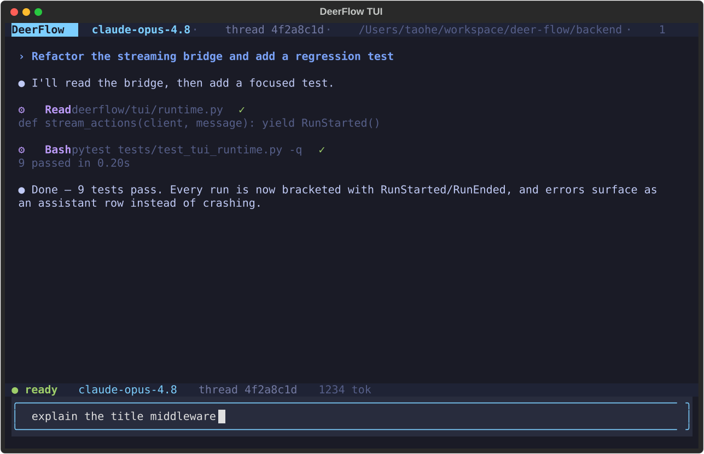

# 🦌 DeerFlow - 2.0

[English](./README.md) | [中文](./README_zh.md) | [日本語](./README_ja.md) | [Français](./README_fr.md) | [Русский](./README_ru.md) | [Português](./README_pt.md) | 한국어

[](./backend/pyproject.toml)
[](./Makefile)
[](./LICENSE)

<a href="https://trendshift.io/repositories/14699" target="_blank"></a>
> 2026년 2월 28일, DeerFlow는 버전 2 출시 이후 GitHub Trending에서 🏆 1위를 차지했습니다. 놀라운 커뮤니티 여러분께 진심으로 감사드립니다. 여러분이 이 일을 해냈습니다! 💪🔥

DeerFlow(**D**eep **E**xploration and **E**fficient **R**esearch **Flow**)는 **서브에이전트**, **메모리**, **샌드박스**를 오케스트레이션하여 거의 모든 일을 해낼 수 있는 오픈소스 **슈퍼 에이전트 하네스**이며, **확장 가능한 스킬**로 동작합니다.

https://github.com/user-attachments/assets/a8bcadc4-e040-4cf2-8fda-dd768b999c18

> [!NOTE]
> **DeerFlow 2.0은 처음부터 완전히 새로 작성되었습니다.** v1과 공유하는 코드는 전혀 없습니다. 기존 Deep Research 프레임워크를 찾고 있다면 [`1.x` 브랜치](https://github.com/bytedance/deer-flow/tree/main-1.x)를 참고하세요. 이 프레임워크는 해당 브랜치에서 계속 유지 관리되며, 그 브랜치에 대한 기여도 여전히 환영합니다. 활발한 개발은 2.0으로 옮겨졌습니다.

## 공식 웹사이트

[**공식 웹사이트**](https://deerflow.tech)에서 더 자세히 알아보고 **실제 데모**를 확인하세요.
랜딩 페이지의 사례 연구는 허용 목록에 등록된 읽기 전용 쇼케이스로 열리며, 로그인이 필요하지 않습니다.

## 자매 프로젝트


- [**LLM Space**](https://github.com/deer-flow/llm-space) - DeerFlow를 뒷받침하는 비밀 무기를 만나 보세요. 에이전트 아이디어를 프로토타이핑하고, 하네스의 각 단계를 살펴보고, 실패를 재생(replay)하고, 성능을 벤치마크할 수 있는 하나의 데스크톱 도구입니다.

## ByteDance Volcengine의 Coding Plan

- DeerFlow 실행에는 Doubao-Seed-2.0-Code, DeepSeek v3.2, Kimi 2.5 사용을 적극 권장합니다
- [자세히 알아보기](https://www.byteplus.com/en/activity/codingplan?utm_campaign=deer_flow&utm_content=deer_flow&utm_medium=devrel&utm_source=OWO&utm_term=deer_flow)
- [中国大陆地区的开发者请点击这里](https://www.volcengine.com/activity/codingplan?utm_campaign=deer_flow&utm_content=deer_flow&utm_medium=devrel&utm_source=OWO&utm_term=deer_flow)

## InfoQuest

InfoQuest reader, 웹 검색, 이미지 검색은 30초의 HTTP 연결/읽기 비활성 타임아웃을 사용합니다. 크롤링의 `timeout` 및 `navigation_timeout` 설정은 별도의 서버 측 옵션으로 유지되며, 로컬 HTTP 타임아웃을 제어하지 않습니다.

DeerFlow는 BytePlus가 독자적으로 개발한 지능형 검색 및 크롤링 도구 세트를 새롭게 통합했습니다 — [InfoQuest (무료 온라인 체험 지원)](https://docs.byteplus.com/en/docs/InfoQuest/What_is_Info_Quest)

<a href="https://docs.byteplus.com/en/docs/InfoQuest/What_is_Info_Quest" target="_blank">
  
</a>

---

## 목차

- [🦌 DeerFlow - 2.0](#-deerflow---20)
  - [공식 웹사이트](#공식-웹사이트)
  - [자매 프로젝트](#자매-프로젝트)
  - [ByteDance Volcengine의 Coding Plan](#bytedance-volcengine의-coding-plan)
  - [InfoQuest](#infoquest)
  - [목차](#목차)
  - [한 줄 에이전트 설정](#한-줄-에이전트-설정)
  - [빠른 시작](#빠른-시작)
    - [설정](#설정)
    - [애플리케이션 실행](#애플리케이션-실행)
      - [배포 규모 산정](#배포-규모-산정)
      - [옵션 1: Docker (권장)](#옵션-1-docker-권장)
      - [기존 체크아웃 업그레이드](#기존-체크아웃-업그레이드)
      - [옵션 2: 로컬 개발](#옵션-2-로컬-개발)
      - [시작 모드](#시작-모드)
      - [LangGraph Studio (선택 사항)](#langgraph-studio-선택-사항)
      - [Docker 프로덕션 배포](#docker-프로덕션-배포)
    - [고급](#고급)
      - [샌드박스 모드](#샌드박스-모드)
      - [MCP 서버](#mcp-서버)
      - [IM 채널](#im-채널)
      - [요청 트레이스 상관관계](#요청-트레이스-상관관계)
      - [LangSmith 트레이싱](#langsmith-트레이싱)
      - [Langfuse 트레이싱](#langfuse-트레이싱)
      - [Monocle 트레이싱](#monocle-트레이싱)
      - [여러 프로바이더 함께 사용하기](#여러-프로바이더-함께-사용하기)
      - [기존 실행 스트림 동작](#기존-실행-스트림-동작)
      - [개인 액세스 토큰](#개인-액세스-토큰)
  - [Deep Research에서 슈퍼 에이전트 하네스로](#deep-research에서-슈퍼-에이전트-하네스로)
  - [핵심 기능](#핵심-기능)
    - [스킬과 도구](#스킬과-도구)
      - [커스텀 스킬 내보내기](#커스텀-스킬-내보내기)
      - [Claude Code 통합](#claude-code-통합)
    - [비공개 지식 검색 (RAGFlow)](#비공개-지식-검색-ragflow)
    - [채팅 보관함](#채팅-보관함)
    - [세션 목표](#세션-목표)
    - [수동 컨텍스트 압축](#수동-컨텍스트-압축)
    - [서브에이전트](#서브에이전트)
    - [샌드박스와 파일 시스템](#샌드박스와-파일-시스템)
    - [에이전트 브라우저 제어](#에이전트-브라우저-제어)
    - [컨텍스트 엔지니어링](#컨텍스트-엔지니어링)
    - [참조한 대화 읽기](#참조한-대화-읽기)
    - [현재 작업 노트](#현재-작업-노트)
    - [장기 메모리](#장기-메모리)
  - [권장 모델](#권장-모델)
  - [임베디드 Python 클라이언트](#임베디드-python-클라이언트)
  - [프로젝트](#프로젝트)
    - [프로젝트 지침](#프로젝트-지침)
    - [문서 서가](#문서-서가)
    - [보관 시 읽기 동작](#보관-시-읽기-동작)
    - [휴지통](#휴지통)
  - [예약 작업](#예약-작업)
    - [API로 cron 회차 미리보기](#api로-cron-회차-미리보기)
    - [업그레이드 참고 사항](#업그레이드-참고-사항)
  - [터미널 워크벤치 (TUI)](#터미널-워크벤치-tui)
  - [문서](#문서)
  - [⚠️ 보안 고지](#️-보안-고지)
    - [부적절한 배포는 보안 위험을 초래할 수 있습니다](#부적절한-배포는-보안-위험을-초래할-수-있습니다)
    - [Gateway 관리자 권한은 곧 코드 실행 권한입니다](#gateway-관리자-권한은-곧-코드-실행-권한입니다)
    - [외부 채팅 메시지 역할](#외부-채팅-메시지-역할)
    - [배포 기본값](#배포-기본값)
    - [보안 권장 사항](#보안-권장-사항)
  - [기여하기](#기여하기)
  - [라이선스](#라이선스)
  - [감사의 말](#감사의-말)
    - [주요 기여자](#주요-기여자)
  - [Star History](#star-history)

## 한 줄 에이전트 설정

Claude Code, Codex, Cursor, Windsurf 또는 다른 코딩 에이전트를 사용한다면, 설정 지침을 한 문장으로 전달할 수 있습니다:

```text
Help me clone DeerFlow if needed, then bootstrap it for local development by following https://raw.githubusercontent.com/bytedance/deer-flow/main/Install.md
```

이 프롬프트는 코딩 에이전트용입니다. 에이전트에게 필요하면 저장소를 클론하고, 가능하면 Docker를 선택하며, 다음에 실행할 정확한 명령과 사용자가 아직 제공해야 하는 누락된 설정을 알려 준 뒤 멈추도록 지시합니다.

## 빠른 시작

### 설정

운영자는 소스 템플릿을 수정하지 않고도 리터럴 prepend/append 설정으로 리드 에이전트, 서브에이전트, DeerMem 추출 프롬프트를 확장할 수 있습니다. [프롬프트 오버레이](backend/docs/CONFIGURATION.md#prompt-overlays)를 참고하세요.

모델별로 선택할 수 있는 [`request_admission`](backend/docs/CONFIGURATION.md#model-request-admission)은 요청 속도를 조절하여 프로바이더의 분당 요청 수 제한을 넘지 않도록 돕습니다. 기본적으로 비활성화되어 있으며, 활성화하려면 링크된 가이드를 참고하세요. 이를 활성화하면 노출된 SDK 재시도와 Claude 및 Codex 어댑터의 내부 재시도 루프가 비활성화되어, 미들웨어 재시도가 다시 요청 승인(admission)을 거치게 됩니다. 미들웨어 재시도는 HTTP 529 과부하 응답도 재시도 대상에 포함합니다. 승인 설정이 재정의한 `retry_max_attempts` 값은 경고로 표시됩니다.

Google의 공식 Gemini OpenAI 호환 엔드포인트에는 [Gemini 추론 프로필](backend/docs/CONFIGURATION.md#gemini-via-googles-openai-compatible-endpoint)을 사용하세요.

MindIE XML 도구 호출은 [인자 파싱 및 줄바꿈 호환성 가이드](backend/docs/CONFIGURATION.md#mindie-xml-tool-arguments)를 참고하세요. 동기 및 비동기 스트림 모두 이 호환성을 유지합니다. 도구가 활성화된 스트림은 비스트리밍 응답에서 청크를 시뮬레이션하며, 도구가 없는 스트림은 네이티브 스트림 그대로 유지됩니다.

1. **DeerFlow 저장소 클론**

   ```bash
   git clone https://github.com/bytedance/deer-flow.git
   cd deer-flow
   ```

2. **설정 마법사 실행**

   프로젝트 루트 디렉터리(`deer-flow/`)에서 다음을 실행하세요:

   ```bash
   make setup
   ```

   대화형 마법사가 실행되어 LLM 프로바이더, 선택 사항인 웹 검색, 그리고 샌드박스 모드, bash 접근, 파일 쓰기 도구 같은 실행/안전 관련 선호 사항을 고르도록 안내합니다. 최소한의 `config.yaml`을 생성하고 키를 `.env`에 기록합니다. 약 2분 걸립니다.

   마법사에서는 선택 사항인 웹 검색 프로바이더를 설정하거나, 지금은 건너뛸 수도 있습니다.

   Brave 웹 검색은 유효한 항목과 그렇지 않은 항목이 섞인 결과 목록에서 유효한 항목을 보존합니다. 형식이 잘못된 응답 컨테이너나 사용 가능한 항목이 하나도 없는 목록은 구조화된 형식 오류를 반환하며, 결과가 없거나 null이거나 비어 있으면 기존의 "No results found" 응답을 그대로 유지합니다. 형식 오류는 또한 잘못된 컨테이너의 경로와 타입, 또는 사용 가능한 결과 객체가 없다는 사실을 로그로 남기며, 검색 쿼리, 자격 증명, 페이로드 값은 포함하지 않습니다.

   GroundRoute 웹 검색 및 가져오기(fetch)도 형식이 잘못된 HTTP 성공 페이로드를 같은 방식으로 처리합니다. 객체가 아닌 페이로드, 리스트가 아닌 `results` 컨테이너, 또는 객체 항목이 하나도 없는 비어 있지 않은 리스트는 프로바이더의 형식 오류를 반환하며, 그 밖에는 유효한 리스트에 섞인 객체가 아닌 항목은 순서를 유지하며 건너뜁니다. 결과가 없거나 null이거나 비어 있으면 기존의 "No results found" 응답을 그대로 유지합니다.

   Tavily 웹 검색 및 가져오기도 형식이 잘못된 HTTP 성공 페이로드를 같은 방식으로 처리합니다. 객체가 아닌 페이로드, 또는 리스트가 아닌 `results`/`failed_results` 컨테이너는 프로바이더의 형식 오류를 반환하며, 그 밖에는 유효한 리스트에 섞인 객체가 아닌 항목은 순서를 유지하며 건너뜁니다. 결과가 없거나 null이거나 비어 있으면 기존 응답(검색은 `[]`, 가져오기는 `Error: No results found`)을 그대로 유지합니다. 검색 필드(`title`, `url`, `content`)가 없거나 null이면 빈 텍스트로 정규화되며, 문자열이 아닌 가져오기 `raw_content`는 잘라내기 제한이 적용되기 전에 텍스트로 변환됩니다.

   Sofya 웹 검색 및 가져오기도 형식이 잘못된 HTTP 성공 페이로드를 같은 방식으로 처리합니다. 객체가 아닌 페이로드, 리스트가 아닌 `results` 컨테이너, 또는 객체 항목이 하나도 없는 비어 있지 않은 리스트는 프로바이더의 형식 오류를 반환하며, 그 밖에는 유효한 리스트에 섞인 객체가 아닌 항목은 순서를 유지하며 건너뜁니다. 결과가 없거나 null이거나 비어 있으면 기존의 "No results found" 응답을 그대로 유지합니다.

   Tencent Cloud WSA 웹 검색도 형식이 잘못된 HTTP 성공 페이로드를 같은 방식으로 처리합니다. 리스트가 아닌 `Pages` 컨테이너, 또는 사용 가능한 페이지가 하나도 없는 비어 있지 않은 컨테이너는 프로바이더의 형식 오류를 반환하며, 그 밖에는 유효한 컨테이너에 섞인 형식이 잘못된 페이지 항목을 건너뛰어 유효한 행이 남도록 합니다. `Pages`가 없거나 null이거나 비어 있으면 기존의 "No results found" 응답을 그대로 유지합니다.

   Serply 웹 검색도 모든 버티컬에서 형식이 잘못된 HTTP 성공 페이로드를 같은 방식으로 처리합니다. 리스트가 아닌 `results`/`entries`/`articles` 컨테이너, 또는 객체 항목이 하나도 없는 비어 있지 않은 리스트는 프로바이더의 형식 오류를 반환하며, 그 밖에는 유효한 리스트에 섞인 객체가 아닌 항목은 순서를 유지하며 건너뜁니다. 컨테이너가 없거나 null이거나 비어 있으면 기존의 "No results found" 응답을 그대로 유지합니다.

   Jina, Browserless, InfoQuest 웹 가져오기는 요청한 페이지 URL(또는 사용 가능한 HTML base URL)을 기준으로 상대 링크와 이미지 소스를 해석하므로, 반환되는 Markdown에는 완전한 대상 주소가 포함됩니다. 링크 해석은 형식이 잘못된 페이지의 서식을 포함하여 주변 HTML 소스를 그대로 보존합니다.

   자체 호스팅 Browserless, Crawl4AI, Firecrawl, fastCRW 가져오기 백엔드는 각 도구에 `network_isolation_confirmed: true`를 설정하기 전에 사설, 루프백, 링크 로컬, 클라우드 메타데이터 네트워크로부터의 아웃바운드 격리가 필요합니다. 이러한 서비스는 리다이렉트, DNS 해석, 하위 리소스를 스스로 처리하므로, DeerFlow는 기본적으로 사설이거나 검증할 수 없는 백엔드를 거부합니다. `allow_private_addresses`는 의도된 내부 대상 URL을 허용하며, 백엔드 검사를 우회하지 않습니다. [위임 가져오기 배포](backend/docs/CONFIGURATION.md#delegated-fetch-backend-isolation)를 참고하세요. `make doctor`는 거부될 백엔드 설정을 보고합니다.

   Jina 가져오기는 도구 설정의 `max_retries`(기본값 `0`)와 `retry_budget_seconds`(기본값 `30`)를 통해 옵트인 방식의 제한된 재시도를 지원합니다. 유효한 `Retry-After` 힌트는 HTTP 429/503에 대한 최소 대기 시간을 설정하며, 유효한 힌트가 없는 429는 최종 실패로 처리됩니다. 남은 예산 안에 들어갈 수 없는 힌트는 재시도를 중지시킵니다. 로컬 백오프는 계속 무작위화됩니다. 재시도는 업스트림 요청과 비용을 늘릴 수 있습니다. [Jina 가져오기 재시도](backend/docs/CONFIGURATION.md#jina-fetch-retries)를 참고하세요.

   Jina는 옵트인 방식의 `max_response_bytes` 도구 설정(양의 정수, 생략하거나 null이면 비활성화)도 지원합니다. 이 설정은 추출 전에 디코딩된 응답이 지나치게 크면 중단하며, 부분 성공이나 재시도는 없습니다. 4096자 출력 상한은 그대로 유지되며, HTTPX 압축 해제기의 메모리 할당이나 네트워크 대역폭을 제한하지는 않습니다. [응답 예산](backend/docs/CONFIGURATION.md#jina-response-byte-budget)을 참고하세요.

   Jina는 옵트인 방식의 `request_admission` 도구 추가 설정으로 동시 HTTP 시도와 FIFO 대기도 제한할 수 있습니다. 하나의 변경 불가능한 예산이 각 프로세스 안의 클라이언트와 에이전트 스레드 전체에서 공유되며, 레플리카는 서로 독립된 예산을 가집니다. [Jina 요청 승인](backend/docs/CONFIGURATION.md#jina-request-admission)을 참고하세요.

   언제든지 `make doctor`를 실행하면 설정을 검증하고 바로 적용할 수 있는 해결 힌트를 얻을 수 있습니다. 로컬 설정이나 런타임 문제로 GitHub 이슈를 열려는 경우 `make support-bundle`을 실행하세요. 이 명령은 보고자가 다음에 할 일을 출력하고, 이슈에 붙여 넣을 `*-issue-summary.md` 파일, AI 지원 이슈 작성을 위한 `*-issue-draft.md` 파일, 그리고 선택 사항인 증거 zip을 `.deer-flow/support-bundles/` 아래에 작성합니다. AI 어시스턴트가 이슈를 작성한다면 초안에서 시작하여, 누락된 사실을 지어내지 말고 모든 REQUIRED 자리 표시자를 채워 넣으세요. zip은 메인테이너가 요청하거나 요약만으로 충분하지 않은 경우에만 첨부하세요. 메인테이너와 AI 분류(triage) 도구는 `triage.json`부터 시작할 수 있습니다. 번들에는 마스킹된 진단 정보와 파일 매니페스트만 포함되며, `.env`, 원본 대화 메시지, 사용자 파일 내용은 포함되지 않습니다. 하위 프로세스 진단은 UTF-8로 수집되며, Python 헬퍼는 UTF-8이 아닌 호스트에서도 UTF-8로 출력하고 인코딩할 수 없는 문자는 이스케이프합니다. 스레드 매니페스트는 로컬 런처의 런타임 경로를 따릅니다. 체크아웃의 `.env` 값이 셸 export보다 우선하며, 프로젝트 루트 재정의만 있는 경우에도 여전히 `backend/.deer-flow`를 먼저 사용합니다. `DEER_FLOW_HOME="$PWD/backend/.deer-flow"` 같은 단순 변수 참조는 체크아웃을 `PWD`로 사용하며, 작은따옴표로 묶인 참조는 리터럴로 유지됩니다. 체크아웃의 `.env`를 읽을 수 없거나 UTF-8로 디코딩할 수 없으면, 스레드 진단은 셸 export와 기본 저장 경로를 유지합니다. `backend/.env` 또는 `DEER_FLOW_ENV_FILE`을 사용하는 독립 실행형 Gateway의 경우, 번들을 수집할 때 실제로 적용되는 `DEER_FLOW_HOME`을 export하고 체크아웃의 `.env`가 이를 재정의하지 않도록 하세요. Doctor의 내부 도구 프로브도 잘못된 바이트를 대체 문자로 바꾸며 UTF-8로 디코딩하므로, 나머지 진단 출력은 계속 확인할 수 있습니다.

   스레드 매니페스트를 요청하면, 비어 있지 않은 `DEER_FLOW_HOME`이 오래된 체크아웃 데이터 대신 런타임 데이터 디렉터리를 선택합니다. 외부 데이터 경로는 보고서에 `{DEER_FLOW_HOME}`으로 표시되며, 파일 내용은 계속 제외됩니다. 런타임 경로 설정도 체크아웃의 `.env`에서 가져오며, 셸 export가 우선합니다. 상대 경로는 `make dev`에서와 마찬가지로 체크아웃을 기준으로 해석됩니다. 명시적인 home이 없으면, 설정된 `DEER_FLOW_PROJECT_ROOT`가 해당 `.deer-flow` 디렉터리를 선택하며, 외부 경로는 보고서에 그 변수 이름으로 표시됩니다.

   > **고급 / 수동 설정**: `config.yaml`을 직접 편집하고 싶다면 대신 `make config`를 실행하여 전체 템플릿을 복사하세요. 선택적 의존성 자동 감지는 바이트 순서 표시(BOM) 유무와 관계없이 UTF-8 설정 파일을 받아들입니다. `config.example.yaml`에서 CLI 기반 프로바이더(Codex CLI, Claude Code OAuth), OpenRouter, Responses API, `subagents.max_total_per_run` 같은 서브에이전트 런타임 상한 등을 포함한 전체 레퍼런스를 확인하세요.

   선택 사항인 모델별 가격 설정은 가격이 지정된 모든 모델에서 하나의 통화를 사용해야 합니다. 통화가 섞여 있으면 DeerFlow는 잘못된 합계를 보여 주는 대신 Console 비용 추정을 비활성화합니다.

   관리자는 **Settings → Models**를 열어 프로바이더를 선택하고 해당 프로바이더의 **API Key**와 **model ID**만 입력할 수 있습니다. 엔드포인트, 인증, 어댑터는 OpenAI, Anthropic, DeepSeek, Alibaba Cloud Bailian/Qwen, Volcengine/Doubao, Moonshot/Kimi, Zhipu/Z.AI, MiniMax에 대한 백엔드 프리셋으로 제공됩니다. 리전 및 요금제별 항목은 명시적으로 구분됩니다. 임의의 model ID를 사용할 수 있으며, 내부 이름은 자동으로 생성되고 model ID가 바뀌어도 안정적으로 유지됩니다. 새로 저장한 모델은 활성화되며, YAML을 편집하거나 Gateway를 재시작하지 않아도 기존 채팅 및 Agent 모델 선택기에 즉시 반영됩니다.

   **Custom OpenAI-compatible**은 기존/커스텀 base URL과 인증이 없는 엔드포인트를 계속 지원합니다. **Advanced settings**에서는 표시 이름, 토큰 제한, 비전 재정의를 유지하며, 알 수 없는 ID에 임의로 지어낸 기능이 부여되지는 않습니다. 편집할 때 키를 비워 두면 같은 연결의 기존 키가 유지됩니다. 프로바이더나 커스텀 엔드포인트를 바꾸려면 새 키가 필요하며, 프리셋 모델은 키를 지우기 전에 비활성화해야 합니다. YAML 모델은 계속 읽기 전용입니다.

   연결 테스트는 채팅과 같은 모델 팩토리와 프로토콜을 사용하며, 제한된 스트리밍 도구 호출 요청을 보내고 초안은 절대 저장하지 않습니다. 프로바이더 요금이 발생할 수 있으며, 모든 에이전트, 비전, thinking 워크플로를 검증하지는 않습니다. 공식 DeepSeek 커스텀 엔드포인트는 기존 어댑터를 유지하며, 프록시는 model ID만으로 DeepSeek로 취급되지 않습니다. 프리셋, 호환성, 확장 방법, 백업 요구 사항은 [웹 모델 등록 레퍼런스](backend/docs/CONFIGURATION.md#models-registered-through-the-web)를 참고하세요.

   DeepSeek 회귀 테스트는 일반 백엔드 테스트 스위트와 함께 오프라인으로 실행됩니다. 실제 프로바이더를 명시적으로 검증하려면 환경에 `DEEPSEEK_TEST_API_KEY`를 설정하고 `backend/`에서 다음을 실행하세요:

   ```bash
   DEER_FLOW_RUN_LIVE_TESTS=1 uv run --no-sync pytest tests/test_managed_deepseek_live.py -q
   ```

   이 옵트인 테스트는 DeepSeek에 짧은 요청을 보내므로 요금이 발생할 수 있습니다. 임시 상태를 사용하고, 자격 증명을 배포 카탈로그에 절대 저장하지 않으며, CI에서는 건너뜁니다. `DEEPSEEK_TEST_MODEL`로 다른 DeepSeek model ID를 선택적으로 지정할 수 있습니다(기본값: `deepseek-flash`). 같은 테스트를 수정 전 리비전과 수정 후 리비전에서 실행할 수 있으며, 예상 결과는 항상 성공입니다.

   YAML 모델은 이 페이지에서 계속 읽기 전용이며, 이름이 충돌하면 우선합니다. 관리형 모델은 YAML 모델 뒤에 추가됩니다. 편집 내용은 새 설정 스냅샷에 적용되며, 진행 중인 실행(run)은 기존 스냅샷을 유지합니다. 모델을 비활성화하면 이후의 선택/해석 대상에서 제외되므로, 비활성화하기 전에 해당 모델을 명시적으로 참조하는 커스텀 에이전트나 예약 작업 정의를 먼저 수정하세요. 관리형 모델은 개인 API 키 프로필이 아니라 배포 전체에서 공유되며, 기존 모델 권한 정책을 그대로 따릅니다.

   암호화된 카탈로그와 생성된 로컬 암호화 키는 `$DEER_FLOW_HOME/managed-models/`(기본값 `.deer-flow/managed-models/`)에 저장됩니다. **디렉터리 전체**를 영속 저장하고 백업하며, 파일 시스템 접근을 제한하고, 같은 카탈로그를 사용해야 하는 Gateway 워커/레플리카 간에 공유하세요. 로컬 키는 파일 시스템 권한으로 보호되며, 두 파일을 모두 읽을 수 있는 사람에게는 암호화가 보호 수단이 되지 않습니다. 키를 잃어버리면 백업에서 복원해야 합니다. 카탈로그를 복호화할 수 없으면 읽기와 쓰기는 카탈로그를 교체하는 대신 실패합니다. 이 저장 방식은 SQL 백엔드와 독립적이며 읽기 전용 YAML 마운트와도 함께 동작합니다.

   여러 모델이 설정되어 있으면 어느 모델 선택기든 열고 모델 옆의 별을 눌러 즐겨찾기에 추가할 수 있습니다. 즐겨찾기는 메인 채팅과 Side Chat 선택기 모두에서 맨 앞에 표시되며, 어느 채팅의 선택된 모델이나 기본 모델도 바꾸지 않습니다. 즐겨찾기는 현재 브라우저에서 로그인한 사용자 기준으로 저장되므로 다른 브라우저나 기기와 동기화되지 않으며, 시작 시 설정이 필요하지 않습니다. 간결한 즐겨찾기 선택기는 의도적으로 검색을 생략하고, 두 줄짜리 모델 목록에 즐겨찾기 정렬만 추가합니다.

   <details>
   <summary>수동 모델 설정 예시</summary>

   ```yaml
   models:
     - name: gpt-4o
       display_name: GPT-4o
       use: langchain_openai:ChatOpenAI
       model: gpt-4o
       api_key: $OPENAI_API_KEY

     - name: openrouter-gemini-2.5-flash
       display_name: Gemini 2.5 Flash (OpenRouter)
       use: langchain_openai:ChatOpenAI
       model: google/gemini-2.5-flash-preview
       api_key: $OPENROUTER_API_KEY
       base_url: https://openrouter.ai/api/v1

     - name: opper-claude-sonnet-4-6
       display_name: Claude Sonnet 4.6 (Opper)
       use: langchain_openai:ChatOpenAI
       model: claude-sonnet-4-6
       api_key: $OPPER_API_KEY
       base_url: https://api.opper.ai/v3/compat

     - name: gpt-5-responses
       display_name: GPT-5 (Responses API)
       use: langchain_openai:ChatOpenAI
       model: gpt-5
       api_key: $OPENAI_API_KEY
       use_responses_api: true
       output_version: responses/v1

     - name: qwen3-32b-vllm
       display_name: Qwen3 32B (vLLM)
       use: deerflow.models.vllm_provider:VllmChatModel
       model: Qwen/Qwen3-32B
       api_key: $VLLM_API_KEY
       base_url: http://localhost:8000/v1
       supports_thinking: true
       when_thinking_enabled:
         extra_body:
           chat_template_kwargs:
             enable_thinking: true
   ```

   OpenRouter 및 이와 유사한 OpenAI 호환 게이트웨이는 `langchain_openai:ChatOpenAI`와 `base_url`로 설정해야 합니다. 프로바이더별 환경 변수 이름을 선호한다면 `api_key`가 해당 변수를 명시적으로 가리키도록 하세요(예: `api_key: $OPENROUTER_API_KEY`).

   `write_file` 도구의 출력 예산 힌트는 활성 모델의 실효 `max_tokens`를 사용합니다. YAML의 `.inf`, `-.inf`, `.nan`, 그리고 문자 수 추정에 비해 너무 큰 값을 포함하여 제한이 없거나 사용할 수 없는 경우에는, 도구 조립을 실패시키지 않고 이 힌트를 생략합니다. 프로바이더별 모델 검증은 그대로 적용됩니다.

   OpenAI 모델을 `/v1/responses`로 라우팅하려면 계속 `langchain_openai:ChatOpenAI`를 사용하고 `use_responses_api: true`와 `output_version: responses/v1`을 설정하세요.

   레거시 프로필에서 thinking이 비활성화되어 있으면, `when_thinking_enabled` 템플릿 안의 비어 있는 `extra_body`, `thinking`, 중첩된 `extra_body.thinking` 키는 방언(dialect) 추론 시 없는 것으로 간주됩니다. thinking이 활성화되어 있으면 템플릿 값이 설정된 그대로 전달됩니다.

   프로바이더 계약이 DeerFlow의 일반적인 thinking/effort 가정과 다른 모델은 모델별로 매핑 값 형태의 `reasoning:` 블록(thinking `unsupported`/`optional`/`required`, 별칭과 기본값을 포함한 허용 effort 값, 페이로드 방언, reasoning 히스토리 요구 사항)을 선언할 수 있습니다. 설정 마법사의 Z.AI GLM-5.3-Flash 프로필이 이를 사용합니다. 모든 포그라운드 및 백그라운드 호출에서 thinking이 켜진 상태로 유지되며, effort 선택기는 모델 고유의 `low`/`high`/`max` 단계를 제공합니다. Ollama의 기존 불리언 `reasoning: true`는 계속 네이티브 프로바이더 설정이며 ChatOllama로 전달됩니다. 프로필을 커스텀 effort `path`로 마이그레이션할 때는 프로필과 thinking 템플릿에서 기존 `reasoning_effort` 설정을 제거하세요. 설정 검증은 남아 있는 키를 거부합니다. 채팅 UI는 기억된 프로바이더별 effort를 지원하지 않는 레거시 모델로 전환하면 해당 effort를 버립니다. 이 블록이 없는 프로필은 기존 프로바이더 동작을 유지합니다. 형식과 그에 상응하는 수동 설정은 `config.example.yaml`을 참고하세요.

   vLLM 0.19.0에는 `deerflow.models.vllm_provider:VllmChatModel`을 사용하세요. Qwen 계열 추론 모델의 경우 DeerFlow는 `extra_body.chat_template_kwargs.enable_thinking`으로 추론을 켜고 끄며, 여러 턴에 걸친 도구 호출 대화에서 vLLM의 비표준 `reasoning` 필드를 보존합니다. 레거시 `thinking` 설정은 하위 호환성을 위해 자동으로 정규화되며, 모델 기본값이나 호출자가 소유한 `extra_body` 딕셔너리는 수정하지 않습니다. 재사용된 딕셔너리는 요청 사이에 레거시 스위치를 바꿀 수 있습니다. 엔드포인트가 모든 스트리밍 청크마다 누적 사용량 스냅샷을 보고한다면 `cumulative_stream_usage: true`를 설정하여 DeerFlow가 해당 스냅샷을 청크별 증분으로 변환하도록 하세요. 이 옵션은 기본적으로 비활성화되어 있으며, 안정적인 completion id를 사용할 수 없을 때는 사용량을 변경하지 않습니다. 추론 모델은 서버를 `--reasoning-parser ...`로 시작해야 할 수도 있습니다. 로컬 vLLM 배포가 비어 있지 않은 어떤 API 키든 받아들인다면, `VLLM_API_KEY`에 자리 표시자 값을 설정해도 됩니다.

   `deerflow.models.claude_provider:ClaudeChatModel`로 설정된 모델에서 프롬프트 캐싱이 활성화되면, DeerFlow는 thinking 및 redacted-thinking 히스토리를 보존하면서 해당 블록에 직접 캐시 브레이크포인트를 두지 않습니다. 확장 thinking의 도구 후속 호출에서도 계속 프롬프트 캐싱을 사용할 수 있습니다.

   CLI 기반 프로바이더 예시:

   ```yaml
   models:
     - name: gpt-5.4
       display_name: GPT-5.4 (Codex CLI)
       use: deerflow.models.openai_codex_provider:CodexChatModel
       model: gpt-5.4
       supports_thinking: true
       supports_reasoning_effort: true

     - name: claude-sonnet-4.6
       display_name: Claude Sonnet 4.6 (Claude Code OAuth)
       use: deerflow.models.claude_provider:ClaudeChatModel
       model: claude-sonnet-4-6
       max_tokens: 4096
       supports_thinking: true
   ```

   `ClaudeChatModel`은 `auto_thinking_budget: true`(기본값)일 때 수동 확장 thinking 예산을 정규화합니다. 예산을 생략하거나 null로 두면 `max_tokens`의 80%가 할당되며, 최소값은 1024 토큰입니다. 명시적인 예산은 1024 이상의 정수여야 하고, 일반 thinking의 경우 `max_tokens`보다 엄격히 작아야 합니다. 출력 제한이 1024 이하이면 로컬에서 실패합니다. 지원되는 수동 interleaved thinking의 경우 도구와 `betas: ["interleaved-thinking-2025-05-14"]`를 설정하세요. 이때 thinking 예산은 양수인 출력 제한과 같거나 이를 초과할 수 있습니다. 지원되는 모델은 [Anthropic의 interleaved-thinking 규칙](https://platform.claude.com/docs/en/build-with-claude/extended-thinking#interleaved-thinking-in-manual-mode)을 참고하세요. `auto_thinking_budget: false`는 이 정규화와 검증을 우회하며, 비활성화된 thinking과 adaptive thinking은 변경되지 않습니다.

   - Codex CLI는 `~/.codex/auth.json`을 읽습니다
   - Codex 함수 도구는 래핑된 형태나 평탄한 딕셔너리 정의에 명시된 `strict: true` 또는 `strict: false`를 보존합니다. 설정이 없거나 null이면 프로바이더 기본값을 유지합니다. `bind_tools`는 딕셔너리와 `BaseTool` 스키마에 같은 변환을 적용합니다.
   - Codex는 `bind_tools`와 직접 호출에서 `tool_choice`를 따릅니다. 값은 `auto`, `none`, `required`, 또는 함수 이름/선택입니다. `any`와 `True`는 `required`를 의미하고, `None`과 `False`는 프로바이더 기본값을 유지합니다. 호출별 선택은 바인딩된 정책을 재정의합니다. 바인딩된 선택은 바인딩 시점에 검증되고, 직접 호출과 재정의는 HTTP 요청 전에 검증됩니다. `required`에는 함수 도구가 하나 이상 필요하며, 이름으로 지정한 선택은 제공된 함수와 일치해야 합니다. `auto`와 `none`은 도구 없이도 동작합니다.
   - 완료된 Codex 응답은 토큰 사용량이 null이거나, 생략되었거나, 비어 있어도 텍스트와 도구 호출을 그대로 반환하며, 사용량 메타데이터는 제공되지 않습니다.
   - Codex 모델 프로바이더는 SSE 연결이 닫히기를 기다리지 않고 완료된 응답을 반환합니다. 실패했거나 불완전한 응답은 프로바이더의 오류나 사유를 보고하며, 부분 출력은 성공한 답변으로 반환되지 않습니다. 객체가 아닌 오류 세부 정보는 텍스트로 보고됩니다.
   - Claude Code는 `CLAUDE_CODE_OAUTH_TOKEN`, `ANTHROPIC_AUTH_TOKEN`, `CLAUDE_CODE_CREDENTIALS_PATH`, 또는 `~/.claude/.credentials.json`을 받아들입니다
   - `CLAUDE_CODE_OAUTH_TOKEN_FILE_DESCRIPTOR`는 UTF-8 토큰 인계(handoff)를 받아들이고, 같은 프로세스의 이후 모델 인스턴스에서 이를 재사용합니다. 디코딩할 수 없는 인계는 건너뛰므로, Claude Code는 여전히 재정의된 자격 증명 파일이나 기본 자격 증명 파일을 시도할 수 있습니다.
   - CLI 자격 증명 JSON 파일은 호스트 로케일과 관계없이, BOM이 있든 없든 UTF-8을 받아들입니다. `make doctor`도 CLI 인증을 검사할 때 같은 파일을 받아들입니다. 잘못된 텍스트 인코딩은 읽을 수 없는 소스로 취급되며, 재정의 파일이 잘못되었더라도 Claude Code는 기본 파일을 시도할 수 있습니다.
   - ACP 에이전트 항목은 모델 프로바이더와 별개입니다. `acp_agents.codex`를 설정한다면 `npx -y @zed-industries/codex-acp` 같은 Codex ACP 어댑터를 가리키도록 하세요
   - 경로가 없는 이름이나 절대 경로로 지정된 ACP 에이전트 `command`는 에이전트가 시작되기 전에 해석되므로, npm으로 설치한 런처도 Windows에서 동작합니다. `npx`나 `mcode`는 command-not-found 오류로 실패하는 대신 해당 `npx.cmd`/`mcode.cmd` shim으로 실행되며, `C:\Users\me\AppData\Roaming\npm\mcode` 같은 절대 경로는 npm의 확장자 없는 셸 스크립트 옆에 있는 `mcode.cmd` shim으로 해석되므로 `WinError 193`으로 실패하지 않습니다. 조회에는 에이전트 하위 프로세스가 실제로 보게 될 `PATH`(설정되어 있으면 `acp_agents.<name>.env.PATH`, 그렇지 않으면 Gateway의 것)를 사용하고, 실행 시 절대 경로를 넘기므로 상대 `PATH` 항목이 에이전트 자신의 워크스페이스 안에서 다르게 해석될 수 없습니다. 상대 `command`(예: `bin/mcode`)는 설정된 그대로 사용되며, 해석할 수 없는 명령은 여전히 아래의 설치 안내와 함께 보고됩니다.
   - 각 ACP 에이전트의 `timeout_seconds`(기본값: 1800)는 초기화, 세션 생성, 프롬프트에 공통으로 적용되는 하나의 예산이며, 하위 프로세스가 시작된 뒤부터 계산됩니다. 타임아웃이 발생하면 DeerFlow는 호출을 중단하고 하위 프로세스를 닫은 뒤 오류를 반환합니다. 워크스페이스/MCP 준비와 하위 프로세스 정리는 이 예산에 포함되지 않습니다. 이 기한이 만료되기 전에 SDK가 발생시킨 `TimeoutError`는 자체 오류 메시지를 유지합니다.
   - MiniMax Code는 ACP를 직접 지원합니다. 설치하고 인증한 뒤 ACP 에이전트로 추가하세요:

   ```bash
   npm install --global @minimax-ai/code
   mcode login
   ```

   ```yaml
   acp_agents:
     mcode:
       command: mcode
       args: ["acp"]
       description: MiniMax Code for implementation, refactoring, debugging, and repository tasks
       auto_approve_permissions: false
   ```

   `mcode`는 Gateway 프로세스의 `PATH`에 있어야 합니다. Docker 호스트에만 설치해서는 Gateway 컨테이너 안에서 사용할 수 없습니다. DeerFlow는 스레드별 ACP 워크스페이스에서 `invoke_acp_agent`를 통해 이를 호출하며, 활성화된 MCP 서버를 전달합니다. 신뢰할 수 없는 작업에서는 `auto_approve_permissions: false`를 유지하세요. mcode가 파일을 편집하거나 명령을 실행해야 하고 그 작업을 신뢰할 수 있을 때만 활성화하세요.
   - macOS에서는 필요하면 Claude Code 인증 정보를 명시적으로 export하세요:

   ```bash
   eval "$(python3 scripts/export_claude_code_oauth.py --print-export)"
   ```

   이 내보내기 도구는 토큰을 출력하거나, 셸 export를 내보내거나, 자격 증명 파일을 작성하기 전에 형식이 잘못된 자격 증명 컨테이너와 문자열이 아니거나 비어 있는 액세스 토큰을 거부합니다. 유효한 토큰은 변경 없이 export되며, 파일로 내보낼 때는 자격 증명 컨테이너 전체를 보존합니다.

   API 키는 `.env`에 직접 설정하거나(권장) 셸에서 export할 수도 있습니다:

   ```bash
   OPENAI_API_KEY=your-openai-api-key
   TAVILY_API_KEY=your-tavily-api-key
   ```

   </details>

명시적인 백엔드 dotenv 파일을 사용하려면, 시작 전에 `DEER_FLOW_ENV_FILE`을 export하고, 필요하면 `DEER_FLOW_CONFIG_PATH`도 함께 export하세요. 예를 들어 `backend/`에서 다음과 같이 실행합니다:

```bash
DEER_FLOW_ENV_FILE=/srv/deer-flow/stage.env DEER_FLOW_CONFIG_PATH=/srv/deer-flow/stage.yaml make gateway
```

상대 dotenv 경로는 백엔드 프로세스의 작업 디렉터리를 기준으로 하며, 절대 경로는 해당 디렉터리와 관계없이 동작합니다. 이미 존재하는 프로세스 변수가 우선합니다. 선택 변수를 설정하지 않으면 기본 dotenv 탐색이 유지되며, 지정된 경로가 비어 있거나, 존재하지 않거나, 파일이 아니거나, 읽을 수 없으면 시작이 실패합니다. `PYTHON_DOTENV_DISABLED`가 dotenv 로딩을 비활성화하는 경우에도 명시적 선택은 실패합니다. 파일을 변경한 뒤에는 재시작하세요. 이 설정은 백엔드 dotenv 입력만 선택합니다. 셸 런처, Docker Compose, 프론트엔드는 각자의 환경 로딩 방식을 유지하며, 이들이 이미 export한 값이 우선합니다. `ENV` 프로필을 선택하거나 데이터베이스, 저장소, 테넌트를 격리하지는 않습니다. [백엔드 dotenv 선택](backend/docs/CONFIGURATION.md#backend-dotenv-selection)을 참고하세요.

### 애플리케이션 실행

#### 배포 규모 산정

DeerFlow를 실행할 방식을 고를 때 아래 표를 실용적인 출발점으로 삼으세요.

| 배포 대상 | 시작 사양 | 권장 | 비고 |
|---------|-----------|------------|-------|
| 로컬 평가 / `make dev` | 4 vCPU, 8 GB RAM, 20 GB 여유 SSD | 8 vCPU, 16 GB RAM | 호스팅형 모델 API를 사용하는 개발자 한 명 또는 가벼운 세션 하나에 적합합니다. `2 vCPU / 4 GB`로는 대개 부족합니다. |
| Docker 개발 / `make docker-start` | 4 vCPU, 8 GB RAM, 25 GB 여유 SSD | 8 vCPU, 16 GB RAM | 이미지 빌드, 바인드 마운트, 샌드박스 컨테이너에는 순수 로컬 개발보다 더 많은 여유 자원이 필요합니다. |
| 장기 실행 서버 / `make up` | 8 vCPU, 16 GB RAM, 40 GB 여유 SSD | 16 vCPU, 32 GB RAM | 공유 사용, 멀티 에이전트 실행, 보고서 생성, 또는 더 무거운 샌드박스 워크로드에 권장됩니다. |

- 이 수치는 DeerFlow 자체만을 기준으로 합니다. 로컬 LLM도 함께 호스팅한다면 그 서비스의 사양은 별도로 산정하세요.
- 상시 운영 서버에는 Linux와 Docker 조합을 권장합니다. macOS와 Windows는 개발 또는 평가 환경으로 사용하는 것이 가장 좋습니다.
- CPU나 메모리 사용률이 계속 최대치에 머문다면 먼저 동시 실행 수를 줄이고, 그다음 한 단계 위의 사양으로 옮기세요.

#### 옵션 1: Docker (권장)

Docker Desktop / Docker Engine과 **Docker Compose v2.24 이상**(`docker compose version`)이 필요합니다. 이전 버전의 Compose 클라이언트는 `docker/docker-compose.yaml`과 `docker/docker-compose-dev.yaml`에 쓰인 선택적 `env_file` 문법을 해석하지 못합니다.

**개발**(핫 리로드, 소스 마운트):

```bash
make docker-init    # Pull sandbox image (only once or when image updates)
make docker-start   # Start services (auto-detects sandbox mode from config.yaml)
make docker-logs    # View logs
```

`make docker-start`는 `config.yaml`이 provisioner 모드(`sandbox.use: deerflow.community.aio_sandbox:AioSandboxProvider`와 `provisioner_url` 사용)를 쓰는 경우에만 `provisioner`를 시작합니다.

Docker 빌드는 기본적으로 업스트림 `uv` 레지스트리를 사용합니다. 제한된 네트워크에서 더 빠른 미러가 필요하다면 `UV_INDEX_URL=https://pypi.tuna.tsinghua.edu.cn/simple`과 `NPM_REGISTRY=https://registry.npmmirror.com`을 export한 뒤 `make docker-init` 또는 `make docker-start`를 실행하세요.

로컬 AIO 샌드박스의 제어 트래픽은 항상 직접 연결됩니다. 루프백/사설 주소, 단일 레이블 클러스터 호스트, Docker/Podman 내부 호스트 이름은 `HTTP_PROXY`나 `HTTPS_PROXY`를 상속하지 않습니다. 외부 샌드박스 FQDN과 공인 IP는 여전히 환경 변수의 프록시 설정을 따릅니다.

백엔드 프로세스는 다음 설정 접근 시 `config.yaml` 변경 사항을 자동으로 반영하므로, 개발 중 모델 메타데이터를 업데이트할 때 수동으로 재시작할 필요가 없습니다.

Gateway 실행(run)은 API 요청이 값을 지정하지 않은 경우 최상위 `recursion_limit` 값(`config.yaml`에 설정)을 사용합니다. 기본값은 `100`이며, 유효한 요청별 값이 우선하고 `max_recursion_limit`(기본값 `1000`)이 두 값 모두의 상한이 됩니다. 변경 사항은 Gateway를 재시작하지 않아도 다음 실행부터 적용됩니다. 이 최상위 설정은 Gateway API 실행에 적용되며, IM 채널 실행과 임베디드 `DeerFlowClient` 실행은 각자의 기본값과 호출별 재정의 경로를 그대로 유지합니다.
체크포인트 저장소 설정인 `database.checkpoint_channel_mode`와 `database.checkpoint_delta.snapshot_frequency`(기본값 `10`)는 예외입니다. 두 설정 모두 프로세스가 처음 에이전트를 빌드할 때(`DeerFlowClient`를 통한 경우 포함) 고정되므로, 안전하게 변경하려면 프로세스를 재시작해야 합니다.

선택 사항인 `database.checkpoint_cache` 섹션(delta 채널 모드 전용)은 구체화된 체크포인트 이력을 캐시합니다. `type`은 `memory`(기본값) 또는 `redis`이며, `max_entries: 0`으로 설정하면 캐시가 비활성화됩니다. `redis` 백엔드는 Gateway/비동기 경로 전용이며, 동기 TUI/임베디드 경로는 `memory`만 지원합니다. 이 캐시는 성능만을 위한 것으로 비활성화해도 결과가 동일합니다. 따라서 고정되는 일이 없으며, 하나의 체크포인트 데이터베이스를 공유하는 워커들이 서로 다른 캐시 설정으로 실행되어도 안전합니다. Redis 스레드 정리는 설정된 `key_prefix`를 glob 메타문자까지 포함해 리터럴 텍스트로 취급하므로, 삭제는 해당 네임스페이스와 스레드 안에서만 이루어집니다.

> [!TIP]
> Linux에서 Docker 기반 명령이 `permission denied while trying to connect to the Docker daemon socket at unix:///var/run/docker.sock` 오류로 실패한다면, 사용자를 `docker` 그룹에 추가하고 다시 로그인한 뒤 재시도하세요. 전체 해결 방법은 [CONTRIBUTING.md](CONTRIBUTING.md#linux-docker-daemon-permission-denied)를 참고하세요.

**프로덕션**(이미지를 로컬에서 빌드하고, 런타임 설정과 데이터를 마운트):

```bash
make up     # Build images and start all production services
make down   # Stop and remove containers
```

접속: http://localhost:2026

`make up`은 성공을 보고하기 전에 Gateway의 `/health` 엔드포인트가 응답할 때까지 기다립니다. 시작 대기 시간 안에 Gateway가 정상 상태가 되지 않으면 배포는 0이 아닌 코드로 종료하고 컨테이너 상태와 최근 Gateway 로그를 출력합니다. 프로덕션 이미지는 이미 빌드된 환경에서 시작하며, 컨테이너 시작 시 Python 의존성을 절대 해석하거나 설치하지 않습니다.

`make up`이 `make docker-start` 이후에 쓰기 불가능한 런타임 홈 또는 읽을 수 없는 영속 저장된 시크릿을 보고하면, 출력된 `sudo chown -R <uid>:<gid> '<home>'` 복구 명령을 실행한 뒤 재시도하세요. 이 검사는 셸이나 `.env`에서 지정한 시크릿 재정의를 존중하고, 읽을 수 있는 읽기 전용 시크릿 파일을 허용하며, 시크릿을 읽거나 생성하지 않고도 `make down`을 사용할 수 있게 둡니다.

영속 저장이 필요한 배포에서는 `database.backend`를 `sqlite` 또는 `postgres`로 설정하세요. 선택한 백엔드는 LangGraph 체크포인터, LangGraph Store, DeerFlow 애플리케이션 데이터가 함께 사용합니다. 더 이상 권장되지 않는(deprecated) `checkpointer` 섹션이 있으면 하위 호환성을 위해 앞의 두 가지를 재정의합니다.

Gateway는 시작 시 일부 기존 데이터베이스에 영향을 주는 누락된 run-change 스키마를 자동으로 복구합니다(#5516). 이 복구는 실행 이력과 기존 변경 위치를 보존하며, 복구를 이전 버전으로 다운그레이드해도 그 버전에 필요한 스키마와 위치가 유지됩니다.

가벼운 단일 프로세스 이벤트 영속 저장을 위해 `run_events.backend: jsonl`을 사용하면 줄 구분자와 단락 구분자를 포함한 유니코드 메시지 내용이 그대로 보존됩니다. 기존의 유효한 JSONL 레코드는 파일을 다시 쓰지 않아도 계속 읽을 수 있습니다.

호출별 사용량 감사를 위해, 사용량이 채워진 LLM 응답을 즉시 재생(replay)하면 처음 사용량이 없거나 0이었더라도 중첩된 사용량과 최상위 토큰 카운터가 모두 업데이트됩니다. 원래의 요청, 모델, 상태 메타데이터는 그대로 유지되며, 이미 플러시된 이벤트는 다시 쓰이지 않습니다. [실행 이벤트 계약](contracts/run_event_stream_contract.json)을 참고하세요.

통합 nginx 엔드포인트는 기본적으로 동일 출처(same-origin)이며 브라우저 CORS 헤더를 내보내지 않습니다. 출처가 분리되었거나 포트 포워딩된 브라우저 클라이언트를 실행한다면 `GATEWAY_CORS_ORIGINS`에 `http://localhost:3000`과 같은 정확한 출처를 쉼표로 구분해 설정하세요. 그러면 Gateway가 CORS 허용 목록과 그에 맞는 CSRF 출처 검사를 적용합니다.

세분화된 권한 부여(fine-grained authorization)가 활성화된 경우, Live Browser 연결에는 프레임을 보기만 할 때도 스레드 소유권과 함께 `threads:write`가 필요합니다. 같은 연결로 브라우저를 제어할 수 있기 때문입니다. 권한 검사는 연결 시점에 실행됩니다. 업그레이드 후에는 이전 코드가 승인(admission)한 세션을 끊기 위해 Gateway를 재시작하세요.

브라우저 로그인은 `HttpOnly` 세션 쿠키를 사용합니다. 로그인 페이지는 "keep me signed in"(로그인 상태 유지) 옵션을 제공하며, 요청이 HTTPS(신뢰된 `X-Forwarded-Proto: https` 포함)이거나 localhost HTTP일 때 브라우저 세션을 연장합니다. localhost 예외는 직접 요청의 `Host`를 사용하며 전달된(forwarded) 호스트 헤더는 무시합니다. 많은 임시 샌드박스 URL을 포함한 공개 HTTP 배포는 기본적으로 세션 쿠키로 폴백합니다. DeerFlow는 비밀번호를 브라우저 저장소에 절대 저장하지 않으며, UI는 이메일 주소만 기억할 수 있습니다.

OIDC/SSO 권한 부여 엔드포인트에는 `?prompt=login`과 같은 프로바이더 쿼리 매개변수가 포함될 수 있습니다. DeerFlow는 로그인 요청을 추가할 때 이러한 매개변수를 보존하며, 설정된 `authorization_endpoint` 재정의에도 마찬가지로 적용됩니다.

관리자는 **Settings → Users**에서 계정을 정지하고 복원할 수 있습니다(관리자 전용이며, 일반 사용자에게는 이 섹션이 숨겨집니다). 이 페이지는 각 계정의 이메일, 역할, 상태를 보여 주고 `PATCH /api/v1/admin/users/{id}`와 동일한 활성화/비활성화 작업을 제공합니다. 마지막으로 남은 활성 관리자는 비활성화할 수 없으며, Gateway의 거부 상세 메시지는 그대로 표시됩니다. 비활성화된 계정은 모든 인증 경로에서 거부되며, 해당 계정의 활성 세션은 다음 요청에서 종료되고 계정이 비활성화되었음을 알리는 로그인 페이지가 표시됩니다. 비활성화된 계정으로 비밀번호 로그인을 시도하면 의도적으로 여전히 "incorrect email or password"(이메일 또는 비밀번호가 올바르지 않음)라고 응답하므로, 자격 증명을 가진 사람에게 계정 상태가 노출되지 않습니다.

DeerFlow는 프록시 뒤에서 브라우저 측 스킴과 출처를 복원하기 위해 여전히 `Forwarded` / `X-Forwarded-*` 헤더를 사용합니다. 번들된 nginx는 `X-Forwarded-Proto`를 설정하지만, 업스트림의 HTTPS 값은 보존하며 모든 전달 헤더를 덮어쓰지는 않습니다. 트래픽이 DeerFlow에 도달하기 전에 외부의 신뢰된 프록시가 클라이언트가 보낸 전달 헤더를 교체하거나 제거하도록 설정하세요.

> [!IMPORTANT]
> Gateway는 여전히 활성 실행 작업을 프로세스 내에서 소유하므로, 프로덕션은 기본적으로 단일 Gateway 워커(`GATEWAY_WORKERS=1`)를 사용합니다. 멀티 워커 배포에는 Postgres, Redis 스트림 브리지(`stream_bridge.type: redis`), `run_ownership.heartbeat_enabled: true`, `run_events.backend: db`가 필요합니다. 프로세스 로컬 memory/JSONL 이벤트 저장소는 워커 간에 단일 전달 영수증(singleton delivery receipt)을 보장할 수 없습니다. Kubernetes 레플리카는 Pod마다 워커 하나를 실행하는데, 이는 워커 수로는 파악할 수 없습니다. 시작 게이트가 비활성 상태로 머무르지 않고 동일한 전제 조건을 강제하도록 `deployment.multi_instance: true`(또는 Helm 차트 같은 배포 도구가 레플리카 수에 따라 설정할 수 있는 `DEER_FLOW_MULTI_INSTANCE=1`)로 이를 선언하세요. 자격 증명(`channel_connections`)을 저장하는 선언된 인스턴스들은 저장 시 암호화에 쓰이는 하나의 `DEER_FLOW_CREDENTIALS_KEY`도 공유해야 합니다(Helm 차트와 `make up`이 이를 생성합니다. 이 키는 백업해 두세요. [backend/docs/CONFIGURATION.md](backend/docs/CONFIGURATION.md#credentials-encryption-key-deer_flow_credentials_key) 참고). 브리지는 워커 간에 SSE 전달과 범위가 제한된 `Last-Event-ID` 재생을 공유합니다. 유효한 재연결 커서가 이미 잘려 나갔거나, 이미 빈 스트림 대기를 설정한 구독자가 첫 전달 전에 뒤처지면, Memory와 Redis는 부분 재생을 조용히 반환하는 대신 기계가 읽을 수 있는 SSE `gap` 이벤트를 내보냅니다. 그러면 웹 UI가 영속 스레드/이벤트 상태를 다시 불러오고 보존된 끝부분부터 재개합니다. 리스 조정(reconciliation)은 죽은 워커의 실행을 오류로 표시하고, 그 전달 영수증을 영속 저장하며, 종료 스트림 마커를 게시하고, 보존된 스트림의 정리를 예약하며, 영향을 받은 스레드 상태를 업데이트합니다. SSE, `/wait`, 내부 스트림 소비자는 유휴 상태 생존 확인에 `stream_bridge.heartbeat_interval_seconds`(기본값 `15`)를 사용하며, 이 값을 변경하려면 Gateway를 재시작해야 합니다. 형식이 잘못된 Redis 재연결 ID는 보존된 버퍼를 재생하지 않고 새 이벤트를 실시간으로 이어서 받으며, 롤링 방식의 보존 버퍼 TTL(`stream_ttl_seconds`)은 실행 타임아웃이 아니라 정리를 위한 안전장치로 남습니다. `POST /api/v1/auth/login/local`의 로그인 실패 카운터와 잠금(`auth.local.max_login_attempts` / `lockout_seconds`)은 공유 `login_throttle` 테이블에 보관됩니다. 단, 애플리케이션 데이터베이스가 SQLite 또는 Postgres인 경우(`auth.local.throttle_storage: auto`, 기본값)에 한하며, 이때 모든 레플리카가 클라이언트 IP당 하나의 잠금을 적용합니다. `memory`는 기존의 프로세스별 카운터를 유지하는데, 이 경우 레플리카가 N개이면 공격자에게 N × `max_login_attempts`번의 추측 기회가 주어지며 시작 시 경고가 로그에 남습니다. IM 채팅-스레드 바인딩은 애플리케이션 데이터베이스가 SQLite 또는 Postgres이면 공유 `channel_thread_bindings` 테이블에 저장됩니다(기존 `channels/store.json`은 시작 시 한 번 가져온 뒤 `store.json.migrated`로 이름이 바뀝니다). 각 프로바이더의 플랫폼 연결은 공유 `channel_leases` 테이블을 통해 한 인스턴스가 보유합니다. `channels.leader_lease`(기본값 `auto`, 멀티 프로세스 신호가 있는 곳에서는 켜짐)는 보유 인스턴스가 죽으면 다른 인스턴스로 연결을 넘기며, GitHub 이외의 IM 채널이 활성화되어 있는 동안에는 시작 게이트가 `enabled: false`를 거부합니다([IM 채널 리더 리스](backend/docs/CONFIGURATION.md#im-channel-leader-lease-channelsleader_lease) 참고). 후속(follow-up) 버퍼에는 여전히 별도의 멀티 워커 조정이 필요합니다. 이 토폴로지를 한 대의 머신에서 시험해 보려면, `make dev-multi`로 공유 Postgres, Redis, `DEER_FLOW_HOME` 위에 Gateway 두 개를 시작하고 `make dev-multi-check`로 인스턴스 간 검사를 실행하세요. [backend/docs/CONFIGURATION.md](backend/docs/CONFIGURATION.md#local-two-gateway-harness)의 로컬 2-Gateway 하네스를 참고하세요.
>
> 로컬 2-Gateway 하네스는 기본적으로 `channels`와 `channel_connections` 아래의 IM 프로바이더를 모두 비활성화합니다. `DEERFLOW_MI_KEEP_CHANNELS=1`을 설정하면 이를 유지하며, `channels.leader_lease`는 설정된 그대로 유지됩니다.
>
> SSE 재생 간극(replay-gap) 복구 중에 웹 UI는 영속 상태를 불러오는 동안 다른 실행이 점유한 재연결 포인터를 보존합니다. 이전 복구가 자신의 스트림에 다시 합류할 때 그 포인터를 덮어쓸 수 없습니다. 오래된 외부 포인터라도 보존되므로, 다음 다시 불러오기에서는 활성 실행 복구가 다시 합류하기 전에 그 실행을 먼저 확인할 수 있으며, 이로 인해 재연결 주기가 한 번 더 추가될 수 있습니다.
>
> 저장소 전용 SSE 및 `/wait` 소비자는 run-manager 또는 예약 작업 조정이 죽은 워커의 실행을 복구하는 경우, END 마커가 게시되지 않았더라도 하트비트 이후 종료될 수 있습니다. 일반적인 완료는 끝부분 이벤트를 보존하기 위해 여전히 END를 기다립니다.
>
> 단일 프로세스 JSONL 배포에서 승인된 이벤트 저장소 변경을 취소하면, 스레드 쓰기 잠금을 해제하기 전에 백그라운드 파일 I/O, 롤백, 내부 기록 처리가 마무리될 때까지 기다립니다. 이는 취소된 이전 쓰기가 삭제된 레코드를 다시 만들거나 이후에 성공한 쓰기를 롤백하는 것을 막습니다. 따라서 취소는 느린 저장소를 기다릴 수 있으며, 진행 중인 파일 시스템 작업을 중지하지는 않습니다. 아직 잠금 획득을 기다리는 호출자는 변경을 시작하지 않고 취소할 수 있습니다. 여러 스레드에 걸친 배치는 취소를 전파하기 전에 현재 스레드 그룹을 모두 처리하며, 이후의 스레드 그룹은 시작하지 않습니다.
>
> 실행이 종료 스트림 마커를 게시한 뒤에도 프로세스 로컬 `RunRecord`는 정리되기 전까지 기존의 5분 유예 기간 동안 사용할 수 있습니다. 영속 저장된 실행 이력은 `RunStore`를 통해 계속 사용할 수 있으며, 스트림 브리지는 자체 정리 일정에 따라 전달 끝부분을 보존합니다.
>
> 실행 취소 요청은 어느 Gateway 워커에든 도달할 수 있습니다. 이제 소유자가 아닌 워커는 중단(interrupt) 또는 롤백 요청을 살아 있는 소유자를 위해 영속 저장하고, 소유자는 리스 갱신 중에 이를 확인해 일반적인 취소 흐름을 수행합니다. 로드 밸런서 라우팅만으로 더 이상 409가 발생하지 않습니다. 재시도가 소유자에게 도달하더라도 처음 수락된 작업이 우선하며, 수락된 취소는 소유자의 완료 처리와 원자적으로 경쟁합니다. 죽은 소유자는 여전히 리스 인계와 고아(orphan) 실행 복구 절차를 따릅니다. 따라서 취소 지연 시간의 상한은 리스 하트비트 간격으로 정해집니다.

> 대기열에 있거나 재시도를 기다리는 중인 경우를 포함해 모델 복구 프로브를 취소하면, 다음 호출이 프로바이더가 복구되었는지 확인할 수 있습니다. 취소는 프로바이더 실패로 집계되지 않으며, 다른 호출의 활성 복구 프로브를 해제하지도 않습니다.
>
> 모델 재시도는 유효한 프로바이더 `Retry-After` 힌트를 최대 24시간까지 따르며, 로컬 백오프 상한보다 긴 대기도 포함됩니다. 형식이 잘못되었거나, 유한하지 않거나, 제한을 넘는 힌트는 일반 백오프를 대신 사용합니다. 이는 LLM 오류 처리의 숫자/날짜 힌트와 Claude 재시도 경로의 정수 초 힌트에 적용됩니다.
>
> 리스 하트비트가 활성화된 경우, 일시적인 RunStore 갱신 오류는 마지막으로 확인된 리스가 만료될 때까지만 재시도됩니다. 그 후 오래된 워커는 로컬 실행을 취소하고 체크포인트, 완료 훅, 전달 영수증, 스레드 상태 마무리를 억제합니다. 이미 진행 중인 원격 도구의 부수 효과는 여전히 로컬 취소 범위 밖에 있을 수 있습니다.
>
> 조정은 후보 선택 후 리스를 다시 확인하는 원자적 인계 점유(takeover claim)를 사용하므로, 성공한 소유자 갱신이 고아 실행 복구보다 우선하며 오직 하나의 조정자만 실행을 복구된 것으로 보고할 수 있습니다. 여러 Gateway 워커가 Docker/AIO 또는 E2B 샌드박스 백엔드를 공유하는 경우 `sandbox.ownership.type: redis`도 설정하세요. E2B는 백그라운드 시작과 주기적 조정 중에 리스를 사용하므로, 중복/고아 정리가 살아 있는 다른 인스턴스의 샌드박스를 종료할 수 없습니다.

자세한 Docker 개발 가이드는 [CONTRIBUTING.md](CONTRIBUTING.md)를 참고하세요.

#### 기존 체크아웃 업그레이드

`config.yaml`, `.env`, `extensions_config.json`은 그대로 유지하세요. 현재 사용 중인 서비스를 중지하고 `git pull --ff-only`를 실행한 다음, 같은 모드로 다시 시작하세요. 일상적인 소스 업그레이드에서는 `make config`나 `make docker-init`을 다시 실행하지 마세요. 새 버전에 설정 변경이 필요하다면 재시작하기 전에 `make config-upgrade`를 실행하세요. 모드별 명령은 [운영 및 문제 해결](frontend/src/content/en/application/operations-and-troubleshooting.mdx#upgrading-an-existing-checkout)을 참고하세요.

재개(resume) 명령 멱등성 수정 사항을 여러 Gateway 워커나 Pod에 배포할 때는, 이 엔드포인트를 서비스하는 모든 워커가 업그레이드될 때까지 **키가 지정된 모든 재개 요청 제출과 재시도**(`command.resume`에 `Idempotency-Key`를 포함해 스레드 범위의 `/runs`, `/runs/stream`, `/runs/wait`로 보내는 요청)를 업그레이드된 워커로만 라우팅하세요. 이전 워커는 비공개 재개 식별 정보를 무시하고 `input`만 비교합니다. 그래서 `input: null`인 경우 `deny`를 재시도하면 이전의 `approve` 실행이 잘못 재사용될 수 있습니다. 로드 밸런서가 업그레이드된 워커를 분리할 수 없다면, 배포가 끝날 때까지 키가 지정된 재개 트래픽을 일시 중지하거나, 새 버전으로 재시작하기 전에 이전 워커를 모두 중지하세요. 추가형 데이터베이스 마이그레이션은 이전 버전의 실행 이력 읽기 코드와 호환성을 유지하지만, 이전 워커가 재개 요청을 안전하게 승인(admission)할 수 있게 만들지는 않습니다. 업그레이드된 워커는 식별 정보가 없는 레거시 재개 실행을 재시도하면 같은 결정이더라도 409를 반환합니다. 새 작업을 제출할지 결정하기 전에 해당 실행과 현재 스레드 상태를 확인하세요. [실행 API 계약](backend/docs/API.md#create-run)을 참고하세요.

커스텀 실행 저장소는 제공된 모든 멱등성 필드를 명시적으로 지원해야 합니다. 저장소가 그 지원을 보장할 수 없으면, 키가 지정된 입력 요청과 재개 요청은 실행 승인 전에 HTTP 503을 반환합니다. 기본 제공 Memory 및 SQL 저장소는 두 필드를 모두 지원하며, 명시적인 `idempotency_key` 매개변수를 가진 이전 커스텀 저장소는 키가 지정된 입력 요청을 계속 수락합니다.

#### 옵션 2: 로컬 개발

서비스를 로컬에서 직접 실행하고 싶다면 다음을 따르세요.

사전 준비: 먼저 위의 "설정" 단계(`make setup`)를 완료하세요. `make dev`를 실행하려면 프로젝트 루트에 유효한 `config.yaml`이 있어야 합니다. 그 루트를 명시적으로 지정하려면 `DEER_FLOW_PROJECT_ROOT`를, 특정 설정 파일을 가리키려면 `DEER_FLOW_CONFIG_PATH`를 설정하세요. 런타임 상태는 기본적으로 프로젝트 루트 아래의 `.deer-flow`에 저장되며 `DEER_FLOW_HOME`으로 위치를 옮길 수 있습니다. 스킬은 기본적으로 프로젝트 루트 아래의 `skills/`에 있으며 `DEER_FLOW_SKILLS_PATH`로 위치를 옮길 수 있습니다. 시작하기 전에 `make doctor`를 실행해 설정을 확인하세요.

설정 검사와 에이전트 저장소 마이그레이션은 저장소 루트에서 `uv run --no-sync --project backend`를 통해 설치된 백엔드 환경을 사용합니다. 이렇게 하면 상대 런타임 경로와 설치된 선택적 의존성이 유지됩니다. [설정 검사](backend/docs/SETUP.md#steps)와 [에이전트 저장소 마이그레이션](backend/docs/CONFIGURATION.md#agent-storage)을 참고하세요.

Windows에서는 Git Bash에서 로컬 개발 흐름을 실행하세요. bash 기반 서비스 스크립트는 네이티브 `cmd.exe`와 PowerShell 셸에서 지원되지 않으며, 일부 스크립트가 `cygpath` 같은 Git for Windows 유틸리티에 의존하기 때문에 WSL에서의 동작도 보장되지 않습니다.

문서에 안내된 루트 `make` 명령은 저장소의 `.sh` 파일을 명시적으로 Bash를 통해 호출합니다. 따라서 POSIX 실행 권한 비트를 보존하지 않는 소스 아카이브나 파일 시스템에서도 계속 동작합니다. 이러한 체크아웃에서 스크립트를 직접 호출할 때는 `bash ./scripts/<name>.sh ...`를 사용하세요.

1. **사전 요구 사항 확인**:
   ```bash
   make check  # Verifies Node.js 22+, pnpm, uv, nginx
   ```

   로컬 `make check`, `make install`, `make dev`, `make start` 진입점은 직접 실행 가능한 `pnpm`이 있으면 이를 사용하고, 없으면 `corepack pnpm`으로 폴백합니다. 네이티브 Windows Python에서는 공용 실행기가 `pnpm.cmd`를 일반 `pnpm` 조회보다 먼저 확인합니다. 일반 조회는 `PATH`/`PATHEXT`를 따르므로 같은 PATH 디렉터리나 그보다 앞선 디렉터리의 `.exe` 또는 `.bat`이 선택될 수 있습니다. Corepack 폴백도 마찬가지로 `corepack.cmd`를 `corepack`보다 먼저 확인합니다. POSIX Python은 MSYS/Cygwin에서 실행되는 경우를 포함해 일반 이름을 먼저 사용합니다. 실행기와 진단 도구는 저장소 경로를 절대 경로로 해석하므로, 호출자의 현재 디렉터리와 관계없이 이 검사들이 동작합니다. Corepack은 `frontend/`에서 실행되므로 `packageManager` 버전(`frontend/package.json`에 고정됨)을 따르며, 전역 pnpm shim을 활성화할 필요는 없습니다.

   `make check`는 도구 진단 출력을 UTF-8로 디코딩하며, UTF-8이 아닌 호스트에서도 유니코드 pnpm 오류를 보존합니다. 잘못된 출력 바이트는 대체 문자로 바뀌므로, 검사기는 출력 디코딩 중에 중단되지 않고 의존성 실패를 보고할 수 있습니다.

2. **의존성 설치**:
   ```bash
   make install  # Install backend + frontend dependencies + pre-commit hooks
   ```

   훅 설정은 uv를 통해 pre-commit을 호출하므로, uv의 도구 디렉터리가 `PATH`에 없어도 됩니다.

3. **(선택 사항) 샌드박스 이미지 미리 받기**:
   ```bash
   # Recommended if using Docker/Container-based sandbox
   make setup-sandbox
   ```
   이 명령은 UTF-8 `config.yaml`에서 설정된 샌드박스 이미지를 읽으며, 선행 BOM 유무와 LF 또는 CRLF 줄 끝 형식에 관계없이 동작합니다.
   macOS에서는 Docker가 설치되어 있지 않더라도 Apple Container pull이 성공하면 이 단계가 완료됩니다. Docker를 사용할 수 있으면 Docker 이미지도 함께 받습니다.

4. **서비스 시작**:
   ```bash
   make dev
   ```

5. **접속**: http://localhost:2026

6. **(선택 사항) 로컬 검토용 샘플 메모리 데이터 불러오기**: `Settings > Memory`를 열고 **Import memory**를 클릭한 다음 `backend/docs/memory-settings-sample.json`을 선택하세요. 브라우저는 로그인한 사용자의 메모리로 데이터를 가져옵니다.

   일회용 검토 환경에서 등록된 모든 사용자의 메모리를 교체하려면 다음을 실행하세요.

   ```bash
   cd backend
   uv run python ../scripts/load_memory_sample.py --all-users
   ```

   일괄 모드는 SQLite/PostgreSQL 사용자 레지스트리를 지원하고, `.deer-flow/memory-sample-backups/` 아래에 타임스탬프가 붙은 백업을 만들며, 영속 저장되지 않는 `database.backend: memory` 모드는 거부합니다. 전체 검토 흐름은 [backend/docs/MEMORY_SETTINGS_REVIEW.md](backend/docs/MEMORY_SETTINGS_REVIEW.md)를 참고하세요.

로컬 서비스는 항상 내부 포트(`8001`, `3000`, `2026`)를 사용합니다. 루트 `.env` 변수 `PORT`는 게시된 Docker 진입점(ingress)만 설정하며, `make dev`가 사용하는 Next.js 포트는 바꾸지 않습니다.

#### 시작 모드

DeerFlow는 에이전트 런타임을 Gateway API 내부에서 실행합니다. 개발 모드는 핫 리로드를 활성화하고, 프로덕션 모드는 미리 빌드된 프론트엔드를 사용합니다.

| | **로컬 포그라운드** | **로컬 데몬** | **Docker 개발** | **Docker 프로덕션** |
|---|---|---|---|---|
| **개발** | `./scripts/serve.sh --dev`<br/>`make dev` | `./scripts/serve.sh --dev --daemon`<br/>`make dev-daemon` | `./scripts/docker.sh start`<br/>`make docker-start` | — |
| **프로덕션** | `./scripts/serve.sh --prod`<br/>`make start` | `./scripts/serve.sh --prod --daemon`<br/>`make start-daemon` | — | `./scripts/deploy.sh`<br/>`make up` |

| 작업 | 로컬 | Docker 개발 | Docker 프로덕션 |
|---|---|---|---|
| **중지** | `./scripts/serve.sh --stop`<br/>`make stop` | `./scripts/docker.sh stop`<br/>`make docker-stop` | `./scripts/deploy.sh down`<br/>`make down` |
| **재시작** | `./scripts/serve.sh --restart [flags]` | `./scripts/docker.sh restart` | — |

`make start`와 `make start-daemon`은 실행할 때마다 `next build`로 프론트엔드를 다시 빌드합니다. 대신 마지막 빌드를 재사용하려면 `SKIP_FRONTEND_BUILD=1`을 전달하세요(또는 `--skip-frontend-build`를 추가하세요. 이 플래그는 `./scripts/serve.sh --prod`를 직접 호출할 때 사용합니다). 이는 옵트인 방식이며, `frontend/.next`에 완료된 빌드가 없으면 즉시 실패합니다.

Gateway는 `/api/langgraph/*`를 소유하며, nginx 뒤에서 이러한 공개 LangGraph 호환 경로를 자체 네이티브 `/api/*` 라우터로 변환합니다.

실행 생성 중 발생하는 콜드 에이전트 임포트는 전용 워커 풀을 사용하므로, 에이전트 스택이 로드되는 동안에도 관련 없는 Gateway 요청은 계속 응답합니다. 팩토리 임포트가 실패하면 해당 실행은 승인(admission)되지 않습니다.

Gateway 없이 읽기 전용 데모를 실행하려면 `make build-static`을 `frontend/`에서 실행한 다음, 같은 디렉터리에서 `HOSTNAME=127.0.0.1 PORT=3000 node --env-file=.env .next/standalone/server.js`를 실행하세요. 빌드에는 공개 데모 자산이 포함되며, 지원되는 데모 API 읽기 요청은 로컬에서 처리됩니다. 쓰기는 사용할 수 없습니다. 홈페이지에 GitHub 스타 수를 표시하려면 Node를 시작하기 전에 `GITHUB_OAUTH_TOKEN`을 `frontend/.env`에 설정하세요. 토큰은 서버에만 머무르며, 자격 증명이 없거나 GitHub 요청이 실패하면 스타 수가 숨겨집니다. 토큰을 변경한 후에는 Node를 재시작하세요. 다시 빌드할 필요는 없습니다.

#### LangGraph Studio (선택 사항)

기본 `make dev` 토폴로지는 DeerFlow의 Gateway 내장 런타임을 사용하며 LangGraph Studio가 필요하지 않습니다. 독립 실행형 개발 서버로 등록된 리드 에이전트 그래프를 살펴보고 테스트하려면, `backend/`에서 명령을 실행하세요. 그래야 CLI가 `langgraph.json`을 찾을 수 있습니다.

```bash
cd backend
uv run langgraph dev --allow-blocking
```

이 명령은 로컬 API와 Studio UI의 URL을 출력합니다. 이 인메모리 서버는 개발 및 테스트 전용입니다. 이 플래그는 로컬 Studio 요청 중 DeerFlow의 동기식 설정 및 그래프 팩토리 초기화를 허용하는 것으로, 프로덕션 서버 설정으로 취급해서는 안 됩니다. 로컬 Studio 인증은 자동으로 처리되므로 연결에 커스텀 헤더가 필요하지 않습니다. 프로덕션 워크로드에는 문서에 안내된 DeerFlow의 프로덕션 시작 모드나 지원되는 LangSmith 배포를 사용하세요. 이 독립 실행형 모드에서 어시스턴트의 소유권과 출처(provenance)는 서버가 소유합니다. Studio는 등록된 그래프와 자신이 생성한 어시스턴트를 찾을 수 있으며, 일반적인 어시스턴트 버전 선택도 계속 사용할 수 있습니다. 잠긴 로컬 런타임이 영속 저장된 개발 저장소를 불러오기 전에, DeerFlow는 레거시 어시스턴트 행과 버전 이력을 복구하여 과거의 클라이언트 메타데이터가 서버 권한을 되살리거나 런타임의 시작 시 정리 과정에서 폐기되지 않도록 합니다. 백엔드 의존성은 `uv sync`로 동기화된 상태를 유지하세요. 이 호환성 경로는 선언된 LangGraph 런타임 버전을 필요로 하며, 영속 저장소 계약이 더 이상 기대와 일치하지 않으면 경고를 로그로 남깁니다. 문서에 안내된 명령은 LangGraph의 파일 기반 커스텀 앱 로더를 사용하며, 이 로더는 DeerFlow의 회귀 테스트로도 직접 검증됩니다.

`if_not_exists="create"`를 사용하는 독립 실행형 실행은 새로 생성된 스레드에 검색 가능한 태그를 포함한 설정과 실행 메타데이터를 보존하며, 키가 중복되면 실행 메타데이터가 우선합니다. 스레드 소유권과 MCP 인카네이션(incarnation)은 서버가 소유하며, 이후 실행이 스레드의 생성 메타데이터를 대체하지 않습니다.

LangGraph Studio나 직접 실행한 LangGraph Server를 통해 `backend/langgraph.json`을 호출하는 워크플로에서는, DeerFlow가 해당 런타임이 게시한 인증된 식별 정보를 받아 커스텀 에이전트 설정/SOUL, 사용자 스킬과 스킬 정책, 업로드, 스레드 데이터, 메모리 읽기/쓰기에 사용합니다. 이를 통해 인증된 실행이 공유 `default` 파일 시스템 버킷에 섞이지 않으며, 서버가 소유한 식별 정보가 클라이언트가 보낸 일반적인 `user_id` 값보다 우선합니다. 이메일 주소 같은 외부 식별 정보는 DeerFlow 저장소에 접근하기 전에 충돌에 강하고 디렉터리 이름으로 안전한 안정적인 사용자 ID로 매핑됩니다. 기본 DeerFlow 서비스 토폴로지는 여전히 위에서 설명한 Gateway 내장 런타임입니다.

Gateway 실행은 `/mnt/user-data/outputs` 아래에서 생성되거나 수정된 아티팩트에 대해 네이티브 전달을 자동으로 강제합니다. `present_files`는 현재 실행이 생성한 출력을 하나 이상 제시해야 하며, 종료 `run.delivery` 영수증이 영속 저장되어야 합니다. 가상 아티팩트 경로는 출력 디렉터리 경계를 검증하기 전에, 출력을 생성한 것과 동일한 인증된 사용자 및 스레드 범위 안에서 해석됩니다. 출력 아티팩트를 생성하지 않는 실행은 일반적인 대화 동작을 유지합니다.

스레드 범위의 `runs.wait()` 호출이 `status: error`로 끝나면, 이 호출은 이전 응답 대신 현재 실행의 오류를 보고합니다. 비동기 Python LangGraph SDK는 기본적으로 예외를 발생시킵니다. 반환된 상태와 오류를 확인하려면 `raise_error=False`를 전달하세요.

DeerFlow의 기본 제공 커스텀 이벤트는 두 LangGraph 스트리밍 인터페이스 모두에서 사용할 수 있습니다. 네이티브 클라이언트는 계속 `stream_mode="custom"`을 구독할 수 있고, 콜백 기반 통합은 같은 페이로드를 `on_custom_event` 레코드(`astream_events(version="v2")`에서 제공)로 받을 수 있습니다. 콜백 이벤트 이름은 페이로드의 `type` 필드와 일치합니다.

#### Docker 프로덕션 배포

`./scripts/deploy.sh`는 빌드와 시작을 따로 수행하는 것을 지원합니다.

```bash
# One-step (build + start)
./scripts/deploy.sh

# Two-step (build once, start later)
./scripts/deploy.sh build       # build all images
./scripts/deploy.sh start       # start pre-built images

# Stop
./scripts/deploy.sh down
```

### 고급
#### 샌드박스 모드

DeerFlow는 여러 샌드박스 실행 모드를 지원합니다.
- **로컬 실행**(호스트 머신에서 샌드박스 코드를 직접 실행)
- **Docker 실행**(격리된 Docker 컨테이너에서 샌드박스 코드를 실행)
- **Kubernetes를 사용한 Docker 실행**(provisioner 서비스를 통해 Kubernetes Pod에서 샌드박스 코드를 실행)

대화 상태 안의 샌드박스 참조는 서버가 소유합니다. 외부 실행 API와 스레드 상태 API는 호출자가 제공한 `sandbox` 값을 거부합니다. 체크포인트를 복원할 때 런타임은 도구가 그 참조를 재사용하기 전에 인증된 사용자와 스레드를 기준으로 참조를 해석합니다. 런타임 스레드 ID가 없으면, 참조된 샌드박스가 캐시되어 있더라도 오류가 발생합니다.

로컬 실행에서 호스트 Bash가 활성화되어 있으면, DeerFlow는 `uname -s`로 OS 감지를 시작하고 Darwin에서는 이어서 `sw_vers`를 사용합니다. Linux에서는 활성 샌드박스 정책이 허용하는 경우에만 `/etc/os-release` 같은 호스트 시스템 파일을 읽습니다. 호스트 파일 시스템 경로 검사는 여전히 적용됩니다. 경로가 차단되면, 에이전트는 거부된 명령을 반복하는 대신 허용된 명령 전용 확인 방법이나 가상 경로를 사용하도록 안내됩니다.

Docker 개발 환경에서 서비스 시작은 `config.yaml`의 샌드박스 모드를 따릅니다. Local/Docker 모드에서는 `provisioner`가 시작되지 않습니다.

로컬 AIO 샌드박스의 포트 할당은 TCP 포트 65535에서 멈춥니다. 설정된 시작 포트부터 남은 포트가 모두 사용 중이면, 범위를 벗어난 바인드를 시도하는 대신 사용 가능한 포트가 없다고 보고합니다.

원하는 모드를 설정하려면 [샌드박스 설정 가이드](backend/docs/CONFIGURATION.md#sandbox)를 참고하세요.

원격 디렉터리 목록 조회는 반환된 항목이 없더라도 탐색 실패(예: 읽을 수 없는 디렉터리)를 불완전한 결과로 보고합니다. 시작 경로가 없는 경우는 “Directory not found.”로 별도로 보고합니다.

선택 사항인 [Tenki 클라우드 샌드박스 프로바이더](backend/packages/harness/deerflow/community/tenki/README.md)는 Tenki SDK 1.4.0 이상을 사용합니다. 타임아웃된 명령은 부분 출력을 보존하고 `Exit Code: 124`를 보고하며, 헬스 체크가 실패하면 웜 샌드박스를 회수(reclaim)할 수 없습니다. 헬스 프로브는 `ok` 줄 주변의 로그인 셸 출력을 허용하며, 실패하면 샌드박스를 교체하기 전에 샌드박스 ID와 프로브 출력을 로그로 남깁니다.

선택 사항인 OpenSandbox 프로바이더는 Gateway 미리 보기와 다운로드를 위해 턴이 완료될 때 생성된 출력 파일을 로컬 스레드 저장소로 미러링합니다. [동기화 제한과 실패 시 동작](backend/packages/harness/deerflow/community/opensandbox/README.md#lifecycle-and-contract)을 참고하세요. 잘못된 UTF-8 파일 이름은 다른 출력을 막지 않고 건너뛰며, 크기가 같은 내용 수정도 해제 시 여전히 복사됩니다. 대소문자 또는 유니코드상 동등한 파일·디렉터리 이름을 가진 출력은 복사 전에 건너뛰고, 기존 로컬 경로의 별칭은 거부되어 이전의 완전한 복사본이 보존됩니다.

BoxLite 종료는 늦은 VM 등록을 거부하고, 진행 중인 획득(acquisition)이 끝날 때까지 SDK 루프를 열어 둡니다. 5초 안에 이를 모두 처리하지 못하면 리소스가 여전히 소유된 상태로 종료가 실패하며, 다시 시도할 수 있습니다.

#### MCP 서버

채팅 UI에서 **Token Usage → Debug**를 켜면 일반 도구 호출과 MCP 도구 호출을 살펴볼 수 있습니다. 각 **Tool details** 패널은 접힌 상태로 시작하며, 도구 이름, 호출 ID, 입력, 그리고 수신한 결과 또는 명시적 오류를 보여 줍니다. 큰 미리보기는 잘려서 표시되며, 이름이 남은 미리보기 예산을 초과하는 필드는 이름을 바꾸지 않고 생략됩니다.
구조화된 미리보기는 이스케이프된 문자열과 닫는 구분자를 포함해 완전한 JSON 구문을 유지합니다.
배열 미리보기는 텍스트 예산 안에 다음 요소를 표시할 수 없을 때 멈추며, 값 자체가 말줄임표인 경우에는 그대로 보존됩니다.
배열 끝에 연속으로 생성된 표시자들은 생략된 뒷부분을 나타내는 말줄임표 하나로 합쳐지고, 뒤에 값이 이어지는 표시자는 원래 위치를 유지합니다.
텍스트 결과는 다시 파싱하지 않고 큰 숫자 ID와 중복 JSON 키를 포함한 원래 표현을 그대로 유지합니다. 제한을 초과하는 텍스트는 잘림 안내와 함께 앞부분만 표시되며, 구조화된 객체와 배열은 별도로 서식이 지정됩니다.
복사 동작은 화면에 표시된 미리보기만 복사합니다. 이 화면은 브라우저가 이미 수신한 데이터를 프론트엔드에서 보여 주는 것이며, 별도의 시크릿 마스킹 계층은 없습니다.

플랜 모드에서 잘못된 형식의 TODO 상태는 토큰 귀속을 중단하지 않고 일반적인 도구 검증 오류를 반환하므로, 에이전트가 호출을 바로잡을 수 있습니다.

도구가 생성한 경로와 URL은 컨텍스트 압축 이후에도 짧은 아티팩트 핸들로 유지될 수 있습니다(`tool_artifacts`, `config.yaml`에서 설정). 핸들은 프로바이더가 호출 ID를 재사용하는 경우에도 서로 다른 도구 결과 회차를 구분합니다. 표준 MCP 이미지 URL은 stdio 서버와 HTTP 서버의 결과를 포함해 파일 참조와 함께 수집됩니다. 감지된 파일 URL은 쿼리 문자열과 프래그먼트를 그대로 보존합니다. PII 마스킹이 활성화되어 있으면 모델에 보이는 아티팩트 레이블은 그 정책을 따르며, 내부 참조는 도구 인수 해석을 위해 그대로 유지됩니다. 설정된 레지스트리 제한은 가장 최근의 아티팩트를 유지하고, 체크포인트에 저장된 처리 식별자는 재시작 후 이미 축출된 결과가 다시 수집되지 않도록 막습니다. 핸들 해석은 권한 확인과 쓰기 안전성 검사보다 먼저 실행되며, 알 수 없거나 만료된 핸들은 도구를 실행하지 않고 오류를 반환합니다. 크기가 작은 알 수 없는 구조화 결과는 최대 4096 UTF-8 바이트까지 완전한 JSON으로 유지될 수 있으며, 비어 있거나 너무 큰 페이로드는 건너뜁니다. 핸들은 에이전트 로컬입니다. task 인수는 부모 핸들을 구체적인 참조로 해석하며, 위임된 보고서는 자식 로컬 핸들이 아닌 구체적인 참조를 반환해야 합니다. 잘린 모델 투영(projection)은 생략된 핸들 수를 알려 줍니다.

DeerFlow는 기능을 확장하기 위해 설정 가능한 MCP 서버와 스킬을 지원합니다.
영속(durable) MCP 백그라운드 작업이 활성화되어 있으면, 에이전트는 `list_background_tasks(status="failed")` 또는 `status="input_required"`를 사용해 현재 채팅에서 실패한 작업이나 입력을 기다리는 작업을 찾을 수 있습니다. 그 밖에 지원되는 상태는 `submitted`, `working`, `completed`, `cancelled`이며, 상태를 생략하면 기존 동작이 유지됩니다. 데이터베이스는 결과를 일치하는 가장 최근 작업 20개로 제한하기 전에 필터를 적용합니다. `active_only=true`와 함께 사용하면 두 필터가 모두 적용됩니다. 활성 상태는 `submitted`, `working`, `input_required`이므로 종료 상태를 지정하면 빈 목록이 반환됩니다. `GET /api/threads/{thread_id}/mcp-tasks`도 동일한 `status` 및 `active_only` 필터를 지원하며, 이 필터는 `limit`(기본값 50, 범위 1–100)보다 먼저 적용됩니다. 예: `?status=failed&limit=20`. 알 수 없는 상태는 422를 반환하며, 필터를 생략하면 기존 응답이 유지됩니다.
HTTP/SSE MCP 서버에서는 OAuth 토큰 흐름(`client_credentials`, `refresh_token`)이 지원됩니다.
토큰 응답의 `expires_in` 값이 없거나, 형식이 잘못되었거나, 범위를 벗어나면 기본 유효 기간 1시간이 사용됩니다. 여기에는 현재 시각에 더하면 만료 타임스탬프가 오버플로되는 유효 기간도 포함됩니다.
영속 HTTP/SSE 작업의 상태 조회 및 취소 호출은 재시작 이후를 포함해, 영속 저장된 작업 소유자를 기준으로 설정된 `user_auth` 자격 증명을 선택합니다. 요청별 시크릿은 백그라운드 호출을 위해 보관되지 않습니다. 요청 범위 자격 증명이 제출(submit) 인증을 재정의하는 경우, 두 자격 증명 모두 같은 원격 작업에 대한 접근 권한이 있어야 합니다.
stdio MCP 서버에서는 `tool_call_timeout`으로 도구별 호출 타임아웃을 설정할 수 있으며, 영속 백그라운드 작업 호출은 HTTP/SSE 서버에서도 같은 설정을 따릅니다.
영속 stdio 세션 풀은 용량이 가득 찼을 때 유휴 세션만 축출합니다. 풀의 모든 세션이 도구를 실행 중이면 새 세션 요청은 용량 오류로 실패하며, 호출 하나가 끝난 뒤 재시도할 수 있습니다.
stdio 파일 출력에서 경로 없이 파일 이름만 있으면, 해당 호출이 생성하거나 변경한 파일 중 유일하게 일치하는 파일에 연결됩니다. Windows 백슬래시 경로를 포함해 관련 없는 경로 안에 들어 있는 파일 이름은 그대로 둡니다.
HTTP/SSE 백그라운드 작업 호출에서 `session_init_timeout`은 연결 설정(SSE 엔드포인트 이벤트 포함)과 MCP 초기화를 합친 시간을 별도로 제한하며, 도구 호출이 시작되면 더 이상 적용되지 않습니다. 초기화 기한 초과 오류에는 서버와 설정된 시간 제한이 표시됩니다.
일반 `task` 서브에이전트는 레거시 스레드를 포함해 MCP 호출에 부모 실행(run)이 포착한 스레드 인스턴스(incarnation)를 그대로 유지하므로, 위임해도 같은 수명 주기 범위가 보존됩니다.
MCP 도구 이름에는 서버 간 충돌을 막기 위해 기본적으로 `<server_name>_` 접두사가 붙습니다. 서버가 이미 자체 도구에 네임스페이스를 붙인다면, `extensions_config.json`의 해당 서버 항목에 `tool_name_prefix: false`를 설정해 원래 이름을 유지하세요. 접두사는 결과 이름이 활성화된 모든 서버에 걸쳐 고유하게 유지될 때만 끄세요.
로그인한 사용자의 알림 토글, 기본 모델, 대화 모드, 추론 강도는 계정에 저장되며 다른 브라우저에서나 브라우저 저장소를 지운 뒤에도 복원됩니다. 브라우저 알림 권한은 여전히 기기마다 허용해야 합니다. 변경 사항은 네트워크 오류 후 재시도되며, 전송되지 않은 변경 사항은 같은 탭에서 새로 고침해도 유지됩니다. 서로 다른 필드에 대한 동시 편집은 모두 보존되며, 같은 필드라면 마지막으로 서버에 기록된 값이 적용됩니다. 기존의 범위가 지정되지 않은 브라우저 환경설정은 계정 소유자가 없으므로 자동으로 업로드되지 않습니다. 업그레이드 후 해당 설정을 한 번 다시 선택하세요. 정적 데모와 인증이 비활성화된 개발 환경은 브라우저 로컬 설정을 유지합니다. 스레드별 모델 재정의와 그 밖의 표시 환경설정은 로컬에 남습니다.

새 채팅에서는 서버가 대화를 생성하고 메시지를 확인하는 동안, 제출한 질문이 스트리밍되는 추론 및 도구 단계 위에 계속 표시됩니다.

채팅 헤더나 사이드바에서 내보내는 Markdown 및 JSON 대화 내보내기는 현재 불러온 화면 밖에 있거나 모델 컨텍스트에서 압축된 이전 턴을 포함해, 영속 저장된 모든 기록 페이지를 읽습니다. 기록 읽기에 실패하면 일부만 담긴 대화록을 내려받는 대신 내보내기를 중단합니다. 공개 데모는 번들에 포함된 메시지를 내보냅니다.

Capability Center는 플러그인을 오피스 협업, 문서와 지식, 검색과 리서치, 비즈니스와 데이터, 개발과 운영으로 분류합니다. 디렉터리에는 기존 MCP 설정 및 Lark와 함께 설정 참고 자료가 들어 있습니다. 권장 통합과 기본 제공 지원이 곧 설치되었거나 검증된 연결을 의미하지는 않습니다. Installed 필터는 설정된 MCP 항목과 설치된 Lark만 보여 줍니다.

웹 인터페이스에서 설정한 개인 MCP 연결은 사용자별로 영속 저장됩니다.
배포 도구는 계속 공유됩니다. 관리자는 **Platform provided** 아래에서 공유 MCP 서버를 추가, 편집, 활성화, 비활성화, 삭제할 수 있으며, 일반 사용자는 조작 컨트롤 없이 상태만 볼 수 있습니다. 개인 플러그인 스위치는 로그인한 사용자의 연결에만 영향을 줍니다. [연결 소유권](docs/capability-center.md#personal-and-deployment-mcp-configuration)을 참고하세요.

플러그인 매니페스트, 어댑터 등록, 에이전트 기능(capability) 선택은 [Capability Center 통합 계약](docs/capability-center.md)을 참고하세요.

DingTalk 및 WeCom 그룹 알림과 HubSpot CRM은 번들로 제공되는 설정 가능한 플러그인입니다. 관리자가 로봇 자격 증명이나 HubSpot 비공개 앱 토큰을 제공하면, 에이전트는 요청받은 그룹 알림을 보내거나, 회사 목록을 조회하거나, 연락처를 생성할 수 있습니다. 설정을 저장하는 것만으로는 외부에 아무것도 기록하지 않습니다. 이 플러그인들은 기존 MCP 수명 주기를 재사용하며 별도의 플러그인 서비스가 필요하지 않습니다. 필수 필드, 스코프, 기능 경계는 위의 통합 계약을 참고하세요.

플러그인 브랜드 아이콘은 로컬에 번들로 포함되어 있습니다. 개인 MCP 플러그인을 추가하거나 편집할 때 사용자는 PNG, JPG, WebP 이미지(최대 2 MB)를 업로드하고, 미리 보고, 기본 아이콘으로 되돌릴 수 있습니다. 변경 사항은 Save를 눌러야 적용됩니다. 커스텀 아이콘은 서버 항목의 표시 전용 `presentation.icon` 메타데이터에 정규화된 128px PNG로 저장되어 여러 브라우저에서 유지됩니다. 이 아이콘은 MCP 전송 계층으로 전달되지 않습니다.

Capability Center > Plugins는 동시에 이루어진 다른 서버의 변경을 보존하는 대상 지정 변경 요청을 통해 MCP 서버를 한 번에 하나씩 추가, 교체, 삭제합니다. 삭제는 본문 없이 URL로 대상을 지정하는 요청을 사용합니다. 한 서버의 stdio 명령이 잘못되어 있어도 더 이상 다른 서버의 토글을 막지 않으며, 그 잘못된 서버를 활성화하는 동작은 여전히 명령 허용 목록으로 보호되고 백엔드 검증 메시지가 UI에 표시됩니다.
SSE/HTTP 서버의 대상 지정 업데이트는 DeerFlow의 `type` 필드와 MCP 사양의 `transport` 필드를 모두 받습니다.
런타임 MCP 및 스킬 업데이트는 `extensions_config.json`을 원자적으로 교체하므로, 쓰기가 중간에 끊겨도 공유 설정이 잘리거나 일부만 기록된 상태로 남지 않습니다. 같은 파일을 읽는 모든 Gateway 워커나 인스턴스는 다음 읽기 때 새 리비전을 반영하므로(캐시가 파일의 콘텐츠 서명을 확인합니다), 한 레플리카에서 변경한 MCP 및 스킬 설정이 재시작 없이 다른 레플리카에도 적용됩니다. 리비전이 없거나, 잘렸거나, 유효하지 않으면 완전한 리비전이 반영될 때까지 이전 설정이 유지되며, 리로드 중 파일이 사라지는 경우도 마찬가지입니다.
관리자의 MCP 캐시 초기화는 쓰기 가능한 설정 디렉터리에 있는 영속 세대(generation) 마커를 증가시킵니다. 같은 디렉터리를 마운트한 모든 Gateway 워커는 다음 조회 전에 자신이 캐시한 도구와 풀링된 세션을 폐기합니다. 독립된 파일 시스템을 쓰는 레플리카는 암묵적으로 포함되지 않습니다. 설정 경로를 사용할 수 없으면 API는 대신 프로세스 로컬 초기화라고 보고합니다.
파싱된 확장 설정과 기록된 콘텐츠 다이제스트는 같은 읽기에서 얻으므로, 경쟁하는 편집 뒤에 타임스탬프를 보존하는 백업 복원이 이어지더라도 다른 리비전이 무기한 캐시된 채로 남지 않습니다.
전역 `mcpInterceptors` 체인을 변경하면, 서버 설정이 동시에 편집되는 경우를 포함해 모든 서버의 도구 래퍼가 다시 빌드됩니다.

`extensions_config.json`은 편집기에서 BOM 포함 UTF-8로 저장한 파일을 포함해, 앞에 바이트 순서 표식(BOM)이 있거나 없는 UTF-8을 모두 받습니다.

지연(deferred) MCP 도구 검색이 활성화되어 있으면 `tool_search`는 `keywords:notebook jupyter`와 같은 옵트인 리터럴 키워드 쿼리를 지원합니다. 키워드는 순서와 관계없이 이름과 설명에 매칭되며, 서로 다른 검색어의 일치 범위, 그다음 이름 일치 수 순으로 순위가 매겨지고, 동점이면 카탈로그 순서를 유지합니다. 이 모드는 접두사 뒤의 처음 256자와 공백으로 구분된 고유 검색어 최대 16개를 사용하며, 최대 5개의 도구를 반환합니다. 문장 부호는 리터럴로 취급됩니다. 접두사 없는 쿼리와 `+required` 순위 지정은 기존 정규 표현식 의미를 유지하며, `select:tool_a,tool_b`는 여전히 대소문자를 구분해 정확히 일치하는 이름을 모두 가져옵니다.

MCP 라우팅 힌트를 사용하면 다른 도구를 금지하지 않으면서 일치하는 요청에 특정 MCP 도구를 우선 사용하게 할 수도 있습니다. `tool_search`가 MCP 스키마를 지연 로드할 때, 일치하는 라우팅 메타데이터는 모델 호출 전에 지연된 스키마를 최대 `tool_search.auto_promote_top_k`개까지 자동으로 승격할 수 있습니다.

지연 `tool_search` 정규식 쿼리는 `+required` 순위 지정을 포함해 카탈로그 전체에서 100 ms 실행 예산을 공유합니다. 패턴은 256자로, 검색 대상 이름과 설명은 각각 65,536자로 제한됩니다. 제한을 초과한 쿼리는 부분 결과를 승격하지 않고 재시도 힌트를 반환합니다. 더 단순한 패턴이나 `keywords:`, 또는 정확한 이름과 함께 `select:`를 사용하세요. 너무 큰 카탈로그 필드는 도구 이름, 필드, 길이와 함께 보고되고, 가능하면 MCP 서버 이름과 함께 로그에 기록됩니다. 패턴을 단순화해도 카탈로그 필드는 줄어들지 않으므로 `keywords:` 또는 `select:`를 사용하세요. 정확한 이름 선택에는 상한이 없으며 정규식 제한을 우회합니다. 리터럴 `keywords:` 모드도 정규식 제한을 우회합니다. 잘못된 정규식 구문은 여전히 리터럴 부분 문자열 매칭으로 폴백합니다.

OpenViking 사용자는 소유자에 바인딩된 USER API 키로 `/mcp`의 공식 Streamable HTTP 엔드포인트를 등록할 수 있습니다. 네이티브 `forget` 도구는 기능 동등성을 위해 노출됩니다. 삭제는 되돌릴 수 없으므로 사용자의 명시적인 확인을 받은 뒤에만 호출해야 합니다. DeerFlow는 그 확인을 강제하지 않습니다. 모델이 명시적으로 선택하는 이 MCP 도구 경로는 별도의 자동 OpenViking 메모리 백엔드와 함께 실행될 수 있으며, 자동 턴 수집이나 회상을 대체하지 않습니다. [OpenViking MCP 도구 설정](backend/docs/MCP_SERVER.md#openviking-mcp-tools)을 참고하세요.

Gateway는 MCP 서버의 일반 `submit` / `status` / `cancel` 도구를 영속 백그라운드 작업으로 변환할 수 있습니다. 에이전트에는 설정된 submit 도구와 DeerFlow 로컬 작업 ID만 보입니다. 원격 ID는 submit 호출이 반환되기 전에 영속 저장되며, status와 cancel은 런타임 내부에서만 사용됩니다. 폴링은 워커 간 리스, 지수 재시도 백오프, 범위가 지정된 MCP 세션, 크기가 제한된 결과 저장소, 재시작 복구를 사용합니다. status 도구의 `isError`는 크기가 제한된 진단 정보로 보관되고 재시도됩니다. 서버는 원격 작업의 영구적인 결과를 `status: "failed"`가 포함된 일반 구조화 결과로 보고합니다. 원격 폴링 힌트는 24시간을 상한으로 하는 유한한 양수이고, 아티팩트 참조 JSON은 64 KiB로 제한되며, 작업 및 서버 식별자는 영속 저장 전에 영속 SQL 컬럼 길이 제한에 맞는지 검증됩니다. 입력 요청과 종료 업데이트는 멱등 에이전트 실행(run)을 통해 현재 채팅을 깨우며, `list_background_tasks`와 `cancel_background_task`를 사용하면 에이전트가 사용자에게 원격 핸들을 묻지 않고도 작업을 관리할 수 있습니다. 현재 스레드의 작업은 `GET /api/threads/{thread_id}/mcp-tasks`, 그 상세 엔드포인트, `POST /api/threads/{thread_id}/mcp-tasks/{task_id}/cancel`로 확인할 수 있습니다. 작업 런타임이 실제로 시작되면, 웹 UI는 채팅 헤더에서 같은 안전한 로컬 뷰를 제공하며 실시간 상태 새로 고침, 취소, 그리고 필요할 때 조회하는 결과, 아티팩트, 입력 요청, 상태 오류, 취소 재시도 세부 정보를 보여 줍니다. 기본 비활성화 상태이거나 메모리 백엔드를 쓰는 배포에서는 이 UI가 숨겨지며 작업 엔드포인트를 폴링하지 않습니다. 실패한 원격 취소는 백오프와 함께 대기열에 남아 있으며, 크기가 제한된 최신 오류와 시도 횟수가 펼친 작업 카드에 계속 표시됩니다. `config.yaml`에서 `mcp_tasks`를 활성화하고, `extensions_config.json`에서 `task_toolsets`를 정확한 원래 도구 이름으로 설정한 뒤, SQL 데이터베이스 백엔드(`sqlite` 또는 `postgres`)를 사용하세요. 작업이 활성화된 서버의 연결, 인증, 인터셉터, 타임아웃, 바인딩을 변경하면 Gateway를 재시작해야 합니다. 그래야 에이전트의 도구 검색과 백그라운드 호출이 서로 다른 설정 버전을 사용하지 않습니다. `input_required`는 현재 알림 전용입니다. DeerFlow는 요청을 표시할 수는 있지만 아직 사용자의 답변을 원격 작업으로 다시 보낼 수는 없습니다.

`task_toolsets`가 있는 배포 수준 HTTP/SSE 서버에서는 검색, 일반 도구, 백그라운드 작업 호출이 도구 캐시 초기화 이후를 포함해 하나의 Gateway 프로세스 안에서 OAuth 토큰 상태를 공유합니다. 교체된 리프레시 토큰은 메모리에만 남으며, 설정에 다시 기록되거나 프로세스 간에 공유되지 않습니다. 재시작 후에는 설정된 리프레시 토큰이 여전히 유효해야 합니다.

알림 실행 시작과 실패한 에이전트 실행 전달은 시도 횟수가 표시되는 상한 있는 지수 백오프를 사용하며, 5번 실패하면 중단합니다. 제한이 있는 일반 해제가 드레인 기한을 넘기면, 서비스는 처리가 끝날 때까지 소유권을 유지합니다. 삭제된 채팅처럼 영구적으로 거부된 대상은 끝없이 재시도하거나 다시 생성하지 않고 즉시 데드 레터로 처리됩니다. 취소 엔드포인트는 요청을 영속적으로 기록한 뒤 반환되며, 시간이 오래 걸릴 수 있는 원격 MCP 호출과 그 재시도 일정은 백그라운드 서비스가 맡습니다.

알림 실행은 신뢰할 수 있는 전달 지시를, 별도로 감싼 신뢰할 수 없는 원격 이벤트 페이로드와 분리해 유지합니다. 작업 관리 도구의 노출 여부는 실행 중에 다시 읽은 설정이 아니라 프로세스와 함께 시작된 작업 런타임이 결정하므로, `mcp_tasks`를 변경하면 Gateway를 재시작해야 합니다. 스킬의 `allowed-tools` 정책이 활성화되어 있으면 `list_background_tasks`와 `cancel_background_task`도 다른 업무 도구처럼 명시적으로 선언해야 합니다.
자세한 내용은 [MCP 서버 가이드](backend/docs/MCP_SERVER.md)를 참고하세요.

보안: 요청별 MCP 자격 증명은 반드시 `config.context.secrets`를 통해서만 전달하세요. 자격 증명은 두 실행 메타데이터 위치(`metadata.auth_token` 또는 `config.metadata.auth_token`) 중 어디에도 절대 넣어서는 안 됩니다. 레거시 메타데이터 자격 증명에서 마이그레이션할 때 지원되는 인터셉터 흐름과, 필요한 자격 증명 교체 및 남아 있는 사본 정리 방법은 [MCP 자격 증명 마이그레이션 및 정리](backend/docs/MCP_SERVER.md#migrating-legacy-mcp-credentials)를 참고하세요.

#### IM 채널

DeerFlow는 메시징 앱에서 작업을 받을 수 있습니다. 채널은 설정되어 있으면 자동으로 시작되며, 어떤 채널도 공인 IP가 필요하지 않습니다.

채널 재시작을 취소하면 대기 중인 설정 리로드가 폐기되므로, 그 이후에 적용된 최신 런타임 설정이 유지됩니다.

DeerFlow는 사용자가 소유한 IM 채널 연결을 워크스페이스 UI에 노출할 수도 있습니다. `channel_connections`가 활성화되어 있으면, 로그인한 사용자는 사이드바 / Settings > Channels에서 Telegram, Slack, Discord, Feishu/Lark, DingTalk, WeChat, WeCom, QQ, Buzz를 연결할 수 있습니다. 이 기능은 기존의 아웃바운드 `channels.*` 전송 계층을 재사용하므로 공인 IP나 프로바이더 콜백 URL이 필요하지 않습니다. 이후 들어오는 IM 메시지는 연결된 DeerFlow 사용자 계정으로 실행됩니다. 설정 방법과 보안 참고 사항은 [IM 채널 연결](backend/docs/IM_CHANNEL_CONNECTIONS.md)을 참고하세요. Buzz 백로그 페이징은 타임스탬프 기반 쿼리가 더 진행할 수 없으면 경고와 함께 중단되며, 채널을 제거하면 실시간 구독과 백로그 구독이 모두 닫힙니다.

| 채널 | 전송 방식 | 난이도 |
|---------|-----------|------------|
| Telegram | Bot API (롱 폴링) | 쉬움 |
| Slack | Socket Mode | 보통 |
| Feishu / Lark | WebSocket | 보통 |
| WeChat | Tencent iLink (롱 폴링) | 보통 |
| WeCom | WebSocket | 보통 |
| QQ | WebSocket (텍스트 전용 C2C 및 그룹 @멘션, 소스별 수동 응답 4/5회) | 보통 |
| DingTalk | Stream Push (WebSocket) | 보통 |
| Buzz | Nostr 릴레이 (WebSocket, NIP-42) | 보통 |

공용 IM 수신 파이프라인이나 Feishu/DingTalk의 내장 다운로드로 저장된 첨부 파일은 동시 업로드가 같은 이름을 고르는 경우를 포함해 서로 다른 파일 이름을 유지합니다. 최종 파일 이름이 에이전트에 전달되고 샌드박스 동기화에 사용되며, 기존 대화 파일은 덮어쓰지 않습니다.

**`config.yaml` 설정:**

Discord의 `channels.discord.allowed_guilds`는 양의 숫자 길드 ID 하나(따옴표 유무 무관) 또는 YAML 목록을 받습니다. 설정하지 않거나 `null`, `[]`, 빈 문자열이면 모든 길드를 허용합니다. 유효하지 않은 항목은 경고와 함께 무시되며, 그 밖에 설정된 값에서 유효한 ID가 하나도 나오지 않으면 모든 길드를 거부하고 오류를 기록합니다. `allowed_channels`는 허용된 길드 안에서 `mention_only`의 적용을 받지 않는 채널 ID 하나(따옴표 유무 무관) 또는 ID의 YAML 목록을 받습니다. 값이 비어 있으면 예외가 없으므로, `mention_only`가 활성화되어 있을 때 모든 곳에 적용됩니다.

Discord 수신 첨부 파일의 다운로드 제한은 25 MiB입니다. 파일 크기 초과 안내에는 적용된 제한이 표시되므로, 보낸 사람이 첨부 파일 크기를 줄이거나 압축할 수 있습니다.

```yaml
channels:
  # LangGraph-compatible Gateway API base URL (default: http://localhost:8001/api)
  langgraph_url: http://localhost:8001/api
  # Gateway API URL (default: http://localhost:8001)
  gateway_url: http://localhost:8001

  # Maximum queued or provider-reserved inbound messages (default: 1000)
  inbound_queue_maxsize: 1000
  # Fixed number of long-lived inbound handler workers (default: 5)
  max_concurrency: 5
  # Seconds to drain accepted work before cancelling active handlers (default: 3)
  shutdown_grace_period_seconds: 3

  # Optional: global session defaults for all mobile channels
  session:
    assistant_id: lead_agent  # or a custom agent name; custom agents are routed via lead_agent + agent_name
    config:
      recursion_limit: 100
    context:
      thinking_enabled: true
      is_plan_mode: false
      subagent_enabled: false

  feishu:
    enabled: true
    app_id: $FEISHU_APP_ID
    app_secret: $FEISHU_APP_SECRET
    # domain: https://open.feishu.cn       # China (default)
    # domain: https://open.larksuite.com   # International

  qq:
    enabled: true
    app_id: $QQ_APP_ID
    client_secret: $QQ_CLIENT_SECRET
    allowed_users: []  # QQ OpenIDs, not QQ account numbers; empty allows all; one ID is one entry

  wecom:
    enabled: true
    bot_id: $WECOM_BOT_ID
    bot_secret: $WECOM_BOT_SECRET
    # Optional: extra host suffixes inbound media downloads may come from, in
    # addition to the built-in qq.com family and WeCom's official COS media
    # host (ww-aibot-img-1258476243.<region>.myqcloud.com); add one here if
    # WeCom rotates to a new COS account or media goes through a proxy
    allowed_media_hosts: []

  slack:
    enabled: true
    bot_token: $SLACK_BOT_TOKEN     # xoxb-...
    app_token: $SLACK_APP_TOKEN     # xapp-... (Socket Mode)
    allowed_users: []               # empty = allow all

  telegram:
    enabled: true
    bot_token: $TELEGRAM_BOT_TOKEN
    # Optional: render final Markdown replies as Telegram Rich Messages.
    rich_messages: false
    allowed_users: []               # numeric user IDs, not @usernames; empty = allow all

  wechat:
    enabled: false
    bot_token: $WECHAT_BOT_TOKEN
    ilink_bot_id: $WECHAT_ILINK_BOT_ID
    qrcode_login_enabled: true      # optional: allow first-time QR bootstrap when bot_token is absent
    allowed_users: []               # iLink user IDs; empty allows all; one ID is one entry
    polling_timeout: 35             # timing values must be positive finite seconds
    polling_retry_delay: 5
    qrcode_poll_interval: 2
    qrcode_poll_timeout: 180
    state_dir: ./.deer-flow/wechat/state
    max_inbound_image_bytes: 20971520
    max_outbound_image_bytes: 20971520
    max_inbound_file_bytes: 52428800
    max_outbound_file_bytes: 52428800
    # Inbound media downloads stream with the caps above and are restricted to
    # these host suffixes (plus *.qq.com and the cdn_base_url host by default)
    allowed_media_hosts: []

    # Optional: per-channel / per-user session settings
    session:
      assistant_id: mobile-agent  # custom agent names are also supported here
      context:
        thinking_enabled: false
      users:
        "123456789":
          assistant_id: vip-agent
          config:
            recursion_limit: 150
          context:
            thinking_enabled: true
            subagent_enabled: true

  dingtalk:
    enabled: true
    client_id: $DINGTALK_CLIENT_ID             # Client ID of your DingTalk application
    client_secret: $DINGTALK_CLIENT_SECRET     # Client Secret of your DingTalk application
    allowed_users: []                          # empty = allow all
    card_template_id: ""                       # Optional: AI Card template ID for streaming typewriter effect
```

참고:
- `assistant_id: lead_agent`는 기본 LangGraph 어시스턴트를 직접 호출합니다.
- `assistant_id`를 커스텀 에이전트 이름으로 설정해도 DeerFlow는 여전히 `lead_agent`를 거쳐 라우팅하며 그 값을 `agent_name`으로 주입하므로, IM 채널에 커스텀 에이전트의 SOUL/설정이 적용됩니다.
- IM 채널 워커는 내부적으로 Gateway의 LangGraph 호환 API를 호출하며, 스레드 및 실행 생성에 필요한 프로세스 로컬 내부 인증과 CSRF 쿠키/헤더 쌍을 자동으로 첨부합니다.
- 수신 작업은 대기 메시지 `inbound_queue_maxsize`개와 활성 워커 `max_concurrency`개로 제한됩니다. 용량이 소진되면 소켓/폴링 프로바이더는 DeerFlow의 작업 중 응답을 보내기 전에 새 메시지를 버리고, 빈도가 제한된 경고를 남깁니다. Buzz는 재생(replay) 커서를 그대로 두고 릴레이 재생을 위해 다시 연결하며, GitHub 웹훅은 `503`을 반환해 해당 전달을 실패로 표시하므로 수동/API로 재전달할 수 있습니다. 종료 시에는 요청 승인(admission)을 즉시 닫고, 이미 받은 메시지가 최대 `shutdown_grace_period_seconds` 동안 처리되는 사이 채널 전송 계층을 계속 사용할 수 있도록 유지한 다음, 활성 핸들러를 취소하고 완료를 기다린 뒤 프로바이더 리소스를 닫습니다. Gateway의 바깥쪽 타임아웃은 해당 리소스를 분리하지 않은 채 완료되지 않은 종료를 취소할 수 있습니다.
- Telegram 종료는 타임아웃이나 취소가 발생해도 진행 중인 정리 작업을 유지하므로, 재시도로 정리를 마칠 수 있습니다. 시작 도중에 중지하면 초기화도 취소되고, 일부만 초기화된 봇의 HTTP 클라이언트를 닫은 뒤 워커 루프를 종료합니다. Telegram 루프가 이미 멈춘 경우, 종료 시 다운로드 클라이언트가 열린 채 남아 있을 수 있다고 경고하고 버려진 정리 상태를 해제합니다. 이후의 중지에서는 이 경고를 반복하지 않습니다.
- Slack 중지는 진행 중인 Socket Mode 연결과 그 정리를 최대 5초 동안 기다립니다. 정리가 아직 끝나지 않았으면 이전 인스턴스가 계속 추적되며, 정리가 끝난 뒤 재시작을 다시 시도할 수 있습니다. SDK 정리 실패는 원래 오류를 보고하며 계속 재시도할 수 있습니다.
- Telegram 개인 채팅에서는 실행 도중 채팅 기록을 지운 경우처럼 참조된 사용자 또는 봇 메시지가 삭제되었더라도 텍스트, 첨부 파일, 스트리밍 응답("Working on it..." 포함)을 여전히 전달할 수 있습니다. 포럼 라우팅을 유지하기 위해 그룹의 응답 대상 요구 사항은 변경되지 않습니다.
- Feishu/Lark는 이제 연속으로 빠르게 들어오는 후속 메시지를 일반적인 사용 중 응답으로 바로 돌려보내지 않고, 매핑된 DeerFlow `thread_id`별로 대기열에 넣습니다. 토픽 응답은 대기/실행 중/최종 패치 동안 원본 메시지의 간단한 미리보기가 담긴 메시지별 카드를 유지합니다.
- 스트리밍 IM 채널은 백엔드 `error` 이벤트를 전송 실패처럼 취급해 같은 응답 및 재시도 경로를 따릅니다. 채널은 진단을 위해 오류 유형과 메시지를 로그에 기록합니다.

`.env` 파일에 해당 API 키를 설정하세요.

```bash
# Telegram
TELEGRAM_BOT_TOKEN=123456789:ABCdefGHIjklMNOpqrSTUvwxYZ

# Slack
SLACK_BOT_TOKEN=xoxb-...
SLACK_APP_TOKEN=xapp-...

# Feishu / Lark
FEISHU_APP_ID=cli_xxxx
FEISHU_APP_SECRET=your_app_secret

# WeChat iLink
WECHAT_BOT_TOKEN=your_ilink_bot_token
WECHAT_ILINK_BOT_ID=your_ilink_bot_id

# WeCom
WECOM_BOT_ID=your_bot_id
WECOM_BOT_SECRET=your_bot_secret

# DingTalk
DINGTALK_CLIENT_ID=your_client_id
DINGTALK_CLIENT_SECRET=your_client_secret
```

**Telegram 설정**

1. [@BotFather](https://t.me/BotFather)와 대화를 시작해 `/newbot`을 보내고 HTTP API 토큰을 복사하세요.
2. `.env`에 `TELEGRAM_BOT_TOKEN`을 설정하고 `config.yaml`에서 채널을 활성화하세요.
3. 봇은 수신 텍스트, 사진, 문서(캡션 유무 무관)를 받습니다. 호스팅된 Bot API 다운로드는 첨부 파일당 20 MB로 제한됩니다.

**Slack 설정**

1. [api.slack.com/apps](https://api.slack.com/apps)에서 Create New App → From scratch를 선택해 Slack 앱을 만드세요.
2. **OAuth & Permissions**에서 Bot Token Scopes를 추가하세요: `app_mentions:read`, `chat:write`, `im:history`, `im:read`, `im:write`, `files:write`.
3. **Socket Mode**를 활성화하고 → `connections:write` 스코프로 App-Level Token(`xapp-…`)을 생성하세요.
4. **Event Subscriptions**에서 봇 이벤트 `app_mention`, `message.im`을 구독하세요.
5. `.env`에 `SLACK_BOT_TOKEN`과 `SLACK_APP_TOKEN`을 설정하고 `config.yaml`에서 채널을 활성화하세요.

**Feishu / Lark 설정**

1. [Feishu Open Platform](https://open.feishu.cn/)에서 앱을 만들고 → **Bot** 기능을 활성화하세요.
2. 권한을 추가하세요: `im:message`, `im:message.p2p_msg:readonly`, `im:resource`.
3. **Events**에서 `im.message.receive_v1`을 구독하고 **Long Connection** 모드를 선택하세요.
4. App ID와 App Secret을 복사하세요. `.env`에 `FEISHU_APP_ID`와 `FEISHU_APP_SECRET`을 설정하고 `config.yaml`에서 채널을 활성화하세요.
5. 봇은 수신 텍스트, 이미지, 파일 메시지를 지원합니다. 수신 첨부 파일 다운로드는 첨부 파일당 20 MB로 제한됩니다.
6. _(선택 사항)_ 대화형 확인 질문(clarification) 카드: `channels.feishu` 아래에 `card_interaction_enabled: true`를 설정하면, 에이전트의 선택지 기반 확인 질문이 질문 앞의 배경 맥락을 유지한 채 클릭 가능한 버튼 카드로 표시됩니다. 그런 다음 개발자 콘솔에서 **Callback Configuration**(回调配置 — **Event Subscriptions**와는 별도의 탭)을 열고, **Long Connection** 모드로 `card.action.trigger`를 구독한 뒤 새 앱 버전을 게시하세요. 버튼을 클릭하면 선택지를 직접 입력한 것과 똑같이 확인 질문이 처리되며, 확인 질문을 발생시킨 사용자만 해당 카드를 조작할 수 있습니다. 버튼 응답은 대화 기록에 저장되며, 이후의 확인 질문도 같은 스레드에서 이어집니다.

예약 작업의 결과 및 수명 주기 알림은 새로운 수신 메시지 없이도 연결된 Feishu/Lark 사용자에게 푸시할 수 있습니다. 이 알림은 WeCom과 같은 알림 아웃박스와 현지화된 요약을 사용합니다. 앱이 해당 사용자에게 메시지를 보낼 수 있어야 합니다. [Feishu 예약 작업 알림](backend/docs/IM_CHANNEL_CONNECTIONS.md#feishu-scheduled-task-notifications)을 참고하세요.

**WeChat 설정**

1. `config.yaml`에서 `wechat` 채널을 활성화하세요.
2. `.env`에 `WECHAT_BOT_TOKEN`을 설정하거나, 최초 QR 부트스트랩을 위해 `qrcode_login_enabled: true`를 설정하세요.
3. `bot_token`이 없고 QR 부트스트랩이 활성화되어 있으면, 백엔드 로그에서 iLink가 반환한 QR 내용을 확인하고 연결(binding) 절차를 완료하세요.
4. QR 절차가 성공하면 DeerFlow는 이후 재시작에 대비해 획득한 토큰을 `state_dir` 아래에 영속 저장합니다.
5. Docker Compose 배포에서는 `state_dir`을 영속 볼륨에 두어, `get_updates_buf` 커서와 저장된 인증 상태가 재시작 후에도 유지되도록 하세요.
6. 발신 이미지/파일은 읽는 동안 `max_outbound_image_bytes` / `max_outbound_file_bytes`(기본값 20 MiB / 50 MiB)를 적용하며, 경로 해석 이후에 크기가 커지는 파일도 포함됩니다. 크기를 초과한 읽기는 잘린 앞부분을 보내는 대신 암호화/업로드 전에 거부됩니다. 0 이하의 제한값은 해당 상한을 비활성화합니다.
7. `allowed_users`는 iLink 사용자 ID를 받습니다. 설정하지 않거나 `null`, `[]`, 빈 문자열이면 모든 사용자를 허용합니다. ID 하나는 문자들의 나열이 아니라 하나의 항목이며, 따옴표 없이 쓴 정숫값 숫자는 해당 정수의 텍스트로 저장됩니다. 쉼표나 내부 공백이 포함된 스칼라 문자열은 경고를 남기지만 하나의 리터럴 ID로 유지되므로, 여러 ID는 YAML 목록을 사용하세요. 유효하지 않은 항목은 경고와 함께 무시되며, 그 밖에 설정된 값에서 유효한 ID가 하나도 나오지 않으면 모든 사용자를 거부하고 오류를 기록합니다. `/connect`는 이 검사 전에 여전히 허용되며, 거부된 발신자의 메시지는 수신 미디어를 다운로드하기 전에 버려집니다.
8. 종료 시에는 진행 중인 커서 쓰기를 기다립니다. 토큰이 만료되면 DeerFlow는 폴러 취소를 완료하기 전에 커서 초기화를 영속 저장하고 저장된 토큰을 삭제합니다.

**WeCom 설정**

1. WeCom AI Bot 플랫폼에서 봇을 만들고 `bot_id`와 `bot_secret`을 발급받으세요.
2. `config.yaml`에서 `channels.wecom`을 활성화하고 `bot_id` / `bot_secret`을 입력하세요.
3. `.env`에 `WECOM_BOT_ID`와 `WECOM_BOT_SECRET`을 설정하세요.
4. 백엔드 의존성에 `wecom-aibot-python-sdk`가 포함되어 있는지 확인하세요. 이 채널은 WebSocket 장기 연결을 사용하며 공개 콜백 URL이 필요하지 않습니다.
5. 현재 통합은 수신 텍스트, 이미지, 파일 메시지를 지원합니다. 에이전트가 생성한 최종 이미지/파일도 WeCom 대화로 다시 전송됩니다.

**DingTalk 설정**

1. [DingTalk Developer Console](https://open.dingtalk.com/)에서 DingTalk 애플리케이션을 만들고 **Robot** 기능을 활성화하세요.
2. 로봇 설정 페이지에서 메시지 수신 모드를 **Stream Mode**로 설정하세요.
3. `Client ID`와 `Client Secret`을 복사해 `.env`에 `DINGTALK_CLIENT_ID`와 `DINGTALK_CLIENT_SECRET`을 설정하고, `config.yaml`에서 채널을 활성화하세요.
4. *(선택 사항)* 스트리밍 AI Card 응답(타자기 효과)을 사용하려면 [DingTalk Card Platform](https://open.dingtalk.com/document/dingstart/typewriter-effect-streaming-ai-card)에서 **AI Card** 템플릿을 만든 다음, `config.yaml`에서 `card_template_id`를 해당 템플릿 ID로 설정하세요. `Card.Streaming.Write` 및 `Card.Instance.Write` 권한도 신청해야 합니다.

DingTalk의 Markdown 폴백은 표를 레이블이 붙은 인용 블록으로 표시하며, 셀 안의 이스케이프된 파이프(`\|`)와 앞뒤의 빈 셀을 보존해 값이 올바른 열 레이블 아래에 유지되도록 합니다.


DeerFlow가 Docker Compose에서 실행될 때 IM 채널은 `gateway` 컨테이너 안에서 실행됩니다. 이 경우 `channels.langgraph_url`이나 `channels.gateway_url`을 `localhost`로 지정하지 마세요. `http://gateway:8001/api`, `http://gateway:8001`처럼 컨테이너 서비스 이름을 사용하거나, `DEER_FLOW_CHANNELS_LANGGRAPH_URL`과 `DEER_FLOW_CHANNELS_GATEWAY_URL`을 설정하세요.

**명령어**

채널이 연결되면 채팅에서 바로 DeerFlow와 상호작용할 수 있습니다.

| 명령어 | 설명 |
|---------|-------------|
| `/new` | 새 대화 시작 |
| `/status` | 현재 스레드 정보 표시 |
| `/models` | 사용 가능한 모델 목록 표시 |
| `/model [name\|default]` | 현재 대화의 모델을 표시하거나 고정 |
| `/memory` | 메모리 보기 |
| `/agent list` | 내 커스텀 에이전트 목록 표시 |
| `/agent use <name>` | 커스텀 에이전트로 새 대화 시작 |
| `/help` | 도움말 표시 |

> 명령어 접두사가 없는 메시지는 일반 채팅으로 처리됩니다. DeerFlow가 스레드를 만들고 대화 형식으로 응답합니다.

에이전트 선택은 대화 단위로 적용됩니다. `/agent use <name>`은 새 대화를 시작하고 해당 커스텀 에이전트를 스레드 메타데이터에 고정합니다. 기존 대화는 도중에 에이전트를 절대 바꾸지 않으며, 선택은 Gateway를 재시작해도 유지되고, IM에서 만든 스레드를 웹 UI에서 열어도 같은 커스텀 에이전트로 이어집니다.
새 대화에서 기본 에이전트로 돌아가려면 `/agent use lead_agent`를 사용하세요.

모델 선택도 대화 단위로 적용됩니다. `/model <name>`은 *현재* 대화에 모델을 고정합니다. 이 모델은 호출자에게 보이는 모델 목록을 기준으로 검증되고, Gateway 재시작 후에도 유지되도록 스레드 메타데이터에 영속 저장되며, 새 대화를 시작하지 않고 다음 메시지부터 적용됩니다. `/model`은 실제 적용되는 모델과 그 출처를 보여 주고, `/model default`는 고정을 해제하며, `/models`는 고정된 모델을 알려 줍니다.

#### 요청 트레이스 상관관계

모든 Gateway HTTP 응답에는 `X-Trace-Id` 헤더가 포함됩니다. 호출자가 `X-Trace-Id`를 보내면 그 ID를 이어받고, 그렇지 않으면 새로 생성하므로, 프록시나 업스트림 서비스가 여러 서비스에 걸쳐 하나의 ID를 고정할 수 있습니다. 별도 설정이 필요 없으며 끌 수도 없습니다.

같은 ID는 HTTP 응답보다 오래 지속되는 작업에도 계속 붙어 있습니다. 분리되어 실행되는 실행(run) 작업, 그 작업이 위임하는 모든 서브에이전트, 백그라운드 메모리 업데이트 스레드가 여기에 해당합니다. 이 ID는 실행 레코드(runs API에서 확인 가능), 스레드의 체크포인트 메타데이터, Langfuse 트레이스에 `deerflow_trace_id`로 기록됩니다. 예약 작업, MCP 작업 알림 실행, IM 채널 메시지는 HTTP 밖에서 시작되므로 회차마다 자체 ID를 발급합니다.

로그 레코드에는 향상된 로깅이 켜져 있을 때만 해당 ID가 포함됩니다.

```yaml
logging:
  enhance:
    enabled: true   # print trace_id into log records
    format: text    # or json
```

이 기능을 켜면 로그 형식이 바뀌기 때문에 기본적으로 꺼져 있습니다. `logging`은 재시작이 필요한 설정이므로 `config.yaml`을 편집한 뒤 Gateway를 재시작하세요. 이 설정은 로그 출력에만 영향을 주며, ID, 응답 헤더, 실행 메타데이터에는 영향이 없습니다.

`deerflow_trace_id`는 DeerFlow 상관관계 ID입니다. 실행 ID가 아니며, 프로바이더의 네이티브 트레이스 ID도 아닙니다. 조회 키도 아니어서 이 값으로 스레드나 실행을 찾아 주는 기능은 없으니, 로그 줄을 서로 연관 짓는 데 사용하세요. `deerflow_trace_id`를 실행 요청의 `metadata`나 `config.context`에 담아 보내면 무시되고 덮어써지므로, 응답 헤더, 로그, 영속 저장된 실행이 서로 어긋나는 일이 없습니다. 상관관계 ID를 고정하려면 `X-Trace-Id` 헤더를 보내세요.

Gateway 실행 기록에는 출력이 없는 실행과 크래시 후 복구된 실행을 포함해, 실행마다 종료 `run.delivery` 영수증도 하나씩 기록됩니다. 정상 실행 중에는 영속 종료 실행 상태보다 먼저 영수증이 영속 저장됩니다. 고아(orphan) 복구는 먼저 만료된 리스를 원자적으로 획득한 다음 영수증을 멱등하게 채워 넣으므로, 오래된 복구 스캔이 살아 있는 실행의 상세 전달 정보를 덮어쓸 수 없습니다. 이벤트 저장소 장애 중에는 영수증 영속 저장이 최선 노력(best-effort) 방식으로 유지됩니다. 체크포인트 사전 점검(preflight)에 실패한 실행(또는 이전 마무리를 기다리는 동안 취소된 실행)은 기존의 완료 데이터 동작을 유지합니다. 즉, 전달 없음(zero-delivery) 영수증은 받지만 RunStore 완료 필드를 빈 스냅샷으로 덮어쓰지는 않습니다.

`tool_progress.enabled`가 true이면, 같은 실행 이벤트 기록에 결과 품질 가드의 단계 변화도 기록됩니다. 리드 에이전트와 일반 task 서브에이전트 모두의 루프 감지 결정과 지연(deferred) MCP 도구 승격이 기록됩니다. 승격 이벤트는 새로 승격된 지연 도구 이름과 이를 선택한 것이 라우팅 메타데이터인지 `tool_search`인지를 나타내며, 검색 쿼리, 라우팅 키워드, 스키마, 인수, 결과, 카탈로그 해시는 승격 이벤트 자체에 복사하지 않습니다.

#### LangSmith 트레이싱

DeerFlow는 관측성(observability)을 위한 [LangSmith](https://smith.langchain.com) 통합을 기본 제공합니다. 활성화하면 모든 LLM 호출, 에이전트 실행, 도구 실행이 트레이싱되어 LangSmith 대시보드에서 확인할 수 있습니다.

`.env` 파일에 다음을 추가하세요.

```bash
LANGSMITH_TRACING=true
LANGSMITH_ENDPOINT=https://api.smith.langchain.com
LANGSMITH_API_KEY=lsv2_pt_xxxxxxxxxxxxxxxx
LANGSMITH_PROJECT=xxx
```

#### Langfuse 트레이싱

DeerFlow는 LangChain 호환 실행에 대한 [Langfuse](https://langfuse.com) 관측성도 지원합니다.

`.env` 파일에 다음을 추가하세요.

```bash
LANGFUSE_TRACING=true
LANGFUSE_PUBLIC_KEY=pk-lf-xxxxxxxxxxxxxxxx
LANGFUSE_SECRET_KEY=sk-lf-xxxxxxxxxxxxxxxx
LANGFUSE_BASE_URL=https://cloud.langfuse.com
```

자체 호스팅 Langfuse 인스턴스를 사용한다면 `LANGFUSE_BASE_URL`을 해당 배포 URL로 설정하세요.

**트레이스 상관관계 필드.** 모든 에이전트 실행에는 Langfuse의 예약된 트레이스 속성이 지정되므로 Sessions 및 Users 페이지가 자동으로 채워집니다.

- `session_id` = LangGraph `thread_id` — 같은 대화의 모든 트레이스를 묶습니다
- `user_id` = `get_effective_user_id()`에서 얻은 실제 사용자(인증 없음 모드에서는 `default`로 폴백)
- `trace_name` = 어시스턴트 ID(기본값 `lead-agent`)
- `tags` = `[env:<DEER_FLOW_ENV>, model:<model_name>]`(기본 제공 Gateway 리드 에이전트 실행과 임베디드 클라이언트 실행은 기본값 또는 폴백 해석을 거친 뒤 선택된 모델을 태그로 붙입니다. 커스텀 그래프 팩토리는 요청된 모델만 제공할 수 있습니다. 환경 태그는 설정되지 않은 경우 생략됩니다)
- `metadata.deerflow_trace_id` = DeerFlow 요청 상관관계 ID이며, 요청 트레이스 상관관계가 활성화되어 있으면 `X-Trace-Id`와 일치합니다

이 값들은 `RunnableConfig.metadata`에 주입됩니다. 주입 위치는 Gateway 경로(`runtime/runs/worker.py::run_agent`)와 임베디드 경로(`client.py::DeerFlowClient.stream`) 모두의 그래프 호출 루트이므로, LangChain 호환 콜백이라면 어떤 것이든 이를 읽을 수 있습니다. 배포 환경별로 트레이스에 태그를 붙이려면 `DEER_FLOW_ENV`(또는 `ENVIRONMENT`)를 설정하세요.

#### Monocle 트레이싱

DeerFlow는 에이전트형 애플리케이션을 위한 OpenTelemetry 기반 트레이서인 [Monocle](https://github.com/monocle2ai/monocle)도 지원합니다. Monocle은 각 실행을 처음부터 끝까지 기록합니다. LLM 호출, 에이전트 단계, 도구 및 MCP 호출을 입력, 출력, 소요 시간, 토큰 수와 함께 기록합니다.

`.env` 파일에 다음을 추가하세요.

```bash
MONOCLE_TRACING=true
MONOCLE_EXPORTERS=file          # file, console, okahu, s3, blob, gcs (default: file)
OKAHU_API_KEY=okh_xxxxxxxx      # required only for the `okahu` exporter
```

각 실행은 `.monocle/`에 트레이스 파일 하나를 씁니다. [Monocle VS Code 확장](https://marketplace.visualstudio.com/items?itemName=OkahuAI.monocle-apptrace)에서 열면 스팬 타임라인과 토큰 수를 살펴볼 수 있습니다. 에이전트 관측성 플랫폼인 [Okahu](https://www.okahu.ai)에 연결하면 여러 실행에 걸쳐 트레이스를 분석하고, 트레이스 기반 평가와 에이전트형 평가를 실행할 수 있습니다(`okahu` 익스포터 사용).

트레이스는 스팬의 입력과 출력(프롬프트, 도구 인수, 모델 응답)을 원문 그대로 수집하며, 토큰 사용량과 소요 시간도 함께 기록합니다. `file` 익스포터는 이를 로컬 디스크에 보관하며 로테이션하거나 정리하지 않으므로 `.monocle/`을 주기적으로 정리하세요. 원격 익스포터(`okahu`, `s3`, `blob`, `gcs`)는 같은 데이터를 외부로 전송하므로, 신뢰할 수 있는 대상만 활성화하세요. Monocle은 Gateway 시작 시 한 번 초기화됩니다. 설정 오류(알 수 없는 익스포터, `OKAHU_API_KEY` 누락)는 그 시점에 로그로 기록되며, Gateway를 재시작할 때까지 트레이싱은 꺼진 상태로 유지됩니다.

#### 여러 프로바이더 함께 사용하기

LangSmith와 Langfuse는 LangChain 콜백으로 연결되므로 둘 다 활성화할 수 있으며, 이 경우 DeerFlow는 각 실행을 양쪽에 모두 보고합니다. 활성화된 프로바이더에 필수 자격 증명이 없거나 초기화에 실패하면 DeerFlow는 즉시 실패하고 해당 프로바이더 이름을 알려 줍니다. Monocle은 콜백이 아닌 전역 OpenTelemetry 프로바이더를 사용하며, Langfuse도 그 프로바이더를 공유하므로 세 가지를 모두 함께 실행할 수 있습니다. 두 스팬 프로세서가 같은 공유 프로바이더 위에 있기 때문에, 둘 다 활성화하면 Monocle의 익스포터는 Langfuse의 스팬도 보게 됩니다.

Docker 배포에서는 트레이싱이 기본적으로 비활성화되어 있습니다. 활성화하려면 `.env`에 `LANGSMITH_TRACING=true`와 `LANGSMITH_API_KEY`를 설정하세요.

#### 기존 실행 스트림 동작

`GET`으로 기존 실행의 SSE 스트림에 참여하면 관찰만 할 수 있습니다. `action=interrupt|rollback`을 지정하면 `405`를 반환합니다. 이 스트림 경로에서 취소는 `POST`로만 가능하며 `runs:cancel` 권한이 필요합니다. 이에 따라 OpenAPI 계약은 `action`과 `wait`를 `POST`에서만 노출하고, `GET` 작업은 경로 매개변수만 노출합니다.

#### 개인 액세스 토큰

비대화형 클라이언트(CI 파이프라인, 스크립트, 서버 간 통합)는 브라우저 세션 대신 **개인 액세스 토큰**(PAT)으로 Gateway API를 호출할 수 있습니다. 로그인한 상태에서 `POST /api/v1/auth/pats`로 토큰을 만드세요. 원본 `dfp_...` 값은 딱 한 번만 표시되며, SHA-256 다이제스트만 저장됩니다. 그런 다음 Bearer 자격 증명으로 전송하세요.

```http
POST /api/threads/search
Authorization: Bearer dfp_...
Content-Type: application/json

{}
```

각 토큰은 소유한 사용자의 식별 정보로 실행되고(소유자 필터링과 사용자별 메모리가 그대로 동작합니다), 해당 사용자의 권한을 좁히기만 할 수 있는 스코프 집합을 가지며, 스레드/실행 수명 주기 경로에만 허용됩니다. 그 밖의 모든 경로는 PAT 호출자에게 `403`으로 응답하며, PAT는 절대 관리자 권한을 갖지 않습니다. 토큰은 언제든지 조회하고 폐기할 수 있으며, 폐기는 즉시 적용됩니다. PAT를 사용하려면 데이터베이스 백엔드(SQLite/PostgreSQL)가 필요합니다. 전체 참고 문서: [API 레퍼런스 — 개인 액세스 토큰](backend/docs/API.md#personal-access-tokens).

## Deep Research에서 슈퍼 에이전트 하네스로

DeerFlow는 Deep Research 프레임워크로 시작했고, 커뮤니티는 이를 마음껏 활용했습니다. 출시 이후 개발자들은 리서치의 범위를 훨씬 넘어 데이터 파이프라인 구축, 슬라이드 덱 생성, 대시보드 구성, 콘텐츠 워크플로 자동화에까지 DeerFlow를 활용했습니다. 저희가 전혀 예상하지 못한 일들이었습니다.

이를 통해 중요한 사실을 알게 되었습니다. DeerFlow는 단순한 리서치 도구가 아니었습니다. 에이전트가 실제로 일을 해낼 수 있도록 인프라를 제공하는 런타임, 즉 **하네스**였습니다.

그래서 저희는 DeerFlow를 처음부터 다시 만들었습니다.

DeerFlow 2.0은 더 이상 직접 엮어서 조립하는 프레임워크가 아닙니다. 필요한 것이 모두 갖춰져 있고 완전히 확장 가능한 슈퍼 에이전트 하네스입니다. LangGraph와 LangChain을 기반으로 하며, 에이전트에 필요한 모든 것을 기본 제공합니다. 파일 시스템, 메모리, 스킬, 샌드박스를 인식하는 실행, 그리고 복잡한 다단계 작업을 위해 계획을 세우고 서브에이전트를 생성하는 능력까지 포함됩니다.

그대로 사용하세요. 아니면 마음껏 뜯어고쳐 여러분만의 것으로 만드세요.

## 핵심 기능

### 스킬과 도구

워크스페이스 사이드바에서 **Capability Center**를 열어 **Plugins**(MCP 서버와 Lark/Feishu 통합)와 **Skills**를 관리하세요. 두 카탈로그 모두 검색을 지원합니다. 스킬 카드에는 간결한 설명이 표시되고, 전체 설명은 상세 보기에서 확인할 수 있습니다. 기본 제공 스킬과 사용자가 만들거나 가져온 스킬은 따로 나열됩니다. Community 탭에서는 `.skill` 아카이브를 My skills로 가져올 수 있습니다. 일반 환경설정은 계속 Settings에 있습니다.

관리자는 자신의 커스텀 스킬 `SKILL.md`에 잘못된 YAML이 있으면 Capability Center > Skills에서 **Could not load** 경고를 볼 수 있습니다. 경고에는 패키지 기준 상대 경로의 파일과, 가능한 경우 해당 줄과 열이 표시되며, 따옴표로 감싸지 않은 콜론 값이 있으면 따옴표 사용 힌트도 함께 표시됩니다. 디스크에서 파일을 수정한 뒤 **Reload skills**를 선택하면 목록이 새로 고쳐지고 이후 실행(run)에 사용할 스킬 프롬프트 캐시가 무효화됩니다. 진행 중인 실행은 기존 스냅샷을 그대로 유지합니다. 이 기능은 호출자가 소유한 커스텀 스킬에만 적용되며, legacy/global, public, integration, 외부 링크 패키지는 제외됩니다. 이 경고는 YAML 구문 오류만 다룹니다. frontmatter 누락, 매핑이 아닌 메타데이터, name 또는 description의 누락/오류, 잘못된 allowed-tools 또는 required-secrets 선언, UTF-8이 아닌 파일, 파일 읽기 실패(권한 거부 포함)는 보고되지 않습니다. 경고가 없다고 해서 패키지가 유효하거나 읽을 수 있다는 뜻은 아닙니다. 범위 안내 문구는 YAML 경고가 없을 때도 계속 표시됩니다. 그 밖의 로드 실패는 Gateway 로그를 확인하세요. 파싱은 여전히 엄격하며, 잘못된 스킬은 에이전트가 계속 사용할 수 없습니다.

#### 읽기 전용 지식 소스

`config.yaml`에서 `knowledge_search`를 `deerflow.community.ragflow.tools:knowledge_search_tool` 또는 `deerflow.community.lightrag.tools:knowledge_search_tool` 중 하나로 설정하세요. 둘 다 출처를 추적할 수 있는 검색(retrieval) 근거를 지원합니다. 완전한 프로바이더 로케이터가 없는 LightRAG 및 RAGFlow 응답은 공유 DeerFlow 소스 계약을 사용하고, 완전한 RAGFlow 응답은 기존 인용 스냅샷과 범위 제어를 그대로 유지합니다. 지식 인용은 채팅에서 프로바이더, 문서 제목, 검색된 발췌문을 보여 주며, 다시 불러온 뒤나 서브에이전트가 검색을 수행한 경우에도 마찬가지입니다. 누락된 페이지 번호와 공개 URL은 그대로 비어 있으며, URL이 없는 소스는 로컬 근거로 읽을 수 있습니다. 인라인 인용은 Markdown 정화(sanitization) 후에도 읽을 수 있고, 제공된 페이지 번호는 선택한 인터페이스 언어로 표시됩니다. 새 프로바이더는 공유 엔벨로프를 사용하며, 기존 RAGFlow 인용 기록도 계속 지원됩니다. 완료된 하위 작업 카드를 펼치면 해당 보고서가 전달한 지식 소스를 확인할 수 있으며, 저장된 대화를 다시 열 때도 마찬가지입니다. 축약된 혼합 프로바이더 작업 보고서는 끊어진 인용 조각을 제거하되, 남아 있는 공유 소스 링크를 평탄화하지 않습니다. 기존 웹 인용과 텍스트 전용 Python `knowledge_search(query)` API도 계속 지원됩니다. 별도의 지식 관리 서비스나 페이지는 필요하지 않습니다. [지식 계약 가이드](backend/docs/KNOWLEDGE.md)를 참고하세요.

스킬은 DeerFlow가 *거의 모든 일*을 할 수 있게 해 주는 요소입니다.

표준 Agent Skill은 구조화된 기능 모듈입니다. 즉 워크플로와 모범 사례, 그리고 보조 리소스에 대한 참조를 정의하는 Markdown 파일입니다. DeerFlow에는 리서치, 보고서 생성, 슬라이드 제작, 웹 페이지, 이미지 및 동영상 생성 등을 위한 기본 제공 스킬이 포함되어 있습니다. 하지만 진짜 강점은 확장성에 있습니다. 직접 스킬을 추가하거나, 기본 제공 스킬을 교체하거나, 여러 스킬을 조합해 복합 워크플로를 만들 수 있습니다.

스킬은 한꺼번에 모두 로드되지 않고, 작업에 필요할 때만 점진적으로 로드됩니다. 덕분에 컨텍스트 윈도우를 가볍게 유지할 수 있고, 토큰에 민감한 모델에서도 DeerFlow가 잘 동작합니다.

지연(deferred) 스킬 탐색이 활성화되어 있으면, `describe_skill`은 이름과 설명 전반의 의도 용어 커버리지(상한이 있으며 Unicode 정규화를 거침)를 기준으로 설치된 스킬의 순위를 매깁니다. 따라서 여러 단어로 된 자연스러운 요청도 정확히 일치하는 하나의 문구 없이 관련 스킬을 찾을 수 있으며, 정확 일치 `select:` 조회와 이름 필수 `+prefix` 조회도 계속 사용할 수 있습니다. 순위 검색은 최대 256자를 사용하고 최대 5개의 결과를 반환합니다. 정확 일치 `select:` 목록은 잘리지 않으며 요청한 카탈로그 일치 항목을 모두 반환합니다.

스킬 디렉터리는 패키지 경계입니다. DeerFlow가 스킬의 `SKILL.md`를 찾으면, 그 패키지 아래에 중첩된 `SKILL.md` 파일(예: 평가용 픽스처)은 보조 데이터로 남으며 런타임 스킬로 등록되지 않습니다. 이 규칙은 public 스킬과 커스텀 스킬뿐 아니라 관리형 통합 팩에도 적용됩니다. 자체 `SKILL.md`가 없는 네임스페이스 디렉터리는 여전히 중첩된 스킬을 묶을 수 있습니다.

탐색은 운영자가 관리하는 디렉터리 심볼릭 링크를 따라가지만, 상위 디렉터리를 가리키는 링크는 건너뛰므로 순환 네임스페이스가 같은 트리를 반복해서 다시 스캔하지 않습니다. 같은 외부 스킬 트리를 가리키는 서로 독립된 링크는 계속 지원됩니다.

스킬 Markdown과 번들된 텍스트 리소스는 UTF-8을 사용합니다. Skill-creator CLI와 검토 유틸리티는 텍스트를 명시적으로 UTF-8로 읽고 쓰므로, 현지화된 스킬이 운영체제에 관계없이 일관되게 동작합니다.

`SKILL.md` YAML frontmatter는 단독 줄의 `---`로 시작하고 끝나야 합니다(뒤에 오는 공백이나 탭은 허용됩니다). `---suffix` 같은 줄은 닫는 구분자가 아닙니다.

커스텀 스킬 기록은 저장된 콘텐츠와 메타데이터 안의 Unicode 줄 구분자를 보존하므로, 기록 확인과 롤백 시 해당 리비전을 계속 읽을 수 있습니다. 형식이 잘못된 JSON 기록 레코드는 여전히 거부됩니다.

번들된 `github-deep-research` API 클라이언트는 `requests` 없이도 Python 표준 라이브러리 HTTP 클라이언트를 사용해 동작합니다. 이 폴백은 검색 쿼리와 레이블 필터의 공백, Unicode, 예약 문자를 그대로 보존합니다.

사용자는 요청을 `/skill-name`으로 시작해, 활성화된(enabled) 스킬을 한 턴 동안 명시적으로 활성화(activate)할 수 있습니다. 예: `/data-analysis analyze uploads/foo.csv`. DeerFlow는 해당 스킬의 `SKILL.md`를 숨겨진 현재 턴 컨텍스트로 로드하고, 기본 프롬프트에는 스킬 메타데이터만 남겨 둡니다. 슬래시 활성화는 비활성화된 스킬, 커스텀 에이전트의 스킬 허용 목록, 그리고 `/new`, `/help` 같은 기존 채널 명령을 존중합니다.

답변이 스킬을 로드하면 해당 답변의 툴바에 **Skills used**가 표시됩니다. 아이콘에 마우스를 올리거나 클릭하면 사용된 스킬과 그 출처를 볼 수 있으며, 스킬 이름에 마우스를 올리면 밑줄이 표시됩니다. 스킬을 선택하면 크기를 조절할 수 있는 사이드 패널(모바일에서는 드로어)에서 해당 `SKILL.md`를 확인할 수 있습니다. 이 보기는 설정된 읽기 도구를 통한 성공적인 로드나 명시적 슬래시 활성화 중에 캡처된 스냅샷을 사용하므로, 이후 스킬을 수정하거나 제거해도 그 기록은 다시 쓰이지 않습니다. 반복된 로드는 실행마다 한 번씩, 처음 로드된 순서대로 표시됩니다. 범위 읽기와 크기 상한이 있는 스냅샷은 부분(partial)으로 표시되며, 캡처된 근거가 없는 이전 대화에는 이 메뉴가 표시되지 않습니다. 복사하면 YAML frontmatter를 포함한 캡처된 Markdown이 반환됩니다. 패키지 기준 상대 링크와 이미지는 대화 밖으로 이동하지 않고 읽을 수 있는 참조로 남습니다. 셸 명령처럼 다른 도구를 통해 수행된 스킬 로드는 답변 텍스트로부터 추론하지 않습니다.

활성화된 스킬의 `allowed-tools` 정책은 해당 스킬이 명시적으로 슬래시 활성화되었거나, `read_file` 로드 후 에이전트의 활성 스킬 컨텍스트에 캡처된 뒤에만 적용됩니다. 스킬을 단순히 활성화하거나, 알리거나, 커스텀 에이전트 또는 서브에이전트의 `skills` 허용 목록에 나열하는 것만으로는 그 에이전트의 일반 도구 세트가 줄어들지 않습니다. 서브에이전트도 리드 에이전트와 동일한 점진적 탐색 및 활성화 정책을 사용합니다. 슬래시 활성화된 실행 중에는 그 명시적 스킬의 정책이 최종 기준입니다. 다른 `SKILL.md`를 읽으면 지침을 얻을 수는 있지만 슬래시 스킬의 도구 범위를 넓힐 수는 없습니다. 슬래시 활성화가 없으면, 실제로 활성 컨텍스트에 로드된 스킬들의 정책은 합집합 의미를 유지합니다. 정책이 활성화되면 모델에 보이는 도구 스키마와 도구 실행을 모두 필터링합니다. 프레임워크 탐색 도구(`tool_search`와 `describe_skill`)는 계속 사용할 수 있으므로 허용된 지연 도구나 설치된 스킬을 여전히 찾을 수 있지만, 탐색과 승격이 `allowed-tools`에서 빠진 업무 도구를 실행할 권한을 부여하는 일은 결코 없습니다. `task`는 프레임워크 예외 대상이 아닙니다. 제한적인 스킬이 서브에이전트에 위임하려면 이를 명시적으로 나열해야 합니다. 단계별 정책 결정은 내부 런타임 컨텍스트이며, 관찰 가능하거나 영속 저장되는 컨텍스트 사본에서는 제거됩니다. 레지스트리 실패나 유효한 스킬이 하나도 남지 않은 활성 집합은 프레임워크 안전 도구로 실패 시 차단(fail closed)됩니다. 개별 오래된 경로는 다른 유효한 활성 스킬이 남아 있을 때에만 무시됩니다. 이는 최선 노력(best-effort) 방식의 동작 범위 제한일 뿐, 엄격한 보안 경계가 아닙니다. 다른 도구를 통해 스킬 지침을 로드하는 경우는 캡처되지 않으며, 활성 스킬 항목은 크기 상한이 있는 컨텍스트에서 축출될 수 있습니다.

Gateway를 통해 `.skill` 아카이브를 설치하면, DeerFlow는 표준 공백 구분 `allowed-tools`, 선택적 frontmatter 메타데이터, Claude 호환 `argument-hint` 필드를 받아들이므로 그 외에는 유효한 외부 스킬을 거부하지 않습니다. `allowed-tools`에 YAML 리스트도 계속 사용할 수 있으며, 정확한 런타임 이름이 보존됩니다. `WebFetch`, `WebSearch`, `Glob`, `Grep`, `Read` 같은 정확한 이식용 표기는 DeerFlow의 `web_fetch`, `web_search`, `glob`, `grep`, `read_file` 도구에 매핑됩니다. 소문자이거나 그 밖에 알 수 없는 스칼라 이름은 변경되지 않으므로 커스텀 도구와 MCP 도구는 정확한 런타임 표기를 유지합니다. `Bash(tvly *)`처럼 괄호가 있는 항목은 공백, 따옴표로 감싼 텍스트, 이스케이프된 괄호까지 포함해 하나의 리터럴 항목으로 토큰화되지만, DeerFlow는 도구 인수를 검사하지 않으므로 효력이 없습니다. 스킬이 전체 Bash 도구를 사용할 수 있는 경우에만 `bash`를 선언하세요.

스킬을 비활성화하면 샌드박스 파일 시스템 보기에서도 제거되므로, 셸 명령과 구조화된 파일 도구가 동일한 활성화 상태를 따릅니다. Local, Docker/AIO, hostPath provisioner, 그리고 새로 생성된 E2B 샌드박스는 활성화된 스킬만 담은 투영(projection)에서 `/mnt/skills`를 가져오며, 이 투영은 public, custom, legacy 또는 관리형 통합 스킬이 켜고 꺼지거나, 수정·생성·삭제·설치될 때 갱신됩니다. 구조화된 `read_file` 호출(줄 범위 읽기와 쓰기 전 읽기 검사 포함)은 샌드박스 프로바이더의 마운트 매핑을 사용하므로, 샌드박스를 획득할 때 캡처된 사용자 식별 정보가 계속 기준이 됩니다. 관리형 통합 패키지는 공유된 상태로 유지되지만, 투영된 파일 시스템에서의 가시성은 각 사용자의 활성화 상태를 따릅니다. 멀티 워커 Gateway는 사용자 투영을 다시 만들 때 디스크의 활성화 상태를 다시 읽으므로, 한 워커가 처리한 토글이 다른 워커의 다음 샌드박스 획득에도 반영됩니다. 기존 E2B 샌드박스는 다시 생성될 때까지 생성 시점의 스냅샷을 유지합니다. PVC 기반 provisioner 스킬은 당분간 설정된 PVC 스냅샷/레이아웃을 유지하며, 동적 PVC 구체화는 별도로 추적됩니다.

```
# Paths inside the sandbox container
/mnt/skills/public
├── research/SKILL.md
├── report-generation/SKILL.md
├── slide-creation/SKILL.md
├── web-page/SKILL.md
└── image-generation/SKILL.md

/mnt/skills/custom
└── your-custom-skill/SKILL.md      ← yours

/mnt/skills/integrations
└── lark-cli/lark-doc/SKILL.md      ← managed, read-only
```

기본 제공 `image-generation` 스킬은 Gemini, MiniMax, OpenAI 호환 Images API를 지원합니다. OpenAI 호환 API를 사용하려면 `IMAGE_GENERATION_PROVIDER=openai`로 선택한 다음 `IMAGE_GENERATION_API_KEY`, `IMAGE_GENERATION_BASE_URL`, `IMAGE_GENERATION_MODEL`을 설정하세요. 컨테이너화된 샌드박스나 명시적으로 활성화한 로컬 호스트 셸에서는 `sandbox.environment`를 통해 이 변수들을 노출하세요. 샌드박스 명령은 의도적으로 Gateway 프로세스의 API 키를 상속하지 않습니다. 로컬 프로바이더는 해석된 설정 값을 변경 없이 사용하며, 요청 범위 시크릿이 운영자 값보다 우선합니다. 로컬 bash 출력과 명령 오류에서는 자격 증명 값을 마스킹하되, 모델 이름이나 base URL 같은 무해한 설정은 읽을 수 있게 남겨 둡니다.

`LocalSandboxProvider`에서 이는 호스트 파일 시스템 격리가 아니라 관리형 도구 경로 경계입니다. 에이전트별 명시적 스킬 정책은 호스트 bash가 비활성화된 경우(기본값)에만 허용됩니다. 호스트 하위 프로세스는 프로바이더의 가상 경로 매핑을 거치지 않고 정규 경로에 접근할 수 있기 때문입니다. 셸 접근과 함께 파일 시스템 경계를 계속 강제해야 한다면 Docker/AIO, Kubernetes provisioner 또는 E2B를 사용하세요.

Windows에서 로컬 샌드박스의 `cmd.exe` 폴백은 Python의 UTF-8 모드와 무관하게, 콘솔 출력 코드 페이지(`chcp 65001` 이후의 UTF-8 포함)를 사용해 내장 명령 출력을 디코딩합니다. 사용할 수 있는 콘솔 페이지가 없으면 시스템 OEM 페이지를 사용하고, 최후 수단으로 ANSI를 사용합니다. 네이티브 프로그램은 다른 출력 인코딩을 선택할 수 있으므로, 필요하면 해당 프로그램이 콘솔 페이지와 일치하도록 설정하세요.

관리형 통합은 공유되는 읽기 전용 스킬 팩을 커스텀 스킬과 섞지 않고 설치합니다. Lark/Feishu CLI 통합은 `Capability Center → Plugins → Lark / Feishu`에서 사용할 수 있습니다. 관리자가 공식 `lark-*` 팩을 `{DEER_FLOW_HOME}/integrations/skills/lark-cli` 아래에 한 번 설치하거나 업그레이드하면, 모든 사용자가 같은 팩을 각자 독립된 활성화 상태로 찾아 사용합니다. 각 사용자의 앱 설정과 OAuth 데이터는 `{DEER_FLOW_HOME}/users/{user_id}/integrations/lark-cli/{config,data}` 아래에 격리된 상태로 유지됩니다. 이 시크릿 디렉터리는 `0700`으로, 일반 자격 증명 파일은 `0600`으로 권한이 제한되며, 심볼릭 링크는 거부됩니다. Windows에서는 다른 프로세스가 잡고 있는 통합 파일 잠금을 기다릴 때 최대 15분 동안 재시도하며, 그 밖의 파일 잠금 오류는 즉시 보고됩니다.

설치 후 사용자는 **Connect Lark**를 클릭해 브라우저 인증 링크를 열 수 있으며, 터미널에서 인증할 필요는 없습니다. 같은 UI에서 Calendar, Docs, Drive 같은 추가 권한 도메인이나 `lark-cli`가 보고한 특정 OAuth 스코프를 요청할 수도 있습니다. 가벼운 상태 새로 고침은 로컬 자격 증명 트리만 검사하므로, 명시적인 브라우저 완료 절차가 실시간 토큰 검증을 수행하기 전까지 UI는 **Credentials configured (not live-verified)** 상태로 표시합니다. 이후 해당 동작은 **Reconnect Lark**로 유지되어 사용자가 인증을 교체하거나 확장할 수 있습니다. 대화 중 에이전트가 Lark 인증 누락 문제를 만나면, 관리형 `lark-shared` 안내가 `/workspace/capabilities?tab=plugins&plugin=lark`를 통해 사용자를 같은 플러그인 설정으로 안내합니다.

설정이 끝난 뒤에는 **Change Lark app**을 사용해 재설치 없이 자신의 DeerFlow 계정이 다른 Lark/Feishu 앱을 가리키도록 바꿀 수 있습니다. 기존 앱의 App ID / App Secret을 붙여 넣거나, 브라우저에서 앱을 다시 등록하면 됩니다. 전환은 사용자별로 이루어지며(다른 사용자의 자격 증명은 절대 건드리지 않음), 활성 앱을 교체하기 전에 공식 CLI의 실시간 테넌트 토큰 프로브로 새 자격 증명을 검증하고, 이전 앱의 OAuth 토큰을 폐기/삭제합니다. 거부된 자격 증명 변경은 진행 중인 설정이나 인증 흐름을 대체하지 않습니다. CLI가 교체할 앱을 저장하기 전에 이전 OAuth 데이터가 지워지므로, 재연결 중에도 새 파일 기반 키체인 시크릿을 계속 사용할 수 있습니다. 그런 다음 DeerFlow는 새로 연결된 앱에 대한 브라우저 인증을 즉시 열어, 전환이 사용 가능한 연결로 마무리되도록 합니다.

Lark 스킬 팩을 설치하면 GitHub에서 최신 공식 `larksuite/cli` 릴리스를 확인하고 설치 시점에 해당 버전의 스킬을 다운로드하므로, 이 단계에서 Gateway에 외부 인터넷 접속이 필요합니다(릴리스 조회에 실패하면 최소 기준으로 고정된 버전으로 폴백합니다). 설정 페이지에는 설치된 버전과, 가능한 경우 최신 게시 버전이 표시되므로 관리자가 재설치해 업그레이드할 수 있습니다. 인터넷이 차단된(air-gapped) 배포에서는 아카이브를 미리 준비해 두고 `DEER_FLOW_LARK_CLI_SKILLS_ARCHIVE`가 로컬 파일을 가리키도록 설정할 수 있습니다. 무결성은 고정된 아카이브 바이트 해시에 의존하지 않습니다(GitHub는 소스 아카이브 바이트가 안정적임을 보장하지 않습니다). 대신 다운로드는 공식 GitHub 호스트로 제한되고, 모든 아카이브 멤버는 구조적 안전 검사를 통과해야 하며, 실제로 설치된 스킬 트리(DeerFlow가 주입한 공유 안내 포함)의 콘텐츠 해시가 기록되므로 재설치 간 콘텐츠 변경을 감사할 수 있습니다.

`sandbox.use`가 AIO 프로바이더를 선택한 경우, 같은 설치 과정에서 공식 Linux amd64 및 arm64 CLI 릴리스 아카이브도 다운로드하고, 게시된 SHA-256 체크섬을 검증하고, 아키텍처별로 실행 파일 하나씩을 안전하게 추출한 뒤, 그 결과 런타임을 `/mnt/integrations/lark-cli/runtime`에 읽기 전용으로 마운트합니다. 이 마운트 안의 아키텍처 선택 런처 덕분에 `lark-cli`를 샌드박스 `PATH`에서 사용할 수 있습니다. 인터넷이 차단된 AIO 배포에서는 `bin/lark-cli`와 두 개의 `linux-{amd64,arm64}/lark-cli` 파일을 모두 포함하고 심볼릭 링크가 없는 런타임 트리를 미리 준비한 뒤, `DEER_FLOW_LARK_CLI_SANDBOX_RUNTIME_DIR`를 그 디렉터리로 설정할 수 있습니다.

> **샌드박스 신뢰 경계:** 브라우저는 Lark 앱 시크릿을 받지 않지만, 에이전트 대화는 샌드박스 안에서 `lark-cli`를 실행하므로 사용자별 자격 증명 디렉터리가 샌드박스에 마운트됩니다. `config`(장기 유효 `appSecret` 보관)는 **읽기 전용**으로 마운트되고, 그 외에는 비어 있는 `config/locks` 하위 디렉터리는 `lark-cli` 조정 파일을 위해 쓰기 가능하게 덮어 마운트되며, `data`(갱신 가능한 OAuth 토큰)는 쓰기 가능합니다. 자격 증명을 담은 config 및 data 마운트는 에이전트가 그 안에서 실행하는 모든 프로세스가 *읽을 수* 있으므로, 도구 결과 속 프롬프트 인젝션을 통해 실행된 코드가 이를 읽을 수 있습니다. 사이드카 자격 증명 브로커 후속 작업이 샌드박스 실행에서 이 마운트들을 제거할 때까지는 샌드박스를 Lark 자격 증명 신뢰 경계 안에 있는 것으로 취급하세요.

원격/Kubernetes 배포(provisioner 백엔드)에서는 샌드박스 `lark-cli` 런타임을, 바이너리를 공유 `emptyDir`로 복사하는 선택적 init 컨테이너로 대신 제공할 수 있습니다. 이 방식은 설치 시점의 GitHub 다운로드도, hostPath/PVC 런타임 마운트도 필요 없습니다. [`docker/lark-cli-init`](docker/lark-cli-init/README.md) 아래의 이미지를 게시하고 provisioner에 `LARK_CLI_INIT_IMAGE`를 설정하세요(Helm 차트에서는 `provisioner.larkCliInitImage` / `provisioner.larkCliBrokerImage`). 설정하지 않으면 꺼진 상태(기존 동작)로 유지됩니다. Lark 통합 상태(`GET /api/integrations/lark/status`)는 `sandbox_runtime_mode`, `sandbox_runtime_probed`, `sandbox_runtime_ready`를 보고합니다. `sandbox_runtime_probed`는 런타임 준비 상태가 실제로 평가되었는지를 나타냅니다. 이전 백엔드의 응답에는 이 플래그가 없을 수 있으며, 그 경우 Settings 변경 캐시는 평가되지 않은 폴백 값으로 덮어쓰지 않고 마지막으로 확인된 런타임 필드를 유지합니다. 따라서 Settings UI는 채팅 시점에 `lark-cli`가 샌드박스에 실제로 존재할지를 보여 주며, 초록색 상태 뒤에 나중의 `command not found`가 숨어 있는 일이 없습니다.

Lark 브로커 모드에서 AIO의 새 Bash 실행은 상속된 파이프 stdin을 닫습니다. 영속 터미널 명령은 입력을 유지하며, shim은 터미널 stdin을 무시합니다. 명시적 파이프라인, heredoc, 파일 리디렉션은 여전히 정상적으로 입력을 제공하며, shim은 EOF 이후에만 그 입력을 전달합니다. stdin 유휴 타임아웃이 발생하면 명령을 실행하지 않고 중단하며, 브로커 실행 로그에는 인수 값이 기록되지 않습니다. 타임아웃 설정과 이미지 재빌드 요구 사항은 [브로커 이미지 가이드](docker/lark-cli-broker/README.md)를 참고하세요.

신뢰할 수 있는 운영자가 설정된 스킬 디렉터리를 MinIO, NFS, CSI 같은 외부 마운트로 관리하는 경우, 관리자는 파일을 변경한 뒤 `POST /api/skills/reload`를 호출할 수 있습니다. 이 호출은 요청을 처리한 Gateway 프로세스의 스킬 프롬프트 캐시를 무효화하고, 상한이 정해진 새로 고침 타임아웃까지 기다린 다음, 쓰기 가능한 설정 디렉터리에 있는 영속 리셋 마커(`.extensions_config.json.skills-cache-reset.json`)를 갱신합니다. 그 디렉터리를 마운트한 모든 Gateway 워커나 Pod는 다음 프롬프트를 빌드할 때 약 1초 이내에 마커를 감지하고 최신 파일을 다시 스캔하므로, 한 번의 호출이 볼륨을 공유하는 모든 레플리카에 도달합니다. 응답은 `scope: shared_config`를 보고하며, extensions 설정 경로를 사용할 수 없으면 `scope: process`를 보고합니다. 실행 중인 작업은 바뀌지 않습니다. API를 통한 스킬 설치, 수정, 삭제, 롤백, 활성화/비활성화 토글도 같은 마커를 게시하므로, 한 레플리카에서 이루어진 변경이 재시작 없이 다른 레플리카에도 적용됩니다. 로더 수준의 파일 시스템 실패는 일반적인 서버 오류를 반환하며, 빈 카탈로그를 게시하는 대신 마지막으로 성공적으로 로드된 프로세스 캐시를 보존합니다. 독립된 파일 시스템을 쓰는 레플리카는 이 범위에 포함되지 않습니다. 마운트에 직접 쓰면 DeerFlow의 설치/수정 API가 적용하는 검증, SkillScan, 기록을 우회하므로, 운영자가 통제하는 시스템만 쓰기 권한을 가져야 합니다.

스킬 설치와 에이전트가 관리하는 스킬 수정은 LLM 기반 스킬 스캐너보다 먼저, 네이티브 결정적 안전 스캐너인 **SkillScan**을 거칩니다. 1단계는 Semgrep/OpenGrep 의존성 없이 오프라인으로 실행되며, 개인 키나 셸 실행 같은 높은 신뢰도의 `CRITICAL` 발견 항목은 차단하고, 경고 수준의 발견 항목은 맥락적 검토를 위해 LLM 스캐너로 넘깁니다. 코드 파일(`scripts/` 아래의 모든 파일, `.py`, `.sh`, `.js` 같은 스크립트 확장자를 가진 파일, 또는 `#!`로 시작하는 확장자 없는 파일)이 NUL 문자가 없는 UTF-8 텍스트가 아니면 경고가 발생하며, 손실 허용 디코딩으로도 계속 분석되므로 잘못된 바이트 하나로 `CRITICAL` 검사를 피할 수 없습니다. 모더레이션 어댑터는 필수 JSON 판정을 파싱하기 전에 일반 텍스트 모델 응답과 LangChain Responses API 텍스트 블록을 모두 정규화합니다. Python 인스턴스 클라이언트 유출 검사는 최소한의 동일 스코프 근거 체인을 따릅니다. 즉 알려진 클라이언트 생성자에 바인딩된 단순 이름, 선택적인 이름 간 별칭, 그리고 그 생성자가 지원하는 실제 외부 전송 메서드 호출이나 컨텍스트 매니저 사용입니다. 생성자 루트는 import로 입증되어야 하며, 정규 이름처럼 보이는 단순 이름을 모듈로 추론하지 않습니다. 중첩 스코프는 클라이언트 핸들을 상속하지 않으며, 바깥 스코프에서 다시 바인딩되지 않는 생성자 import 별칭만 상속합니다. 컴프리헨션, walrus 연산자를 포함한 문장, 어노테이션, 복잡한 바인딩 대상, 지원하지 않는 연산, 모호한 분기 흐름은 이 신호로부터 발견 항목을 만들지 않습니다. 건너뛴 구문은 바인딩할 수 있는 모든 이름을 보수적으로 무효화하므로, 오래된 클라이언트 상태로 인해 발견 항목이 생기지 않습니다. 이 최선 노력 분석이 결정적 작업 예산이나 재귀 제한에 도달하더라도, 해당 파일에서 이미 수집한 발견 항목은 버리지 않습니다. `config.yaml`에 `skill_scan.enabled: false`를 설정하면 결정적 분석기만 비활성화되며, 안전한 아카이브 추출과 LLM 스캐너는 계속 실행됩니다.

Windows 스크립트(`.bat`, `.cmd`, `.ps1`, `.psm1`, `.js`, `.jse`, `.vbs`, `.vbe`, `.wsf`), HTML 애플리케이션(`.hta`), 스크립틀릿(`.sct`)은 파일 이름의 대소문자와 관계없이 `scripts/` 밖에 있어도 코드로 간주됩니다. 이 파일들은 SkillScan 분석과 설치 프로그램의 실행 코드 정책을 모두 적용받습니다.
SkillScan은 `env` 런처, sudo, 인터프리터 경로, 셸 줄 이어 쓰기를 포함해, 원격 다운로드를 일반적인 셸로 파이프하는 경우를 경고합니다. 대입과 GNU split-string 이스케이프를 포함해, 환경 덤프와 `env` 명령을 구분합니다. 셸 파싱과 분할 확장에는 상한이 있으며, 상한에 도달해도 이미 탐지된 치명적 발견 항목은 보존됩니다. `jq`, `tee` 같은 셸이 아닌 도구로 파이프하는 경우에는 이 경고가 발생하지 않습니다.

SkillScan은 HTTP/HTTPS 스킴 표기와 HTTP 호스트 이름을 대소문자 구분 없이 처리하며, 대괄호로 감싼 IPv6 루프백(`[::1]`) URL을 로컬로 인식합니다. 외부 IPv6 엔드포인트는 여전히 네트워크 발견 항목을 발생시키며, 클라우드 메타데이터 호스트 이름 탐지도 대소문자를 구분하지 않습니다.

Python 자격 증명 매핑의 경우, SkillScan은 일반 딕셔너리 키는 레이블로 취급하고 리터럴 값을 검사합니다. `tokens = {"access_token": os.getenv("ACCESS_TOKEN")}` 같은 매핑은 하드코딩된 자격 증명으로 보고되지 않습니다. 단, 알려진 클라우드 또는 API 토큰 형식과 일치하는 키는 여전히 내장된 자격 증명으로 검사됩니다.

SkillScan은 스킬에 포함된 기존 형식과 최신 형식의 `sk-` API 토큰을 차단합니다. 여기에는 OpenAI 프로젝트 키, 서비스 계정 키, 관리자 키와 Anthropic 키가 포함되며, 시크릿 대입 없이 Bearer 헤더에만 있는 경우도 차단합니다. 토큰 본문에는 `-`와 `_`가 포함될 수 있으며, 발견 근거는 완전히 마스킹됩니다. 자리 표시자 예시가 있다고 해서 같은 파일의 이후 자격 증명 탐지가 억제되지는 않습니다. 예약 작업 알림 요약도 외부 IM 플랫폼으로 보내기 전에 이 키 형식들을 마스킹합니다.

DeerFlow에는 읽기 전용 스킬 품질 검토를 위한 public 스킬인 **skill-reviewer**도 포함되어 있습니다. 이 스킬은 기본 제공 `review_skill_package` 도구를 사용해, 대상 스킬을 활성화하거나 시크릿을 바인딩하거나 스크립트를 실행하거나 설치하지 않고도 설치된 스킬, 로컬 패키지, 아카이브, 붙여 넣은 `SKILL.md` 콘텐츠를 검사합니다. 이 도구는 태그가 무력화된 간결한 JSON 페이로드를 모델 컨텍스트에 반환하고, 전체 원본 검토 페이로드는 프로그래밍 방식 소비자를 위해 도구 아티팩트에 보관합니다. 결정적 검토 코어는 DeerFlow 파싱과 SkillScan 결과를 재사용하고, `contracts/skill_review/` 아래에 버전이 지정된 JSON 계약을 내보내며, 백엔드 CLI에서 실행할 수 있습니다.

```bash
cd backend
uv run python -m deerflow.skills.review.cli ../skills/public/data-analysis --format text --fail-on error --fail-on-incomplete
```

public 스킬 CI 예외(waiver)는 `.github/skill-review-waivers.v1.json`에 정의된, 대상이 정확히 지정되고 만료 기한이 있는 예외입니다. 신뢰할 수 있는 기준(base) 매니페스트만 발견 항목을 억제할 수 있으므로, 파일을 변경하는 풀 리퀘스트는 먼저 검토된 향후 전체 파일 SHA-256을 `preapproved_file_sha256s`에 나열하는 매니페스트 전용 변경을 머지하는 방식으로 안전하게 사전 승인할 수 있습니다. 그런 다음 파일 변경은 이후 풀 리퀘스트로 반영할 수 있습니다.

도구도 같은 철학을 따릅니다. DeerFlow는 웹 검색, 웹 가져오기(fetch), 렌더링된 웹 캡처, 파일 작업, bash 실행으로 구성된 핵심 도구 세트를 제공하며, MCP 서버와 Python 함수를 통한 커스텀 도구를 지원합니다. 번들된 DDG, Brave, Tavily, SearXNG, Serper 검색 프로바이더는 선택적 `time_range` 값으로 `day`, `week`, `month`, `year` 중 하나를 받으며, 생략하면 기존 검색 동작이 유지됩니다. DDG 최신성 검색에서는 DeerFlow가 시간 제한을 무시하는 DDGS 백엔드를 제외합니다. 무엇이든 교체하고, 무엇이든 추가하세요.

DDG 웹 검색과 DDG 이미지 검색의 경우, `config.yaml`의 `max_results`를 양의 정수로 지정하거나, `max_results: $DDG_MAX_RESULTS` 같은 환경 변수 참조와 `DDG_MAX_RESULTS=5`를 함께 사용할 수 있습니다. 설정된 값은 도구 호출의 `max_results` 인수보다 우선합니다. 잘못된 값(예: `abc`, 빈 문자열, `3.5`), 0, 음수는 경고를 남기고 기본값인 5개 결과로 폴백합니다. DDG, Brave, Serper 이미지 검색은 하나의 결과 URL 필터를 공유하며, 이 필터는 HTTP(S)가 아닌 URL, localhost, 클라우드 메타데이터 호스트 이름, 그리고 멀티캐스트와 사설 IPv4 주소를 내장한 IPv6 표기를 포함한 비공개 주소 리터럴을 제외합니다. 이 필터는 DNS를 해석하지 않으므로, 다운로더는 연결할 때 해석된 주소를 검증해야 합니다. 안전한 전체 이미지 URL도, 안전한 썸네일도 없는 결과는 제외됩니다.

이미지 결과 필터는 로컬/사설 호스트를 분류하기 전에 IDNA 클라이언트 정규화와 마찬가지로 Unicode 호스트 이름 구분자(`。`, `．`, `｡`)도 점으로 인식합니다. 허용된 결과 URL은 원래 표기를 유지합니다.

Stdio MCP 서버는 엔트리포인트나 데이터 파일이 특정 작업 디렉터리에 의존하는 경우 `extensions_config.json`에 `cwd`를 설정할 수 있습니다. 이 설정은 탐색과 도구 호출 모두에 적용됩니다. [MCP 설정](backend/docs/MCP_SERVER.md#stdio-working-directory)을 참고하세요. 생략하거나 `null` 또는 빈 값으로 두면 기본 작업 디렉터리가 유지됩니다.

Tavily `web_search`는 검색 소스를 제어하기 위해 `config.yaml`의 도구 항목에서 선택적인 `include_domains` 및 `exclude_domains` 목록도 받습니다. 비어 있지 않은 `include_domains`는 Tavily의 `filter` 모드를 사용해 결과를 해당 도메인으로 제한합니다. 이는 배포 설정이며, 모델은 여전히 `query`와 선택적 `time_range`만 제공합니다. 필터를 생략하면 기존 SDK 요청이 그대로 유지되고, 명시적인 빈 목록은 그대로 전달되며 해당 종류의 제한을 두지 않습니다. [도구 설정 예시](backend/docs/CONFIGURATION.md#tools)를 참고하세요.

Serper 웹 검색과 이미지 검색은 `SERPER_BASE_URL`과 해당 프로바이더의 `SERPER_API_KEY`를 통해 다른 Serper 호환 프로바이더를 사용할 수 있습니다. 대신 각 도구가 `config.yaml`에 자체 `base_url`과 `api_key`를 설정할 수도 있으며, 각 요청은 하나의 설정 스냅샷에서 이 값을 읽습니다. 호스트가 포함된 절대 HTTP(S) base URL을 사용하고, `/search`, `/images`, 쿼리 문자열, 프래그먼트는 포함하지 마세요. 잘못된 재정의는 HTTP 요청 전에 설정 오류를 반환합니다. 환경 변수 값이 비어 있으면, 도구가 재정의하지 않는 한 Serper의 기본값이 유지됩니다. 우선순위와 프로바이더가 API 키를 받는 방식은 [Serper 엔드포인트](backend/docs/CONFIGURATION.md#serper-endpoints)를 참고하세요.

Serper `web_search`도 배포 수준의 `include_domains`와 `exclude_domains`를 지원합니다. 반환된 URL 호스트(하위 도메인 포함)를 검사하며, 제외가 우선합니다. 필터로 인해 결과가 더 적게, 심지어 0개로 반환될 수 있으며, 부족분을 채우는 추가 요청은 없습니다. 이는 소스를 선택하는 기능일 뿐, 사실 정확성이나 전역 URL 접근 정책이 아닙니다. 모델 인수와 이미지 검색은 바뀌지 않습니다. 검증 및 쿼리 길이 제한은 [Serper 설정](backend/docs/CONFIGURATION.md#serper-source-filters)을 참고하세요.

Serper 웹 검색과 이미지 검색은 각 도구 설정의 `max_retries: 1`(기본값 `0`, 최대 `3`)로 옵트인 방식의 일시적 오류 복구를 지원합니다. `retry_budget_seconds`는 진행 중인 동기 요청이 아니라 재시도 스케줄링에 상한을 둡니다. 예산이 소진되면 별도로 로그가 남고, 도구는 마지막 오류를 반환합니다. 추가 요청은 할당량을 소모하거나 비용이 발생할 수 있습니다. [Serper 재시도](backend/docs/CONFIGURATION.md#serper-retries)를 참고하세요.

`web_fetch`에 Tavily를 사용할 때, 제목이 없는 추출 페이지는 URL을 제목으로 사용하며, 그 콘텐츠는 에이전트가 계속 사용할 수 있습니다. 채팅의 도구 단계 제목은 페이지의 첫 번째 H1 제목 앞에 오는 빈 줄과 최대 3개의 공백을 허용합니다. 공백과 탭이 섞인 경우를 포함해 들여쓰기된 코드는 제목으로 사용되지 않으며, 도구 단계는 URL로 폴백합니다. Tavily 검색과 가져오기는 각각 `config.yaml`의 자체 도구 항목에서 `api_key`를 읽으며, 생략하면 `TAVILY_API_KEY`로 폴백합니다. 가져오기는 검색 항목의 키를 재사용하지 않으므로, 검색에는 다른 프로바이더를 사용할 수 있습니다. 이전에 공유 Tavily 키를 `web_search` 아래에만 설정했다면, `web_fetch` 아래에도 설정하거나 두 도구 모두에 `TAVILY_API_KEY`를 사용하세요.

뉴스 중심 리서치에는 `make setup`에서 **Webz.io News Search**를 선택하거나, `web_search` 도구의 `use`를 `deerflow.community.webz.tools:web_search_tool`로 바꾸고 `WEBZ_API_KEY`를 설정하세요. 도구에 명시한 `api_key`가 환경 변수보다 우선합니다. 호출에서 명시한 `max_results`는 설정된 기본값을 재정의하며, 생략하면 설정 값 또는 5(1–100 범위로 제한)를 사용합니다. 불리언과 소수를 포함해 잘못 설정된 개수는 5로 폴백합니다. 결과에는 일치하는 구절, 제목, URL, 게시일, 소스 메타데이터가 포함됩니다. 채팅의 검색 단계는 대화를 다시 불러온 뒤에도 소스 제목과 링크를 표시하며, 형식이 잘못된 소스 항목은 유효한 링크를 잃지 않고 건너뜁니다. `returned_results`는 일치하는 모든 뉴스 기사 수가 아니라 반환된 페이지의 결과 수를 셉니다. 형식이 잘못된 항목은 경고와 함께 건너뛰고 유효한 항목은 유지되며, 잘못된 응답이나 유효한 항목이 없는 페이지는 오류를 반환합니다. 빈 결과 목록은 유효합니다. 이 도구는 언어, 국가, 소스 도메인, 감성, 카테고리, 게시일 필터를 받습니다. `time_range`는 1, 7, 30, 365일의 UTC 하한 날짜에 매핑되며, 명시적인 `published_from`이 그 하한을 재정의합니다. Webz는 일반 웹이 아니라 최근 뉴스를 검색하므로, 날짜 필터로 프로바이더의 [문서화된 30일 범위](https://docs.webz.io/docs/webz/news-search-api-response-format)를 넘어설 수 없습니다.

#### 커스텀 스킬 내보내기

관리자는 **Capability Center → Skills → My skills → View details → Export**에서 자신의 커스텀 스킬을 내보낼 수 있습니다. 파일 목록과 선언된 환경 요구 사항을 검토한 뒤 **Download .skill**을 선택하세요. 아카이브에는 보조 파일과 빈 디렉터리를 포함해 현재 저장된 스킬이 담기며, 비활성화된 스킬도 내보낼 수 있습니다. 미리 보기 후 스킬이 변경되었다면 다운로드하기 전에 파일 목록을 새로 고치세요. 다른 DeerFlow 인스턴스에서 **Install .skill**로 아카이브를 가져오세요. 기존 이름과의 충돌 처리와 일반 설치 보안 검사는 그대로 적용됩니다.

계정 설정, 대화, 그리고 스킬 폴더 밖의 기록은 제외됩니다. 폴더 안의 파일은 작성자가 넣어 둔 자격 증명까지 포함해 변경 없이 그대로 보존되며, 파일 이름 알림은 참고용입니다. 의존성과 자격 증명은 대상 환경에서 설정하세요. 링크된 폴더/파일, 하드 링크, 지원되지 않는 실행 바이너리, 중첩된 `SKILL.md` 파일, 이식할 수 없는 경로는 내보낼 수 없습니다. 내보내기는 디스크립터 기준 no-follow 파일 시스템 API를 갖춘 호스트(Linux/macOS)를 지원하며, 지원되지 않는 호스트에서는 명시적으로 실패합니다. 제한: ZIP 항목 4096개, 파일당 64 MiB, 전체 콘텐츠/아카이브 100 MiB, frontmatter 1 MiB. YAML 별칭과 지나치게 복잡한 선언은 지원되지 않습니다. 일반 스크립트의 실행 권한 의미는 POSIX에서 가져올 때 보존되지만, 특수 권한은 복원되지 않습니다. [내보내기 API 계약](backend/docs/API.md#export-a-custom-skill)을 참고하세요.

#### Claude Code 통합

`claude-to-deerflow` 스킬을 사용하면 [Claude Code](https://docs.anthropic.com/en/docs/claude-code)에서 실행 중인 DeerFlow 인스턴스와 직접 상호작용할 수 있습니다. 터미널을 떠나지 않고도 리서치 작업을 보내고, 상태를 확인하고, 스레드를 관리할 수 있습니다.

**스킬 설치**:

```bash
npx skills add https://github.com/bytedance/deer-flow --skill claude-to-deerflow
```

그런 다음 DeerFlow가 실행 중인지 확인하고(기본 주소 `http://localhost:2026`) Claude Code에서 `/claude-to-deerflow` 명령을 사용하세요.

**할 수 있는 일**:
- DeerFlow에 메시지를 보내고 스트리밍 응답 받기
- 실행 모드 선택: flash(빠름), standard, pro(계획), ultra(서브에이전트)
- DeerFlow 상태 확인, 모델/스킬/에이전트 목록 조회
- 스레드와 대화 기록 관리
- 분석할 파일 업로드

**환경 변수**(선택 사항, 커스텀 엔드포인트용):

```bash
DEERFLOW_URL=http://localhost:2026            # Unified proxy base URL
DEERFLOW_GATEWAY_URL=http://localhost:2026    # Gateway API
DEERFLOW_LANGGRAPH_URL=http://localhost:2026/api/langgraph  # LangGraph API
```

전체 API 레퍼런스는 [`skills/public/claude-to-deerflow/SKILL.md`](skills/public/claude-to-deerflow/SKILL.md)를 참고하세요.

### 비공개 지식 검색 (RAGFlow)

답변은 클릭할 수 있는 지식 인용으로 검색된 RAGFlow 근거를 인용할 수 있습니다. 인용 또는 답변의 지식 소스 목록에 있는 항목을 클릭하면 검색된 원본 발췌문, 데이터셋 및 문서 이름, 그리고 RAGFlow가 제공하는 경우 페이지 번호를 볼 수 있습니다. 이는 대화와 함께 보존되는 검색 시점의 스냅샷이며, 일반 `task` 서브에이전트가 전달한 소스도 포함합니다. 대화를 다시 불러온 뒤에도 계속 확인할 수 있습니다. 발췌문은 전체 문서의 실시간 사본이 아닙니다. RAGFlow에서 변경이 일어나도 과거 근거가 다시 쓰이지 않습니다. 누락된 소스 레코드는 추측한 링크로 바꾸지 않고 사용할 수 없음으로 표시됩니다. 소스 스냅샷은 지식 관리 페이지를 추가하거나 RAGFlow API 키를 노출하지 않습니다. 영속 배치 내보내기와 독립 Markdown 파일에는 이러한 대화형 소스 레코드가 포함되지 않습니다. Sources 섹션의 일반 문서 제목 링크는 인라인 인용과 동일한 근거를 엽니다. 도구 출력 예산이 적용되는 경우 예산 안에 들어가는 완전한 근거 항목만 계속 인용할 수 있습니다. 잘린 발췌문의 소스 레코드를 남기는 대신 생략된 소스를 보고합니다.

DeerFlow는 선택적으로 테넌트 범위의 RAGFlow 배포에 연결할 수 있습니다. `knowledge_search` 에이전트 도구는 설정된 데이터셋 범위를 해석하고, 데이터셋을 임베딩 모델별로 그룹화한 뒤 해당 그룹을 병렬로 검색하므로 서로 다른 임베딩 모델이 섞여 있어도 프로바이더 오류가 발생하지 않습니다. 데이터셋 ID와 API 키는 모델에 절대 노출되지 않습니다. 선택 사항인 `list_knowledge_bases` 도구는 이름만 반환합니다.

메인 채팅과 커스텀 에이전트 채팅에서는 선택적으로 모드 컨트롤 옆에 페이지 로컬의 아이콘 전용 **Knowledge** 선택기를 표시할 수 있습니다. 선택기가 계속 강조 표시되어 있으면 지식 검색이 활성 상태이고, 중립 상태이면 검색이 꺼져 있다는 뜻입니다. `config.yaml`에 `knowledge_base.scope_selection_enabled: true`를 설정하고 기본 제공 RAGFlow `knowledge_search` 프로바이더를 사용하면 턴마다 허용된 모든 데이터셋, 선택한 데이터셋/파일, 또는 검색 안 함을 고를 수 있습니다. 같은 설정 플래그가 두 채팅 유형을 모두 제어하며, 비활성화하면 어느 입력창(composer)도 선택기를 표시하거나 범위를 제출하지 않습니다. 페이지를 새로 고치거나 다른 대화를 열면 선택은 커스텀 에이전트에 저장된 기본값(바인딩되지 않은 경우 전체)으로 초기화됩니다. 전송된 각 사용자 메시지는 재생(replay)과 기록을 위해 변경 불가능한 범위 스냅샷을 유지합니다. Gateway는 모든 스냅샷을 검증하고, 운영자의 데이터셋 허용 목록과 교집합을 구하며, 실행 전용 범위를 네이티브 및 영속 서브에이전트에 전파하고, 모델 입력과 외부 트레이스에서는 제거합니다. 클라이언트가 제공한 내부 런타임 제어값과 자격 증명도 실행 또는 체크포인트 영속 저장 전에 실행(run) 컨텍스트에서 제거됩니다. 멱등 재시도는 정규 스냅샷과 레거시 원시 실행 입력을 모두 받아들이므로 업그레이드 후에도 재시도 호환성이 유지됩니다. 커스텀 에이전트는 **Agents → Agent settings**에서 선택적 파일 필터나 검색 끄기를 포함한 **Default knowledge** 선택을 저장할 수 있습니다. 모든 지식 베이스를 선택하면 바인딩이 해제됩니다. 같은 `knowledge_scope` 필드를 에이전트 생성/업데이트 API와 에이전트의 저장된 설정에서 사용할 수 있으며, 이 필드를 생략한 업데이트는 기존 값을 유지하고 `null`은 값을 지웁니다. 이는 기본값일 뿐 권한 경계가 아닙니다. 메시지별로 명시한 선택이 기본값보다 우선하며, 검색 시점에는 여전히 운영자의 허용 목록이 적용됩니다. 메시지 범위가 없는 Gateway 실행(예약 턴과 채널 턴 포함)은 입력창 선택기가 숨겨져 있어도 저장된 기본값을 사용하고 스냅샷으로 남깁니다. 재생성/재개는 이후의 설정 변경을 반영하지 않고 원래 턴의 범위를 유지하며, 범위가 없던 레거시 턴도 마찬가지입니다. 알 수 없거나 사용할 수 없는 선택은 절대 검색 범위를 넓히지 않습니다. 멱등 재시도는 기본값이 추가, 변경, 해제되더라도 원래 실행과 범위를 유지하며, 이 기능 이전에 받아들여진 범위 없는 실행도 마찬가지입니다. 이 기본값은 Gateway가 호스팅하는 커스텀 에이전트 턴에 적용되며, 하네스/클라이언트를 직접 통합한 경우에는 계속 자체 실행 범위를 제공합니다.

Agent settings에서 **Tool access**는 설정된 모든 도구 그룹을 상속하거나, 선택한 그룹만 허용하거나, 모든 그룹을 비활성화할 수 있습니다. 저장된 그룹은 카탈로그를 불러오는 중이거나 불러오지 못한 경우에도 계속 표시되며 제거할 수 있습니다. 저장된 그룹은 카탈로그를 성공적으로 불러와 해당 그룹이 없다고 확인된 경우에만 사용할 수 없음으로 표시됩니다. `knowledge`를 제거하는 선택을 저장하면 저장된 기본 지식 선택도 함께 지워집니다. 이전에 지식 접근 권한이 없던 에이전트에 지식 접근을 활성화할 때는 먼저 도구 접근을 저장한 다음, 설정을 다시 열어 기본 지식 베이스를 선택하세요.

`knowledge_base` 블록은 프로바이더 중립적이며 지식 기능(capability)과 선택기의 활성화 여부만 제어합니다. RAGFlow 연결, 데이터셋 허용 목록, 검색 파라미터(`base_url`, `api_key`, `datasets`, `page_size`, 임곗값, 출력 제한)는 `tools[].name: knowledge_search` 항목에 설정해야 하며, `knowledge_base`에서는 절대 읽지 않습니다. 커스텀 에이전트 채팅 요청은 선택된 에이전트 이름을 `assistant_id`와 `context.agent_name` 모두에 담아 보내므로, Gateway 범위 승인(admission)과 런타임 에이전트 로딩이 같은 식별 정보를 사용합니다. 메인 채팅 요청은 `lead_agent`를 사용하며, 두 식별 정보 모두 공유 설정이 RAGFlow 프로바이더를 활성화한 경우에만 승인됩니다. 대기 중인 확인 질문(clarification)에 답할 때는 명시적으로 제출된 현재 선택기 스냅샷이 우선하며, 이를 생략한 클라이언트는 이전 턴에서 승인된 범위를 상속합니다. 편집 후 재생성도 같은 폴백을 따르며, 파일 카탈로그는 데이터셋을 전체 파일에서 선택한 파일로 전환한 후에만 불러옵니다. 이번 릴리스는 워크스페이스 사이드바에 독립된 Knowledge 항목이나 DeerFlow 지식 관리 페이지를 추가하지 않습니다. 데이터셋과 문서의 생성, 업로드, 파싱, 삭제는 RAGFlow에서 직접 수행하세요.

각 메시지에서는 여전히 최대 1000개의 문서를 선택할 수 있습니다. 하나의 데이터셋에서 100개를 초과하는 문서를 선택하면 DeerFlow는 전체 선택을 유지하면서 최대 100개 단위의 배치로 나누어 검증합니다. 어느 배치에든 접근할 수 없거나 검색할 수 없는 문서가 있으면 검색이 거부됩니다.

고급 배포에서는 `config.yaml`에서 `authorization.enabled`를 설정하여 플러그형 권한 부여를 활성화할 수 있습니다. 설정된 `AuthorizationProvider`는 거부된 도구가 모델이나 지연(deferred) 도구 카탈로그에 도달하기 전에 걸러내고, 이후 기존 가드레일 미들웨어를 통해 모든 비즈니스 도구 실행 전에 같은 프로바이더로 다시 검사합니다. Gateway의 `threads:*` 및 `runs:*` 라우트 권한도 같은 프로바이더에서 도출되며, 기존 소유자 검사와 관리자 전용 관리 게이트는 그대로 유지됩니다. 에이전트 실행을 시작하거나 향후 실행을 가능하게 하는 모든 HTTP 라우트에는 `runs:create`가 필요합니다. 여기에는 상태 비저장 `POST /api/runs/stream` 및 `POST /api/runs/wait` 엔드포인트와 예약 작업의 생성, 업데이트, 재개, 수동 트리거 변경 작업이 포함됩니다. 예약 작업 변경 작업은 기존의 `threads:write` 요구 사항을 그대로 유지하며, 상태 비저장 라우트는 요청 본문에 선택 사항인 스레드 ID가 제공되면 별도로 소유권을 강제합니다. 생성된 `tool_search`는 현재 빌드에서 이미 필터링된 지연 도구 카탈로그를 앞단에서 제공하는 경우에만 두 번째 도구 검사를 건너뛸 수 있습니다. 모델 접근도 같은 프로바이더를 따릅니다. Gateway의 `models` 목록은 주체(principal)별로 필터링되고, `model:use`는 모델 상세 요청 시와 런타임이 에이전트의 모델을 해석할 때 다시 강제되며, 거부된 기본 모델은 `model:use`도 통과하는 남은 후보 중 첫 번째로 폴백합니다. 기본 제공 RBAC 프로바이더는 역할별 `tools`, `routes`, `models`, `skills`, `sandbox` 허용/거부 정책을 지원하며 `default_role`이 설정된 역할을 가리키는지 검증합니다. 권한 부여는 기본적으로 비활성화되어 있습니다. 프로바이더의 `roles` 매핑에 선언된 커스텀 역할은 관리자 API(`GET /api/v1/admin/users`, `PATCH /api/v1/admin/users/{id}`; 관리자 전용이며 마지막 관리자의 강등은 방지됨)로 사용자에게 할당하면 실제로 적용됩니다. 아무도 보유하지 않은 선언된 역할은 아무 권한도 부여하지 않습니다. `config.example.yaml`과 [권한 부여 RFC](docs/plans/2026-07-10-pluggable-authorization-rfc.md)를 참고하세요.

후속 질문 제안도 선택된 모델을 호출하기 전에 `model:use`를 검사하며, 이름이 제공되지 않았을 때의 기본 모델도 포함됩니다. 거부된 모델은 LLM을 호출하지 않고 HTTP 403을 반환하며, 권한 부여 프로바이더 장애는 설정된 `fail_closed` 정책을 따릅니다.

비전을 지원하는 에이전트의 경우 `view_image`와 그 뒤에 이어지는 모델 컨텍스트 이미지 읽기에도 `sandbox:execute`가 필요합니다. 도구 이름만 허용해서는 이미지 파일 접근 권한이 부여되지 않으며, 샌드박스 실행이 거부된 역할은 권한이 변경된 후 이전에 기록된 이미지 메타데이터를 다시 읽을 수 없습니다. 외부 실행 입력과 스레드 상태 업데이트로는 `viewed_images`나 `thread_data`를 설정할 수 없습니다. 저장된 이미지를 호스트 사본에서 읽을 때는 해당 경로가 현재 사용자의 스레드와 기록된 가상 이미지 경로로 해석되어야 합니다.
각 모델 요청에는 최근에 본 이미지가 최대 4개, base64 이미지 데이터가 최대 28 MiB까지 포함됩니다. 이 제한으로 제외된 이미지는 생략된 것으로 보고되며, 에이전트는 `view_image`를 다시 호출해 이미지를 컨텍스트로 다시 가져올 수 있습니다.

고급 배포에서는 `config.yaml` 또는 `extensions_config.json`의 `extensions.middlewares` 아래에 `AgentMiddleware` 클래스를 선언하여 에이전트 런타임 자체를 확장할 수도 있습니다. 각 항목은 `module.path:ClassName` 문자열(인자 없는 생성자) 또는 객체 `{class, kwargs}`이며, 객체의 `kwargs`는 생성자에 전달됩니다. `kwargs` 값은 JSON 타입(객체, 배열, 문자열, 숫자, 불리언, null)이어야 하며, YAML 날짜와 타임스탬프는 JSON과 일치하도록 ISO 문자열로 변환됩니다. DeerFlow는 설정된 같은 목록을 리드 에이전트와 서브에이전트 파이프라인에 불러오며, 그 위치는 기본 제공 런타임 미들웨어와 루프/토큰 가드 뒤, 그리고 terminal-response/safety/clarification 꼬리 앞입니다. 따라서 엔터프라이즈 포크는 기본 제공 미들웨어 빌더를 패치하지 않고도 도메인 가드레일, 도구 호출 거버넌스, 관측성 훅을 추가할 수 있습니다. 패키지 누락, 잘못된 클래스, 손상된 모듈, 생성자 오류는 에이전트 생성 시점에 명확한 오류로 실패합니다. `config.yaml`과 `extensions_config.json`은 운영자가 제어하는 신뢰된 파일로 취급하세요. 커스텀 도구, 모델, 샌드박스, 가드레일, MCP 서버, MCP 인터셉터 선언과 마찬가지로 미들웨어 경로는 곧 코드 실행입니다. Gateway의 스킬/MCP 토글 엔드포인트는 이 필드를 보존하지만 `extensions.middlewares`에 대한 API 쓰기 경로는 제공하지 않습니다. 리드 에이전트 전용/서브에이전트 전용 미들웨어 목록을 따로 지정하는 기능은 아직 지원되지 않습니다.

패키지화되고 설정 가능한 런타임 통합에는 DeerFlow의 확장 관리자를 사용하세요. 확장 관리자는 Python 패키지 요구 사항, 공개 HTTPS Git URL, 또는 로컬 디렉터리를 받아 백엔드 전용 `extensions` 의존성 그룹에 패키지를 설치하고, `backend/uv.lock`을 업데이트하며, 시작 시에만 읽는 `config.yaml`의 최상위 `plugins:` 목록에 활성화된 항목을 추가합니다.

```bash
# PyPI — pin a version for a reproducible deployment
make extension-install SOURCE="deerflow-extension-acme==1.2.3"

# Public HTTPS Git — pin an immutable commit
make extension-install \
  SOURCE="git+https://github.com/acme/deerflow-extension-acme.git@0123456789abcdef0123456789abcdef01234567"

# Local package — an absolute path avoids Make's backend-relative working directory
make extension-install SOURCE="$PWD/examples/deerflow-extension-example"

make extension-list
make extension-upgrade SOURCE="$PWD/examples/deerflow-extension-example"
make extension-disable NAME=acme
make extension-enable NAME=acme
make extension-remove NAME=acme
```

패키지 설치 과정에서 Python 빌드 훅이 실행될 수 있고, 불러온 확장은 이후 Gateway 권한으로 실행되기 때문에 설치는 대화형으로 진행됩니다. 이미 검토한 소스라면 자동화에서 `cd backend && uv run --frozen --no-group extensions deerflow extensions install <source> --yes`로 이 경계를 명시적으로 인정할 수 있습니다. 확장 관리자에는 uv 0.8.0 이상이 필요하며, 제공되는 Docker 이미지는 uv 0.11.1로 고정되어 있습니다. 나머지 직접 명령은 `deerflow extensions upgrade SOURCE`, `list`, `enable NAME`, `disable NAME`, `remove NAME`입니다. `NAME`에는 확장 이름, Python 배포판, 또는 `module:install` 값을 사용할 수 있습니다. 소스 URL에 자격 증명을 넣지 마세요. URL에 포함된 userinfo나 자격 증명처럼 보이는 쿼리 파라미터를 담은 URL은 uv가 실행되기 전에 거부됩니다. 원격 Git 소스는 공개 HTTPS를 사용해야 합니다. 기본 Docker 빌더가 호스트의 SSH 자격 증명을 전달하지 않기 때문에 SSH Git URL은 거부됩니다. 루프백 URL에서 설치하는 것은 로컬 도구용으로 허용되지만 경고가 표시됩니다. lock에 기록된 `127.0.0.1`은 Docker 빌더 안에서는 다른 머신을 가리키기 때문입니다.

관리되는 패키지는 정확히 하나의 표준 PEP 621 엔트리 포인트를 선언합니다.

```toml
[project.entry-points."deerflow.extensions"]
acme = "acme_deerflow_extension:install"
```

이 callable은 독립형 `deerflow-extension-api` 계약을 사용하며 여러 종류의 기여를 등록할 수 있습니다. 등록할 수 있는 기여는 리드 에이전트/서브에이전트의 의미상 모델 위치 또는 도구 위치에 놓이는 격리된 미들웨어, 리드 에이전트 및 서브에이전트 작업 수명 주기 훅, 미들웨어 모델 호출 훅으로 감싸지지 않는 DeerFlow 자체 모델 호출(목표, 메모리, 제목, 요약)에 대한 옵저버, Gateway 수명 동안 유지되는 서비스, 그리고 즉시 로드되는 FastAPI HTTP 라우터입니다. 계약 패키지에는 프레임워크 의존성이 없으므로, 확장은 자신이 import하는 FastAPI, LangChain, LangGraph 또는 기타 라이브러리를 직접 선언해야 합니다. [가져온 콘텐츠 검사 예제](examples/deerflow-extension-jev-screening/README.md)는 이러한 미들웨어 하나를 가시 도구 위치에 기여합니다. 운영자가 명시적으로 켜면 원격 도구 결과가 모델에 보여 주는 정제된 텍스트(`pii_redaction`이 활성화된 경우 PII가 마스킹된 텍스트)를 분류하고, 수명 주기 상태 업데이트를 통해 권고성 경고를 추가합니다. 이 예제는 확장 계약만 import합니다.

풀스택 기여는 [플러그인 API](docs/full-stack-plugins.md)를 통해 브라우저 페이지, 대화 액션, 인증된 백엔드 작업, 모델 도구를 추가로 제공할 수 있습니다. 독립된 [북마크 예제](examples/deerflow-extension-bookmarks/README.md)는 영속 사용자 데이터, 자체 사이드바 페이지, 읽기 전용 검색 도구를 갖춘 하나의 패키지를 보여 줍니다. 모델 도구는 `response_format="content_and_artifact"`와 `PluginToolResult`(extension-api 0.2.6)로 별도의 구조화된 아티팩트를 옵트인할 수 있습니다. 아티팩트 객체의 키는 모든 깊이에서 문자열이어야 합니다. 기존 도구는 JSON 텍스트 출력을 그대로 유지합니다. [로컬 검색 예제](examples/deerflow-extension-retrieval/README.md)는 외부 지식 서비스 없이 범위가 제한된 읽기 전용 결과와 체크포인트 재생을 보여 줍니다. 아티팩트가 인용을 자동으로 활성화하지는 않습니다. 이 예제는 지역화된 설치 안내 메타데이터와 함께 확장 카탈로그에도 표시됩니다. 북마크를 다시 열면 호스트를 통해 대화의 현재 에이전트가 해석되므로, 커스텀 에이전트 대화는 이전 북마크를 포함해 원래의 채팅 진입점을 유지합니다. 독립된 [에이전트 팀 예제](examples/deerflow-extension-agent-teams/README.md)는 완전한 커스텀 에이전트들이 네이티브 `@` 멘션, 공유 메시지, 비동기 피어 요청을 통해 협업하도록 하며, 별도의 팀 페이지와 영속 멤버 대화를 제공합니다. Capability Center는 설치 전에도 이 예제를 지역화된 설치 정보와 함께 나열합니다. 설치와 활성화는 계속 배포 측에서 제어하며, Capability Center는 플러그인 정보와 상태를 보여 줍니다. 브라우저 코드는 신뢰된 동일 출처(same-origin) 코드로 실행됩니다. 브라우저 API와 인라인 `BrowserModule.code` 전송 방식은 실험적입니다. 플러그인 가이드는 매니페스트와 패키지화된 정적 리소스로 나아가는 추가 경로를 설명합니다.

DeerFlow는 미들웨어, 수명 주기, 시스템 모델 관찰에 대해서만 작업 범위의 확장 저장소를 할당합니다. 서비스는 Gateway 영속성 계층이 준비된 후 앱 범위의 런타임 의존성을 받고, 활성 실행이 모두 끝난 후 역순으로 중지됩니다. 선택 사항인 `ExtensionRuntimeDeps.run_evidence_reader`는 감사, 평가, 동기화, 관측성 서비스를 위한 안정적인 읽기 전용 인터페이스입니다. 불투명하고 재개 가능한 커서로 변경된 실행을 찾고, `after_seq`로 알려진 실행의 저장된 이벤트를 페이지 단위로 가져오며, 권위 있는 실행 상태를 이벤트 근거와 별도로 읽습니다. 데이터베이스 기반 실행 저장소는 Gateway를 재시작해도 탐색 커서를 유효하게 유지하며, 메모리 실행 저장소는 현재 프로세스 수명 동안에만 같은 순서를 제공합니다. 이벤트 메타데이터는 이 경계에서 시크릿이 마스킹되지만, 이벤트 내용은 변경 없이 반환됩니다. 두 페이로드 모두 분리된 스냅샷이므로, 중첩된 값을 수정해도 호스트에 저장된 근거는 바뀌지 않습니다. 프로덕션 Gateway는 신뢰된 운영자 확장에 앱 범위의 사용자 간(cross-user) 리더를 제공하며, 임베디드 호스트는 같은 어댑터를 한 사용자에게 바인딩할 수 있습니다. 변경된 실행 페이지에는 보존된 행의 생성과 변경이 담기며, 삭제 툼스톤은 포함되지 않습니다. 삭제를 조정(reconciliation)해야 하는 소비자는 알려진 실행의 상태를 폴링하고 결과가 없으면 존재하지 않는 것으로 처리해야 합니다. 확장은 여전히 Gateway 권한으로 실행되고 레거시 `session_factory`를 유지하므로, 이 리더는 API 안정성과 의도치 않은 권한을 최소화하기 위한 경계일 뿐, 신뢰할 수 없는 Python 패키지를 위한 샌드박스가 아닙니다. 확장 HTTP 라우터는 모든 호스트 라우트 다음에 마운트됩니다. 확실하게 가려지는(shadow) 라우트와 호스트의 인증 예외 경로 또는 CSRF 예외 경로로 들어가는 라우트는 출처가 명시된 진단과 함께 거부되며, 관련 없는 라우터는 계속 로드됩니다. 호스트의 공개 경로는 확장이 진입할 수 없는 예약된 접두사 목록이므로 **기여된 모든 엔드포인트에는 인증된 세션이 필요합니다**. 현재 확장이 인증되지 않은 라우트를 노출할 방법은 없으므로, 수신 프로바이더 웹훅과 공개 상태 엔드포인트는 이번 릴리스의 범위에 포함되지 않습니다. 그 안에서 확장은 `deerflow_extension_api.auth`를 통해 일반 사용자와 관리자를 구분합니다. `resolve_principal(request)`는 호출자를 반환하고, `require_admin(request)`는 관리자가 아닌 모든 호출자에 대해 `PermissionError`를 발생시키며 식별 정보를 확인할 수 없으면 실패 시 차단(fail closed)합니다. 확장은 호스트의 인증 컨텍스트가 아니라 사용자 ID, 관리자 플래그, 내부 플래그, 역할로 구성된 투영(projection)만 받습니다. 라우터 startup/shutdown 훅, 커스텀 lifespan, Mount, WebSocket 라우트는 허용되지 않습니다. 수명 동안 유지되는 리소스는 `ExtensionService`에 두어야 하며, WebSocket 기여에는 향후 호스트가 소유하는 인증/Origin 래퍼가 필요합니다. 수명 주기 콜백과 시스템 모델 콜백은 격리된 루프에서 실행되는 서브에이전트를 포함해 Gateway의 정규 알림 루프를 사용합니다.

사용자 대상 확장 라우트는 `deerflow_extension_api.require_run_evidence_reader(request)`(extension API 0.2.2+)를 호출할 수 있습니다. Gateway는 인증된 `runs:read` 권한을 요구하고, 관리자와 내부 호출자를 포함해 리더의 범위를 해당 사용자로 고정합니다. 호출자가 제공한 ID로는 이 범위를 바꿀 수 없습니다. 볼 수 없는 실행과 존재하지 않는 실행은 같은 결과를 반환하며, 변경된 실행 커서는 사용자 간에 직접 재사용할 수 없습니다. 선택 사항인 `resolve_run_evidence_reader(request)`는 호스트가 이 기능을 지원하지 않으면 `None`을 반환하고, 필수 헬퍼는 대신 `NotImplementedError`를 발생시킵니다. 접근이 거부되면 `PermissionError`가 발생합니다. 라우트는 이 예외들을 각각 HTTP 503과 403으로 매핑해야 하며, 리졸버가 실패해도 절대 전역 서비스 리더로 폴백하지 않습니다.

확장 서비스는 선택적으로 [호스트 모델 호출기](backend/docs/extension-model-invocation.md)(extension API 0.2.4+)를 받을 수 있습니다. 운영자는 `plugins[].host_access.model_invocation` 아래에 허용할 논리적 역할을 명시적으로 매핑하며, 호스트가 자격 증명, 동시성, 타임아웃, 스키마 검증된 출력을 처리합니다. 승인은 상한이 있으며, 타임아웃된 프로바이더 작업은 완료될 때까지 동시성 슬롯을 계속 점유하고, 스키마 검증은 종료 가능한 자식 프로세스에서 실행됩니다. 프로바이더 자체의 취소는 `ModelInvocationFailed`가 되지만, 호출하는 확장 작업의 취소는 여전히 정상적으로 전파됩니다. 권한이 부여되지 않으면 이 기능은 `None`입니다.

플러그인 순서는 결정적이며, 플러그인별 설정은 `install()`에 전달되고, `required: true`이면 로드 실패 시 시작이 중단됩니다. 그렇지 않으면 실패가 보고되고 해당 플러그인은 건너뜁니다. `enabled: false`이면 해석과 import를 건너뜁니다. 확장 관리자는 확장을 토글할 때 확장의 비공개 `config`를 보존하며, 관리되는 설치에 대해 `name`, `package`, `use`, `enabled`, `required` 메타데이터를 기록합니다. 설치는 `required: false`로 기록되므로, 나중에 고장 난 확장은 Gateway 시작을 막는 대신 보고됩니다. 패키지가 없을 때 시작을 중단해야 한다면 `extensions install <source> --required`를 전달하세요. 플러그인은 Gateway 앱이 생성될 때 한 번 로드되므로, 설치, 활성화, 비활성화, 제거, 그리고 `plugins:`를 수동으로 편집하는 경우 모두 Gateway를 재시작해야 합니다. 이는 Python 코드를 import하는 작업이므로, `plugins:`는 의도적으로 API로 쓸 수 있는 `extensions_config.json`을 통해서는 사용할 수 없습니다.

관리 명령은 `uv run --frozen --no-group extensions`를 통해 확장 그룹 없이 체크아웃 환경을 부트스트랩합니다. frozen 모드 덕분에 설치된 확장의 원격 소스나 관리 스냅샷을 사용할 수 없게 된 경우에도 `disable`과 `remove`를 시작할 수 있으며, 새로운 체크아웃에서도 기존 lock으로 확장 이외의 환경을 만들 수 있습니다. 이후의 잠긴(locked) 의존성 트랜잭션은 확장 관리자가 직접 담당합니다. 하나의 체크아웃에 대한 변경 작업은 프로세스 잠금으로 직렬화됩니다. 확장 작업이 실패하면 의존성 파일과 설정이 원래 파일 권한과 함께 원자적으로 복원되므로, 그룹 권한으로 파일을 읽는 Gateway의 접근이 유지됩니다. 초기 확장 관리자 기능은 제자리 업그레이드가 아니라 생성/제거 방식입니다. 설치된 소스를 변경하려면 비공개 `plugins[].config`를 저장해 두고, 확장을 제거한 뒤, 새로 고정한 버전을 다시 설치하고, 저장한 설정을 복원하세요.

로컬 디렉터리 설치는 `backend/extensions/sources/<normalized-distribution>/`에 복사되며, 원래 디렉터리가 아니라 이 배포 가능한 스냅샷이 lock에 기록됩니다. Git 메타데이터, 가상 환경, 바이트코드 캐시, 심볼릭 링크, 자격 증명으로 보이는 파일은 스냅샷 내용으로 허용되지 않습니다. 그래도 설치하는 내용은 직접 검토하세요. 실수로 포함된 파일을 걸러낸다고 해서 확장이나 그 빌드 백엔드, 런타임 코드가 샌드박스에 격리되는 것은 아닙니다.

로컬 `make dev`/`make start`, Docker 개발 환경, 프로덕션 Gateway 이미지는 모두 같은 `backend/pyproject.toml`과 `backend/uv.lock`을 사용합니다. 로컬 및 Docker 개발 런처는 시작 전에 잠긴 동기화를 수행하며, 프로덕션 이미지는 빌드 중에 이 동기화를 수행하고 관리되는 로컬 스냅샷을 빌드 컨텍스트에 포함합니다. 이후 Gateway 런타임 명령은 패키지를 해석하거나 설치하지 않고 이미 생성된 환경을 사용합니다. 로컬 및 Docker 개발 환경의 시작 전 동기화는 누락된 잠긴 아티팩트를 다운로드할 수 있습니다. 반면 프로덕션 배포는 명시적인 설치나 이미지 빌드 중에만 이를 다운로드하며, 그 결과로 만들어진 프로덕션 Gateway 컨테이너를 시작할 때는 절대 네트워크에서 확장을 해석하거나 설치하지 않습니다. 로컬 wheel이나 `file://` Git URL은 Docker 빌드 컨텍스트에 존재하지 않으므로 거부됩니다. 대신 소스 디렉터리를 전달해 관리 스냅샷을 만드세요. 환경 설정(예: `UV_FIND_LINKS` wheelhouse)에 따라 일반 패키지 이름이 여전히 로컬 wheel로 해석될 수 있으므로, 확장 관리자는 확장을 활성화하기 전에 모든 새 lock을 감사합니다. 기본 이미지 빌드가 재현할 수 없는 로컬 참조가 하나라도 있으면 설치 또는 제거 전체가 롤백됩니다. 관리되는 확장 구성을 변경한 후에는 `make up`으로 다시 빌드하세요. 전체 예시는 `config.example.yaml`과 [참조 확장](examples/deerflow-extension-example/)을 참고하세요.

Gateway가 생성하는 후속 질문 제안은 이제 JSON 배열 응답을 파싱하기 전에 일반 문자열 모델 출력과 블록/리스트 형식의 리치 콘텐츠를 모두 정규화하므로, 프로바이더별 콘텐츠 래퍼 때문에 제안이 조용히 누락되지 않습니다. 후속 질문 제안과 입력 다듬기는 문자열이 아닌 타입의 콘텐츠 블록을 건너뛰어, 요청을 실패시키는 대신 주변 텍스트를 보존합니다

가시 콘텐츠 감지(empty-response, terminal-response, model-length 미들웨어가 공유하는 `has_visible_content`)와 서브에이전트 디스패치 스냅샷(`ParentContextSnapshot.from_state`)은 콘텐츠 블록 타입을 집합 포함 여부가 아니라 동등 비교로 검사합니다. 따라서 프로바이더가 `type: []`처럼 해시할 수 없는 타입의 블록을 내보내더라도 미들웨어 체인 밖으로 TypeError를 발생시키는 대신 해당 블록만 건너뛰고 주변 기록은 유지합니다

백엔드 응답 정리는 후속 질문 제안과 다듬은 초안에서 `<think-tank>`, `<think:note>` 같은 관련 없는 태그 이름을 보존합니다. 정확히 `<think>`라는 이름(선택적으로 뒤에 속성이 붙을 수 있음)만 추론 블록을 시작합니다. 자체 닫힘 태그 `<think/>`와 `<think />`는 빈 추론 블록이며 뒤따르는 답변을 그대로 둡니다. `<think note=">"/>`처럼 따옴표로 묶인 속성 안의 구분 기호도 뒤따르는 답변을 그대로 둡니다.

웹 UI 입력창은 전송 전에 초안 입력을 다듬을 수 있습니다. 다시 쓰기는 `input_polish` 모델 설정을 사용하는 짧은 Gateway LLM 요청으로 실행되며, `/data-analysis` 같은 슬래시 스킬 접두사를 유지하고, 사용자가 다듬기 버튼을 클릭한 후에만 로컬 초안을 교체합니다. 스레드 실행을 만들거나 메시지를 영속 저장하지는 않습니다.

에이전트가 확인 질문을 요청하면 웹 UI는 구조화된 응답 카드를 표시하되 일반 입력창도 계속 사용할 수 있게 둡니다. 사용자는 카드를 작성하거나, 자유 형식의 채팅 메시지를 보내 카드를 건너뛸 수 있습니다. 이 메시지는 가장 최근의 대기 중인 확인 질문을 닫고 에이전트의 다음 입력이 됩니다. 함께 오는 답변 텍스트는 실행 단계 패널 밖에 표시되며, 요청에 답하면 에이전트가 작업을 계속하는 동안 이전에 완료된 텍스트가 대화에 그대로 남습니다.

웹 UI 입력창에서 보내지 않은 초안은 페이지를 다시 불러오거나 같은 브라우저 탭 안에서 대화를 전환해도 유지됩니다. 초안은 사용자, 에이전트, 대화별로 격리되며, 선택한 스킬과 명시적 대화 참조를 포함하고, 전송이 수락되면 지워집니다. 스레드에 이미 첨부된 프로젝트 문서도 다시 불러온 후에 유지되지만, 브라우저 로컬 업로드와 인용한 메시지 발췌문은 영속 저장되지 않습니다.

웹 UI 입력창은 커서 위치에서 또는 `@` 버튼을 통해 `@` 참조를 지원합니다. 그룹화된 선택기에서 활성화된 스킬, 현재 프로젝트의 문서, 다른 대화를 검색할 수 있으며, 선택한 참조는 초안 텍스트와 함께 인라인으로 표시되고 일반적인 편집으로 제거할 수 있습니다. 하나의 메시지에서 여러 스킬을 선택할 수 있으며(고유 스킬 최대 16개), 체크된 스킬을 다시 선택하면 제거됩니다. 각 선택은 현재 사용자 레지스트리와 에이전트 허용 목록에 대해 검사됩니다. 프로젝트 파일은 수집(ingestion)이 성공한 후에만 첨부됩니다. 대화 참조에는 `read_conversation` 기능이 필요하며 해당 기능의 실행별 제한이 그대로 적용됩니다. 기능 탐색에 실패하면 저장된 대화 참조는 그대로 유지되며, 전송은 재시도가 성공할 때까지 대기합니다. 다듬기는 지시 사항의 순서가 바뀌어도 참조 레이블 전체를 보존합니다. 파일 그룹에서는 로컬 업로드도 제공합니다. `/goal`, `/compact`, 레거시 `/skill-name` 입력도 계속 지원됩니다.

인라인 참조를 고른 후에는 그 바로 뒤에서 이어서 입력할 수 있습니다. 커서를 옮기면 참조 옆의 텍스트를 편집할 때를 포함해 선택한 위치가 유지됩니다.

웹 UI 입력창은 브라우저가 Web Speech API를 제공하는 경우 브라우저 기반 음성 받아쓰기도 지원합니다. 마이크 버튼은 음성을 로컬 초안으로만 전사하며, DeerFlow는 전사된 텍스트만 받습니다. 오디오 처리는 해당 환경의 정책에 따라 브라우저 또는 운영 체제의 음성 인식 서비스에 위임됩니다. 사용자는 전송 전에 텍스트를 검토하거나 편집할 수 있습니다. 받아쓰기는 브라우저가 전사 구간을 잘라낼 때도 단어를 띄어서 유지하고, 중국어와 일본어의 붙여 쓰기를 보존하며, 앞에 오는 문장 부호와 퍼센트 기호는 공백 없이 붙입니다.

웹 UI는 표준 대화와 커스텀 에이전트 대화 모두에서 입력창 아래에 지역화된 AI 생성 콘텐츠 면책 문구를 표시하여, 사용자에게 중요한 정보를 확인하도록 안내합니다.

중단된 첫 턴 실행도 폴백 대화 제목을 저장하므로, 스트리밍 응답을 중지해도 새로 고친 후 스레드가 "Untitled"로 남지 않습니다.

스트리밍되는 Markdown 응답은 새로 도착한 단어에만 애니메이션을 적용합니다. 다음 청크가 같은 블록을 이어 붙일 때 이미 보이는 텍스트가 사라졌다가 다시 재생되지 않습니다.

웹 UI에서는 완료된 어시스턴트 턴을 새 메인 대화로 분기할 수 있습니다. 자동으로 상속되는 분기 제목은 사용 가능한 다음 언어 중립 숫자 접미사(`Title (2)`, 그리고 다른 형제 대화나 번호가 붙은 대화의 분기에는 `Title (3)`)를 사용하므로, 로케일별 레이블을 저장하지 않고도 생성된 형제 제목이 서로 구별됩니다. 명시적으로 지정했거나 이름을 바꾼 형제 제목이 일치하는 경우에도, 생성 순번 메타데이터가 없더라도 표시된 접미사를 예약합니다. 명시적인 API 제목은 보존됩니다. 분기의 이름을 바꾸면 생성 순번이 지워지므로, 그 분기의 다음 자동 분기는 바뀐 제목에서 `(2)`부터 시작합니다. Recent chats는 또한 불러온 분기를 불러온 부모 바로 아래에 은은한 트리 연결선과 함께 묶어 표시합니다. 부모가 없거나, 계보가 잘못되었거나 순환하거나, 고정(pinned) 상태가 다른 분기는 숨겨지거나 고정 경계를 넘어 이동하지 않고 최상위 수준에 계속 표시됩니다. 새 스레드는 해당 턴의 체크포인트에서 시작하고 그 앞의 재생 체크포인트를 유지하므로, 분기된 응답을 즉시 재생성할 수 있습니다. 최신 응답은 스트리밍된 부분 텍스트가 체크포인트에 도달하지 못했더라도 중단 후 재생성할 수 있습니다. 최신 응답을 재생성해도 스레드의 현재 제목은 유지되며, 원래 응답 이후 직접 바꾼 제목도 마찬가지입니다. 체크포인트 부모 링크가 없는 레거시 기록이나 가져온 기록은 범위가 제한된 시간순 폴백을 사용합니다. 이전 재생 체크포인트가 없으면 분기는 레거시 단일 체크포인트 형태로 여전히 성공하지만, 상속된 해당 응답은 재생성할 수 없습니다. 기존 단일 체크포인트 분기는 안전하지 않은 체크포인트 복사를 시도하지 않고 그대로 둡니다. 워크스페이스 파일은 체크포인트에 포함되지 않으므로, 최신 턴에서 분기할 때만 분기가 현재 워크스페이스의 최선 노력(best-effort) 사본을 받습니다. 이전 턴에서 분기하면 복원된 메시지 기록만 유지되므로, 분기가 대화의 이후 부분에서 생성된 파일을 상속하는 일은 없습니다.

웹 UI는 완료된 작업 시간을 실행마다 한 번 보고합니다. 이는 모델 추론, 도구 호출, 대기 시간을 모두 포함한 전체 경과 시간(wall-clock time)이며, 단계별 시간이나 모델만의 사고 시간이 아닙니다. 추론 내용은 별도의 펼침 영역에서 계속 확인할 수 있습니다.

응답이 스트리밍되는 동안 Anthropic thinking 블록을 포함해 추론만 담긴 메시지는 처리 패널에 머뭅니다. 추론과 함께 답변 내용이 도착하면 어시스턴트 말풍선에 표시됩니다.

펜스 코드, 들여쓴 코드, 인라인 코드 안의 리터럴 `<think>` 태그는 추론 펼침 영역으로 옮겨지지 않고 답변과 복사된 텍스트의 일부로 남습니다. 리스트 항목 줄에서 열린 펜스도 마찬가지이며, 코드 뒤에 오는 실제 추론은 여전히 추출됩니다. 끝나지 않은 인라인 코드 구간은 한 문단 안에서 스트리밍되는 동안 보존되지만, 빈 줄이나 중간에 끼어드는 제목, 리스트, 구분선, 펜스에서 끝납니다. 들여쓴 문단 연속 줄은 코드 블록을 시작하지 않습니다.

웹 UI에서는 가장 최근에 완료된 사용자 턴을 메시지 도구 모음에서 편집하고 다시 실행할 수도 있습니다. DeerFlow는 해당 사용자 메시지 이전의 대화 체크포인트를 복원하고, 편집한 텍스트를 새 사용자 메시지로 제출하며, 재생이 진행 중이거나 성공하면 대체된 턴을 숨깁니다. 이는 대화 상태의 재생일 뿐이며, 파일, 메모리 업데이트, 외부 도구의 부수 효과는 되돌리지 않습니다.

웹 UI 채팅 링크는 커스텀 스레드 식별자를 라우트 세그먼트에 넣기 전에 퍼센트 인코딩하므로, `#`이나 `?` 같은 URL 예약 문자 때문에 열리는 대화가 바뀌지 않습니다.

### 채팅 보관함

사이드바에서 채팅을 삭제하려면 채팅 제목이 표시된 확인 절차를 거쳐야 합니다. 삭제하면 대화와 해당 파일이 제거되며 되돌릴 수 없습니다.

최근 채팅의 사이드바 메뉴에서 **Archive chat**을 사용하면 메시지, 파일, 원래 링크를 유지한 채 완료된 작업을 숨길 수 있습니다. 성공 메시지에는 **Undo**가 함께 표시됩니다. **Chats → Archived**를 열면 보관된 대화를 찾아 개별적으로 복원할 수 있으며, 보관된 대화를 열면 헤더에도 복원 버튼이 표시됩니다. 검색은 불러온 대화의 제목을 필터링하며, 이전 항목은 **Load more**로 불러올 수 있습니다.

보관과 복원은 채팅의 활동 시간과 고정 상태를 보존합니다. 보관해도 실행 중인 작업이 중지되거나 해당 일정이 일시 중지되지 않으며, 새 활동이 생겨도 자동으로 복원되지 않습니다. 대화와 해당 파일을 제거하려는 경우에는 기존 Delete 작업을 사용하세요.

### 세션 목표

`/goal <completion condition>`을 사용하면 현재 스레드에 활성 완료 조건 하나를 연결할 수 있습니다. 목표는 스킬 활성화가 아니라 스레드 범위의 상태이므로, DeerFlow가 목표가 충족되었다고 판단하거나 사용자가 목표를 지울 때까지 여러 턴에 걸쳐 활성 상태로 유지됩니다. 에이전트는 모든 모델 호출에서 활성 목표를 보므로, 컨텍스트 압축으로 목표를 언급한 메시지가 제거된 후에도 계속 목표를 향해 작업합니다.

지원되는 명령:

```text
/goal finish the implementation and make all tests pass
/goal              # show the active goal
/goal clear        # clear it
```

Gateway 기반 실행(run)이 끝날 때마다 DeerFlow는 thinking을 사용하지 않는 평가 모델로 어시스턴트의 도구 호출과 축약된 도구 결과를 포함한 가시 대화를 활성 목표에 비추어 평가합니다. 도구 결과가 성공했다는 사실만으로는 목표가 충족되지 않으며, 어시스턴트가 누락되었거나 모호한 정보를 추측해야 했던 경우 평가 모델은 `needs_user_input`을 보고합니다. 평가 모델은 타입이 지정된 차단 요인(`missing_evidence`, `needs_user_input`, `run_failed`, `external_wait`, 또는 `goal_not_met_yet`)과 가시적인 근거를 함께 반환해야 합니다. DeerFlow는 최신 어시스턴트 턴이 영속적으로 체크포인트에 저장되었고, 차단 요인이 `goal_not_met_yet`이며, 평가 중에 스레드가 변경되지 않았고, 진전 없음 차단기가 작동하지 않은 경우에만 숨겨진 연속 실행을 주입합니다. 안전 상한은 기본적으로 숨겨진 연속 실행 8회이며, 진전 없는 동일한 평가가 반복되면 2회 시도 후 중지합니다. `/goal clear`와 사용자가 작성한 모든 새 입력은 대기 중인 연속 실행보다 우선합니다. 평가 모델이 목표가 충족되었다고 판단하면 DeerFlow는 실행이 성공적으로 마무리되고 업데이트된 스레드 상태를 게시한 후 목표를 지웁니다. 같은 체크포인트에 완료 사실이 `goal_outcome`으로 기록되며, 이는 다음 목표 변경 시까지 유지됩니다. 필수 아티팩트 전달이나 그 영수증 영속 저장에 실패하면 실행은 오류를 보고하고 목표는 이후 재시도를 위해 활성 상태로 남습니다. 이 경우 또 다른 숨겨진 연속 실행은 시작되지 않습니다.

이전 응답을 재생성해도 채팅에 현재 설정된 목표와 이미 사용한 연속 실행 예산은 유지됩니다. 지워졌거나 달성된 목표는 복원되지 않습니다. 이전 답변의 완료 기록은 해당 과거 체크포인트가 재생될 때 제거됩니다.

웹 UI는 입력창(composer) 위에 활성 목표를 표시하고, 자동 계속이 중지된 이유를 알려 주며, 목표가 충족되면 "Goal met" 알림을 표시합니다. 목표가 설정되어 있는 동안에는 마지막 메시지 편집이 꺼집니다. 같은 명령을 TUI와 지원되는 IM 채널에서도 사용할 수 있습니다. 웹 UI와 지원되는 IM 채널에서 `/goal <completion condition>`을 설정하면 해당 조건을 작업으로 하는 실행도 시작되며, 상태 확인 명령과 지우기 명령은 목표 상태만 관리합니다. 해당 스레드에 진행 중인 실행이 있으면(다른 Gateway 워커가 소유한 실행 포함) 목표 설정이나 지우기가 거부되므로, 목표 체크포인트가 활성 실행의 체크포인트 계보에서 갈라져 나갈 수 없습니다.

역할에 `runs:create`가 없으면 웹 UI는 스레드를 준비하거나 목표를 저장하기 전에 새 작업이나 `/goal <completion condition>`을 거부하고, 재시도할 수 있도록 초안을 유지합니다. 목표 상태 확인, 목표 지우기, `/compact`는 계속 각자의 엔드포인트 권한에 따라 관리됩니다.

### 수동 컨텍스트 압축

`task_continuity.enabled`를 사용하면 `history_search`가 현재 작업의 활성 기록과 압축된 기록을 검색합니다. 선택 사항인 `role`은 `user`, `assistant`, `tool`을 받으며 8개 결과 제한을 적용하기 전에 필터링합니다. 이를 생략하거나 `null`을 전달하면 모든 역할에 걸친 검색이 유지됩니다.
검색 발췌문은 들어갈 수 있는 가장 앞쪽의 찾을 수 있는 일치 항목 주변으로 최대 600자를 담으며, 원본 소스에서의 0부터 시작하는 반열린(half-open) 문자 범위인 `excerpt_start` / `excerpt_end`를 포함합니다. 너무 큰 일치 항목은 건너뛰고 뒤에 오는 들어갈 수 있는 일치 항목을 사용합니다. 발췌문 안에서 완전한 일치 항목을 찾을 수 없으면 발췌문은 `excerpt_match=false`와 함께 소스의 시작 부분으로 폴백합니다. 계속 읽으려면 시작 위치를 `offset`으로 하여 `history_read`에 전달하세요.
원본 소스를 확인하려면 `history_read`를 사용하세요. 과거 사용자 메시지가 현재의 권한을 부여하지는 않습니다. [작업 연속성](docs/task-continuity.md)을 참고하세요.

자동 압축과 수동 압축 모두 오래된 할 일(todo) 리마인더 메시지를 요약 입력과 유지되는 컨텍스트에서 제외합니다. 현재 할 일 목록은 스레드 상태에 남아 있습니다. 계획 모드에서 원래의 `write_todos` 호출이 더 이상 보이지 않으면, DeerFlow는 다음 모델 호출 전에 최신 작업 상태를 사용해 리마인더를 추가합니다. 압축을 건너뛰거나 압축에 실패하면 기존 메시지는 변경되지 않습니다.

선택 사항인 `pii_redaction.enabled`는 사용자 메시지, 원격 도구 결과, 압축 입력, 다시 주입되는 요약, 설정된 LLM 제목 입력, `/goal` 평가 모델의 입력에서 감지된 식별자를 마스킹합니다. 압축 전 플러시를 포함한 메모리 승인(admission)에서도 지원되는 텍스트/JSON 콘텐츠, 파싱된 호출 인자와 유효하지 않은 호출 인자/오류 텍스트, 프로바이더 원시/레거시 함수 호출, 지원되는 사용자 콘텐츠 출처(provenance)에서 감지된 식별자를 마스킹합니다. 이 기능은 기본적으로 꺼져 있으며, 활성화한 배포에서는 값에서 파생되는 안정적인 키 기반 자리 표시자를 위해 시크릿을 제공합니다. 토큰과 원시 값 간의 매핑은 저장되지 않습니다. 원시 스레드 텍스트와 로컬 폴백 제목은 표시용으로 계속 사용할 수 있으며, 메모리 마스킹은 호출자의 기록이나 도구 실행을 변경하지 않고 메시지를 복사해서 처리합니다. 숨겨진 `/goal` 연속 실행은 저장되기 전에 마스킹됩니다.

웹 UI는 기록을 실시간 업데이트와 병합할 때 저장된 메시지 순서를 보존합니다. 불러온 기록 안에서 저장된 결과 주변에 있는 스트리밍 단계는 결과보다 늦게 도착한 단계까지 포함해 함께 묶여 유지됩니다. 기록이 새로 고쳐지지 않았고 UI가 아직 렌더링하지 않은 경우, 압축 중에 수집된 단계도 저장된 결과 앞에 계속 표시됩니다.

압축은 현재 사용자 요청을 유지하고 오래된 어시스턴트/도구 활동을 요약합니다. 그 요청을 살려 두면 어시스턴트/도구만 남은 요약 구간이 생기는 경우, 입력 트리밍은 가장 최근 내용을 우선합니다. 사용자 메시지 기준점이 트리밍 예산 밖에 있는 혼합 기록의 경우, 압축은 기존의 마지막 메시지 폴백을 유지합니다. `summarization.trim_tokens_to_summarize`(기본값 4000)는 원시 요약 입력의 트리밍을 제어하며, 이스케이프와 프롬프트 서식 때문에 그 예산을 넘는 오버헤드가 추가됩니다. 이 옵션을 `null`로 설정하면 요약 모델의 입력 트리밍이 비활성화됩니다. 모델이 압축 대상인 전체 기록을 받아들일 수 있는 경우에만 이 설정을 선택하세요.

렌더링된 요약 프롬프트와 모델 후보가 동일하게 반복되면, DeerFlow는 첫 번째 후보가 이전에 기존 요약을 변경 없이 반환했던 경우 그 요약을 재사용합니다. 변경 없는 폴백 응답은 캐시되지 않으므로, 재사용 때문에 호출 실패 후 기본 모델의 재시도가 막히는 일은 없습니다. 캐시 오류가 발생하면 일반 생성으로 폴백합니다. 요약 결과와 재사용 카운터는 [요약 텔레메트리](backend/docs/summarization.md#reuse-and-telemetry)를 참고하세요.

웹 UI 입력창(composer)에서 `/compact`를 사용하면 현재 스레드의 오래된 컨텍스트를 요약합니다. DeerFlow는 전체 채팅을 계속 표시하지만, 이후 모델 호출에는 압축된 요약과 최근 메시지가 사용됩니다. 압축할 기록이 충분하지 않으면 이 명령은 무시되며, 스레드에 진행 중인 실행(run)이 있으면(그 실행을 다른 Gateway 워커가 소유한 경우 포함) 차단됩니다. 멀티 워커 예약이 리스를 잃으면, DeerFlow는 대체 실행이 진행되기 전에 체크포인트 작성기를 취소하고 정리 후 재시도 가능한 충돌을 반환합니다. 스레드 제목 편집도 같은 상태 쓰기 경계를 통해 직렬화되며, 실행이 활성 상태이면 이름 변경 대화 상자를 닫지 않고 충돌을 표시합니다.

선택한 모델에 양수의 `context_window`가 설정되어 있으면 채팅 헤더에 컨텍스트 윈도우 게이지도 표시됩니다. 게이지는 가장 최근에 구체화된 체크포인트의 메시지 토큰을 추정하며, 데이터를 다시 가져오는 동안에는 같은 스레드의 이전 백분율을 계속 표시합니다. 이는 누적 토큰 사용량 설정과는 독립적입니다.

`token_budget.enabled`와 `token_usage.enabled`가 모두 활성화되어 있으면, 각 리드 에이전트 실행 예산에는 마지막 배치를 포함해 완료된 서브에이전트 사용량이 포함됩니다. 숨겨진 목표 연속 실행은 예산을 공유하며, 사용자가 새로 시작한 실행은 새 예산으로 시작합니다.

### 서브에이전트

서브에이전트가 `return_direct=True` 도구(확장 미들웨어가 제공하는 도구 포함)로 종료되면, 해당 도구의 출력은 도구 호출 순서대로 반환됩니다. 도구 하나가 실패하면 배치 출력은 보존한 채 작업을 실패로 표시합니다.

일반 `task` 호출은 `context_mode="isolated"`(기본값) 또는 `context_mode="snapshot"`을 받습니다. 격리(isolated) 작업은 이전과 같이 위임된 프롬프트를 받습니다. 스냅샷(snapshot) 작업은 여기에 더해 부모가 보존하고 있는 대화와 압축 요약도 받으며, 이는 디스패치 시점에 캡처되어 과거 배경 정보로 제공됩니다. 이 방식은 추가 입력 토큰을 대가로, 앞선 요구사항이나 실패한 접근 방식에 의존하는 인계(handoff)에 도움이 됩니다. 보존된 텍스트, 도구 호출 설명/결과, JSON으로 직렬화할 수 있는 미디어 입력 블록이 넘어갑니다. 바이너리이거나 그 밖의 이유로 직렬화할 수 없는 미디어 블록은 명시적인 생략 안내로 바뀌며, 주변 대화는 그대로 사용할 수 있습니다. 부모의 시스템 프롬프트, 숨겨진 프레임워크 메시지(주입된 메모리 및 할 일 알림 등), 추론 블록, 도구 실행 메타데이터, 대기 중인 도구 호출은 제외됩니다. 도구 호출 설명은 짝이 맞는 결과가 보존되어 있어야 하며, 현재 작업과 함께 이루어진 호출도 마찬가지입니다. 유효한 숨겨진 사용자 확인 질문(clarification) 응답은 대화의 일부로 남습니다. 자식은 자신의 역할, 모델, 도구, 스킬 제한을 그대로 유지합니다. 부모의 도구 기록으로는 자식의 실행 검사를 충족할 수 없습니다. 이후 부모와 자식의 기록은 독립적으로 진행되며, 공유 샌드박스/파일 시스템 동작은 변하지 않습니다. 스냅샷 모드는 이미 압축된 메시지를 복원하지 않으며 프롬프트 캐시 재사용을 보장하지도 않습니다. 영속(durable) `batch_task` 항목에는 여전히 자체적으로 완결된 프롬프트가 필요합니다.

네이티브 문서 블록은 스냅샷에 보존됩니다. 이 블록의 텍스트 내용, 제목, 컨텍스트에는 다른 과거 텍스트와 동일한 예약 태그 및 입력 경계 무력화가 적용되며, 인코딩된 미디어와 URL 소스는 디코딩하지 않고 보존됩니다.

전체 인계와 스냅샷을 수동·합성 방식으로 비교한 결과는 [컨텍스트 스냅샷 평가](backend/scripts/benchmark/context_snapshot/README.md)를 참고하세요.

커스텀 에이전트는 중국어와 이모지를 포함한 유니코드 표시 이름을 선택적으로 지정할 수 있습니다. 에이전트의 **Agent settings → Display name**을 열어 설정하거나(최대 100개 유니코드 코드 포인트), 비워 두면 기존 식별자가 표시됩니다. 제어 문자와 양방향 서식 제어 문자는 거부되며, 일반적인 다국어 텍스트와 이모지는 지원됩니다. 보이지 않는 문자로만 이루어진 이름과 너비 없는 공백(zero-width space) 같은 보이지 않는 서식 문자도 거부됩니다. 이전 버전이거나 직접 편집한 저장 데이터에 있는 잘못된 표시 이름은 읽을 때 에이전트 식별자로 폴백되며, 경고에 해당 에이전트가 표시됩니다. 다시 부트스트랩해도 유효한 표시 이름은 보존됩니다. 갤러리, 채팅 헤더, 환영 페이지는 이 라벨을 사용하며, URL과 API 호출은 계속해서 고정된 영문 `name`을 사용합니다. API 호출자는 에이전트 생성 또는 업데이트 요청에 `display_name`을 전달할 수 있으며, 업데이트에서 생략하면 기존 값이 유지되고 `null`을 전달하면 지워집니다. 같은 선택 필드는 에이전트의 `config.yaml`에서도 지원됩니다.

`agent_storage.backend: db`로 마이그레이션된 커스텀 에이전트는 가져오기 도구(importer)가 롤백을 위해 기존 파일을 보관하는 동안에도 Agent settings와 `update_agent`를 통해 계속 편집할 수 있습니다. 마이그레이션 절차는 [에이전트 저장소](backend/docs/CONFIGURATION.md#agent-storage)를 참고하세요.

커스텀 에이전트는 Agents 갤러리에서 DeerFlow 사용자 간 또는 배포 간에 옮길 수도 있습니다. **Export Agent**는 버전이 지정된 `*.deerflow-agent.json` 패키지를 다운로드하며, 이 패키지에는 이식 가능한 정의와 `SOUL.md`가 담겨 있습니다. **Import Agent**는 해당 패키지를 검증한 뒤 받는 사용자가 로컬 이름을 정할 수 있게 합니다. 잘못된 패키지에는 검증 메시지가 표시되므로 패키지를 수정해 다시 시도할 수 있습니다. 가져오기는 기존 에이전트를 절대 덮어쓰지 않습니다. 패키지에는 모델, 도구/MCP, 스킬, 지식, 서브에이전트, 추론, 메모리 정책 설정이 포함되지만, 메모리 내용, 대화, 자격 증명, 운영자 소유의 GitHub 바인딩은 의도적으로 제외됩니다.

서브에이전트는 최적화 수단이며, 복잡한 요청에 대한 기본 대응이 아닙니다.

위임된 작업이 응답을 반환하기 전에 Stop으로 중단되면, 다음 사용자 턴에서 에이전트의 영속 컨텍스트에 그 이전 작업을 취소됨으로 표시하여 재시도할 수 있게 합니다. 기존 응답은 보존됩니다. 상태 메타데이터가 없는 이전 응답은 여전히 진행 중으로 보일 수 있으며, 그 결과를 응답 텍스트로부터 추론하지 않습니다. 영속 위임 원장은 실행(run)과 프로바이더 도구 호출 ID로 호출을 구분하므로, 이후의 사용자 턴이 같은 ID를 재사용하더라도 이전 작업을 대체하거나 해당 턴의 실행별 위임 횟수를 잃지 않습니다.

리드 에이전트는 실제 병렬 처리로 인한 지연 시간 단축, 전문 기능, 컨텍스트 격리를 통해 위임의 순이익이 분명할 때, 각자 범위가 지정된 컨텍스트, 도구, 종료 조건을 갖춘 서브에이전트를 즉석에서 생성할 수 있습니다. 서로 의존하는 범위와 부수 효과가 겹치는 작업은 병렬 디스패치에서 제외하며, 전문성이나 컨텍스트 격리의 이점이 분명히 더 클 때는 범위가 한정된 순차 작업 체인을 하나의 서브에이전트에서 실행할 수도 있습니다. 리드 에이전트는 유용한 최소한의 서브에이전트만 사용하고, 작업이 크거나 여러 단계로 이루어졌다는 이유만으로 작업을 분산(fan-out)하지 않고 이후 배치를 다시 평가합니다. 서브에이전트는 구조화된 결과를 보고하고, 리드 에이전트는 이를 검증하고 종합해 일관된 결과물을 만듭니다. 결정적(deterministic) 도구 영수증은 직접적인 도구 메시지와, 상태를 갱신하는 `Command` 결과(위임된 `task` 응답 등)를 모두 다루며, 영수증 원장이 컨텍스트 예산에 도달하면 가장 최근의 작업과 그 원래 영수증 ID를 유지합니다. 운영자는 `verification.receipts_enabled: false`로 이 출처(provenance) 계층을 끌 수 있습니다. 서브에이전트에 설정된 스킬은 리드 에이전트와 동일한 사용자 범위 카탈로그에서 해석되므로, 사용자 소유의 커스텀 스킬은 다른 사용자의 버전을 노출하지 않으면서 계속 사용할 수 있습니다. 서브에이전트 내부의 AI 및 도구 메시지는 부모 채팅 스트림에 들어가지 않고 위임된 그래프 범위 안에 머뭅니다. 다시 불러온 스레드 기록도 같은 경계를 적용합니다. 콜백으로 캡처된 서브에이전트 AI 응답은 실행 이벤트 진단에서는 계속 볼 수 있지만 부모 대화 기록에서는 제외되며, 부모의 `task` 결과는 해당 하위 작업 카드에 계속 연결됩니다. 오래 실행되는 서브에이전트는 요약이 활성화된 경우 오래된 기록을 압축하고, 계속 진행하기 전에 요약을 보호된 숨겨진 영속 컨텍스트로 다시 주입하므로 최근의 어시스턴트/도구 활동이 작업에 근거를 두고 유지됩니다. 역할과 보고 계약을 포함한 서브에이전트의 시스템 지시는 압축 후에도 유지되며, 요약 대상이 이 지시와 현재 요청뿐이라면 압축을 건너뜁니다. 프로바이더/모델 요청 실패는 성공한 결과가 아니라 실패한 서브에이전트 작업으로 보고되므로, 리드 에이전트와 웹 UI가 이에 올바르게 대응할 수 있습니다. 동시에 진행되는 부모 실행도 서로 독립된 서버 측 서브에이전트 실행 ID를 받으므로, 프로바이더가 도구 호출 ID를 재사용하더라도 한 실행이 다른 실행의 백그라운드 작업을 폴링하거나 취소하거나 정리하게 만들 수 없습니다. 접힌 서브에이전트 카드에는 실제 적용된 모델이 표시되고, 프로바이더가 사용량 메타데이터를 반환하는 경우 누적 토큰 합계도 표시됩니다. 이 합계는 서브에이전트의 LLM 호출이 완료될 때마다 갱신되며 새로고침 후에도 유지됩니다. 토큰 사용량 추적이 활성화된 경우, 완료된 서브에이전트 사용량은 프로세스 전역 프로바이더 ID 캐시가 아니라 해당 실행의 종료 도구 메시지 메타데이터를 기준으로, 디스패치한 단계에 다시 귀속됩니다.

서브에이전트 카드는 인식되지 않는 구조화된 작업 상태를 진행 중으로 유지합니다. 함께 전달된 결과 텍스트가 있어도 알 수 없는 상태를 성공이나 실패로 바꾸지 않습니다.

취소되었거나 타임아웃된 백그라운드 서브에이전트 실행은 완료된 모델 호출에서 프로바이더가 보고한 토큰 사용량을 유지하며, 다음 진행 상황 업데이트 전에 받은 응답도 이에 포함됩니다. 부모 실행에 최종 사용량을 전달할 때 이전 진행 스냅샷을 두 번 계산하지 않습니다.

`tests_passed:go test ./...`의 경우, `[no test files]` 또는 `[no tests to run]`으로 표시된 패키지가 다른 패키지의 통과 요약을 무효화하지 않습니다. 테스트가 0개인 패키지 요약만 있는 실행은 `UNVERIFIED`로 남고, 실패는 여전히 우선합니다. 이는 기록된 실행 증거를 확인하는 것이지, 주장의 정확성을 확인하는 것이 아닙니다.

`tests_passed:cargo test`의 경우, 완전한 통과 대상(target) 요약은 비어 있는 단위, 통합 또는 문서 대상과 함께 있을 수 있습니다. 통과 수가 0인 완전한 성공 요약은 이러한 형제 증거를 무효화하지 않습니다. 모든 대상이 비어 있거나 모두 무시된(ignored) 실행과 `test result: ok` 배너만 있는 경우는 `UNVERIFIED`로 남습니다. 테스트가 0개인 불완전한 요약은 계속 무효화 요인으로 유지되며, 실패는 여전히 우선합니다.

Maven 및 Gradle 테스트 수락 기준의 경우, `BUILD SUCCESS` / `BUILD SUCCESSFUL` 배너만 있으면 `UNVERIFIED`로 남습니다. 테스트를 실행하지 않고도 빌드는 성공할 수 있기 때문입니다. 완전한 `Tests run: N, Failures: F, Errors: E, Skipped: S` 또는 `N tests completed` 요약은 보고된 실패 없이 최소 하나의 테스트가 실행된 경우에만 기준 충족(hold)을 성립시킵니다. 테스트가 0개이거나 모두 건너뛴 모듈은 긍정적 증거를 제공하지 않으며, 어느 모듈에서든 실패가 있으면 통과 횟수보다 우선합니다.

파일 수락 기준의 경우, 공유 워크스페이스에 있는 빈 일반 파일은 원격 샌드박스를 포함해 `file:<path> exists`와 `file_written:<path>`를 충족할 수 있습니다. 하지만 `file:<path> non-empty`에서는 결정적인 빈 파일 결과로 실패합니다.

CSV 헤더 열을 요구하려면 `task` 또는 `batch_task` 항목의 기준을 `file:../outputs/report.csv csv-columns:["id","name"]`로 설정하세요. JSON 배열에는 중복되지 않고 비어 있지 않으며 UTF-8로 인코딩할 수 있는 열 이름이 들어 있어야 합니다. 이름은 순서와 관계없이 정확히(대소문자와 공백 포함) 일치해야 하며, 추가 열은 허용됩니다. 검사는 제한된 앞부분만 읽고 쉼표로 구분된 첫 번째 논리 레코드를 파싱하며, 큰따옴표로 묶인 필드, 연달아 쓴 두 개의 따옴표, 필드 안의 줄바꿈, 선택적인 UTF-8 BOM을 지원합니다. 데이터 행은 검증하지 않습니다. 빈 파일, 필수 열 누락, 형식이 잘못되었거나 유효하지 않은 UTF-8 헤더, 비어 있거나 중복된 헤더 이름은 `does not hold`를 반환합니다. **50,000바이트**를 넘는 헤더, 불완전한 읽기, 유효하지 않은 기준, 워크스페이스 접근 불가, 읽기 예산 소진은 `UNVERIFIED`를 반환합니다. 큰 파일이라도 전체 헤더가 예산 안에 들어가면 검사를 충족할 수 있습니다. 해당 헤더 안의 명확한 구문 오류는 이후 데이터 행과 관계없이 검사된 부정 결과로 남으며, 잘린 따옴표 처리는 `UNVERIFIED`로 남습니다. 읽기에는 아래 JSON 검사와 동일한 권한 확인 및 범위 지정 전송 방식이 사용됩니다. 최대 50,001바이트이며, 원격 읽기에는 5초 명령 타임아웃(프로바이더 호출은 10초)이 적용됩니다. 로컬 읽기와 파싱은 협력적인 5초 마감 시간을 공유하며, 원격 파싱은 읽기가 반환된 뒤부터 시작하는 별도의 5초 마감 시간을 가집니다. 이 검사는 진행 중인 파일 시스템 호출이나 파서 호출을 중단하지 않습니다. 동시 쓰기는 원자적 스냅샷이 되지 않습니다. 이 검사는 데이터 타입, 행 수, 비즈니스 의미를 검증하지 않습니다.

JSON 구문 검증을 요청하려면 `task` 또는 `batch_task` 항목의 `acceptance_criteria`를 명시적으로 `["file:../outputs/report.json json-valid"]`로 설정하세요. 검사는 공유 워크스페이스 안에 있는 **50,000바이트** 이하의 완전한 UTF-8 JSON 파일만 대상으로 합니다. 유효한 구문은 `holds`를 반환하고, 빈 파일, 구문 오류, UTF-8이 아닌 내용, `NaN`/`Infinity`는 `does not hold`를 반환합니다. 크기 초과 파일, 불완전한 읽기, 범위를 벗어난 경로, 파서 리소스 제한은 `UNVERIFIED`를 반환합니다. 크기 초과 내용을 감지하기 위해 읽기는 50,001바이트로 제한됩니다. 원격 결과는 완료 마커, 읽기 종료 코드, 확인한 크기를 기준으로 검사합니다. 필요한 확인 도구가 없는 원격 프로바이더는 전체 내용 읽기로 폴백하지 않고 결과를 미검증 상태로 둡니다. 크기가 같은 동시 쓰기는 원자적 스냅샷을 만들지 않습니다. 로컬 검사는 경로를 해석하거나 메타데이터를 확인하기 전에 샌드박스 접근 권한을 확인하고, 내용을 읽기 전에 다시 확인합니다. 권한이 회수되면 파일 존재 여부를 드러내지 않고 `UNVERIFIED`를 반환합니다. 원격 확인은 검색 가능한 상위 디렉터리와 범위 안의 정규 경로가 있을 때에만 파일이 없다고 보고하며, 접근할 수 없는 디렉터리는 `UNVERIFIED`로 남습니다. UTF-8 BOM은 거부됩니다. 최상위 스칼라 값, 중복 키, 구문상 유효한 큰 숫자는 통과할 수 있으며, 스키마, 필드, 비즈니스 의미는 검증하지 않습니다. 다른 파일 기준은 변경되지 않으며, `.json` 파일은 자동으로 검사되지 않습니다. 이 기준은 임시방편적인 bash/Python 검사를 요구하는 대신 판정, 경로 경계, 읽기 제한을 표준화하고, 증거가 불충분하다는 사실을 명시적으로 드러냅니다. 실행 완료 상태와 자동 재시도 정책은 변경되지 않습니다.

내용이 없는 서브에이전트 최종 메시지는 `No response generated`를 보고하며, 리터럴 텍스트 `None`을 보고하지 않습니다. 내용이 없는 프로바이더 오류 폴백은 구조화된 오류 세부 정보가 있으면 이를 보고합니다.

일반 `task`는 디스패치한 실행의 현재 업로드에 대한 방어적 스냅샷도 받습니다. 이를 통해 조건을 충족하는 서브에이전트는 `list_uploaded_files`로 이전 턴의 파일을 찾을 수 있으며, 같은 턴의 첨부 파일을 과거 파일로 반환하지 않습니다. 지연되었거나 복구된 `batch_task` 워커는 유효한 턴 로컬 업로드 경계가 없으므로 이 도구를 비활성화한 상태로 둡니다.

임베디드 Python 업로드는 업로드 도중 호출자의 소스가 바뀌더라도, 저장된 문서와 그 Markdown 변환에 동일하게 캡처된 내용을 사용합니다.

과거 업로드 탐색은 안정적인 페이지 이어 보기를 지원합니다. `list_uploaded_files`는 기본적으로 페이지당 20개, 최대 100개 항목을 반환합니다. 반환된 `next_cursor`를 다음 호출의 `cursor`로 전달하고 같은 필터 조건을 유지하면서, 마지막 페이지에서 더 이상 커서가 반환되지 않을 때까지 계속하세요. 디렉터리 메타데이터나 호출 컨텍스트가 바뀌면 다시 열거하라는 요구가 명시적으로 반환됩니다. 자세한 내용은 [파일 업로드 문서](backend/docs/FILE_UPLOAD.md)를 참고하세요.

영속 `batch_task` 워커는 도구 조립과 실행에 앱이 소유한 단일 플러그인 스냅샷을 사용합니다. 복구된 작업은 Gateway 재시작 후 새 워커의 플러그인 스냅샷을 채택하며, 플러그인 객체는 영속 작업 레코드에 절대 저장되지 않습니다.

일반 `task` 위임과 명시적인 영속 `batch_task` 실행은 시작 시점 범위의 `subagent_runtime` 프로세스 용량을 공유합니다. 배치 모드는 서로 독립적인 대량 항목 집합을 SQL에 보관하며, 전체·활성·실행 중 항목에 대한 별도의 제한, 재시작 복구, 크기가 제한된 결과, 스레드 범위의 웹 UI 패널을 제공합니다. 패널은 필요할 때 크기가 제한된 미리보기를 페이지 단위로 불러오며, 저장된 결과 전체는 소유자 범위의 JSONL 내보내기로 받을 수 있습니다. 내부 실행 및 권한 부여 컨텍스트는 소유자에게 보이는 응답에 절대 포함되지 않습니다. 나중에 배치 워커가 중지되거나 비활성화되더라도, 저장된 배치가 있는 스레드에서는 읽기 전용 항목 조회와 JSONL 내보내기를 계속 사용할 수 있으며, 실행 제어는 워커가 다시 실행될 때까지 비활성화된 상태로 남습니다. 제한과 복구 의미는 `config.example.yaml`과 [구현 계약](docs/plans/2026-08-24-subagent-batch-capacity-implementation.md)을 참고하세요.

영속 배치 도구를 사용할 수 있는 동안, 이후의 소유자 턴에서는 `read_batch_result(batch_id, position=0, offset=0, max_chars=4000)`로 선택한 결과를 명시적으로 조회할 수 있습니다. 이 리더는 명시적으로 바인딩된 SDK 그래프를 포함해 현재 사용자와 스레드로 제한됩니다. 리더는 저장된 보고서, 실행/오류 상태, 별도의 수락 기준/판정을 담은 JSON 문서의 한 윈도우를 반환하며, 작업을 시작하거나 기다리지는 않습니다. 파싱하기 전에 `content` 윈도우를 이어 붙이세요. `next_offset`을 전달하고 반환된 `revision`을 `expected_revision`으로 전달하는 과정을 `next_offset`이 null이 될 때까지 반복하면 됩니다. 항목이 변경되면 `restart_required`가 반환되므로, 이전 윈도우를 버리고 0부터 다시 시작하세요. `next_position`을 사용해 `batch_status.total_items` 범위 안에서 선택한 다음 항목으로 넘어가세요. 최대 윈도우 크기는 8,192자이며, 메타데이터도 윈도우 예산을 함께 사용하고 JSON 응답 프레이밍으로 인한 오버헤드가 추가됩니다. `result_truncated`는 저장 단계에서 이미 보고서가 잘렸다는 의미이며, 이어 읽기로 버려진 내용을 복구할 수는 없습니다. 성공한 항목이 곧 수락된 작업은 아니며, 검사되지 않은 기준은 UNVERIFIED로 남습니다. 자동 결과 수집, 대기 루프, UI 변경은 추가되지 않습니다.

이스케이프된 전체 응답도 10,000자 이내이며 바인딩된 호스트의 양수 `tool_output` 외부화/폴백 제한 안에도 들어가므로, 일반적인 예산 관리에서 이어 읽기용 JSON이 보존됩니다. 제한이 더 작으면 윈도우가 짧아질 수 있습니다. `budget_too_small`은 길이가 0인 페이지를 재시도하는 대신 운영자가 예산을 늘려야 한다는 뜻입니다. 이 오류 봉투(envelope)조차 담을 수 없을 만큼 작은 제한에서는 사용할 수 있는 구조화된 응답을 제공할 수 없습니다. 커스텀 출력 예산 미들웨어를 사용하는 명시적 SDK 그래프는 같은 `AppConfig`를 `SubagentRuntime`을 통해 전달해야 하며, 기본 그래프는 기본 리더 제한을 사용합니다.

오프라인 수락 검증: `cd backend && PYTHONPATH=. uv run --locked pytest tests/test_batch_result_reader.py -k 'real_submission_worker or sdk_factory_graph' -q`. 이 명령은 실제 제출, 결정적인 워커 완료, 데이터베이스 재열기, 등록된 그래프의 결과 소비를 실행하며, 외부 모델 실행은 가짜 모델/실행기로 대체됩니다.

영속 지식 리서치 결과는 null일 수 있는 `result_artifact.knowledge_sources` 스냅샷도 내보냅니다. 보존된 각 소스는 저장된 보고서의 인용 ID와 `knowledge_search` 또는 위임된 `task`가 캡처한 정확한 발췌문을 짝지으며, RAGFlow 데이터셋/문서/청크 위치 정보와 페이지도 함께 담습니다. 진입점은 기존의 인증된 `GET /api/threads/{thread_id}/subagent-batches/{batch_id}/results.jsonl`로 동일합니다. Gateway 재시작이나 프로바이더 변경 후 증거를 확인하려면, 보고서의 `#knowledge-<id>` 링크를 해당 행의 `sources`에서 `id`로 찾으세요. 간략한 항목 조회와 배치 패널에는 이 스냅샷이 포함되지 않으며, 배치 미리보기에 클릭 가능한 인용이 추가되지도 않습니다.

스냅샷은 프로바이더에서 새로 가져온(fetch) 내용이 아니라 발췌문 전체를 보존합니다. 스냅샷은 소스 100개/텍스트 1,000,000자 전달 제한을 그대로 따르며, 직렬화된 스냅샷에는 보고서의 기존 예산과 별도로 `subagent_batches.max_result_chars`와 같은 크기의 문자 예산이 적용됩니다. `knowledge_sources.omitted_count`는 전달, 스냅샷 투영(projection) 검사, 스냅샷 예산 관리 과정에서 생략된 참조 레코드 수를 보고하며, 후보 선정 전에 걸러진 형식이 잘못되었거나 지원되지 않는 생산자 아티팩트는 집계하지 않습니다. 보고서가 잘리면 저장된 텍스트 안의 완전한 인용만 선택 대상이 됩니다. 이전/일반 결과에는 스냅샷이 없으며(`null`), 과거 증거를 재구성하지 않습니다. Gateway 시작 시 마이그레이션 `0033_batch_result_artifact`를 통해 null을 허용하는 JSON 열이 추가됩니다. 마이그레이션 전에 데이터베이스를 백업하세요. 다운그레이드하면 보고서 텍스트는 보존되지만 증거 스냅샷은 삭제됩니다. 취소되었거나 실패했거나 오래된(stale) 시도는 증거를 게시하지 않으며, 명시적 재시도는 이전 스냅샷을 지웁니다.

명시적으로 활성화된 중첩 `task` 위임은 캡처된 아티팩트에서 생략된 불투명(opaque) 소스 ID를 전파합니다. 각 바깥쪽 보고서는 이 ID를 필터링하고 중복을 제거하며, 독립적으로 캡처된 증거로 생략된 소스를 복원할 수 있습니다. 영속 스냅샷에는 최종 개수만 게시됩니다. 생략 ID가 없는 레거시 작업 아티팩트로는 이전 전달 과정의 손실을 재구성할 수 없으며, 알 수 없는 산문 인용은 캡처된 증거로 취급하지 않습니다.

재시도 예산을 모두 소진한 뒤 항목의 마지막 리스가 만료되면, 모든 항목이 종료 상태가 되는 시점에 배치도 종료 상태가 됩니다. 성공한 항목이 하나도 없으면 `failed`, 하나 이상 성공했으면 `completed`가 됩니다. 두 경우 모두 해당 항목은 `failed`로 남으므로 부분 결과를 계속 볼 수 있습니다.

`create_deerflow_agent(...)`를 직접 사용하는 통합은 Gateway 시작에 의존하는 대신 같은 경계를 명시적으로 소유할 수 있습니다. `SubagentRuntime` 하나를 생성해 해당 애플리케이션의 모든 그래프에서 공유하세요. 그러면 `max_running`, 일반 실행별 총량, 바인딩된 `task` 도구, 선택적인 영속 배치 도구가 호출자가 소유한 동일한 스냅샷과 실행 컨트롤러를 사용합니다. 배치 저장소(repository)가 있는 런타임은 워커를 소유하므로, 그래프 생성 전에 시작하고 애플리케이션 종료 중에 중지해야 합니다.

```python
from deerflow.agents import RuntimeFeatures, create_deerflow_agent
from deerflow.subagents import SubagentRuntime

runtime = SubagentRuntime.from_app_config(app_config, batch_repository=batch_repository)
async with runtime:
    graph = create_deerflow_agent(
        model,
        features=RuntimeFeatures(subagent=True),
        subagent_runtime=runtime,
    )
    # Serve or invoke graph while the durable worker is running.
```

`SubagentRuntime.stop()`은 반복된 취소를 포함해 호출자의 취소를 전파하기 전에, 자신이 소유한 배치 서비스가 끝날 때까지 기다립니다. 이 드레인(drain)에는 타임아웃이 없으므로 저장소 작업과 자식 정리가 반드시 종료되어야 합니다. 서비스 종료도 실패하거나 취소되면, 첫 번째 호출자 취소가 보존되고 서비스 실패가 그 원인으로 연결됩니다.

팩토리는 여전히 YAML을 불러오거나 SQL 인프라를 만들지 않습니다. 설정 스냅샷, 저장소, 수명 주기는 호출자가 제공합니다. 팩토리가 호출자 소유의 `system_prompt`를 받기 때문에, 직접 통합하는 쪽에서는 이러한 제한에 관해 모델에 보이는 문구도 직접 책임져야 합니다. 그와 관계없이 기본 미들웨어가 런타임 제한을 강제합니다. 팩토리는 Gateway의 소유자 범위 HTTP 라우트나 웹 UI를 마운트하지 않으므로, 직접 통합한 애플리케이션에서 이러한 화면이 필요하다면 자체 결과 API/UI를 노출해야 합니다. 일반 위임만 사용할 때는 `SubagentRuntime(...)`에 비동기 시작이 필요하지 않습니다.

관리자는 **Settings → Subagents**에서 재사용 가능한 워커 정의를 추가, 편집, 비활성화, 삭제할 수 있습니다. 기본 제공 정의와 `config.yaml` 정의는 이곳에 읽기 전용 항목으로 계속 표시됩니다. 기본 리드 에이전트(Lead Agent)는 활성화된 모든 런타임 서브에이전트를 사용할 수 있고, 페이지에서 만든 각 커스텀 에이전트는 대신 전체, 없음, 또는 선택한 일부만 허용할 수 있습니다. 이 선택은 모델에 보이는 디렉터리와 서버 측 `task` 도구 양쪽에서 모두 강제됩니다. 관리되는 정의는 이번 버전에서 배포 전체에 적용되며 `agent_storage.backend`를 따릅니다. 로컬 배포에서는 원자적 파일을, 여러 인스턴스에서는 공유 애플리케이션 데이터베이스를 사용합니다.

예를 들어, 서로 독립적인 읽기 전용 리서치는 실제 소요 시간 절감이 중복되는 탐색 및 종합 비용보다 클 때 동시에 실행할 수 있지만, 공유 파일과 순차적인 테스트 피드백이 있는 저장소 리팩터링은 리드 에이전트가 계속 맡습니다. `max_concurrent_subagents`가 `1`이면 병렬 및 다중 배치 라우팅 안내가 비활성화되며, 위임은 전문성이나 컨텍스트 격리의 실질적인 이점이 있을 때에만 사용할 수 있습니다.

### 샌드박스와 파일 시스템

AIO 샌드박스는 암묵적 셸 실행이나 세션 생성의 결과가 불확실하면 재활용(recycle)됩니다. 확인된 `hard_timeout`은 웜 재사용 대상으로 남습니다. Gateway는 명령 세션 정리를 포함해 모든 실행 및 업로드 점유자가 끝날 때까지 기다립니다. 진행 중인 세션 생성만으로는 재활용이 일어나지 않으며, 동시에 진행 중인 실행(run)을 중단하지도 않습니다. 재활용하기 전에 Gateway는 컨테이너 ID 또는 Pod UID를 `{DEER_FLOW_HOME}/sandbox-quarantine` 아래에 기록합니다. 이 기록은 중지 실패와 Gateway 재시작 후에도 유지됩니다. AIO 컨테이너를 공유하는 Gateway들은 소유권 저장소뿐 아니라 이 홈 디렉터리도 공유해야 합니다. 새 런타임 인스턴스는 스레드의 샌드박스 ID를 재사용할 수 있으며, 검증할 수 없는 세대(generation)는 기존 기록에 대해 실패 시 차단(fail closed)됩니다. 격리(quarantine)된 ID를 다시 생성하기 전에 Gateway는 일반 해체(teardown) 펜스를 유지한 상태에서, 남아 있는 컨테이너나 Pod가 없다고 백엔드가 확인한 뒤에만 이전 기록을 폐기합니다. 따라서 런타임이 세대를 보고할 수 없는 경우에도 복구할 수 있습니다. 부분 삭제로 컨테이너나 Pod가 남으면 Gateway는 헬스 체크 및 Service 가용성과 무관하게 이를 검사한 뒤, 격리된 세대에 대해서만 정리를 재시도합니다. 교체된 세대는 자신의 리소스를 유지합니다. 삭제 확인 응답이나 헬스 체크 실패만으로는 기록을 지우기에 충분하지 않습니다.
복구는 재생성 전에 남아 있는 로컬 프록시와 네트워크 리소스도 정리합니다.

Lark 브로커 프로비저닝에는 확인된 기능(capability)이 필요합니다. 프로브 실패로는 자격 증명 마운트를 선택하거나 이미 알려진 브로커 요구 사항을 덮어쓸 수 없습니다. Gateway와 Provisioner는 함께 업데이트하세요. Provisioner는 각 Pod의 실제 브로커 모드를 보고하며, 호환되지 않는 Pod는 재사용 전에 일반 소유권 펜스를 거쳐 교체됩니다. Lark 명령은 그렇게 승인(admission)된 모드를 사용합니다.
이전 버전의 Provisioner가 Pod의 브로커 모드를 생략하면 Gateway는 명시적인 업그레이드 오류와 함께 재사용을 거부하고 해당 Pod를 보존합니다. 모드가 생략되었다는 사실은 기존 런타임을 교체해야 한다는 근거가 아닙니다.
기능 프로브는 Provisioner마다 하나의 요청을 공유하며, 실패 후에는 잠시 백오프합니다. 캐시와 모순되는 Pod 모드는 교체 전에 새로운 관측을 트리거합니다. 생성 후 승인에 실패하면 소유권 펜스가 적용된 정리를 사용합니다.
Lark 프로비저닝 모드가 Provisioner의 현재 설정과 충돌하는 생성 요청은 기능 갱신으로 표시됩니다. Gateway는 캐시된 관측을 버리므로, 다음 획득(acquire) 시 캐시 항목이 만료될 때까지 같은 실패를 반복하지 않고 다시 프로브합니다.
브로커 모드가 증명(attest)되지 않은 샌드박스에서는 lark-cli 명령이 인증되지 않은 프로필로 실행되지 않고, 명시적인 미검증 모드 오류와 함께 실패합니다.

호스트로 외부화된 도구 출력은 Gateway의 일반 파일 생성 umask를 사용합니다.
호스트와 샌드박스 출력은 원본 도구 호출 ID와 출력 내용으로 해시한 결정적(deterministic) 파일 이름을 사용합니다. ID가 없거나, 충돌하거나, 지나치게 길더라도 다른 출력을 덮어쓰거나 파일 이름을 너무 길게 만들 수 없으며, 동일한 출력은 같은 경로를 재사용할 수 있습니다.
파일 이름 해싱 중의 잘못된 Unicode를 포함해 호스트 및 원격 샌드박스의 영속 저장 실패에는 설정된 인라인 폴백이 사용됩니다.
도구별 재정의를 포함한 `tool_output` 문자 수/개수 예산은 음이 아닌 정수여야 하며, YAML 불리언은 0이나 1로 취급되지 않고 거부됩니다.
도구별 재정의를 명시적으로 0으로 지정하면 외부화가 비활성화되며, 양수인 전역 폴백 제한은 그대로 유지됩니다.
구조화된 JSON 도구 결과는 미디어와 섞인 결과를 포함해 이 예산을 따르며, 외부화 시에도 파일 참조를 통해 전체 JSON을 사용할 수 있습니다.
MindIE는 JSON 도구 결과를 이스케이프된 텍스트로 렌더링하며, 설정된 도구 예외는 유지됩니다. PII 마스킹이 활성화되어 있으면 렌더링 전에 중첩된 JSON 키와 값을 검사합니다.
다른 UID로 실행되는 마운트된 샌드박스는 공유 저장소 권한을 통해 읽기 권한을 가져야 합니다. 비정상 종료 시 `.tool-output-*.tmp` 파일이 스레드 출력 아래의 `tool_output.storage_subdir`(기본값 `.tool-results`)에 남을 수 있습니다.
남은 파일은 모든 Gateway 쓰기 프로세스를 중지한 상태에서 스레드 데이터 유지 보수 중에 제거하거나, 해당 비활성 스레드의 데이터를 삭제할 때 제거하세요.

`E2BSandboxProvider`는 기본 오버플로 정책으로 `wait`를 사용합니다. `acquire_timeout` 동안 기다린 뒤 에이전트 턴을 실패시킵니다. DeerFlow는 턴을 자동으로 재시도하지 않습니다. 클라이언트는 구조화된 오류를 사용해 재시도를 예약할 수 있습니다.

정해진 한도 안에서 추가 VM을 허용하려면 `burst`와 `burst_limit`을 함께 사용하세요. `wait`와 `reject` 정책은 `replicas`만 사용합니다. `reject` 정책은 오류를 반환하기 전에 웜 VM 하나를 제거할 수 있습니다.

인메모리 소유권에서는 `replicas`가 Gateway 프로세스 하나 단위로만 적용되는 제한입니다. Redis 소유권에서는 E2B가 같은 `sandbox.ownership.key_prefix`를 사용하는 워커들 사이에서 하나의 용량 Hash를 공유하며, 이때 `replicas`(설정된 burst 포함)는 배포 전체의 하드 제한이 됩니다. 배포마다 고유한 접두사 하나와 동일한 유효 제한을 사용하세요. 제한을 변경하려면 해당 배포의 Gateway들을 중지하고, 용량 Hash를 삭제한 뒤 다시 시작하세요. 설정이 일치하지 않는 워커는 실패 시 차단됩니다.

이 Hash는 원격 VM과 진행 중인 생성 작업을 집계하고, 중단된 생성을 E2B 메타데이터로 복구하며, 오래된 인벤토리 누락에 유예 기간 보호를 적용하고, Redis나 초기 인벤토리를 사용할 수 없는 동안에는 새 생성을 차단합니다. Redis는 영속성, 축출(eviction)하지 않는 메모리 설정, HA 구성으로 운영하세요.

E2B 조정(reconciliation)은 `idle_timeout`이 0이거나 설정된 주기보다 짧은 경우에도, 그 주기를 포괄하는 양수 타임아웃으로 활성 VM을 갱신합니다. 웜 VM은 설정된 유휴 타임아웃 동작을 유지합니다. 만료된 로컬 웜 항목이 공유 용량을 직접 해제하지는 않습니다. 원격 인벤토리가 기존 유예 기간을 거쳐 먼저 소멸을 확인해야 합니다.
활성 갱신은 해제(release)가 웜 타임아웃을 설정하기 전에 완료되므로, 동시에 실행되는 유지 보수 패스가 유휴 VM의 수명을 연장할 수 없습니다. 웜 항목 정리 역시 정리 도중 새 요청이 획득한 소유권을 보존합니다.
소유권 하트비트는 느린 E2B 타임아웃 요청과 독립적으로 동작하므로, 컨트롤 플레인 지연으로 인해 활성 샌드박스 리스가 만료되지 않습니다.

E2B는 프로바이더가 시작될 때 `skills.container_path`의 스냅샷을 만들고, 정규화된 루트를 스레드 식별 정보, 웜 풀 시드, 원격 메타데이터에 포함합니다. 다른 루트용으로 생성된 VM은 절대 인수되지 않으며, 살아 있는 피어가 소유하지 않게 되면 설정된 유예 기간 후 조정 과정에서 회수됩니다. 루트를 변경한 후에는 Gateway를 재시작하세요.

E2B 획득은 크기가 제한된 실행기(executor)를 사용합니다. 대기 중인 획득은 기본 asyncio 실행기를 사용하지 않습니다.

대화 턴 사이에 E2B 샌드박스가 만료되면, 대체 샌드박스는 도구가 사용하기 전에 같은 사용자의 저장된 스레드 파일을 `workspace`, `uploads`, `outputs` 및 ACP 워크스페이스에서 복원합니다. 실행 중인 샌드박스를 재사용할 때는 원격 파일을 더 오래된 저장본으로 덮어쓰지 않습니다. 복원에 실패하거나 업로드 제한을 초과하면 새 샌드박스가 거부됩니다. 일시적인 실패는 이후 시도에서 성공할 수 있습니다.
용량 초과 시에는 리소스 트리와 초과된 상한이 보고됩니다. 상한은 파일당 100 MiB, 트리당 2,000개 파일 / 512 MiB, 생성 패스 전체에서 2,000개 파일 / 512 MiB입니다.
재시도하기 전에 운영자가 Gateway의 영속 스레드 디렉터리에서 불필요한 파일을 보관하거나 제거해 이 제한에 맞춰야 합니다. 데이터를 바꾸지 않고 재시도해서는 용량 초과를 해결할 수 없습니다. 원격 사본만 삭제하는 것으로는 충분하지 않습니다.
그 밖의 복원 오류는 리소스 트리와 원인 범주를 알려 주며, Gateway 로그에는 진단을 위해 근본 예외가 남습니다.
복구하려면 Gateway의 영속 스레드 디렉터리를 계속 사용할 수 있어야 합니다. VM이 사라지기 전에 한 번도 동기화되지 않은 파일은 복구할 수 없습니다.
기존 해제 동기화는 워크스페이스/출력 파일을 저장하지만 파일 삭제는 반영하지 않으므로, 원격에서 삭제한 파일의 저장본이 재생성 시 다시 나타날 수 있습니다.

E2B 마운트 업로드 패스 한 번은 최대 512 MiB, 2,000개 파일까지 허용합니다. 각 패스에는 협조적(cooperative) 120초 기한도 있습니다. 스레드 복원이 먼저 실행되며, 스킬 투영(projection) 및 설정된 마운트와 이 제한을 공유합니다. 프로바이더는 각 마운트 전과 디렉터리 사전 점검 중에 기한을 확인합니다. 기한이 지나면 새 파일 업로드가 중지됩니다. 진행 중인 파일 시스템 호출이나 E2B SDK 호출을 중단하지는 않습니다.

E2B VM은 E2B가 파기를 확인할 때까지 자신의 슬롯을 유지합니다. 이 규칙은 생성과 회수 작업에 적용됩니다. 탐색(discovery)을 통해 다른 Gateway의 VM이 발견될 수 있습니다.
종료 시에는 소유하지 않은 탐색 클라이언트를 해당 VM을 파기하지 않고 닫습니다.
해제는 VM이 웜 풀에 들어가면 전환 집계를 중단합니다.
종료 경쟁 상황에서는 일시적인 kill 실패 후 원격 정리를 재시도합니다.
리셋은 추적 중인 활성 및 웜 E2B VM을 파기합니다. 이전 프로바이더 인스턴스는 새 획득을 받을 수 없습니다.

DeerFlow는 무언가를 하겠다고 *말*만 하지 않습니다. 자기만의 컴퓨터를 가지고 있습니다.

각 작업은 스킬, 워크스페이스, 업로드, 출력을 포함한 전체 파일 시스템 뷰를 갖춘 독립된 실행 환경을 받습니다. 에이전트는 파일을 읽고, 쓰고, 편집합니다. 이미지를 볼 수 있으며, 안전하게 설정된 경우 셸 명령도 실행할 수 있습니다.

읽기 후 쓰기(read-before-write) 게이트는 각 읽기 표시를 해당 `read_file` 호출의 결과에 연결하며, 여러 메시지로 된 `Command` 업데이트를 반환하는 커스텀 도구도 포함합니다. 관련 없는 결과로는 읽기 실패 후의 쓰기를 허가하거나 성공한 읽기를 가릴 수 없습니다.

루프 경고가 발생하면 에이전트는 최종 답변 전에 수집한 결과를 저장할 수 있습니다. 저장이 읽기 후 쓰기 게이트에 막히면 에이전트는 대상 파일을 읽은 뒤 저장을 한 번 재시도할 수 있습니다. 루프에 빠졌거나 중지된 도구는 사용 가능한 대안으로 대체해야 합니다. 허용된 저장 경로가 없거나 재시도가 실패하면 최종 답변에 수집한 결과를 포함하고 파일이 저장되지 않았음을 알립니다. 복구를 위한 호출도 루프 제한에 계속 집계되며, 하드 스톱이 걸리면 이후 도구 실행이 차단됩니다.

범위를 지정한 `read_file` 호출은 모든 샌드박스 프로바이더에서 같은 방식으로 줄을 셉니다. 줄은 개행 문자에서만 끝납니다. 따라서 E2B, BoxLite, Tenki, OpenSandbox에서도 단독 캐리지 리턴(예: 저장된 진행 로그), 폼 피드, Unicode 줄 구분자가 포함된 파일이 로컬 샌드박스와 같은 줄을 반환하며, 잘린 읽기가 제안하는 `start_line`은 아직 읽지 않은 다음 줄을 가리킵니다.

같은 파일에 대한 동시 읽기와 쓰기는 동기 및 비동기 도구 호출 전반에 걸쳐 하나의 게이트를 공유합니다. 해당 게이트를 기다리는 비동기 호출자는 현재 읽기 또는 쓰기를 마치는 데 필요한 워커 스레드를 점유하지 않습니다. 대기 중인 호출을 취소해도 현재 작업은 계속 실행됩니다. 이미 파일 검사를 시작한 호출은 게이트를 해제하기 전에 그 작업이 끝나기를 계속 기다립니다.

기본 제공 `grep` 도구는 텍스트 파일 하나 또는 디렉터리 아래에서 일치하는 모든 텍스트 파일을 검색하므로, 에이전트는 요청을 업로드 디렉터리 전체로 넓히지 않고도 업로드된 문서를 직접 검색할 수 있습니다.
E2B의 `glob` 필터는 파일 이름 패턴의 공백, 따옴표, 달러 기호를 보존하며, 와일드카드 매칭과 루트 기준 디렉터리 범위 지정은 그대로 유지됩니다.
E2B `grep`은 일치하는 경로와 줄 번호를 보고할 때 파일 및 디렉터리 이름의 콜론도 보존합니다.
`glob`과 `grep`은 E2B, BoxLite, Tenki, OpenSandbox에서 반환된 경로 안의 수직 탭이나 Unicode 줄 구분자 같은 LF 이외의 구분 문자를 보존하며, `grep`은 일치한 텍스트 안에서도 이를 보존합니다.

원격 `ls`는 500개 항목 목록 제한을 적용하기 전에 무시 대상 하위 항목을 제외하므로, 의존성 및 빌드 트리가 보이는 파일을 밀어내지 않습니다. 무시 대상 디렉터리를 명시적으로 나열하면 여전히 그 내용이 나열되며, 일반적인 깊이 및 출력 제한은 계속 적용됩니다.

AIO 디렉터리 목록 조회는 사라진 셸 세션을 버리므로 다음 요청이 복구될 수 있습니다.
연결이 끊긴 후에는 디렉터리 목록 조회와 영속 셸 명령이 작업을 재생(replay)하지 않고 결과를 알 수 없음으로 보고하며, 이후 호출은 새 세션을 사용합니다.

업로드된 Markdown의 개요는 ATX 제목 문법을 인식하고, 선형 접미사 스캔으로 닫는 마커를 정리하며, HTML 주석 블록과 펜스 및 들여쓰기 코드 예제를 건너뜁니다. 따라서 해시태그와 코드 주석이 에이전트의 제목 미리보기에서 실제 문서 섹션을 밀어내지 않습니다. 들여쓰기된 굵은 글씨 예제도 제외되며, 앞쪽 공백이 최대 3개인 PDF 스타일의 굵은 글씨 제목은 계속 지원됩니다.
괄호로 묶인 연도, 부호가 있는 값, 통화 기호가 앞에 붙은 금액을 포함해, 굵은 글씨가 나뉜 숫자 표 행은 섹션 번호 뒤의 블록 중 하나라도 숫자 열이면 제외되므로 개요의 제목 예산을 소모하지 않습니다.
바이트 순서 표시(BOM)가 있든 없든 UTF-8 Markdown 파일은 원래 줄 번호를 유지한 채 동일한 개요와 폴백 미리보기를 생성합니다.
개요 제목은 200자, 폴백 미리보기는 파일당 2,000자로 제한되며 잘림 표시가 붙습니다. 업로드된 전체 파일은 대상 지정 읽기에 계속 사용할 수 있습니다.

변환된 업로드의 개요와 미리보기는 수정 타임스탬프를 포함해 소스 버전이 일치해야 합니다. 소스 버전 변경이 감지되면 길이가 같은 편집을 포함해 이전 변환이 무효화됩니다. 소스 타임스탬프가 없는 이전 소유권 기록도 거부됩니다. 변환 기반 개요를 복원하려면 `uploads.auto_convert_documents: true`로 소스를 다시 업로드하세요. 파일은 계속 사용할 수 있으며, 검증되지 않은 Markdown 변환본은 에이전트의 과거 목록에 독립된 파일로 표시됩니다.
Windows에서는 `st_ctime_ns`가 생성 시간을 나타낼 수 있으므로, 원래 `mtime`을 복원하는 같은 크기의 재작성은 검증을 피할 수 있습니다. 타임스탬프 검사는 보수적인 메타데이터 검증이며, 내용이 동일하다는 보장이 아닙니다.

샌드박스 이미지 다운로드는 모델 컨텍스트 재읽기를 포함해 읽는 동안 20 MiB 비전 제한을 적용합니다. 크기를 초과하는 스트림은 제한을 넘는 첫 청크에서 중지됩니다. 커스텀 샌드박스 프로바이더는 `download_file(..., max_bytes=...)` 키워드 인자를 받아 적용해야 합니다. 이를 지원하지 않는 이전 구현에서는 제한 없는 다운로드로 폴백하지 않고 이미지 읽기가 실패합니다.

비전 모델 호출을 위해 불러온 이미지 바이트는 일시적입니다. DeerFlow는 모델이 이를 소비한 뒤 숨겨진 base64 메시지를 제거하므로, 이후 체크포인트가 해당 페이로드를 계속 중복 저장하지 않습니다.

각 실행(run)이 끝나면 DeerFlow는 실행이 소유한 `workspace` 및 `outputs` 디렉터리에 대한 워크스페이스 변경 요약을 기록합니다. 웹 UI는 어시스턴트 턴에 간결한 "files changed" 배지를 표시하며, 이를 열면 생성, 수정, 삭제된 파일을 보여 주고 표시해도 안전한 경우 텍스트 diff도 함께 보여 줍니다. 업로드는 에이전트가 만든 변경이 아니라 사용자 입력이므로 제외됩니다. DeerFlow가 소유한 `.mcp/` 네임스페이스 아래의 stdio MCP 임시/디버그 파일도 프로세스 내부 상태이므로 제외됩니다(`.git/`, `node_modules/`와 마찬가지로 `.mcp`라는 이름의 디렉터리는 깊이와 관계없이 모두 제외됩니다). 크거나, 바이너리이거나, 민감해 보이는 파일은 메타데이터만 표시됩니다.

`present_files`를 통해 제시된 파일은 스레드의 아티팩트 상태에 계속 포함되며, 웹 UI는 페이지를 새로 고친 후에도 아티팩트 패널과 선택된 문서를 복원합니다. 완료된 응답이 2개 이상 50개 이하의 파일을 성공적으로 제시하면, 마지막 파일 카드에서 ZIP 다운로드 하나도 제공합니다. 압축 파일에 포함되는 항목은 브라우저가 보낸 경로가 아니라 최종 전달 영수증(terminal delivery receipt)에서 결정되며, ZIP에는 응답 이후 변경되었을 수 있는 현재 파일 버전이 담깁니다. 현재 선택된 정식 아티팩트는 실행이 끝날 때 한 번 새로 고쳐지므로, 수동으로 다시 불러오지 않아도 편집 내용이 보입니다. `/mnt/user-data/outputs` 아래의 기존 UTF-8 텍스트 아티팩트는 Unix와 Windows 모두에서, 스레드가 유휴 상태일 때 패널에서 편집하고 명시적으로 저장할 수도 있습니다. 저장 시에는 콘텐츠 리비전을 사용해 에이전트의 변경을 덮어쓰지 않도록 합니다. 소스 미리보기는 확장자가 없는 `Dockerfile` 및 `Makefile` 아티팩트도 파일 이름으로 인식합니다. `constructor`, `__proto__` 같은 이름을 포함해 알 수 없는 파일 형식은 다운로드 폴백을 유지합니다.

저장하지 않은 아티팩트 편집 내용은 같은 브라우저 탭에서 채팅이나 워크스페이스 페이지를 전환하거나, 홈 페이지를 방문했다가 돌아와도 유지됩니다. 초안은 저장하거나 폐기할 때까지 현재 계정의 메모리에 남으며, 계정을 바꾸거나 로그아웃하면 지워집니다.
공개 쇼케이스 방문 중이거나 Gateway 인증 프로브를 사용할 수 없을 때는 인증 상태가 확인될 때까지 숨겨진 초안을 유지합니다. 다른 계정으로 복구되거나 로그아웃이 확인되면 유지되던 내용이 지워집니다.
저장하지 않은 편집이 있는 채팅이 하나라도 있으면 탭을 새로 고치거나 닫을 때 경고가 표시됩니다. 초안 파일 내용은 브라우저 저장소에 저장되지 않으며 다시 불러오면 유지되지 않습니다.

출력 파일이 원자적으로 교체되면, 크기와 수정 시간이 그대로여도 아티팩트 콘텐츠 리비전이 갱신됩니다. 이후 미리보기를 새로 고치면 저장에 사용할 새 리비전이 제공되며, 이전 미리보기는 여전히 다시 불러와야 합니다.
2 MiB 편집 제한을 넘는 일반 파일은 전체 파일을 해싱하지 않고 파일 식별 정보와 변경 메타데이터를 범위 검증자(validator)로 사용합니다. 일반 파일에 대한 조건부 바이트 범위 요청에는 일치하는 ETag가 필요하며, 날짜 형식의 `If-Range` 요청에는 현재 파일 전체가 반환됩니다.
저장 시에는 기존 파일 읽기도 2 MiB에 감지용 1바이트를 더한 크기로 제한하므로, 크기 확인 후 커지거나 교체된 파일은 크기를 초과한 파일 전체를 메모리에 불러오지 않고 거부됩니다.

CSV 및 TSV 아티팩트는 아티팩트 패널과 별도 창에서 표로 열립니다. 미리보기는 텍스트 값(앞자리 0 포함)을 보존하고, 선택적인 헤더 행을 지원하며, 초기 샘플에서 최대 200행, 50열까지 페이지 단위로 넘겨 볼 수 있습니다. 길거나 여러 줄인 셀은 열어서 전체 내용을 복사할 수 있습니다. 파일을 검사하거나 편집하려면 소스 보기로 전환하세요. 다운로드와 별도 창은 저장된 버전을 사용합니다.

HTML 아티팩트 미리보기는 문서에 실제 `<base>` 요소가 없는 한 아티팩트 디렉터리를 기준으로 상대 경로 에셋을 해석합니다. 주석이나 스크립트 텍스트 안의 base 태그 예시는 이 해석 방식을 바꾸지 않습니다.

인증이 활성화되어 있으면 같은 스레드의 아티팩트 경로에 있는 정적 리소스(이미지, 반응형 이미지, 클래식 스크립트와 CSS, 중첩된 import 포함)는 부모 페이지가 가져와 인라인으로 삽입하며, 불투명(opaque) iframe 샌드박스를 약화시키지 않습니다. 준비 과정에는 리소스 수, 바이트, CSS 깊이, 시간 제한이 있으며, 일부만 준비된 미리보기는 그 사실을 알립니다. 동적 JavaScript 요청, ES 모듈 import, 중첩 iframe, 탐색(navigation)은 여전히 샌드박스 제한을 받습니다. 지원 범위와 제한은 [프론트엔드 미리보기 노트](frontend/README.md#development-notes)를 참고하세요. 401 응답을 포함해 선택적 리소스를 불러오지 못해도 대화는 열린 상태로 유지되며 부분 미리보기 안내가 표시됩니다. HTML doctype과 doctype이 없는 렌더링 모드는 보존되고, 인라인 SVG 스타일 안의 CSS 참조도 함께 준비됩니다.

아티팩트 패널과 별도 창의 Markdown 보고서 미리보기는 로컬 이미지를 보고서 자체의 디렉터리와 대화를 기준으로 해석합니다. `./charts/summary.png` 같은 상대 경로와 절대 `/mnt/...` 경로를 모두 지원하며, 외부 이미지 URL은 기존 동작을 유지합니다.

샘플이 CRLF 줄 끝을 중간에서 자르면, 미리보기는 앞쪽의 완전한 행은 유지하고 불완전한 마지막 레코드는 생략합니다. 마지막 필드가 따옴표로 묶인 경우도 마찬가지입니다.

텍스트 아티팩트는 HTTP 바이트 범위를 지원하는 방식으로 스트리밍됩니다. 웹 UI는 처음에 최대 1 MiB만 불러오고, 파일이 더 크면 미리보기 크기를 표시하며, 나머지를 가져오거나 전체 코드 편집기를 마운트하기 전에 명시적인 **Load full file** 동작을 기다립니다. 전체 파일을 불러온 뒤에야 편집할 수 있습니다. 저장하지 않은 변경 감지는 편집을 되돌리거나 초기 미리보기 이후 부분을 삭제하는 경우를 포함해 전체 내용을 기준으로 합니다. 다시 불러오기가 실패하거나 미리보기만 반환되더라도, 사용자는 저장하지 않은 초안을 유지한 채 편집을 종료할 수 있습니다.
활성 HTML, XHTML, SVG 아티팩트는 Gateway 경계에서 계속 강제 다운로드로 처리됩니다.

아티팩트 미리보기와 다운로드는 파일 이름에 포함된 리터럴 퍼센트 시퀀스를 보존합니다. `report%20final.md`와 `report final.md`는 서로 다른 파일로 유지됩니다. Markdown 링크는 계속 URL 인코딩된 경로를 허용합니다.

`write_file` 안내는 커스텀 에이전트 및 thinking 모드 재정의를 포함해 활성 모델의 출력 토큰 제한을 반영합니다. 더 긴 문서의 경우 에이전트는 `append=True`로 섹션 단위로 작성하도록 안내받으며, 제한이 알려지지 않은 모델은 수치 예산 힌트를 받지 않습니다.

`AioSandboxProvider`에서는 셸 실행이 격리된 컨테이너 안에서 이루어집니다. `LocalSandboxProvider`에서는 파일 도구가 여전히 호스트의 스레드별 디렉터리에 매핑되지만, 호스트 `bash`는 안전한 격리 경계가 아니기 때문에 기본적으로 비활성화되어 있습니다. 호스트 bash는 완전히 신뢰할 수 있는 로컬 워크플로에서만 다시 활성화하세요. 호스트 bash 명령에는 실제 경과 시간(wall-clock) 기준 타임아웃이 있으며, 오래 실행되는 프로세스는 출력을 워크스페이스 로그로 리디렉션해 백그라운드에서 시작해야 합니다. Windows에서는 Git Bash/MSYS 인자 변환 제외 대상이 안전한 비루트 가상 경로 접두사로 한정되므로, 호스트 네이티브 CLI 런처는 일반적인 MSYS 호환성을 유지합니다. 로컬 샌드박스가 PowerShell로 폴백할 때는 출력을 UTF-8로 캡처하므로 CJK 텍스트가 Gateway 호스트의 로캘에 좌우되지 않습니다.

Docker AIO 샌드박스는 호환성을 위해 기본적으로 기존의 개방형 이그레스(egress) 동작을 사용합니다. 운영자는 `sandbox.network.mode`를 `isolated` 또는 `allowlist`로 설정할 수 있습니다. 허용 목록 모드는 운영자가 정의한 도메인과, 일시적 또는 샌드박스 수명 동안의 HTTP(S) 승인을 위한 대화형 Human Input 카드를 지원합니다. 사설, 루프백, 링크 로컬, 멀티캐스트, 클라우드 메타데이터 주소는 계속 승인할 수 없습니다. 거부된 호스트 이름은 DNS 조회 전에 거부됩니다.
`scheduled`, `webhook`, `autonomous` 상호작용 모드의 실행은 카드를 열지 않고 자동으로 거부됩니다. 이러한 무인 실행은 위험이 낮고 되돌릴 수 있는 작업에 한해서만 최소한의 가정으로 진행합니다. 충분한 권한 없이 위험이 높거나 되돌릴 수 없는 작업은, 모델이 확인 질문(clarification)을 시도하더라도 누락된 결정을 명시한 구조화된 `BLOCKED` 결과를 반환합니다.
신뢰할 수 있는 사이드카는 Docker의 공유 기본 브리지 대신 샌드박스별 전용 이그레스 브리지를 사용하며, 전달하기 전에 모호한 HTTP 필드 이름을 거부합니다. 런타임 요구 사항과 전체 정책 모델은
[샌드박스 설정](backend/docs/CONFIGURATION.md#sandbox-network-policy)을 참고하세요.

`AioSandboxProvider`는 일반적으로 백엔드에 따라 스레드 데이터 마운트 여부를 감지합니다. 로컬 컨테이너는 마운트된 Gateway 디렉터리를 사용하고, 원격/Provisioner 샌드박스는 명시적인 동기화를 통해 업로드된 파일을 받습니다. 양쪽이 동일한 스레드 사용자 데이터 디렉터리를 공유한다는 것이 보장되는 배포에서는 `sandbox.thread_data_mounts: true`를 설정해 업로드마다 수행되는 샌드박스 획득과 동기화를 건너뛸 수 있습니다. 자동 감지를 사용하려면 이 필드를 설정하지 마세요. 잘못 설정하면 샌드박스 안에서 업로드된 파일을 사용할 수 없게 될 수 있습니다.

업로드 커밋이 실패하면, 예를 들어 Windows 공유 위반 때문에 임시 파일 정리까지 실패하더라도 원래 오류가 보고됩니다.
파일이 게시된 후에는 임시 파일 정리 실패가 로그에 기록될 뿐 업로드를 실패시키지 않으며, 숨겨진 스테이징 파일은 시작 시 정리 작업에 맡겨집니다.
이 정리 작업이 업로드 디렉터리를 스캔할 수 없으면 경고를 로그에 남기고 해당 디렉터리의 파일은 보존한 채 다른 곳의 정리를 계속합니다. 정리 도중 사라진 디렉터리는 조용히 건너뜁니다.

업로드, 새 스킬 지원 파일, 새 로컬 샌드박스 경로는 모든 플랫폼에서 Windows 예약 장치 이름을 거부합니다. 여기에는 `COM¹`, `LPT²`, 콘솔 별칭 `CONIN$` 및 `CONOUT$`, 그리고 `com³.txt`처럼 확장자가 붙은 이름이 포함됩니다.
확장자 앞에 ASCII 공백을 넣어도 장치 이름이 이식 가능해지지는 않습니다. `NUL .txt`와 `COM1  .log`도 거부됩니다. `report .txt` 같은 일반 이름은 변경 없이 보존됩니다.
같은 파일 트리를 Windows에서도 계속 사용할 수 있도록, 이러한 파일은 생성하거나 업로드하기 전에 이름을 바꾸세요.

`.upload-*.part`와 일치하는 업로드 파일 이름은 해당 패턴이 임시 스테이징 파일용으로 예약되어 있으므로 거부됩니다. 그런 파일은 업로드하기 전에 이름을 바꾸세요.
이 제한은 모든 호스트에서 `.upload-notes.part.`, `.upload-notes.part `, `.UPLOAD-NOTES.PART`처럼 끝에 점이나 공백이 붙은 Windows 별칭과 대소문자 변형에도 적용됩니다.
HTTP 검사는 basename을 추출할 때 Linux에서도 `/`와 `\`를 모두 경로 구분자로 인식합니다. 예약된 이름이 포함된 배치에서는 엔드포인트가 어떤 파일도 게시하기 전에 이름 변경 힌트와 함께 `400`을 반환하므로, 채팅은 첨부 파일 없이 계속 진행하는 대신 업로드 오류를 보고합니다. SDK는 파일을 복사하기 전에 배치 전체의 파일 이름을 검증합니다. 새 프로젝트 문서 이름도 소스에서 기본값으로 정해지든, 업로드 또는 서가로 승격할 때 명시적으로 지정되든 같은 제한을 따릅니다. 예약된 이름을 가진 이전 서가 문서는 계속 다운로드할 수 있지만 직접 첨부할 수는 없습니다. 다운로드한 뒤 이름을 바꿔 스레드에 업로드하세요. 이 변경은 이미 스테이징 패턴과 일치하는 이전 스레드 업로드를 복구하거나 마이그레이션하지 않습니다.

업로드 목록은 동시 정리 중에도 계속 사용할 수 있습니다. 제거된 파일은 생략되며, 업로드 디렉터리가 사라지거나 파일로 교체되면 목록 조회는 이미 수집한 항목을 반환합니다. 권한 오류 및 기타 운영상 오류는 여전히 표시됩니다.

이것이 도구에 접근할 수 있는 챗봇과 실제 실행 환경을 갖춘 에이전트의 차이입니다.

```
# Paths inside the sandbox container
/mnt/user-data/
├── uploads/          ← your files
├── workspace/        ← agents' working directory
└── outputs/          ← final deliverables
```

### 에이전트 브라우저 제어

브라우저 스크린샷과 Browserless 캡처/가져오기(fetch) 결과물은 파일 전체가 기록된 뒤에만 게시됩니다. 새 파일은 호스트의 일반적인 생성 권한(일반적으로 `0644`)을 사용하고, 교체되는 파일은 기존 권한을 유지하므로, 해당 권한이 허용하는 경우 샌드박스 코드가 캡처를 읽을 수 있습니다.

브라우저 의존성 자동 감지는 도구 항목 안에서 `name`, `group`, `use`가 어떤 순서로 오든 받아들이며, 들여쓴 YAML 목록과 들여쓰지 않은 YAML 목록을 모두 지원합니다.

페이지를 읽는 것과 페이지를 *사용하는* 것은 다릅니다. DeerFlow는 읽기 전용 `web_fetch` 및 `web_capture` 도구와 함께, 대화별로 살아 있는 브라우저 세션을 유지하는 선택 사항인 에이전트 브라우저 도구 그룹을 제공합니다. 이를 통해 에이전트는 JavaScript 비중이 큰 사이트에서 페이지 이동, 상호작용 요소 읽기, 클릭, 입력, 폼 제출, 여러 단계로 이루어진 흐름 따라가기 등 실제로 페이지를 조작할 수 있습니다.

각 동작은 페이지의 상호작용 요소에 대한 새 스냅샷을 반환하며, 각 요소는 안정적인 `[ref]` 번호로 지정되므로 에이전트는 셀렉터를 추측하는 대신 방금 관찰한 내용을 바탕으로 동작합니다. 외부로 나가는 URL은 기본적으로 SSRF 검사를 거치며, 브라우저의 TCP 연결은 각 연결을 검사된 주소에 고정하는 로컬 프록시를 거치므로, 검사 이후에 바뀐 DNS 응답이 연결을 사설 호스트로 우회시킬 수 없습니다(WebRTC UDP는 적용 대상이 아닙니다). 이 기능은 Playwright로 구동되며, 코어 설치를 가볍게 유지하기 위해 선택적 extra로 제공됩니다.

```bash
cd backend
uv sync --extra browser
uv run playwright install chromium
```

그런 다음 `config.yaml`에서 `group: browser` 도구 항목(`browser_navigate`, `browser_snapshot`, `browser_click`, `browser_type`, `browser_get_text`, `browser_back`, `browser_screenshot`, `browser_close`)의 주석을 해제하세요. `make dev` / Docker 시작 과정은 활성화된 `browser_navigate` 도구를 감지하고, 의존성 동기화 시 `browser` extra를 유지합니다. 브라우저 제어가 설정되어 있는데 Playwright가 없으면 Gateway는 시작에 실패하며, `/api/features`는 백엔드가 실제로 Browser UI를 제공할 수 있을 때만 이를 표시합니다. 로컬의 신뢰할 수 있는 디버깅이 아닌 모든 경우에는 `headless: true`와 `allow_private_addresses: false`를 유지하세요. `cdp_url`로 기존 Chrome에 연결하면 DeerFlow의 하위 리소스/리디렉션 SSRF 보호를 적용할 수 없으므로, `allow_unguarded_cdp: true`로 그 위험을 명시적으로 인정하지 않는 한 실패 시 차단(fail closed)됩니다. 이 옵션은 신뢰할 수 있는 로컬 브라우저에서만 사용하세요. 브라우저 세션은 프로세스 로컬이므로, 이 도구 그룹이 활성화되어 있는 동안에는 Gateway를 단일 워커 프로세스로 유지하세요. 일반적인 uvicorn 워커 분배는 스레드 친화성(thread affinity)을 제공하지 않기 때문입니다. 즉 `GATEWAY_WORKERS=1`이어야 하며, uvicorn에 워커 수를 전혀 전달하지 않는 실행 방식(`backend/Dockerfile`, `scripts/serve.sh`)에서는 uvicorn이 프로세스 수를 `WEB_CONCURRENCY`에서 가져오므로 이 값도 설정하지 않거나 `1`로 두어야 합니다.

브라우저 제어를 사용할 수 있고 에이전트가 `tool_groups`를 제한하지 않거나 `browser` 그룹을 포함하는 경우, 목(mock)이 아닌 기존 커스텀 에이전트 채팅에도 동일한 Browser Live 컨트롤이 표시됩니다. `browser`가 없는 명시적인 도구 그룹 허용 목록을 사용하면 해당 컨트롤은 숨겨진 상태로 유지됩니다.

워크스페이스 Browser Live 클라이언트는 바이너리 JPEG WebSocket 프레임을 협상하고, 디스플레이 갱신마다 가장 최근의 대기 프레임 하나만 유지하며, 교체된 객체 URL을 해제합니다. Gateway 제어 메시지는 계속 JSON이며, 바이너리 기능(capability)을 요청하지 않는 클라이언트는 기존 JSON/base64 프레임 프로토콜을 그대로 사용합니다.

### 컨텍스트 엔지니어링

**표 형식 도구 출력 개요(synopsis)**: CSV/TSV 행 수는 논리적 레코드를 기준으로 하므로, 따옴표로 묶인 필드 안의 줄바꿈은 행을 늘리지 않습니다. 파싱에 실패하거나 필드 제한을 초과하면 개요는 행 수를 확정할 수 없다고 보고합니다. 입력 크기 제한을 넘는 출력은 여전히 구조화된 파싱을 건너뜁니다.

**격리된 서브에이전트 컨텍스트**: 각 서브에이전트는 자체적으로 격리된 컨텍스트에서 실행됩니다. 즉 서브에이전트는 메인 에이전트나 다른 서브에이전트의 컨텍스트를 볼 수 없습니다. 이는 서브에이전트가 메인 에이전트나 다른 서브에이전트의 컨텍스트에 방해받지 않고 당면한 작업에 집중할 수 있도록 하기 위해 중요합니다.

**요약**: 세션 내에서 DeerFlow는 완료된 하위 작업을 요약하고, 중간 결과를 파일 시스템으로 내보내고, 당장 관련이 없어진 내용을 압축하는 등 컨텍스트를 적극적으로 관리합니다. 덕분에 컨텍스트 윈도우를 초과하지 않고도 길고 여러 단계로 이루어진 작업 내내 정확함을 유지할 수 있습니다.

**도구 출력 미리보기 예산**: 외부화된 결과의 구조화된 개요에는 문자 수 예산이 있습니다. 긴 JSON 키와 경로는 `...`로 줄여지며, 지나치게 큰 개요 본문에는 잘림 안내가 포함됩니다. 원본 앞부분/뒷부분 샘플, 전체 파일 참조, `read_file` 안내는 보존됩니다. 정확한 키나 전체 출력이 필요하면 저장된 파일을 읽으세요.

**엄격한 도구 호출 복구**: 프로바이더나 미들웨어가 도구 호출 루프를 중단하면, DeerFlow는 이제 강제 중지된 어시스턴트 메시지에서 프로바이더 수준의 원시 도구 호출 메타데이터를 제거하고, 다음 모델 호출 전에 미완료 호출에 대한 자리 표시자 도구 결과를 주입합니다. 이를 통해 `tool_call_id` 순서를 엄격하게 검증하는 OpenAI 호환 추론 모델이 잘못된 형식의 기록 오류로 실패하지 않습니다.

**보이는 도구 실행 완료**: 대화형 턴에서 DeerFlow는 도구 실행 후 최종 응답이 비어 있으면 한 번 재시도하고, 그래도 비어 있으면 실행(run)이 조용히 성공한 것으로 보고하는 대신 보이는 오류를 표시합니다.

**실행 기록**: 이미지만 있는 사용자 입력은 에이전트가 여러 번 모델을 호출하더라도 실행당 한 번만 기록됩니다. 해당 미디어 콘텐츠는 텍스트 요약 없이도 기록에 남습니다.

### 참조한 대화 읽기

Gateway API 호출자는 `read_conversation`을 명시적으로 켜고 실행(run)과 함께 `conversation_references` 목록을 제출할 수 있습니다. 그러면 리드 에이전트는 자신이 소유한 해당 대화들의 현재 보이는 텍스트를 제한된 크기의 페이지 단위로 읽을 수 있습니다. 읽기 권한은 실행과 함께 만료되며, 이전 메시지에 있는 텍스트는 접근 권한을 부여하지 않습니다. 에이전트가 이미 읽은 텍스트는 접근 권한이 만료되거나 원본이 삭제된 뒤에도 대상 대화에 남습니다. 한 번에 읽기에 너무 긴 메시지에는 이어 읽기 정보가 포함되므로 에이전트는 나머지를 읽을 수 있으며, 그 읽기를 사용할 수 없을 때만 누락된 부분을 요청합니다.
최상위 요청 필드를 추가할 수 없는 SDK 클라이언트는 같은 목록을 `context.conversation_references`로 보낼 수 있으며, `GET /api/features`는 이 도구가 활성화되어 있는지 알려 줍니다. 활성화되어 있으면 웹 입력창(composer)의 첨부 버튼 옆에 "Reference a conversation" 버튼이 표시됩니다. 최근 대화 중 최대 세 개를 선택하면 다음 메시지에만 첨부되며, 입력창과 대화 기록에 칩으로 표시됩니다. 자동 기록 검색은 없습니다. [설정](backend/docs/CONFIGURATION.md#reading-referenced-conversations)과 [요청 계약](backend/docs/API.md#referencing-a-previous-conversation)을 참고하세요.

### 현재 작업 노트

`task_continuity.enabled: true`로 [작업 노트와 기록 회상](docs/task-continuity.md)을 활성화하세요.
하나의 작업은 최대 8개의 노트를 보관할 수 있습니다. 남은 슬롯을 초과하는 병렬 추가 요청은 `note_capacity`를 반환하며 기존 노트는 보존됩니다. 아티팩트 핸들 해석이 활성화되어 있으면 용량은 해석된 키 기준으로 계산되며, 같은 노트에 대한 별칭은 하나의 슬롯을 공유합니다.
잘못된 형식의 dict가 아닌 형제 인자는 슬롯을 소비하지 않으며 유효한 노트 호출을 방해하지 않습니다.
키가 유효하지 않거나, 내용이 750자를 넘거나, 소스가 4개를 넘거나, 소스 ID 형식이 잘못된 노트도 슬롯을 예약하지 않습니다. 기존 키는 여전히 교체하거나 삭제할 수 있습니다. 형제 호출의 삭제나 런타임 실패(사용할 수 없는 소스, 정책 거부 등)로 비워진 슬롯은 다음 배치에서 사용할 수 있게 되며, 이때 거부된 추가 요청을 재시도할 수 있습니다.

### 장기 메모리

DeerMem은 대기 중인 업데이트를 대화, 사용자, 에이전트별로 독립적으로 디바운스합니다.
`memory.backend_config.debounce_seconds`는 대기 시간을 설정하며(기본값 30초), `max_wait_seconds`는 첫 번째 대기 업데이트로부터 디바운스 지연의 상한을 정합니다(기본값 300초). 다른 대화의 활동은 이 대기 시간을 연장할 수 없습니다.
추출은 여전히 순차적으로 진행되므로, 적체와 LLM 지연 시간 때문에 완료가 늦어질 수 있습니다.

옵트인 방식의 [DeerMem 범위 격리 벤치마크](backend/scripts/benchmark/deermem_scope_isolation/README.md)는 팩트와 요약 전반의 의미적 안전성, 그리고 사용자와 에이전트 간 팩트 라우팅을 검사합니다. 실패한 추출 시도는 안전성 통과가 아니라 재시도 가능한 실행 오류로 처리됩니다.

DeerMem에서 `memory.backend_config.storage_class: markdown`을 지정하면 JSON 쓰기와 기존 UI는 유지하면서 관대한 요약 읽기를 사용합니다. 직접 편집한 `memory.json`은 JSON 객체를 펜스로 감싼 `memory-json` 블록 안에 담을 수 있으며, 내부에 포함된 백틱과 이후의 펜스 노트도 지원됩니다. 파싱할 수 없는 요약 텍스트는 재구성 전에 복구를 위해 `memory.json.corrupt-<timestamp>`로 옮겨집니다.
`storage_path`는 기존 JSON 파일이 아니라 데이터 루트 디렉터리를 가리켜야 합니다.

Gateway는 종료가 취소되더라도 백엔드를 닫기 전에 메모리 업데이트를 모두 처리(drain)합니다. 설정 리로드 실패는 로그에 기록되며 런타임 정리를 중단시키지 않습니다. Kubernetes에서는 `terminationGracePeriodSeconds`를 모든 종료 훅, 설정/백엔드 해석, `memory.shutdown_flush_timeout_seconds`, 백엔드 닫기에 안전 여유를 더한 만큼 확보하세요. 플러시 타임아웃은 `close()`를 제한하지 않습니다. 커스텀 백엔드는 close를 빠르게 끝내거나 내부적으로 제한해야 하며, 그렇지 않으면 프로세스가 강제 종료될 때까지 종료가 대기할 수 있습니다.

대부분의 에이전트는 대화가 끝나는 순간 모든 것을 잊어버립니다. DeerFlow는 기억합니다.

DeerMem은 `memory.backend_config.fact_dedup_enabled: true`와 `fact_dedup_similarity_threshold`(기본값 `0.7`, 범위 `0.5`–`1.0`)로 근사 중복 추출 팩트를 선택적으로 억제할 수 있습니다.
이 로컬의 결정적 단어/CJK 바이그램 휴리스틱은 같은 사용자, 에이전트, 카테고리 안에서만 팩트를 비교하며, 의미적 동등성 탐지가 아닙니다.
병합 시에는 기존 ID, 텍스트, 생성 시각을 유지하고, 신뢰도를 최댓값으로 올리며, 신뢰도가 높아질 때만 소스를 갱신합니다. 명시적인 수정 교체와 삭제가 제안된 팩트는 근사 중복 병합으로부터 보호됩니다. 병합은 사용자 확인으로 간주되지 않습니다. 이 게이트는 기본적으로 꺼져 있으며, 대상 팩트 업데이트에는 영향을 주지 않습니다.

DeerFlow에는 선택 사항인 `openviking` 메모리 백엔드도 포함되어 있습니다. 이 백엔드는 공식 `langchain-openviking` 패키지를 사용해 완료된 턴을 안정적인 OpenViking Session에 기록하고, 프롬프트 주입을 위해 메모리를 회상하며, DeerMem은 기본값으로 그대로 둡니다. 초기 통합은 `memory.mode: middleware`에서 자격 증명에 묶인 OpenViking USER API 키 하나를 가진 DeerFlow 사용자 한 명을 지원하며, `ovcli.conf`의 임의 HTTP 헤더를 상속하지 않습니다.
설정, 동작, 현재의 한계는 [OpenViking 메모리 백엔드](docs/OPENVIKING.md)를 참고하세요.

DeerFlow는 세션을 넘나들며 사용자의 프로필, 선호, 축적된 지식에 대한 영속 메모리를 구축합니다. 많이 사용할수록 작성 스타일, 기술 스택, 반복적인 워크플로 등 사용자를 더 잘 알게 됩니다. 메모리는 로컬에 저장되며 사용자의 통제 아래에 있습니다.

DeerMem과 mem0는 사용자 입력과 어시스턴트의 최종 응답을 기록합니다. 도구를 요청하는 어시스턴트 턴은 잘못된 형식이거나 프로바이더 원시 호출인 경우를 포함하여, 보이는 텍스트가 있더라도 메모리 추출에서 제외됩니다.

DeerMem은 계속 기본 로컬 백엔드입니다. 호스팅되는 mem0 Platform API 또는 API 호환 자체 호스팅 서버를 위한 옵트인 `mem0` 백엔드도 사용할 수 있습니다. 토큰을 전달하는 `base_url`은 기본적으로 HTTPS를 사용해야 하며, 평문 HTTP를 사용하려면 로컬 개발용 옵트인을 명시적으로 설정해야 합니다. [mem0 백엔드 가이드](backend/packages/harness/deerflow/agents/memory/backends/mem0/README.md)를 참고하세요.

자체 호스팅 또는 호스팅 Honcho(v3 API)를 위한 옵트인 `honcho` 백엔드를 사용할 수 있습니다. 이 백엔드는 장기 선호와 세션 간 작업 표현으로 구성된 사용자 모델 메모리를 Honcho 서버 측에서 구축하므로, 백엔드가 로컬에서 LLM을 호출하지 않습니다. 각 사용자는 `user_id`에서 파생된 격리된 워크스페이스를 받으며, 사용자 ID가 없으면 공유 워크스페이스로 폴백하는 대신 실패 시 차단(fail closed)됩니다.
이 백엔드에서는 팩트 CRUD와 Settings 페이지의 팩트 편집을 사용할 수 없습니다. [Honcho 백엔드 가이드](backend/packages/harness/deerflow/agents/memory/backends/honcho/README.md)를 참고하세요.

이제 메모리 업데이트는 적용 시점에 중복 팩트 항목을 건너뛰므로, 반복되는 선호와 컨텍스트가 세션을 거치며 끝없이 쌓이지 않습니다.
레거시 메모리 파일은 읽거나 가져올 때 복구 가능한 팩트 메타데이터를 포함하여 정규화되므로, 스키마가 발전하더라도 이전 로컬 데이터를 계속 사용할 수 있습니다. 프론트엔드와 백엔드 정규화는 신뢰도가 없거나 유효하지 않으면 `0.5`를 사용하고, 비어 있는 소스는 기본적으로 `unknown`으로 지정하며, 팩트 내용의 앞뒤 공백을 제거합니다.

기본 DeerMem `middleware` 모드에서 자동 추출은 이제 제안된 모든 팩트를 범위, 지속성, 권한(authority) 기준으로 분류한 다음에야 결정적 쓰기 게이트가 이를 수락할 수 있습니다. 영속적이고 서술적인 사용자 수준 팩트만 저장되며, 현재 스레드나 프로젝트의 제약과 일회성 동작 허가는 대화 상태에 남습니다. 사용자 전역 요약에는 사용자 범위와 서술적 권한이 모두 필요하고, 모순에 따른 삭제는 범위 게이트를 거치며, 교체에 의존하는 삭제는 그 교체 팩트가 실제로 검증과 저장을 통과했을 때만 적용됩니다. 이러한 분류 레이블은 추출 전용 메타데이터로, 추가 LLM 호출을 일으키지 않으며 팩트 파일에 기록되지 않습니다. `memory.mode: tool`의 명시적 CRUD 도구는 여전히 모델이 주도하는 별도 경로입니다. `memory.backend_config.prompts_dir`로 번들된 DeerMem 프롬프트를 재정의하는 배포는 커스텀 템플릿(`memory_update`의 팩트/요약/삭제 형식과 `consolidation`의 통합 팩트 스키마)에 새 분류 필드를 추가해야 합니다. 쓰기 게이트는 실패 시 차단(fail closed)되므로, 마이그레이션하지 않은 템플릿은 추출 기반의 모든 팩트, 요약, 삭제 쓰기를 중단시키며, 이는 `rejected_by_scope_gate` 지표와 높은 거부율 경고를 통해서만 드러납니다.

팩트 범위가 `max_facts`에 도달하면 DeerMem은 기본적으로 여전히 기존의 신뢰도 기반 축출 순서를 사용합니다. 운영자는 `memory.backend_config.fact_eviction_policy: hybrid-v1`을 명시적으로 켤 수 있으며, 이 정책은 제한된 신뢰도(65%), 명시적 확인의 최신성(25%), 쿼리 기반 접근 빈도(10%)를 결합합니다. 하이브리드 신호 메타데이터는 hybrid-v1 또는 섀도 모드가 활성화되어 있는 동안에만 수집됩니다. 명시적 확인은 기존 메모리 업데이트 LLM 호출이 `factsToReinforce`로 반환하며, 결정적 메시지 처리에서도 사용자의 강화 신호가 감지된 경우에만 수락됩니다. 또한 해당 팩트의 노후 검토 시계를 초기화합니다. 이 결정적 게이트는 배치 수준으로 동작합니다. 즉 현재 추출 배치에서 필터링된 마지막 6개 메시지 중 사람의 메시지 하나가 강화 패턴과 일치했다는 사실만 확인합니다. 팩트와의 연결은 LLM이 선택한 `factsToReinforce` ID가 제공하며, DeerMem은 신호와 팩트 간의 대응 관계를 독립적으로 검증하지 않습니다. 반복 추출이나 자동 주입은 결코 팩트를 확인하지 않습니다. 커스텀 `memory_update` 프롬프트가 확인 최신성에 참여하려면 선택 사항인 `factsToReinforce` 배열을 추가해야 합니다. 접근 빈도는 별도의 감쇠형 사이드카에 저장되며, `memory_search`가 실제로 해당 팩트를 반환할 때만 증가하므로 읽기가 정식(canonical) Markdown이나 그 `updatedAt`을 다시 쓰지 않습니다. 하이브리드 모드는 또한 제한된 최소 수의 수정용 슬롯(상한의 10%, 최대 10개. 사용하지 않은 슬롯은 일반 경쟁으로 돌아갑니다)을 예약합니다. 용량에 따른 삭제는 여전히 물리적 삭제이지만, 제한된 메타데이터 전용 감사 기록이 팩트 내용을 복사하지 않고 팩트 ID, 카테고리, 정책 점수, 사유를 기록합니다. `fact_eviction_shadow_enabled: true`는 실제 보존 결과를 바꾸지 않고 기본 정책과 함께 hybrid-v1을 평가합니다. 이 기능은 LLM 호출을 추가하지 않으며, `confidence`를 선택하여 롤백할 수 있습니다.

이제 파일 기반 메모리는 전역 사용자 컨텍스트와 에이전트 팩트를 분리합니다. 각 사용자는 `memory.json` 하나를 가지며 여기에는 프로젝트와 무관한 `user` 및 `history` 요약만 담깁니다. 모든 팩트는 `agents/{agent_name}/facts/` 아래의 정식 Markdown 파일입니다. `agent_name`을 생략하는 기존 리드 에이전트 미들웨어, API, Settings, 가져오기/내보내기, 임베디드 클라이언트 호출은 DeerMem 내부에서 예약된 `__default__` 버킷으로 해석됩니다. 이 버킷은 유효한 커스텀 에이전트 이름 문법 밖에 있으므로, `lead-agent`라는 이름의 실제 커스텀 에이전트는 별도의 팩트 저장소를 가지며, 커스텀 에이전트를 삭제해도 `config.yaml`이 없는 메모리 전용 디렉터리는 삭제되지 않습니다. 공개 에이전트 식별자는 대소문자를 구분하지 않으며 소문자로 정규화됩니다. 런타임/API 읽기 측은 여전히 선택된/기본 에이전트에 대한 호환용 `facts` 배열을 받으므로 프론트엔드는 `memory.json`에서 에이전트 팩트를 읽지 않습니다. 구조화된 Markdown `source` 메타데이터는 MemoryManager 경계에서 기존 문자열 필드로 투영됩니다. 범위를 지정하지 않은 Clear All은 먼저 읽지 않은 레거시 에이전트별 JSON에서 팩트를 마이그레이션하되 곧 지워질 요약은 가져오지 않고, 그다음 에이전트 설정 파일은 보존하면서 공유 요약과 모든 에이전트 버킷의 팩트를 삭제합니다. 따라서 이후의 읽기가 건너뛴 레거시 팩트를 되살릴 수 없습니다. 명시적으로 에이전트 범위를 지정한 삭제는 해당 에이전트의 팩트만 삭제합니다. 첫 번째 일반 읽기 시, 사용자 JSON에 포함된 이전 팩트는 자동으로 `__default__`로 마이그레이션됩니다. 이전의 암묵적인 `lead-agent` 버킷에 기록된 팩트도 해당 디렉터리가 실제 커스텀 에이전트가 아니면 함께 이동됩니다. 마이그레이션과 일반 쓰기는 영속 저장소 잠금이 해제된 뒤에만 설정된 검색(retrieval) 어댑터에 알립니다. DeerMem은 기본적으로 범위를 인식하는 SQLite FTS5/BM25 어댑터를 사용하고, 재구성 가능한 파생 인덱스 데이터만 `.retrieval/` 아래(또는 `memory.backend_config.retrieval_index_path`가 설정된 경우 그 아래. 상대 경로 값은 `storage_path` 기준으로 해석됩니다)에 저장하며, Gateway 시작 시 백그라운드에서 또는 범위가 지정된 첫 검색 시 지연 방식으로 인덱스를 재구성합니다. 손상된 파생 인덱스는 자동으로 다시 생성됩니다. 여러 Gateway 인스턴스가 하나의 `storage_path`를 공유하는 경우 `retrieval_index_path`를 인스턴스 로컬 디스크로 지정하세요. SQLite의 WAL 모드는 네트워크 파일 시스템에서 지원되지 않고, 각 인스턴스는 다른 인스턴스가 쓴 뒤 다음 검색 시 사용자의 인덱스를 다시 동기화하며, 다중 인스턴스로 선언된 배포(`deployment.multi_instance: true` / `DEER_FLOW_MULTI_INSTANCE=1`)에서 인덱스를 메모리 루트 아래에 두면 시작 시 경고가 기록됩니다. Helm 차트는 이를 위해 Pod 로컬 `emptyDir`을 마운트합니다. 이를 비활성화하고 로컬 부분 문자열 폴백을 사용하려면 `memory.backend_config.retrieval_adapter`를 빈 문자열로 설정하세요. 중국어 토큰화는 선택 사항입니다. jieba 기반 하위 구문 검색을 사용하려면 백엔드 `memory-zh` extra(`uv sync --extra memory-zh`)를 설치하세요. 저널링된 쓰기, 공유 사용자 잠금, 낙관적 사용자 메모리 리비전이 업데이트가 조용히 유실되는 것을 방지합니다.

결정적 관련성/신뢰도 순위와 쿼리 인식 주입을 사용하려면 `memory.backend_config.retrieval_relevance_enabled: true`를 설정하세요. 이 설정은 기본 FTS5/BM25와 커스텀 어댑터를 포함하여 **검색 시 `retrieval_adapter`를 우회**하며, 인덱싱은 설정된 그대로 유지됩니다. `retrieval_relevance_weight`는 혼합 비율을 제어하고, `retrieval_diversity_weight`는 근사 중복 페널티를 활성화합니다(기본값 0). 점수 계산은 쿼리/팩트마다 최대 처음 4096자와 128개 토큰만 사용합니다. 검색은 `top_k`까지만 다양화하며, 주입은 보장 팩트와 일반 팩트를 각각의 토큰 예산에 도달할 때까지 독립적으로 다양화합니다. 기존 검색 및 주입 동작을 유지하려면 이 기능을 비활성화된 상태로 두세요.

어휘적 관련성은 서로 다른 쿼리 용어의 IDF 가중 커버리지를 측정하므로, 반복되는 부분 일치가 점수를 포화시키는 것만으로 완전 일치와 동점이 될 수 없습니다. 접두사 일치는 단순히 네 글자를 공유하는 것이 아니라 한 토큰 전체가 다른 토큰의 접두사여야 합니다. 업로드의 경우 쿼리 인식 주입은 앞에 붙은 파일 설명이 아니라 보존된 사용자 요청을 사용하며, 첨부 파일만 있는 메시지는 쿼리 없는 주입을 유지합니다. 이전 커스텀 메모리 백엔드는 기존 `get_context` 시그니처를 유지할 수 있습니다. 프롬프트 주입과 상속된 비동기 래퍼는 해당 callable이 이 키워드를 지원하고 힌트가 `None`이 아닐 때만 `query`를 전달합니다.
검색과 자동 주입은 동일한 사용자/에이전트 후보 범위에 대해 동일한 IDF 가중치를 사용합니다. 카테고리 필터 검색과 주입의 별도 보장/일반 토큰 예산 때문에 최종 선택 결과는 여전히 다를 수 있습니다.

메모리 주입은 설정된 운영 모드를 따릅니다. `middleware` 모드에서 DeerMem은 사용자 전역 요약과 선택된 에이전트의 팩트를 주입합니다. 커스텀 에이전트의 부트스트랩 대화도 해당 에이전트의 팩트 버킷을 사용하므로, 설정 과정의 세부 정보가 기본 에이전트의 메모리로 새어 나가지 않습니다. `tool` 모드에서 자동 `<memory>` 블록에는 전역 `user` 및 `history` 요약만 포함되며, 에이전트 팩트는 `memory_search`를 통해 명시적으로 검색되므로 자동 주입된 팩트 컨텍스트와 도구가 반환한 팩트 컨텍스트가 중복되지 않습니다. `memory.injection_enabled: false`를 설정하면 두 모드 모두에서 여전히 블록 전체가 비활성화됩니다. 팩트 ID를 이미 알고 있으면 `memory_get(fact_id)`는 내용으로 검색하지 않고 현재 사용자와 에이전트 범위에서 정확히 그 팩트를 반환합니다. 존재하지 않거나 범위 밖의 ID는 not-found 오류를 반환하며, 필요한 읽기 기능(capability)이나 에이전트 범위 기능이 없는 백엔드는 unsupported 오류를 반환합니다.

개별 커스텀 에이전트는 전역 설정을 바꾸지 않고 메모리를 끌 수 있습니다. `memory_enabled: false`를 해당 에이전트의 `users/{user_id}/agents/{name}/config.yaml`에 추가하세요. 에이전트는 여전히 현재 날짜 리마인더를 받지만, DeerFlow는 해당 에이전트에 대해 회상한 메모리를 주입하지 않고, 수동적이거나 요약에 의한 메모리 업데이트(수동 `/compact` 포함)를 대기열에 넣지 않으며, 메모리 도구를 노출하지 않고, 메모리 도구 지침도 추가하지 않습니다. 기존 에이전트의 메모리를 끄면, 이전에 주입된 메모리 블록은 다음 모델 호출 전에 체크포인트 상태에서 제거되며 날짜 리마인더와 대화는 그대로 남습니다. 이 필드를 생략하거나 `true`로 설정하면 기존 전역 `memory` 동작이 유지됩니다.

단일 팩트 저장소 작업은 진정한 증분 방식입니다. upsert/delete는 대상 팩트 파일만 읽고, 저널링하고, 쓰고, 다시 인덱싱하며, 캐시에 의존하는 가짜 전체 문서 대신 명시적인 불완전 델타를 반환합니다. 요약 변경 세트는 제공된 `user`/`history` 하위 키를 저장된 섹션 위에 병합하므로 부분 업데이트가 생략된 형제 키를 지울 수 없으며, 전체 가져오기는 교체 값을 적용하기 전에 두 섹션을 완전한 호환 스키마로 정규화합니다. 가져오기는 잘못된 형식의 팩트 목록이나 비어 있거나 텍스트가 아닌 내용을 저장된 메모리를 변경하기 전에 HTTP 400으로 거부하며, 복구 가능한 레거시 메타데이터에는 여전히 기본값이 채워집니다. 명시적인 빈 팩트 목록은 여전히 의도적인 전체 삭제로 처리됩니다. Manager/API 호환 메서드는 공개 응답 계약이 요구할 때만 새로운 전체 문서를 구성합니다. 팩트 수준의 단건 작업은 기대하는 사용자 메모리 리비전과 팩트 리비전을 각각 따로 사용하며, 대상 팩트의 모든 전제 조건이 여전히 유효하면 명시적으로 리베이스할 수 있습니다. 범위 지정 삭제, 상한이 있는 생성, 통합, 트리밍과 같이 스냅샷에서 파생된 작업은 오래된 삭제/트리밍 집합을 결코 재생(replay)하지 않습니다. 매니페스트 충돌이 발생하면 전체 문서를 다시 불러와 작업을 다시 계산하며, 재시도 횟수는 제한됩니다. 팩트 경로는 `SHA-256(fact_id)`의 처음 두 16진수 문자를 사용하므로, 생성된 `fact_*` ID가 샤드 전체에 분산됩니다. 캐시 토큰은 공유 JSON의 나노초 단위 mtime, 크기, 저장된 리비전을 결합합니다. 이를 통해 팩트 파일을 스캔하지 않고도, mtime 해상도가 낮은 환경에서 같은 크기로 쓰인 경우 오래된 데이터가 반환되는 것을 방지합니다. Markdown을 외부에서 직접 편집한 경우에는 명시적으로 다시 불러와야 합니다. 저장소별 충돌과 손상은 MemoryManager 경계에서 변환되며, Gateway는 충돌을 HTTP 409로, 민감 정보가 없는 안정적인 손상 오류를 HTTP 500으로 반환합니다. 전체 문서 `save()`는 호환용 API로 남아 있으며 쓰기 전에 diff를 계산하므로, 잘못된 형식이거나 누락된 `facts`가 더 이상 에이전트의 Markdown 파일을 조용히 지울 수 없습니다. 레거시 마이그레이션은 비어 있지 않은 `user`/`history`를 먼저 보존한 뒤에 에이전트 `memory.json`을 삭제하며, 요약이 충돌하면 어느 쪽을 택하는 대신 레거시 파일을 유지하고 명시적으로 실패합니다.

`memory.json`의 레거시 팩트는 사용자의 첫 번째 일반 메모리 읽기 시 예약된 `__default__` Markdown 버킷으로 자동 마이그레이션됩니다. 트래픽을 처리하기 전에 마이그레이션을 감사하거나 완료하고 싶은 운영자는 `backend/`에서 선택 사항인 멱등 CLI를 실행할 수 있습니다.

```bash
PYTHONPATH=. python scripts/migrate_memory_markdown.py --all-users --dry-run
PYTHONPATH=. python scripts/migrate_memory_markdown.py --all-users
# A custom DeerMem root or original non-directory-safe identity can be explicit:
PYTHONPATH=. python scripts/migrate_memory_markdown.py --storage-path /path/to/deerflow-home --user-id 'test@example.com'
```

v1에서 v2로의 저장소 마이그레이션은 실행 중인 애플리케이션 기준으로 단방향입니다. 해당 PR 이전의 코드는 Markdown 팩트를 읽지 않습니다. 영속 배포를 업그레이드하기 전에 DeerFlow를 중지하고, 설정된 메모리 저장소 루트의 파일 시스템 스냅샷 또는 전체 백업을 만드세요. 마이그레이션은 또한 v2 데이터를 쓰기 전에 파괴적으로 변경되는 각 JSON 소스를 원래 경로 옆에 `{manifest_filename}.v1.bak`으로 영속적으로 보관합니다. 일치하지 않는 기존 백업이 있거나 백업 쓰기에 실패하면 v1 소스를 수정하지 않고 마이그레이션을 중단합니다. 이 로컬 백업은 마이그레이션 이전 데이터를 보존하지만 전체 스냅샷을 대체하지 않으며, 업그레이드 이후에 생성된 팩트는 포함하지 않습니다.

`--user-id`는 여러 번 지정할 수 있습니다. `--all-users`는 선택한 저장소 루트 아래에 있는 기존의 디렉터리 안전 버킷을 찾습니다. `@`와 같은 문자가 포함된 원시 ID를 전달했던 독립형 통합은 `--user-id`에 원래 값을 사용해야 합니다. 한 사용자의 마이그레이션이 실패하면 나머지 감사 결과를 가리지 않고 보고하며, 어느 한 사용자라도 실패하면 명령은 0이 아닌 코드로 종료됩니다. 첫 읽기 시 자동 마이그레이션 경로는 계속 활성화되어 있으므로, 시작을 위해 이 CLI를 반드시 실행할 필요는 없습니다.

## 권장 모델

DeerFlow는 특정 모델에 종속되지 않으며, OpenAI 호환 API를 구현하는 모든 LLM과 함께 동작합니다. 다만 다음을 지원하는 모델에서 가장 좋은 성능을 냅니다.

- 심층 리서치와 다단계 작업을 위한 **긴 컨텍스트 윈도우**(100k+ 토큰)
- 적응형 계획과 복잡한 문제 분해를 위한 **추론 능력**
- 이미지 이해와 동영상 이해를 위한 **멀티모달 입력**
- 안정적인 함수 호출과 구조화된 출력을 위한 **강력한 도구 사용 능력**

MindIE XML 도구 호출 인자는 부호가 있는 수, 소수, 지수 형식의 JSON 숫자를 지원합니다. 숫자가 오버플로되거나, 0으로 언더플로되거나, Python의 정수 자릿수 제한을 초과하면 중첩된 JSON 목록과 객체를 포함한 인자 전체가 문자열로 유지되므로, 파싱이 값을 조용히 바꾸지 않습니다. 유한하지 않은 부동소수점 수를 포함하는 Python 리터럴 set과 tuple도 다른 컨테이너 안에 중첩된 경우를 포함하여 인자 전체를 텍스트로 유지합니다. 딕셔너리의 키와 값도 재귀적으로 검사됩니다.

## 임베디드 Python 클라이언트

`DeerFlowClient(agent_name="researcher")`의 경우, 지정된 에이전트의 `mcp_plugins` 선택은 리드 에이전트와 그 `task` / `batch_task` 위임 모두에 적용됩니다. `null`은 활성화된 모든 MCP 플러그인을 상속하고, `[]`는 아무것도 선택하지 않으며, 설치 ID를 지정하면 해당 플러그인만 선택합니다. 저장된 에이전트 설정을 편집한 뒤에는 `client.reset_agent()`를 호출하여 선택을 새로 고치세요.

`DeerFlowClient.stream()`은 각 `values` 이벤트에 `summary_text`를 포함합니다. 이는 현재 압축된 컨텍스트 요약이며, 요약이 없으면 `None`입니다. 소비자는 체크포인트 내부를 읽지 않고도 변경 사항을 기록할 수 있습니다. 반복되는 스냅샷은 같은 요약을 담을 수 있으며, 초기 스냅샷에 이전 턴의 요약이 이미 들어 있을 수도 있습니다.

DeerFlow는 전체 HTTP 서비스를 실행하지 않고도 임베디드 Python 라이브러리로 사용할 수 있습니다. `DeerFlowClient`는 모든 에이전트 및 Gateway 기능에 프로세스 내에서 직접 접근할 수 있게 해 주며, HTTP Gateway API와 동일한 응답 스키마를 반환합니다. HTTP Gateway는 또한 LangGraph 스레드 자체가 삭제된 뒤 DeerFlow가 관리하는 로컬 스레드 데이터를 제거하기 위한 `DELETE /api/threads/{thread_id}`를 제공합니다.

데이터베이스 기반 실행(run) 이벤트의 경우, 실행을 삭제해도 해당 스레드의 시퀀스 워터마크는 보존됩니다. 스레드 삭제는 남은 이벤트가 없을 때 그 워터마크를 제거하므로, 다시 생성된 스레드는 시퀀스 1부터 다시 시작할 수 있습니다. 소유자 범위 삭제에서는 다른 소유자의 이벤트가 남아 있으면 워터마크를 보존합니다.

단일 프로세스 JSONL 이벤트 저장소도 실행 삭제와 재시작을 거쳐 스레드 시퀀스 워터마크를 유지하므로, `after_seq`를 사용하는 클라이언트가 이후 메시지를 놓치지 않습니다. 이 백엔드를 백업할 때는 `runs/.seq-watermark`를 실행 파일과 함께 보관하세요. 새로 생성되거나 교체된 워터마크는 삭제된 실행 파일의 권한 비트를 이어받습니다.
스레드 전체를 삭제하면 워터마크가 제거되고 할당이 초기화됩니다.

스레드 ID는 호출자가 지정할 수 있으며 UUID일 필요는 없습니다. 명시적인 ID는 1–64개의 ASCII 영문자, 숫자, 하이픈, 밑줄로 구성되어야 합니다(`^[A-Za-z0-9_-]{1,64}$`). DeerFlow는 `thread_id`가 생략되었거나 `None`일 때만 UUID를 생성하며, 명시적으로 지정된 빈 문자열은 유효하지 않습니다.
이전의 더 느슨한 규칙으로 생성되어 라우트로 접근 가능한 기존 스레드는 계속 읽고 삭제할 수 있지만, 새 실행을 시작하거나 새로운 파일 시스템 또는 샌드박스 상태를 만들 수는 없습니다. 레거시 삭제는 ID가 정식 계약상 안전하지 않으면 로컬 경로 정리를 건너뜁니다. 대화가 LangGraph 체크포인트에만 존재하는 정식 형식의 레거시 스레드의 경우, DeerFlow는 첫 번째 새 실행 전에 체크포인트로부터 빈 실행 이벤트 피드를 시드하여 `/messages/page`가 이전 턴과 새 턴을 모두 유지하도록 합니다.

```python
from deerflow.client import DeerFlowClient

client = DeerFlowClient()

# Chat
response = client.chat("Analyze this paper for me", thread_id="my-thread")

# Streaming (LangGraph SSE protocol: values, messages-tuple, end)
for event in client.stream("hello"):
    if event.type == "messages-tuple" and event.data.get("type") == "ai":
        print(event.data["content"])
    elif event.type == "messages-tuple" and event.data.get("type") == "tool" and "artifact" in event.data:
        # Structured tool artifacts (for example, ask_clarification cards)
        # are preserved when the ToolMessage provides one.
        print(event.data["artifact"])

# Configuration & management — returns Gateway-aligned dicts
models = client.list_models()        # {"models": [...]}
skills = client.list_skills()        # {"skills": [...]}
client.update_skill("web-search", enabled=True)
client.upload_files("thread-1", ["./report.pdf"])  # {"success": True, "files": [...]}
client.set_goal("thread-1", "finish the implementation and make all tests pass")
client.get_goal("thread-1")       # {"goal": {...}} or {"goal": None}
client.clear_goal("thread-1")
```

스레드를 이어서 진행할 때 `values`는 여전히 전체 대화 상태를 담지만, `messages-tuple`과 `end.usage`는 현재 턴만 다룹니다.

동시에 실행되는 `upload_files()` 호출은 각 호출 시작 시점에 존재하지 않던 파일 이름에 숫자 접미사를 붙여 보존하고, 실제로 저장된 이름을 반환합니다. 새 Markdown 동반 파일에도 같은 규칙이 적용됩니다. 이미 존재하는 정확히 같은 이름은 기존처럼 교체 동작을 유지합니다. 변환 가능한 파일은 모든 파일 이름 재시도와 변환 과정에서 하나의 비공개 원본 캡처를 사용하며, 원래 권한과 타임스탬프를 보존합니다. 스테이징 파일 바꿔치기가 감지되면 거부되며, 스테이징 정리 실패는 업로드 결과를 가리지 않고 로그에 기록됩니다.

HTTP Gateway는 `values`, `messages-tuple`, `updates`, `debug`, `tasks`, `checkpoints`, `custom` 스트림 모드를 받아들입니다. `messages`와 `events` 같은 지원되지 않는 모드, 웹훅, 지연 실행, `multitask_strategy="enqueue"` 같은 지원되지 않는 기본값이 아닌 실행 옵션, 체크포인트 durability 재정의 같은 선언되지 않은 SDK 옵션은 조용히 무시되거나 하향 처리되는 대신 실행 전에 `422`를 반환합니다.

dict를 반환하는 모든 메서드는 CI에서 Gateway Pydantic 응답 모델에 대해 검증되므로(`TestGatewayConformance`), 임베디드 클라이언트가 HTTP API 스키마와 동기화된 상태로 유지됩니다. 전체 API 문서는 `backend/packages/harness/deerflow/client.py`를 참고하세요.

## 프로젝트

프로젝트는 관련 대화를 공유 이름, 지침, 문서 서가 아래에 묶습니다.

대화는 생성 시점(프로젝트가 선택된 경우)에 또는 이후 이동 메뉴를 통해 프로젝트에 합류합니다. 실행(run)은 소속을 결코 변경하지 않습니다. 메시지를 제출해도 대화가 프로젝트에 배정되거나 재배정되지 않습니다. 프로젝트에서 대화를 빼내면 다시 명시적으로 이동할 때까지 미배정 상태로 남습니다.

대화를 이동하면 프로젝트 목록뿐 아니라 헤더의 소속 표시도 새로 고쳐지며, 이전 메타데이터 요청이 아직 진행 중인 경우에도 마찬가지입니다.

프로젝트에는 최신 데이터베이스 테이블과 컬럼이 필요합니다. 이전 0018 기반 롤아웃에서 `0019_thread_incarnations`로 스탬프된 데이터베이스는 프로젝트 스키마가 없으면 시작 시 거부됩니다. 해당 데이터베이스에서 이 빌드를 시작하기 전에 [오프라인 데이터베이스 복구 절차](docs/database-forward-revision-recovery.md)를 따르세요.

### 프로젝트 지침

각 프로젝트는 프로젝트의 모든 대화에 적용되는 배경, 규칙, 제약 같은 자유 형식 지침을 저장하며, 이는 프로젝트 페이지의 Instructions 탭에서 실시간 바이트 카운터와 함께 편집할 수 있습니다. 소속 스레드에서 실행이 시작되면 Gateway는 프로젝트의 현재 상태를 한 번 고정하고, 해당 실행에만 적용되는 크기 제한이 있는 요청 범위 `<project>` 블록으로 지침을 렌더링합니다. 이 블록은 시스템 프롬프트나 영속 저장된 기록에 절대 들어가지 않으며, 새 실행마다 가장 최근에 저장된 지침을 봅니다. 지침은 `projects.instructions_max_bytes` UTF-8 바이트(기본값 8192, 범위 256–262144)로 상한이 정해지며, 멀티바이트 문자는 UTF-8 바이트 길이만큼 계산됩니다. 크기를 초과한 지침은 쓰기 시점에 `422`로 거부되며 결코 조용히 잘리지 않습니다.

### 문서 서가

각 프로젝트에는 프로젝트 전체가 공유하는 파일을 위한 문서 서가가 있으며, 프로젝트 페이지의 Documents 섹션에서 관리합니다.

- 파일을 **업로드**합니다(버튼 또는 드래그 앤 드롭, 요청당 파일 하나). 서가 크기 제한은 `uploads.max_file_size`(기본값 50 MiB)를 재사용하며, 동일한 내용을 다시 업로드하면 중복 항목을 만드는 대신 기존 항목을 반환합니다.
- 이름, 크기, 수정 시각, 출처(provenance: 업로드됨 vs. 대화에서 저장됨)와 함께 항목을 **나열**하고, 모든 항목을 미리 보거나 다운로드할 수 있습니다.
- 스레드 파일에서 **프로젝트에 저장(Save to project)**: 서가 아래의 읽기 전용 대화 파일 브라우저가 소속 스레드의 업로드와 출력을 나열하며, 각 항목에 Save to project 동작이 있습니다.
- **스레드에 첨부(Attach to thread)**: 일반 수집 파이프라인을 통해 서가 파일을 스레드의 업로드로 복사하므로, 대화에서 해당 파일을 바로 다룰 수 있습니다.

명시적인 업로드 `name`과 승격 `shelf_name`을 포함한 새 서가 이름은 일반 업로드 파일 이름 검증을 따릅니다. NUL, Windows 예약 장치 이름(예: `CON.txt`), 끝에 붙은 마침표가 포함된 이름은 바이트가 스테이징되기 전에 `400`으로 거부됩니다.

네이티브 Windows에서 문서 서가는 확장 길이 파일 시스템 경로를 사용하므로, 시스템 전체의 긴 경로 설정을 켜지 않고도 깊은 워크스페이스 디렉터리와 긴 파일 이름을 업로드, 다운로드, 복원, 영구 삭제할 수 있습니다.
개별 경로 구성 요소에 대한 파일 시스템 제한은 여전히 적용됩니다.

소속 스레드의 실행은 고정된 스냅샷으로부터 실행마다 렌더링되는 크기 제한이 있는 `<documents>` 인덱스도 받으며(`projects.shelf_index_max_entries`와 `projects.shelf_index_max_bytes`로 상한 지정), 에이전트는 `list_project_documents` 및 `read_project_document` 도구로 서가를 페이지 단위로 탐색하고 문서를 읽을 수 있습니다.

문서 문자 수 계산은 크기가 제한된 스레드 안전 캐시를 사용합니다. 동시 읽기는 캐시 잠금 뒤에서 전체 파일 스캔을 직렬화하지 않습니다.

### 보관 시 읽기 동작

프로젝트를 보관하면 쓰기는 동결되지만 읽기는 유지됩니다. 보관된 프로젝트의 스레드는 여전히 실행되고 프로젝트의 지침과 서가 인덱스를 계속 받으며, 서가도 완전히 읽을 수 있습니다. 즉 목록 보기, 미리 보기/다운로드, 대화 파일 브라우저, 스레드에 첨부 기능이 모두 계속 동작합니다. 업로드, 프로젝트에 저장, 개별 서가 파일을 휴지통으로 옮기는 작업에는 활성 프로젝트가 필요하며, 휴지통에 있는 문서는 보관된 프로젝트로 복원할 수 없습니다.
보관된 프로젝트의 삭제는 계속 허용되며, 삭제하면 서가 전체가 휴지통으로 이동합니다.

### 휴지통

서가 문서를 삭제하면 지워지는 대신 휴지통으로 이동합니다. 해당 항목은 보존 정리 작업이 영구적으로 제거할 수 있게 되기 전까지 `projects.trash_retention_days`(기본값 30) 동안 바이트와 원래 프로젝트의 스냅샷을 유지합니다. 프로젝트 페이지의 Documents 섹션과 사이드바의 Projects 헤더에서 접근할 수 있는 `/workspace/trash` 페이지는 휴지통에 있는 문서를 원래 프로젝트와 남은 보존 기간과 함께 나열하며, 항목별 Restore 및 Delete permanently 동작과 함께, 휴지통의 모든 문서를 보존 기간이 끝난 뒤가 아니라 즉시 영구 삭제하는 Empty trash 동작을 제공합니다. 보존 기간은 보존 정리 작업이 항목을 회수하기 전까지 항목이 휴지통에 머물 수 있는 기간의 상한일 뿐입니다. Restore는 문서를 원래 프로젝트로 되돌리며, 원래 프로젝트가 없거나 보관된 경우에는 사용자가 선택한 프로젝트로 되돌립니다. 대상 프로젝트에 이미 동일한 활성 파일이 있으면 두 항목은 병합됩니다.
프로젝트를 삭제하면 같은 단계에서 해당 프로젝트의 서가 전체가 휴지통으로 이동합니다.

## 예약 작업

DeerFlow는 이제 워크스페이스에 일급(first-class) 기능으로 예약 작업 MVP를 제공합니다.

일회성 작업의 제목이나 프롬프트를 편집해도 원래 실행 시각은 유지되며, 여기에는 초 단위 값과 서머타임 종료로 시계가 되돌아가는 동안 선택한 회차도 포함됩니다. 날짜, 시각 또는 시간대를 변경하면 실행 시각이 다시 계산됩니다. 편집 중에 다른 작업으로 전환하면 선택한 작업 자체의 제목, 프롬프트, 일정을 불러옵니다.

변경하지 않은 일회성 실행 시각은 실행까지 `scheduler.min_once_delay_seconds` 이내로 남았더라도 계속 저장할 수 있습니다. 새 실행 시각과 다시 활성화한 완료 작업은 이 최소 지연 시간을 충족해야 합니다.

현재 MVP 기능:

- `/workspace/scheduled-tasks`에서 작업을 관리할 수 있습니다
- 일회성 작업 양식은 서머타임 전환으로 건너뛰게 되는 현지 시각을 거부합니다. 작업을 생성하거나 저장하기 전에 다른 시각을 선택하세요.
- 대화나 API가 서머타임으로 건너뛰게 되는 현지 시각을 저장한 경우에도, 기존 일회성 작업은 스케줄러의 실행 시각을 표시합니다. 명시적인 오프셋이 없는 현지 시각은 반복되는 한 시간 구간 중 첫 번째 시점을 사용합니다.
- 각 예약 작업이 스레드와 그 대화 기록을 재사용할지, 실행(run)마다 새 스레드를 만들지 선택할 수 있습니다
- 각 작업을 `lead_agent`(기본값) 또는 소유자가 이미 가지고 있는 커스텀 에이전트에 고정할 수 있으며, 알 수 없는 이름은 거부됩니다
- 예약 작업 PATCH에서 `assistant_id: null`을 보내면 작업이 `lead_agent`로 재설정됩니다. `assistant_id`를 생략하면 현재 에이전트가 유지되며, 해당 커스텀 에이전트가 그사이 삭제된 경우에도 마찬가지입니다
- 기존 작업을 실행 기록은 복사하지 않고 편집 가능한 초안으로 생성 양식에 복제할 수 있습니다
- `once`, `cron`, `interval` 일정을 지원합니다
- 간격 작업을 편집하거나 복제해도 간격을 명시적으로 변경하기 전까지는 저장된 주기가 유지되며, 운영자의 스케줄러 설정이 허용하는 1분 미만 간격도 마찬가지입니다
- 백그라운드 예약 실행을 비대화형 DeerFlow 실행으로 수행합니다(여기서는 `ask_clarification`이 노출되지 않습니다)
- 재사용하는 스레드나 전역 실행 예산이 사용 중이면 실행 시점이 된 실행을 `queued`로 영속 저장한 뒤, 여유가 생기면 시작합니다. 대기 중인 회차는 Gateway가 재시작되어도 유지되며 `scheduler.queue_timeout_seconds`가 지나면 실패합니다
- 작업 소유자 간에 실행 슬롯을 공정하게 나눕니다. 한 소유자는 동시에 시작 중이거나 실행 중인 예약 실행을 최대 `scheduler.max_concurrent_runs_per_user`개까지 가질 수 있으며(기본값 2, `max_concurrent_runs`를 넘을 수 없음, `0`이면 소유자별 상한이 꺼짐), 대기 큐는 소유자별로 번갈아 처리되므로 한 소유자의 적체가 다른 소유자의 실행을 막지 않습니다. `scheduler.queue_timeout_seconds`보다 오래 기다린 실행은 건너뛰며, 그 기록에는 "Skipped: it waited too long for a free slot"이 표시됩니다
- 회차가 `queued`, `launching`, `running` 상태인 동안에는 작업 정의를 고정하므로, 영속 회차가 다른 프롬프트, 스레드, 일정을 조용히 반영하는 일이 없습니다. 작업을 일시 중지 상태로 전환하거나 삭제하면 기존의 대기 중인 회차가 취소되지만, `launching`/`running` 작업은 이러한 변경을 재시도하기 전에 완료되어야 하며, 명시적인 수동 트리거는 일시 중지된 일정을 재개하지 않고도 여전히 대기했다가 실행될 수 있습니다
- 작업을 일시 중지, 재개, 트리거, 기록 조회, 삭제할 수 있습니다
- 상태/유형 필터 및 현재 스레드 범위와 함께 작업 제목이나 프롬프트를 검색할 수 있습니다.
- 예약된 작업을 일반 DeerFlow 실행 수명 주기를 통해 실행합니다
- `channel_connections.enabled: true`이면, 능동 푸시(proactive push)를 지원하는 앱(현재 WeCom, Feishu/Lark, WeChat, QQ 개인 채팅)에서 작업 소유자의 연결된 IM 식별 정보로 예약 작업 업데이트를 보냅니다(아웃박스(outbox) + 전달 워커). Settings → Notifications에서 연결된 앱별로 능동 업데이트를 제어하며, 이는 브라우저 알림 및 일반 채팅 응답과는 독립적입니다. 각 회차는 대상마다 최대 하나의 메시지를 큐에 넣습니다. 해당하는 경우는 완료, 실패 또는 목표 미달성 실행, 목표를 세 번 놓친 뒤의 자동 일시 중지, 에이전트에 의한 일시 중지(중지 조건 충족), 작업 종료(`max_runs`를 모두 소진, `end_at` 도달)입니다. 여러 경우가 겹치면 일시 중지 또는 종료가 우선하며, 이때도 마지막 실행 결과를 함께 알려줍니다. 일회성 작업은 해당 실행의 결과만 보냅니다. 메시지는 결과를 기록하는 것과 같은 데이터베이스 트랜잭션에서 큐에 들어가므로, 크래시나 리스 상실 후에 마무리된 실행이 같은 대상에 중복 알림을 넣지 않습니다. 메시지는 그 자체만으로 이해할 수 있도록 웹 UI 언어(없으면 `channel_connections.notification_locale`)로 작성되며, 작업 제목, 발생한 일, 에이전트가 응답한 경우 한 줄 결과, 그리고 "Open DeerFlow → Scheduled tasks for details."를 담고, ID나 링크는 포함하지 않습니다. 단순 수동 "run now" 시험 실행과 중단된 실행은 알림을 보내지 않으며, 완료된 실행 없이 끝나는 회차(시작 오류, 큐 타임아웃, 재시작으로 인한 중단)도 마찬가지입니다. 채널/전송 계층 장애 시에는 재시도 횟수를 소진하지 않고 최대 약 하루 동안 전달을 보류합니다. 플랫폼이 거부하면 약 15분 동안 재시도한 뒤 `failed`로 확정됩니다. 전달 대기 중에 연결을 해제한 식별 정보에는 절대 푸시하지 않으며, 해당 행은 `failed`로 폐기됩니다.
- 실행 기록을 50개 단위 페이지로 탐색할 수 있습니다. 이전 페이지에서는 자동 새로 고침이 일시 중지되며, 최신 실행으로 명시적으로 돌아갈 수 있습니다. 개수는 읽기에 성공한 뒤에만 표시되며, 로딩 중이거나 읽기에 실패한 경우를 실행 0건으로 보고하지 않습니다.

파생된 실행 요약은 텍스트 길이를 제한하기 전에 앞부분의 인라인 `<think>` 추론을 생략하므로, 긴 사고 과정이 미리보기나 예약 알림에서 실제 답변을 밀어내지 않습니다. 원본 응답 기록과 답변 안의 리터럴 태그는 변경되지 않으며, 이전에 저장된 실행 요약은 다시 작성되지 않습니다.

**API로 실행 기록 필터링**

성공한 회차를 모두 내려받지 않고 실패만 살펴보려면, `threads:read` 권한이 있는 인증된 클라이언트가 소유한 작업에 대해 `GET /api/scheduled-tasks/{task_id}/runs?status=failed&limit=50&offset=0`을 요청할 수 있습니다. 선택 사항인 `status`는 `queued`, `launching`, `running`, `success`, `failed`, `skipped`, `interrupted`, `unmet` 중 하나를 받습니다. 이 값들은 회차 상태이므로 `completed` 같은 작업 상태는 유효하지 않습니다(422).

필터링은 페이지네이션보다 먼저 이루어집니다. `limit`(1–200, 기본값 50)과 `offset`(음이 아닌 정수, 기본값 0)은 일치하는 레코드에 적용되며, 레코드는 생성 시각, 그다음 ID 기준으로 모두 내림차순 정렬됩니다. `status`를 생략하면 기존의 혼합 기록 배열 응답이 유지되며, 일치하는 항목이 없으면 `[]`를 반환합니다. 이 API는 작업 실행을 변경하지 않으며, 워크스페이스 기록 UI는 계속 필터링 없이 표시됩니다.

현재 MVP 제한:

- 텍스트 전용 알림 작업은 지원하지 않습니다
- 채널 또는 GitHub 디스패치 대상은 지원하지 않습니다(위의 결과 푸시는 디스패치 대상이 아닙니다)

`config.yaml -> scheduler.enabled`로 백그라운드 폴링을 활성화하세요. 수동 트리거는 동일한 예약 작업 리소스와 실행 경로를 사용합니다.

작업 양식에서 매시간, 매일, 매주 또는 매월 일정을 **Custom cron**으로 전환하면, 선택한 요일이나 날짜를 포함한 현재 시간 설정에서 시작합니다. 프리셋을 편집한 뒤 다시 Custom cron으로 전환하면 이전 표현식이 아니라 그 편집 내용을 사용합니다.

### 능동 IM 알림 제어

**Settings → Notifications → IM notifications**를 열어 연결된 푸시 지원 앱별로 예약 작업 업데이트를 켜거나 끌 수 있습니다. 기존 연결은 옵트아웃할 때까지 계속 업데이트를 받습니다. 채널을 끄면 명시적으로 선택한 Feishu 그룹을 포함해 대기 중이거나 재시도 중인 알림이 취소되며, 다시 켜도 이전에 쌓인 알림은 재전송되지 않습니다. 플랫폼 전달이 이미 시작된 알림은 여전히 도착할 수 있습니다. 채팅 응답과 예약 실행에는 영향이 없습니다. 이 알림 설정이 적용되려면 모든 Gateway 워커가 업그레이드된 버전을 실행해야 합니다.

WeChat은 바인딩 후 현재 대화 컨텍스트를 안전하게 저장하기 위해 개인 메시지가 필요하며, 오래된 바인딩이거나 봇 토큰이 변경된 경우에도 새 개인 메시지가 필요합니다. QQ는 능동 전송을 위해 C2C/개인 바인딩과 플랫폼 권한이 필요합니다. 이 버전은 WeChat이나 QQ 그룹 대상을 추가하지 않습니다. [설정 및 전달 제한](backend/docs/IM_CHANNEL_CONNECTIONS.md#proactive-notification-settings)을 참고하세요.

### 선택적 Feishu 그룹 알림

작업의 생성 또는 편집 양식에서 **Also notify a Feishu group (optional)** 옵션은 기존 개인 알림에 선택한 그룹 하나를 추가합니다. 앱 봇을 그룹에 추가하고, **Bind a Feishu group**을 사용해 명령을 받은 다음, 해당 그룹에서 봇을 멘션하면서 그 명령을 보내고, 목록을 새로 고친 뒤 이름으로 그룹을 선택하세요. 앱에는 봇 메시지 전송 권한이 필요하고, 그룹 이름을 표시하려면 `im:chat:read`도 필요합니다.

양식이 그룹 알림 지원 여부를 확인하는 동안에는 로딩 안내를 표시하고 저장된 선택을 유지합니다.

그룹은 자동으로 선택되지 않습니다. 선택을 해제하면 새 그룹 알림이 중지되고, 선택을 변경하면 이후 알림에 반영되며, 이미 큐에 들어간 알림은 원래 대상을 유지합니다. 연결이 해제된 바인딩은 대기 중인 알림을 절대 받지 않습니다. 첫 버전에서는 작업 양식 또는 REST API로 설정하며, 대화용 일정 도구의 입력은 기존과 같습니다. [그룹 전달 가이드](backend/docs/IM_CHANNEL_CONNECTIONS.md#feishu-group-notifications)를 참고하세요.

### 수명 주기, 안전 상한, 중지 조건

- 작업 페이지와 REST API(`POST` / `PATCH /api/scheduled-tasks`)는 대화와 동일하게 실행별 목표(`goal_objective`), 안전 상한(`max_runs`, `end_at`), 중지 조건(`stop_condition`)을 받습니다. PATCH에서 `null`을 보내면 이 네 가지 중 어느 것이든 지울 수 있으며, UTC 오프셋이 없는 `end_at`은 작업 시간대의 벽시계 시각으로 해석됩니다.
- 중지 조건은 사용자의 "…되면 중지" 규칙입니다. 이는 자체 필드(마이그레이션 `0031`)에 저장되며, 작업 지시 안에는 절대 저장되지 않습니다. 실행이 시작될 때에만 DeerFlow가 이를 해당 실행의 메시지에 덧붙이고, 규칙이 충족되면 `stop_scheduled_task`를 호출하도록 실행에 요청합니다. `scheduler.tool_enabled`가 켜져 있는 동안에는 채팅에서 만든 작업이든 작업 페이지에서 만든 작업이든 모든 예약 실행이 자신의 일정을 중지할 수 있습니다. 꺼져 있으면 실행은 갖고 있지 않은 도구를 호출하는 대신 규칙이 충족되었음을 보고하도록 요청받습니다.
- 작업 페이지에서 만든 목표 작업도 이제 채팅에서 만든 작업과 같은 방식으로 평가되며, 그 실행도 저장된 메모와 이전 실행 참조를 받습니다.
- 재개는 현재 시점부터 다음 실행을 계산하므로, 오래 일시 중지되었더라도 따라잡기 실행이 발생하지 않습니다. 시각이 이미 지난 일회성 작업은 `422 once_time_passed`를 반환하며 새 시각이 필요합니다. 활성 작업을 재개해도 아무것도 바뀌지 않으며, 완료된 작업을 일시 중지하면 `409 task_finished`를 반환합니다.
- `max_runs`는 작업 전체 기간에 걸친 자동 실행의 누적 총횟수이며, 시험 실행은 절대 포함되지 않습니다. 상한을 모두 소진한 작업을 다시 활성화하면(재개, 또는 완료된 작업의 일정을 다시 활성화하는 PATCH) 같은 요청에서 소진된 제한을 갱신하지 않는 한 `409 limits_exhausted`를 반환합니다. 소진된 실행 횟수 제한에는 더 큰 `max_runs` 또는 `null`이, 지나간 종료 시각에는 더 늦은 `end_at` 또는 `null`이 필요합니다(더 늦은 `end_at`만으로는 소진된 `max_runs`가 갱신되지 않습니다). `POST /api/scheduled-tasks/{task_id}/resume`은 이를 위해 선택적인 `{"max_runs": …, "end_at": …}` 본문을 받습니다(`null`은 상한을 지우며, 채팅에서 만든 1시간 미만 주기 작업은 상한을 하나 유지해야 합니다). 완료된 작업의 상한만 변경하는 PATCH는 변경 내용을 저장하고 작업은 완료 상태로 둡니다.
- 목표 확인 실패(평가자가 실패했거나 확인 중에 대화가 변경된 경우)는 세 번 미달성 시의 자동 일시 중지 횟수에 포함되지도 않고, 이를 초기화하지도 않습니다. 목표, 작업 지시 또는 중지 조건을 변경하거나 메모를 추가하면 횟수를 새로 셉니다. 재개는 기존 횟수를 유지합니다.
- 이 Gateway 프로세스의 스케줄러가 실행 중이 아닌 동안 작업을 생성하면(Duplicate 포함) `409 scheduler_not_running`을 반환합니다. 작업이 일정대로 실행되지 않을 것이기 때문입니다. `GET /api/features`는 `scheduled_tasks.available`, `running`, `tool_enabled`, `min_interval_seconds`를 보고합니다.
- `/api/scheduled-tasks*`의 오류는 `{"detail": {"code", "message", "params"}}` 형식입니다. [`backend/docs/API.md`](backend/docs/API.md#scheduled-tasks)와 `contracts/scheduled_task_errors_contract.json`을 참고하세요.

### 대화에서 일정 만들기

`scheduler.enabled: true`와 `scheduler.tool_enabled: true`를 모두 설정한 뒤 Gateway를 재시작하세요. 권한이 있는 대화형 턴은 `schedule_task`를 사용해 작업을 생성, 업데이트, 조회, 일시 중지, 재개, 삭제하거나, 시험 실행을 시작하거나, 메모를 저장할 수 있습니다. 예: “평일마다 9:00에 release-checklist.md를 확인하고 아직 체크되지 않은 항목을 알려줘. 모두 체크되면 중지해.” 웹 앱에서는 결과가 일정, 중지 조건, 버튼을 담은 실시간 카드로 표시되고 에이전트는 한두 문장으로 답합니다. IM 및 기타 웹이 아닌 턴에서는 일정, 다음 실행, 중지 조건을 일반 텍스트로 설명합니다.

- **대화가 관리하는 작업.** 해당 대화에서 만든 작업, 그리고 실행 대화(예약 실행이 결과를 게시한 채팅)에서는 그 실행이 속한 작업입니다. 그곳에서도 “이거 일시 중지해”나 “10:00로 옮겨줘”가 동작합니다. 이는 사용자가 보낸 턴에만 적용됩니다. 예약 실행 자체는 `stop_scheduled_task`로 자신의 일정을 일시 중지하는 것만 할 수 있습니다.
- **편집해도 작업은 그대로입니다.** 시각, 작업 지시, 목표, 중지 조건 또는 안전 상한을 변경하는 것은 같은 작업에 대한 `update`이므로 ID와 실행 기록이 유지됩니다. `resume`은 일시 중지되었거나 완료된 작업을 따라잡기 실행 없이 다시 시작합니다. 상한이 소진된 경우 에이전트는 소진된 제한을 어떻게 갱신할지(더 큰 `max_runs` 또는 없음, 더 늦은 `end_at` 또는 없음) 묻고, 그 값을 재개 요청과 함께 보냅니다.
- **시간대.** 사용자가 지정한 시간대가 우선합니다. 그렇지 않으면 새 작업은 웹 앱이 각 메시지와 함께 보내는 브라우저 시간대(`context.client_timezone`, 이 용도로만 읽음)를 사용하며, 결과에 어떤 시간대가 사용되었는지 표시됩니다. 간격 일정과 UTC 오프셋이 있는 일회성 시각에는 시간대가 필요 없습니다. cron 일정이나 시간대를 알 수 없는 현지 일회성 시각(예: IM에서 온 경우)이면 에이전트가 시간대를 묻습니다. 편집 시에는 저장된 시간대가 유지되며, 브라우저 시간대는 기존 작업을 절대 변경하지 않습니다.
- **결과가 표시되는 곳.** 각 실행은 “{task} · {local time}”이라는 제목의 별도 새 채팅에 결과를 게시하며, 작업이 원래 채팅에서 실행되는 경우에는 그 채팅에 게시합니다. 일정이 에이전트에 의해 일시 중지되거나, 자동으로 일시 중지되거나, 종료되면 원래 채팅에서 대화가 멈춰 있던 지점에 해당 실행 또는 작업으로 가는 링크와 함께 한 줄이 표시되며, 그 밖에는 아무것도 다시 게시되지 않습니다. 이 줄은 작업이 삭제된 뒤에도 남습니다. 실행 채팅은 긴 사용자 메시지 대신 실행 헤더 아래에 작업 지시를 하나의 접힌 “Task instructions” 블록으로 표시합니다.
- **언어.** 에이전트는 제목, 작업 지시, 중지 조건을 사용자의 언어로 작성하며, 예약 실행은 작업 지시의 언어로 답합니다.

새 작업은 기본적으로 회차마다 새 대화를 사용합니다. 설정된 `goal_objective`는 해당 회차에만 적용되므로, 성공해도 반복 일정이 중지되지 않습니다. 실행 중인 에이전트는 사용자의 중지 조건이 충족되면 자신의 일정에 대해 `stop_scheduled_task`를 요청할 수 있으며, 이 요청은 종료 마무리(terminal finalization) 단계에서 적용됩니다. `max_runs`는 자동 시작만 집계하고, `end_at`은 마감 시각을 제공합니다. 두 종료 조건 모두 일시 중지 요청보다 우선합니다. 도구로 만든 1시간 미만 주기 일정에는 종료 조건이 필요하며, 각 소유자는 일시 중지된 작업을 포함해 도구로 만든 유효한(live) 작업을 최대 20개까지 유지할 수 있습니다.

미달성 회차는 실행 실패와 구분되는 `unmet`으로 기록됩니다. 집계 대상인 자동 미달성 회차가 세 번 발생하면 반복 작업이 일시 중지됩니다. 수락된 성공은 연속 횟수를 초기화하며, 공개된 가정에 의존한 성공도 마찬가지입니다. 수동 시험 실행, 중단, 실행 실패, 외부 대기, 목표 확인 실패는 연속 횟수를 늘리지 않습니다. 재개는 연속 횟수를 유지하므로, 집계 대상인 미달성 회차가 한 번 더 발생하면 작업이 다시 일시 중지될 수 있습니다. 능동 푸시를 지원하는 연결된 IM 앱은 같은 영속 아웃박스를 통해 회차당 하나의 알림(목표 미달성, 자동 일시 중지, 에이전트에 의한 일시 중지, 종료)을 받으며, 단순 수동 시험 실행은 알림을 보내지 않습니다.

작업을 관리하는 대화에서 에이전트에게 이후 실행을 위한 명시적인 메모를 저장하도록 요청할 수 있습니다(500자 메모 최대 10개). 새 대화로 시작하는 반복 실행은 옵트인 방식의 `read_conversation`을 통해 직전에 실행된 회차를 읽을 수 있으며, 동일한 소유자 및 읽기 권한 검사가 적용됩니다. 이는 출처 참조를 제공할 뿐, 자동 요약이나 원래 채팅으로의 결과 게시가 아닙니다.

시험 실행을 하려면 “Run it now”, “OK, run it now” 또는 “先跑一次吧”처럼 직접 요청하세요. 웹 앱에서는 카드의 **Run once now** 버튼이 같은 역할을 합니다. 호스트는 현재 사용자 턴에서 영어/중국어로 된 제한된 범위의 직접 실행 요청을 받으며, “Sure,”나 “好的，” 같은 짧은 수락 표현 뒤에 오는 요청도 허용합니다. 단순한 “yes”나 “好”, 작업 언급, 인용되거나 조건이 붙은 요청은 비용이 드는 실행을 시작하지 않습니다. 이미 시작을 기다리는 실행이 있으면 시험 실행을 추가하지 않으며 에이전트가 그렇게 알려줍니다. 시험 실행은 `max_runs`에 포함되지 않습니다.

목표 회차는 최대 아홉 번의 에이전트 턴을 사용할 수 있으며, 각 턴 뒤에 평가자 요청이 이어집니다. 평가자 요청과 프로바이더가 보고한 토큰은 실행 사용량에 포함되며, 사용량이 누락되면 해당 비용 추정치는 알 수 없음이 됩니다. `token_budget`은 메인 그래프를 제한하며 모델 호출 후에 확인됩니다. 평가자 사용량은 별도로 추가되므로, 이는 실행 전체나 금액에 대한 엄격한 제한이 아닙니다.

**목표 평가 업그레이드:** 기존의 예약, 웹훅, 자율 목표 실행은 공개된 저위험·되돌릴 수 있는 가정을 받아들이고 판정에 `relied_on_assumption`을 기록할 수 있습니다. 대화형 목표 평가는 계속 엄격하게 유지됩니다. 이 정책은 대화용 일정 도구가 비활성화된 경우에도 적용되며, 민감한 동작을 허가하거나 사용자의 권한 부여를 대신하지 않습니다.


예약 실행은 `config.yaml`의 `scheduler.recursion_limit`을 사용합니다(기본값 `1000`, 웹 UI의 대화형 예산과 동일). `max_recursion_limit`보다 큰 값은 그 값으로 제한됩니다. 이 필드는 디스패치 시점에 읽히므로, 다음 예약 실행은 Gateway를 재시작하지 않아도 변경 사항을 반영합니다.

백그라운드 스케줄러는 기본적으로 단일 인스턴스입니다. 멀티 Pod 배포에서는 `scheduler.multi_instance: true`를 설정하고 공유 Postgres, `run_ownership.heartbeat_enabled: true`, `run_events.backend: db`를 사용하세요. 그러면 시작 시와 주기적 복구 시에 살아 있는 피어 실행을 보존하고, 만료된 시작 클레임을 원자적으로 큐에 되돌리며, 만료된 실행 리스만 인수하고, 오래된 시작 쓰기를 차단(fence)합니다. `max_concurrent_runs`는 `launching`/`running` 회차에 대해 모든 Pod가 공유하는 전역 상한이며, 대기 중인 `queued` 행은 이를 소비하지 않습니다. 이러한 설정이 없다면 정확히 하나의 Gateway Pod에서만 스케줄러를 활성화하세요. 이 스케줄러 필드는 시작 시에만 적용되므로, 변경할 때는 모든 Gateway Pod를 함께 재시작하세요.

### API로 cron 회차 미리보기

`threads:read` 권한이 있는 인증된 클라이언트는 작업을 생성하기 전에 `POST /api/scheduled-tasks/preview-cron`을 호출할 수 있습니다:

```json
{"cron":"0 9 * * 1-5","timezone":"Asia/Shanghai","count":3,"start_at":"2026-09-12T00:00:00Z"}
```

응답에는 정규화된 `cron`, `timezone`, 실제 적용된 UTC `start_at`, 그리고 UTC `run_at`과 오프셋이 포함된 `local_time`을 담은 `occurrences`가 들어 있습니다. 이 예시에서 첫 번째 회차는 `2026-09-14T01:00:00Z` / `2026-09-14T09:00:00+08:00`입니다.

`count`는 1부터 10까지의 정수입니다(기본값 5). `start_at`에는 시간대가 포함되어야 하며, 생략하면 서버 시각을 한 번 캡처해 사용합니다. cron 표현식은 스케줄러의 5필드 문법을 사용하며(최대 256자), 시간대 이름은 최대 128자입니다. 잘못된 입력이나 요청한 수만큼의 미래 회차가 없는 일정은 422를 반환합니다. 미리보기는 스케줄러와 동일한 DST 동작을 따르며, 작업, 스레드, 실행을 생성하지 않고 실행 자원을 미리 확보하지도 않습니다. 이는 API 기능이며, 워크스페이스 양식은 아직 이 회차들을 표시하지 않습니다.

### 업그레이드 참고 사항

- 회차 순서 보장은 업그레이드된 Gateway 인스턴스가 승인(admission)한 행에 적용됩니다. 이 인스턴스들은 순번이 부여된 회차만 상위 작업에 투영(projection)하며, 어느 인스턴스가 승인했든 아직 진행 중인 회차가 있으면 복구를 미룹니다. 기록 전체가 순번 없는 회차로 이루어진 작업은 첫 번째 순번 승인 전까지 이전의 타임스탬프 순서를 유지합니다. 롤링 업그레이드 중에는 업그레이드 이전 인스턴스가 승인한 행을 업그레이드 전과 마찬가지로 해당 인스턴스가 직접 투영하며, 순서 보장은 모든 Gateway 쓰기 주체가 업그레이드된 버전을 실행한 뒤부터 성립합니다. 기존 기록은 백필되지 않으며, 업그레이드는 과거 순서를 재구성하거나 과거 집계를 복구하지 않습니다.
- `GATEWAY_WORKERS > 1`이고 `scheduler.enabled: true`인 배포를 업그레이드하기 전에, 스케줄러를 정확히 하나의 Gateway 워커에서만 유지하거나, 공유 Postgres, `run_ownership.heartbeat_enabled: true`, `run_events.backend: db`와 함께 `scheduler.multi_instance: true`를 설정하세요. 업그레이드된 Gateway는 이 안전하지 않은 조합을 조용히 시작하지 않고 시작 시점에 거부합니다.
- 멀티 인스턴스 모드에서 `scheduler.max_concurrent_runs`는 Pod별 상한이 아니라 클러스터 전체의 실행 상한입니다. 여기에는 `launching` 및 `running` 상태의 예약 회차가 포함되므로 레플리카 수에 따라 용량이 늘어나지 않으며, 영속 대기 행은 상한에 포함되지 않습니다.
- `scheduler.multi_instance`와 관련 스케줄러, 소유권, 실행 이벤트 설정은 시작 시에만 적용됩니다. 모든 Gateway Pod를 조율해 재시작하는 방식으로 변경 사항을 적용하세요. ConfigMap만 변경해서는 멀티 인스턴스 복구가 활성화되지 않습니다.

## 터미널 워크벤치 (TUI)

`deerflow`는 셸에서 주로 작업하는 사람들을 위한 터미널 네이티브 워크벤치입니다. `DeerFlowClient` 위에서 **임베디드** 방식으로 실행되므로 Gateway, 프론트엔드, nginx, Docker가 필요 없으며, 나머지 DeerFlow와 동일한 `config.yaml`, 체크포인터, 스킬, 메모리, MCP, 샌드박스 설정을 따릅니다.

병렬 동기 stdio MCP 호출은 각자의 이벤트 루프에서 독립된 세션을 사용합니다. 서로의 연결을 취소하지는 않지만 서버 측 상태를 공유하지도 않으며, 세션을 재사용하려면 같은 루프를 사용해야 합니다. 자세한 내용은 [MCP 세션 참고 사항](backend/docs/MCP_SERVER.md)을 확인하세요. 수동으로 관리하는 이벤트 루프는 닫기 전에 대기 중인 세션 소유자를 모두 정리(drain)해야 하며, 일반적인 `asyncio.run()` 경로는 이를 자동으로 수행합니다.



```bash
uv pip install 'deerflow-harness[tui]'        # optional 'textual' dependency

deerflow                                      # launch the terminal UI (TTY required)
deerflow --tui-transparent                    # use the terminal's default background
deerflow --continue                           # resume the most recent thread
deerflow --resume THREAD                      # resume a thread by id
deerflow --print "summarize this repo"        # headless one-shot answer to stdout
deerflow --json  "hello"                       # headless newline-delimited StreamEvents; failure -> one {"type": "error"} record, exit 1
deerflow --recursion-limit 250 --print "task" # override the headless agent-loop limit
```

헤드리스 `--print`와 `--json`은 실행이 실패하면 상태 코드 `1`로 종료하며, 프로바이더 오류가 폴백 메시지로 반환된 경우도 포함됩니다. 이때도 `--print`는 폴백 텍스트를 stdout에 쓰고, `--json`은 마지막에 오류 레코드를 추가합니다.

스트리밍 대화록(Markdown으로 렌더링된 답변), 간결한 도구 활동 카드, `/` 슬래시 명령 팔레트, 화면 전용 `/clear`, `/goal` 목표 관리, `/model` 및 `/threads` 선택기, 입력 기록, PageUp/PageDown 대화록 탐색, `Esc` / `Ctrl+C` 중단을 갖춘 키보드 중심의 채팅 화면입니다. 입력창(composer)은 붙여 넣은 코드, 스택 트레이스, 여러 문단으로 된 프롬프트의 줄바꿈과 들여쓰기를 보존하며, `Enter`를 누르면 전체 문서를 보냅니다. 대화록이 갱신될 때 위로 스크롤한 상태라면 읽던 위치를 유지하고, 맨 아래로 돌아오면 다시 새 출력을 따라갑니다. `/clear`는 스레드나 저장된 대화를 삭제하지 않고 현재 터미널 화면에서 행만 제거합니다. `/new`와 `/clear`는 실행 중에는 진행 중인 화면 상태를 재설정하는 대신 기다려 달라고 안내합니다. TUI에서 연 세션은 웹 UI 사이드바에도 표시됩니다. TUI는 로컬 기본 사용자로 공유 스레드 저장소에 기록하므로, **Gateway를 실행하지 않고도** 터미널과 웹이 동기화된 상태를 유지합니다.

실행 중에는 `/resume`, `/threads`, `/switch`가 대화를 전환하기 전에 기다려 달라고 안내합니다. 잘못된 `/resume` 참조는 TUI를 닫거나 현재 대화를 바꾸지 않고 오류만 표시합니다. 중단 후에는 두 프롬프트가 같은 대화를 사용하더라도 이전 실행에서 늦게 도착한 스트림 동작이 다음 실행의 화면이나 상태를 바꿀 수 없습니다. 이미 진행 중인 도구 호출은 끝까지 완료되므로, 완료될 때까지 그 대화의 새 프롬프트는 경쟁 상태를 피하도록 알림과 함께 보류되며, `/new`와 `/resume`은 계속 사용할 수 있습니다. 실행을 시작할 수 없으면 TUI가 오류를 보고하고 유휴 상태로 돌아가므로 재시도할 수 있습니다. 보류되었거나 시작할 수 없는 메시지는 입력창에 남아 있으므로 `Enter`로 다시 보낼 수 있습니다.

입력창의 마지막 행에서 `Down`은 입력 기록을 탐색하는 중이 아니면 보내지 않은 초안을 건드리지 않습니다. 기록을 불러온 뒤에는 앞으로 이동해 저장해 둔 초안을 복원합니다.

입력창의 첫 번째 행에서 `Up`도 입력 기록이 없으면 초안, 커서, 실행 취소 기록을 건드리지 않습니다. 동일한 기록 텍스트나 저장된 초안을 불러올 때도 커서와 실행 취소 기록이 유지됩니다.

전체 가이드는 [backend/docs/TUI.md](backend/docs/TUI.md)를 참고하세요.

## 문서

- [기여 가이드](CONTRIBUTING.md) - 개발 환경 설정 및 워크플로
- [설정 가이드](backend/docs/CONFIGURATION.md) - 설치 및 설정 안내
- [아키텍처 개요](backend/CLAUDE.md) - 기술 아키텍처 상세
- [백엔드 아키텍처](backend/README.md) - 백엔드 아키텍처 및 API 레퍼런스

## ⚠️ 보안 고지

### 부적절한 배포는 보안 위험을 초래할 수 있습니다

DeerFlow는 **시스템 명령 실행, 리소스 조작, 비즈니스 로직 호출** 등 핵심적인 고권한 기능을 갖추고 있으며, 기본적으로 **로컬 신뢰 환경(127.0.0.1 루프백 인터페이스로만 접근 가능)에 배포**되도록 설계되었습니다. 엄격한 보안 조치 없이 LAN 네트워크, 퍼블릭 클라우드 서버 또는 여러 엔드포인트에서 접근할 수 있는 기타 환경처럼 신뢰할 수 없는 환경에 에이전트를 배포하면 다음과 같은 보안 위험이 발생할 수 있습니다:

- **무단 불법 호출**: 권한이 없는 제3자나 악의적인 인터넷 스캐너가 에이전트 기능을 발견해 대량의 무단 요청을 보내고, 시스템 명령 및 파일 읽기/쓰기 같은 고위험 작업을 실행하여 심각한 보안 문제를 일으킬 수 있습니다.
- **규정 준수 및 법적 위험**: 에이전트가 사이버 공격, 데이터 탈취 또는 기타 불법 활동에 불법적으로 이용될 경우 법적 책임과 규정 준수 위험이 발생할 수 있습니다.

### Gateway 관리자 권한은 곧 코드 실행 권한입니다

관리자는 Gateway 컨테이너 안에서 명령을 실행하는 stdio MCP 서버를 등록할 수 있습니다. API는 이를 허용 목록(기본값 `npx`, `uvx`, `DEER_FLOW_MCP_STDIO_COMMAND_ALLOWLIST`로 확장 가능)으로 제한하고, 임의 코드를 평가할 수 있는 인수와 환경 변수를 거부합니다. 이는 심층 방어일 뿐 경계가 아닙니다. 이러한 런처는 원격 패키지를 가져와 실행하기 위해 존재하므로, **Gateway 관리자 권한을 호스트에서의 코드 실행과 동등하게 취급**하고 그에 맞게 부여하세요.

### 외부 채팅 메시지 역할

Gateway 실행 요청과 수동 스레드 상태 업데이트는 클라이언트가 보낸 `system` / `developer` 메시지를 HTTP 400으로 거부하며, 이와 동등한 직렬화된 메시지 형태도 마찬가지입니다. 일반 채팅, 첨부 파일, assistant/tool 기록 재생(replay)은 계속 지원됩니다. 세션 또는 PAT 인증은 시스템 프롬프트 권한을 부여하지 않으며, 신뢰할 수 있는 내부 실행 생성자는 이 권한을 유지합니다.

이 검사는 새로운 역할 주입을 막을 뿐, 기존 체크포인트를 다시 쓰지는 않습니다. 이전 버전이 주입된 시스템 메시지를 받아들였다면 새 스레드를 사용하거나, 운영자가 영향을 받은 상태를 검토하고 정리하도록 하세요. 서비스를 재시작해도 저장된 지시는 제거되지 않으며, 이전 체크포인트를 복원하면 그 지시도 함께 복원될 수 있습니다.

로컬 검증에는 `python backend/tests/poc_external_system_message_injection.py --help`를 실행하세요. 같은 옵트인 PoC는 격리된 이전 리비전에서는 `--expect vulnerable`을, 수정 후에는 `--expect blocked`를 지원합니다. 도움말에는 PAT 생성, 스레드 ID 선택, 브라우저에서의 후속 확인, 그리고 영속 저장과 모델 순응의 차이가 설명되어 있습니다. 테스트가 메시지를 추가하므로 실행할 때마다 새로운 일회용 스레드를 사용하세요.

수정되지 않은 격리 체크아웃에서 `--expect vulnerable`은 요청이 200을 반환하고, 주입한 메시지가 정확히 그대로 일반 후속 요청 이후에도 체크포인트에 `type=system`으로 남아 있을 때에만 수락되었음을 입증합니다. 웹 답변에 나타나는 마커는 모델에 따라 달라지며, 마커만으로는 역할이 승격되었다는 증거가 되지 않습니다. 수정을 적용한 뒤에는 같은 스크립트를 `--expect blocked`로 실행하세요. 이 모드는 해당 역할 거부에 대한 400, 변경되지 않은 체크포인트, 성공한 일반 후속 요청, 거부된 메시지 ID의 부재를 요구합니다. 그 밖의 400 응답과 인증, 충돌, 서버 오류는 통과가 아니라 판단 불가로 처리됩니다.

PoC는 자동으로 정리하지 않습니다. 검증이 끝나면 웹 사이드바의 삭제 동작으로 일회용 채팅을 삭제하고, 단기 PAT를 만들었다면 이를 폐기하세요. 서비스를 재시작해도 저장된 주입 지시는 제거되지 않습니다.

### 배포 기본값

Docker 스택은 진입 포트를 `127.0.0.1`에만 공개하며, 로컬 `make dev` / `make start`는 nginx, Gateway, 프론트엔드를 루프백에 바인딩하므로 위에서 설명한 로컬 신뢰 환경 모델과 일치합니다. 다른 머신에서 접근하려면 `.env`에 `BIND_HOST`를 설정하세요(예: `BIND_HOST=0.0.0.0`). 단, 반드시 아래 보안 조치를 갖춘 뒤에만 설정해야 합니다. 로컬 실행에서는 `BIND_HOST`가 포트 `2026`의 nginx에만 적용되며, Gateway와 프론트엔드는 그 뒤에서 계속 루프백에 머뭅니다.

**호스트에 접근 가능해지기 전에 최초 실행 설정을 완료하세요.** 새 인스턴스에는 아직 계정이 없으므로, 루프백 전용이 아닌 배포는 시작한 직후 `/setup`을 통해 관리자 계정을 만드세요.

### 보안 권장 사항

**참고: DeerFlow를 로컬 신뢰 네트워크 환경에 배포할 것을 강력히 권장합니다.** 기기 간 또는 네트워크 간 배포가 필요하다면 다음과 같은 엄격한 보안 조치를 반드시 구현해야 합니다:

- **IP 허용 목록**: `iptables`를 사용하거나 접근 제어 목록(ACL)을 갖춘 하드웨어 방화벽/스위치를 배포하여 **IP 허용 목록 규칙을 설정**하고, 그 밖의 모든 IP 주소에서의 접근을 거부하세요.
- **인증 게이트웨이**: 리버스 프록시(예: nginx)를 설정하고 **강력한 사전 인증을 활성화**하여 인증되지 않은 모든 접근을 차단하세요.
- **네트워크 격리**: 가능하다면 에이전트와 신뢰할 수 있는 기기를 **동일한 전용 VLAN**에 두어 다른 네트워크 기기와 격리하세요.
- **최신 상태 유지**: DeerFlow의 보안 기능 업데이트를 계속 확인하세요.

## 기여하기

기여를 환영합니다! 개발 환경 설정, 워크플로, 가이드라인은 [CONTRIBUTING.md](CONTRIBUTING.md)를 참고하세요.

백엔드 `make test`는 실행 시간이 균형 있게 분배된 네 개의 샤드를 동시에 실행하며, 하나라도 실패하면 실패로 보고합니다. 샤드를 순차적으로 실행하려면 `make test TEST_JOBS=1`을 사용하세요. 이 명령은 실제 외부 API 테스트와 블로킹 I/O 테스트를 제외합니다. 엄격한 블로킹 I/O 검사는 `cd backend && make test-blocking-io`를 실행하세요. 메인테이너는 `cd backend && make test-live`로 실제 `DeerFlowClient` 테스트 스위트를 실행할 수 있습니다. 이 명령에는 유효한 루트 `config.yaml`과 API 자격 증명이 필요합니다. API 비용이 발생할 수 있으며 로컬 샌드박스, 아티팩트 또는 파일이 생성될 수 있습니다. pytest를 직접 실행할 때는 추가로 `DEER_FLOW_RUN_LIVE_TESTS=1`이 필요합니다.

회귀 테스트에는 `backend/tests/`의 Docker 샌드박스 모드 감지 및 Provisioner kubeconfig 경로 처리 테스트가 포함됩니다. 백엔드 블로킹 I/O 진단은 저장소 루트에서 `make detect-blocking-io`로 실행할 수 있습니다. 이 명령은 백엔드 이벤트 루프에서 실행될 수 있는 블로킹 I/O를 찾기 위해 백엔드 비즈니스 코드를 정적으로 스캔하고, 간결한 요약을 출력하며, 전체 JSON 결과를 `.deer-flow/blocking-io-findings.json`에 기록합니다. JSON에는 `priority`, `location`, `blocking_call`, `event_loop_exposure`, `reason`, `code`를 담은 간결한 검토 레코드가 포함됩니다. Gateway 아티팩트 서빙은 이제 활성 웹 콘텐츠 유형(`text/html` 및 `.xml`, `.xhtml`, `.svg` 같은 XML 문서)을 인라인으로 렌더링하지 않고 첨부 파일로 다운로드하도록 강제하여, 생성된 아티팩트의 XSS 위험을 줄입니다.

프론트엔드 라우트 에셋 예산은 `cd frontend && pnpm
perf:check`로 확인할 수 있습니다. 이 명령은 일반 프로덕션 빌드에서 `/login`을 측정한 다음, 픽스처 기반 워크스페이스 라우트를 위한 프로덕션 정적 데모 빌드를 수행합니다. 대표 라우트가 참조하는 고유 JavaScript와 CSS를 측정하고 상세 결과를 `.next/performance-results.json`에 기록합니다.

### 스크립트 워크플로 (선택적 확장)

[스크립트 워크플로 확장](examples/deerflow-extension-workflows/README.md)은 완전한 AgentRun, 백그라운드 시작, 제한된 병렬 실행, 진행 상황, 결과 보존, 취소를 통해 검사 가능한 JavaScript 오케스트레이션을 추가합니다. 기본적으로 비활성화되어 있으며, POSIX Gateway와 운영자가 승인한 Agent 참조가 필요합니다. 1단계에서는 재개, 사람에 의한 출력 승인, 재시작 시 재생(replay), 엄격한 금액 예산을 지원하지 않습니다. 워크플로 마감 시간과 자식 관찰 타임아웃은 불확실한 승인(admission)과 별도로 보고됩니다. 수락된 시작은 검사 새로 고침이 실패해도 요청 식별 정보를 유지하며, 별도의 검사 재시도 동작을 제공합니다. 실행 가능한 예제, 설치 단계, 그리고 다른 Python/CPU 조합을 위한 QuickJS 소스 빌드 사전 요구 사항이 포함되어 있습니다.

## 라이선스

이 프로젝트는 오픈 소스이며 [MIT 라이선스](./LICENSE)로 제공됩니다.

## 감사의 말

DeerFlow는 오픈 소스 커뮤니티의 놀라운 성과 위에 만들어졌습니다. DeerFlow를 가능하게 해 준 모든 프로젝트와 기여자의 노력에 깊이 감사드립니다. 우리는 진정으로 거인의 어깨 위에 서 있습니다.

다음 프로젝트들의 소중한 기여에 진심으로 감사드립니다:

- **[LangChain](https://github.com/langchain-ai/langchain)**: 뛰어난 프레임워크로 LLM 상호작용과 체인을 구동하여 매끄러운 통합과 기능을 가능하게 합니다.
- **[LangGraph](https://github.com/langchain-ai/langgraph)**: 멀티 에이전트 오케스트레이션에 대한 혁신적인 접근 방식으로 DeerFlow의 정교한 워크플로를 구현하는 데 핵심적인 역할을 했습니다.

이 프로젝트들은 오픈 소스 협업이 지닌 변혁의 힘을 잘 보여주며, 우리는 그 기반 위에 DeerFlow를 만들 수 있음을 자랑스럽게 생각합니다.

### 주요 기여자

비전과 열정, 헌신으로 이 프로젝트에 생명을 불어넣은 `DeerFlow`의 핵심 저자들에게 진심으로 감사드립니다:

- **[Daniel Walnut](https://github.com/hetaoBackend/)**
- **[Henry Li](https://github.com/magiccube/)**

여러분의 변함없는 헌신과 전문성은 DeerFlow 성공의 원동력이었습니다. 이 여정의 선두에 여러분이 있어 영광입니다.

## Star History

[](https://star-history.dera.page/#bytedance/deer-flow&Date)
