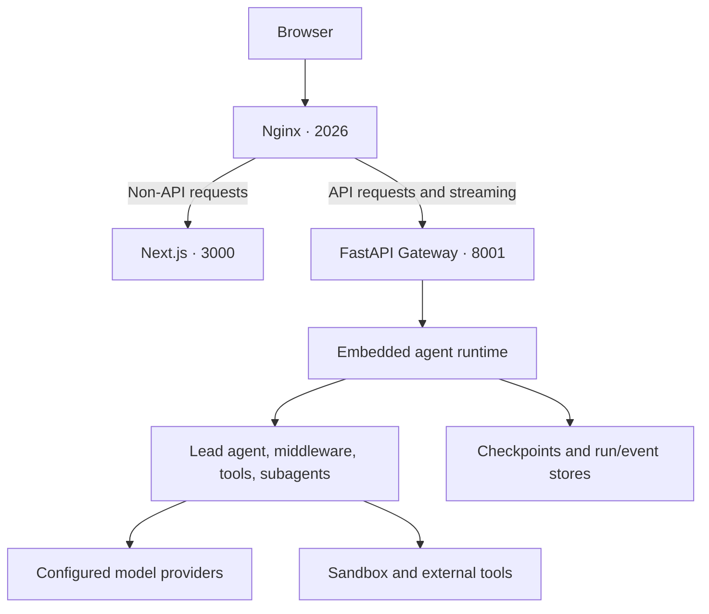

# Architecture Overview

This document provides a comprehensive overview of the DeerFlow backend architecture.

## System Architecture



Nginx rewrites `/api/langgraph/*` to the Gateway's native `/api/*` routes;
other `/api/*` requests also reach the Gateway. The frontend consumes
streaming responses through this proxy. The optional provisioner (`8002`)
is used only for provisioner/Kubernetes sandbox mode.

The application layer (`app/`) imports the reusable harness
(`packages/harness/deerflow/`); the harness must not import `app.*`.
`config.yaml` selects models, tools, sandbox, and runtime policies, while
`extensions_config.json` holds MCP-server configuration and skill state.

## Component Details

### Gateway Embedded Agent Runtime

The agent runtime is embedded in the FastAPI Gateway and built on LangGraph for robust multi-agent workflow orchestration. Nginx rewrites `/api/langgraph/*` to Gateway's native `/api/*` routes, so the public API remains compatible with LangGraph SDK clients without running a separate LangGraph server.

**Entry Point**: `packages/harness/deerflow/agents/lead_agent/agent.py:make_lead_agent`

**Key Responsibilities**:
- Agent creation and configuration
- Thread state management
- Middleware chain execution
- Tool execution orchestration
- SSE streaming for real-time responses

**Graph registry**: `langgraph.json` remains available for tooling, Studio, or direct LangGraph Server compatibility.
It is not the default service entrypoint; scripts and Docker deployments run the Gateway embedded runtime.

```json
{
  "agent": {
    "type": "agent",
    "path": "deerflow.agents:make_lead_agent"
  }
}
```

### Gateway API

FastAPI application providing REST endpoints plus the public LangGraph-compatible `/api/langgraph/*` runtime routes.

**Entry Point**: `app/gateway/app.py`

**Routers**:
- `models.py` - `/api/models` - Model listing and details
- `agents.py` - `/api/agents` - User-scoped Custom Agent CRUD and versioned definition import/export
- `thread_runs.py` / `runs.py` - `/api/threads/{id}/runs`, `/api/runs/*` - LangGraph-compatible runs and streaming
- `mcp.py` - `/api/mcp` - MCP server configuration
- `skills.py` - `/api/skills` - Skills management
- `uploads.py` - `/api/threads/{id}/uploads` - File upload
- `threads.py` - `/api/threads/{id}` - Local DeerFlow thread data cleanup after LangGraph deletion
- `artifacts.py` - `/api/threads/{id}/artifacts` - Artifact serving
- `suggestions.py` - `/api/threads/{id}/suggestions` - Follow-up suggestion generation
- `projects.py` - `/api/projects` - Project CRUD, archive/restore, member threads
- `project_documents.py` - `/api/projects/{id}/documents` - Project document shelf (upload, list, content, move-to-trash)
- `trash.py` - `/api/trash` - Trash tier (list, restore, purge, empty-trash) for project shelf documents

The web conversation delete flow first deletes Gateway-managed thread state through the LangGraph-compatible route, then the Gateway `threads.py` router removes DeerFlow-managed filesystem data via `Paths.delete_thread_dir()`.

### Projects: Pinned Context and the Document Shelf

**Run-start pinning (spec §7.1).** At run admission the Gateway resolves the thread's project once — membership from `threads_meta.project_id`, then the owner-scoped project row (`active` or `archived`) plus a bounded shelf snapshot — and writes it under the server-owned `PROJECT_CONTEXT_KEY` runtime-context key, which is stripped from client-supplied config at admission and refused by the run worker's context merge. `DynamicContextMiddleware.wrap_model_call` renders one transient, request-only HumanMessage per model call from that pinned snapshot: a `<project>` identity/instructions block followed by a bounded `<documents>` shelf index (entry and UTF-8 byte caps from `projects.shelf_index_max_entries` / `shelf_index_max_bytes`, with an honest `count`/`shown` header and an overflow note naming `list_project_documents`). Nothing project-related is persisted to state or checkpoints; the journal records only sha256 fingerprints of the rendered blocks (`project_context_revision`, `project_shelf_revision` on the existing `context:memory` event). Instructions and document names are untrusted text — neutralized before rendering and denylisted (`project`, `documents` in `_BLOCKED_TAG_NAMES`) so user input cannot forge the blocks.

**Role authority.** Project data rides a user-role request message, never the system prompt: framework rules stay in SystemMessages; user-authored project configuration is data.

**Shelf storage (spec §6.1-6.3).** `project_documents` rows carry a server-generated content address (`stored_relpath` relative to `users/{user_id}/projects/`, embedding the sha256 and the row's own document ID) so rows never share files and re-upload after trash lands in a fresh namespace. Layout: `{sha256[:2]}/{sha256}/{document_id}/original/{name}` plus an optional `derived/converted.md` companion created on first read: conversion writes into `.staging/` outside any database transaction, then the document-row lock is taken only to revalidate the live row and atomically rename the output into place (a row trashed or purged meanwhile discards it); concurrent first reads of one document share a single conversion. Inserts are atomic with the active-project row lock: stage → hash → dedup among active `(project_id, sha256)` → place bytes → `INSERT` (file-before-row); a dedup hit returns the existing row (first name wins). Document delete and project delete are pure row transitions to a trash tier (`trashed_at`, `trash_origin` snapshot) — no filesystem work; trashed rows are invisible to the index, the tools, and the listing APIs.

**Bounded live reads (spec §7.3).** `list_project_documents` / `read_project_document` (registered only for runs carrying the pinned key) take `project_id` from the pin and read live shelf rows; binaries and conversion-disabled convertibles are declined with an error naming attach-to-thread, and documents trashed mid-run fail with a "no longer on the shelf" error rather than serving stale content.

**Trash tier (spec §8).** Trashed rows are invisible to the shelf index, tools, and listing APIs; they surface only through the `/api/trash` routes with their `trash_origin` display snapshot. Restore is a database re-point — `stored_relpath` is projects-root-relative, so no file ever moves (spec §10.6) — inside one transaction that locks the target active project row, then the source and any merge-candidate rows in ID order; identical active bytes in the target merge (trash row deleted, discarded namespace unlinked best-effort after commit), and a read-only existence/size check under the document lock rejects restores of missing or size-mismatched content with `409 content_missing`, leaving the row trashed. Purge holds the document-row lock continuously across trashed-state revalidation, unlink of the original and `derived/converted.md`, row deletion, and commit: already-absent content counts as removed, any other unlink error rolls back and keeps the row retryable, and retention callers revalidate the selected trash timestamp and cutoff under the lock so a restored-and-re-trashed row is never purged on its former expiry. Empty trash (`POST /api/trash/purge`) runs that same guarded purge once per trashed row of the caller with no age filter — the confirmation covers the whole listing — so the retention cutoff gates only the sweep's candidate selection. The retention sweep runs lazily on `GET /api/trash/documents` and once at gateway startup (no daemon): it purges rows at or past `projects.trash_retention_days` through the same guarded path, then reconciles storage — `.staging/*` entries and unreferenced files older than 24 hours are removed (nothing younger is ever collected; any active or trashed row protects its whole namespace, even after restore to another project) — and detects rows with missing or size-mismatched content, logging them at warning and surfacing them as `content_missing` without ever deleting the row (the row is the user's only record; disposal always starts with the user trashing it).

**Document summaries (opt-in).** `project_documents.summary` is a nullable, best-effort LLM one-liner. The two shelf write routes enqueue a job after row creation (`projects/summaries.py`, off unless `projects.summaries_enabled`); a bounded worker pool (`summary_concurrency` + bounded `summary_queue_size`, full queue drops) resolves text through `read_text_serving_path` (never re-deriving the convertible-first rule), calls the model via `run_oneshot_llm` with a caller-side wait limit (the worker slot is held until the provider call actually finishes; late results are discarded), rejects length-capped output through the shared provider-normalized detectors, and applies a write-time contract (unwrap → single line → empty is NULL → byte cap on a character boundary) before persisting with `updated_at` pinned so a landing summary never reorders the shelf. The summary rides the row's lifecycle (trash/restore/purge need no hooks), renders into the `<documents>` index and `list_project_documents` tag-neutralized at both exits, and is counted through `eligible/success/failed/skipped/queue_dropped/uncapped_accepted` metrics. All failure modes leave `summary = NULL`, which renders exactly like a shelf without the feature.

### Agent Architecture

The lead graph is built by
[`assemble_lead_agent()`](../packages/harness/deerflow/agents/lead_agent/agent.py).
`make_lead_agent(config)` returns its graph; the Gateway uses the richer
assembly result.

```mermaid
flowchart TD
    assembly["assemble_lead_agent"] --> model["Resolve model and prompt"]
    assembly --> tools["Resolve authorized tools and skills"]
    assembly --> base["Build shared runtime middleware"]
    base --> lead["Add lead-specific middleware"]
    lead --> extensions["Compose extension contributions"]
    model --> graph["LangChain create_agent / LangGraph graph"]
    tools --> graph
    extensions --> graph
```

There is no fixed middleware count. The shared
[`build_lead_runtime_middlewares()`](../packages/harness/deerflow/agents/middlewares/tool_error_handling_middleware.py)
builds runtime boundaries and thread-resource hooks. The lead's
[`build_middlewares()`](../packages/harness/deerflow/agents/lead_agent/agent.py)
adds context and skill handling, optional summarization and todos, conversation
features, configured run limits, and response-completion handling.
[`compose_with_extensions()`](../packages/harness/deerflow/extensions/stack.py)
merges extension contributions after the complete lead stack exists.

These are assembly stages, not the execution order of every hook.
`after_model` hooks run in reverse registration order; the first registered
wrapper is outermost. The built-in stack appends `ClarificationMiddleware`
last before extension composition. Model capabilities, memory mode, runtime
configuration, and extensions affect the resulting stack.

### Request and Agent Execution Flow

```mermaid
flowchart TD
    request["Thread run request"] --> admission["Gateway admission and configuration"]
    admission --> manager["RunManager starts run_agent"]
    manager --> graph["Assemble graph and restore state"]
    graph --> model["Call model through middleware"]
    model --> decision{"Tool calls?"}
    decision -->|"Yes, permitted"| tools["Execute tools or delegate to subagent"]
    tools -->|"Results update state"| model
    decision -->|"No"| finish["Finalize run"]
    model -.-> events["StreamBridge → Gateway SSE → browser"]
    tools -.-> events
    finish -.-> events
```

This is the ordinary tool loop. Clarification, cancellation, errors, and
configured limits can interrupt or stop it. Checkpoints retain graph state;
run records and events track execution and support history/streaming features.
Tool implementations perform actual I/O; model output selects calls that the
runtime and its policies dispatch.

| Stage | Source |
|---|---|
| HTTP run routes | [`app/gateway/routers/thread_runs.py`](../app/gateway/routers/thread_runs.py) |
| Admission and configuration | [`app/gateway/services.py`](../app/gateway/services.py), `start_run()` |
| Run lifecycle | [`runtime/runs/manager.py`](../packages/harness/deerflow/runtime/runs/manager.py), `RunManager` |
| Graph execution | [`runtime/runs/worker.py`](../packages/harness/deerflow/runtime/runs/worker.py), `run_agent()` |
| Event transport | [`runtime/stream_bridge/`](../packages/harness/deerflow/runtime/stream_bridge/) |

### Thread State

The `ThreadState` extends LangGraph's `AgentState` with additional fields:

```python
class ThreadState(AgentState):
    # Core state from AgentState
    messages: list[BaseMessage]

    # DeerFlow extensions
    sandbox: dict             # Sandbox environment info
    artifacts: list[str]      # Generated file paths
    thread_data: dict         # {workspace, uploads, outputs} paths
    title: str | None         # Auto-generated conversation title
    todos: list[dict]         # Task tracking (plan mode)
    viewed_images: dict       # Vision model image data
```

### Sandbox System

```
┌─────────────────────────────────────────────────────────────────────────┐
│                           Sandbox Architecture                           │
└─────────────────────────────────────────────────────────────────────────┘

                      ┌─────────────────────────┐
                      │    SandboxProvider      │ (Abstract)
                      │  - acquire()            │
                      │  - get()                │
                      │  - release()            │
                      └────────────┬────────────┘
                                   │
              ┌────────────────────┼────────────────────┐
              │                                         │
              ▼                                         ▼
┌─────────────────────────┐              ┌─────────────────────────┐
│  LocalSandboxProvider   │              │  AioSandboxProvider     │
│  (packages/harness/deerflow/sandbox/local/) │              │  (packages/harness/deerflow/community/)       │
│                         │              │                         │
│  - Singleton instance   │              │  - Docker-based         │
│  - Direct execution     │              │  - Isolated containers  │
│  - Development use      │              │  - Production use       │
└─────────────────────────┘              └─────────────────────────┘

                      ┌─────────────────────────┐
                      │        Sandbox          │ (Abstract)
                      │  - execute_command()    │
                      │  - read_file()          │
                      │  - write_file()         │
                      │  - list_dir()           │
                      └─────────────────────────┘
```

**Virtual Path Mapping**:

| Virtual Path | Physical Path |
|-------------|---------------|
| `/mnt/user-data/workspace` | `backend/.deer-flow/threads/{thread_id}/user-data/workspace` |
| `/mnt/user-data/uploads` | `backend/.deer-flow/threads/{thread_id}/user-data/uploads` |
| `/mnt/user-data/outputs` | `backend/.deer-flow/threads/{thread_id}/user-data/outputs` |
| `/mnt/skills` | `deer-flow/skills/` |

### Tool System

```
┌─────────────────────────────────────────────────────────────────────────┐
│                            Tool Sources                                  │
└─────────────────────────────────────────────────────────────────────────┘

┌─────────────────────┐  ┌─────────────────────┐  ┌─────────────────────┐
│   Built-in Tools    │  │  Configured Tools   │  │     MCP Tools       │
│  (packages/harness/deerflow/tools/)       │  │  (config.yaml)      │  │  (extensions.json)  │
├─────────────────────┤  ├─────────────────────┤  ├─────────────────────┤
│ - present_files     │  │ - web_search        │  │ - github            │
│ - ask_clarification │  │ - web_fetch         │  │ - filesystem        │
│ - view_image        │  │ - bash              │  │ - postgres          │
│                     │  │ - read_file         │  │ - brave-search      │
│                     │  │ - write_file        │  │ - puppeteer         │
│                     │  │ - str_replace       │  │ - ...               │
│                     │  │ - ls                │  │                     │
└─────────────────────┘  └─────────────────────┘  └─────────────────────┘
           │                       │                       │
           └───────────────────────┴───────────────────────┘
                                   │
                                   ▼
                      ┌─────────────────────────┐
                      │   get_available_tools() │
                      │   (packages/harness/deerflow/tools/__init__.py)  │
                      └─────────────────────────┘
```

### Model Factory

```
┌─────────────────────────────────────────────────────────────────────────┐
│                          Model Factory                                   │
│                     (packages/harness/deerflow/models/factory.py)                              │
└─────────────────────────────────────────────────────────────────────────┘

config.yaml:
┌─────────────────────────────────────────────────────────────────────────┐
│ models:                                                                  │
│   - name: gpt-4                                                         │
│     display_name: GPT-4                                                 │
│     use: langchain_openai:ChatOpenAI                                    │
│     model: gpt-4                                                        │
│     api_key: $OPENAI_API_KEY                                            │
│     max_tokens: 4096                                                    │
│     supports_thinking: false                                            │
│     supports_vision: true                                               │
└─────────────────────────────────────────────────────────────────────────┘
                                   │
                                   ▼
                      ┌─────────────────────────┐
                      │   create_chat_model()   │
                      │  - name: str            │
                      │  - thinking_enabled     │
                      └────────────┬────────────┘
                                   │
                                   ▼
                      ┌─────────────────────────┐
                      │   resolve_class()       │
                      │  (reflection system)    │
                      └────────────┬────────────┘
                                   │
                                   ▼
                      ┌─────────────────────────┐
                      │   BaseChatModel         │
                      │  (LangChain instance)   │
                      └─────────────────────────┘
```

**Supported Providers**:
- OpenAI (`langchain_openai:ChatOpenAI`)
- Anthropic (`langchain_anthropic:ChatAnthropic`)
- DeepSeek (`langchain_deepseek:ChatDeepSeek`)
- Custom via LangChain integrations

### MCP Integration

```
┌─────────────────────────────────────────────────────────────────────────┐
│                          MCP Integration                                 │
│                        (packages/harness/deerflow/mcp/)                              │
└─────────────────────────────────────────────────────────────────────────┘

extensions_config.json:
┌─────────────────────────────────────────────────────────────────────────┐
│ {                                                                        │
│   "mcpServers": {                                                       │
│     "github": {                                                         │
│       "enabled": true,                                                  │
│       "type": "stdio",                                                  │
│       "command": "npx",                                                 │
│       "args": ["-y", "@modelcontextprotocol/server-github"],           │
│       "env": {"GITHUB_TOKEN": "$GITHUB_TOKEN"}                          │
│     }                                                                   │
│   }                                                                     │
│ }                                                                       │
└─────────────────────────────────────────────────────────────────────────┘
                                   │
                                   ▼
                      ┌─────────────────────────┐
                      │  MultiServerMCPClient   │
                      │  (langchain-mcp-adapters)│
                      └────────────┬────────────┘
                                   │
              ┌────────────────────┼────────────────────┐
              │                    │                    │
              ▼                    ▼                    ▼
       ┌───────────┐        ┌───────────┐        ┌───────────┐
       │  stdio    │        │   SSE     │        │   HTTP    │
       │ transport │        │ transport │        │ transport │
       └───────────┘        └───────────┘        └───────────┘
```

### Skills System

```
┌─────────────────────────────────────────────────────────────────────────┐
│                          Skills System                                   │
│                       (packages/harness/deerflow/skills/)                             │
└─────────────────────────────────────────────────────────────────────────┘

Directory Structure:
┌─────────────────────────────────────────────────────────────────────────┐
│ skills/                                                                  │
│ ├── public/                        # Public skills (committed)           │
│ │   ├── pdf-processing/                                                 │
│ │   │   └── SKILL.md                                                    │
│ │   ├── frontend-design/                                                │
│ │   │   └── SKILL.md                                                    │
│ │   └── ...                                                             │
│ └── custom/                        # Custom skills (gitignored)          │
│     └── user-installed/                                                 │
│         └── SKILL.md                                                    │
└─────────────────────────────────────────────────────────────────────────┘

SKILL.md Format:
┌─────────────────────────────────────────────────────────────────────────┐
│ ---                                                                      │
│ name: PDF Processing                                                     │
│ description: Handle PDF documents efficiently                            │
│ license: MIT                                                            │
│ allowed-tools:                                                          │
│   - read_file                                                           │
│   - write_file                                                          │
│   - bash                                                                │
│ ---                                                                      │
│                                                                          │
│ # Skill Instructions                                                     │
│ Loaded on demand after discovery or explicit slash activation...         │
└─────────────────────────────────────────────────────────────────────────┘
```

### Request Flow

```
┌─────────────────────────────────────────────────────────────────────────┐
│                         Request Flow Example                             │
│                    User sends message to agent                           │
└─────────────────────────────────────────────────────────────────────────┘

1. Client → Nginx
   POST /api/langgraph/threads/{thread_id}/runs
   {"input": {"messages": [{"role": "user", "content": "Hello"}]}}

2. Nginx → Gateway API (8001)
   `/api/langgraph/*` is rewritten to Gateway's LangGraph-compatible `/api/*` routes

3. Gateway embedded runtime
   a. Load/create thread state
   b. Execute middleware chain:
      - ThreadDataMiddleware: Set up paths
      - UploadsMiddleware: Inject file list
      - SandboxMiddleware: Acquire sandbox
      - SummarizationMiddleware: Check token limits
      - TitleMiddleware: Generate title if needed
      - TodoListMiddleware: Load todos (if plan mode)
      - ViewImageMiddleware: Process images
      - ClarificationMiddleware: Check for clarifications

   c. Execute agent:
      - Model processes messages
      - May call tools (bash, web_search, etc.)
      - Tools execute via sandbox
      - Results added to messages

   d. Stream response via SSE

4. Client receives streaming response
```

## Data Flow

### File Upload Flow

```
1. Client uploads file
   POST /api/threads/{thread_id}/uploads
   Content-Type: multipart/form-data

2. Gateway receives file
   - Validates file
   - Stores in .deer-flow/threads/{thread_id}/user-data/uploads/
   - If document: converts to Markdown via markitdown

3. Returns response
   {
     "files": [{
       "filename": "doc.pdf",
       "path": ".deer-flow/.../uploads/doc.pdf",
       "virtual_path": "/mnt/user-data/uploads/doc.pdf",
       "artifact_url": "/api/threads/.../artifacts/mnt/.../doc.pdf"
     }]
   }

4. Next agent run
   - UploadsMiddleware lists files
   - Injects file list into messages
   - Agent can access via virtual_path
```

### Thread Cleanup Flow

```
1. Client deletes conversation via the LangGraph-compatible Gateway route
   DELETE /api/langgraph/threads/{thread_id}

2. Web UI follows up with Gateway cleanup
   DELETE /api/threads/{thread_id}

3. Gateway removes local DeerFlow-managed files
   - Deletes .deer-flow/threads/{thread_id}/ recursively
   - Missing directories are treated as a no-op
   - Invalid thread IDs are rejected before filesystem access
```

### Configuration Reload

```
1. Client updates MCP config or requests a cache reset
   PUT /api/mcp/config
   POST /api/mcp/cache/reset

2. Gateway updates runtime state
   - PUT writes extensions_config.json and reloads configuration
   - Config mutations reset the handling worker; peer workers detect the config signature
   - Cache reset writes a shared generation marker, then retires the handling worker

3. MCP Manager reloads on next use
   - Every worker sharing that config directory compares the reset generation before serving cached tools
   - get_cached_mcp_tools() lazily reinitializes MCP tools
   - Loads current server configurations and tool lists

4. Next agent run uses new tools
```

## Security Considerations

### Sandbox Isolation

- Agent code executes within sandbox boundaries
- Local sandbox: Direct execution (development only)
- Docker sandbox: Container isolation (production recommended)
- Path traversal prevention in file operations

### API Security

- Thread isolation: Each thread has separate data directories
- File validation: Uploads checked for path safety
- Environment variable resolution: Secrets not stored in config

### MCP Security

- Each MCP server runs in its own process
- Environment variables resolved at runtime
- Servers can be enabled/disabled independently

## Performance Considerations

### Caching

- MCP tools cached with file mtime invalidation
- Configuration loaded once, reloaded on file change
- Skills parsed once at startup, cached in memory

### Streaming

- SSE used for real-time response streaming
- Reduces time to first token
- Enables progress visibility for long operations

### Context Management

- Summarization middleware reduces context when limits approached
- Configurable triggers: tokens, messages, or fraction
- Preserves recent messages while summarizing older ones
