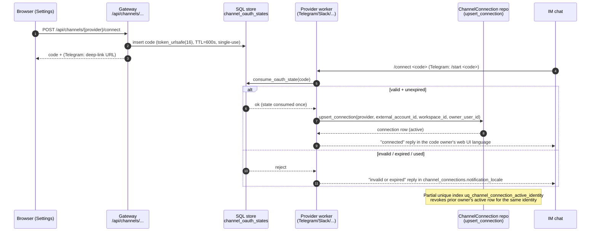
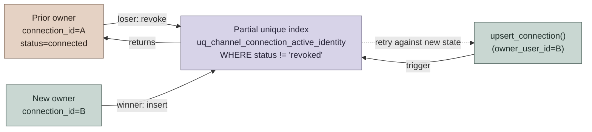
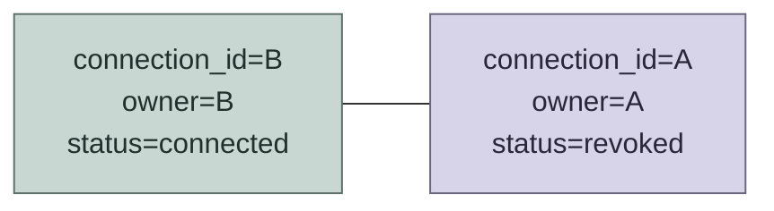
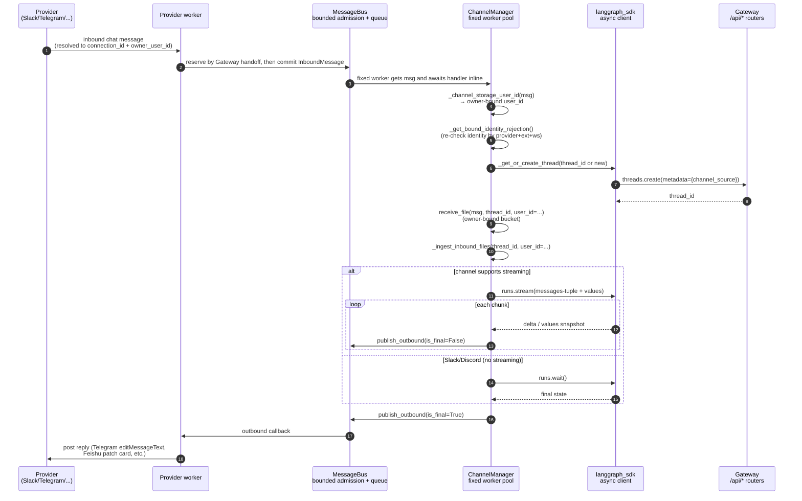
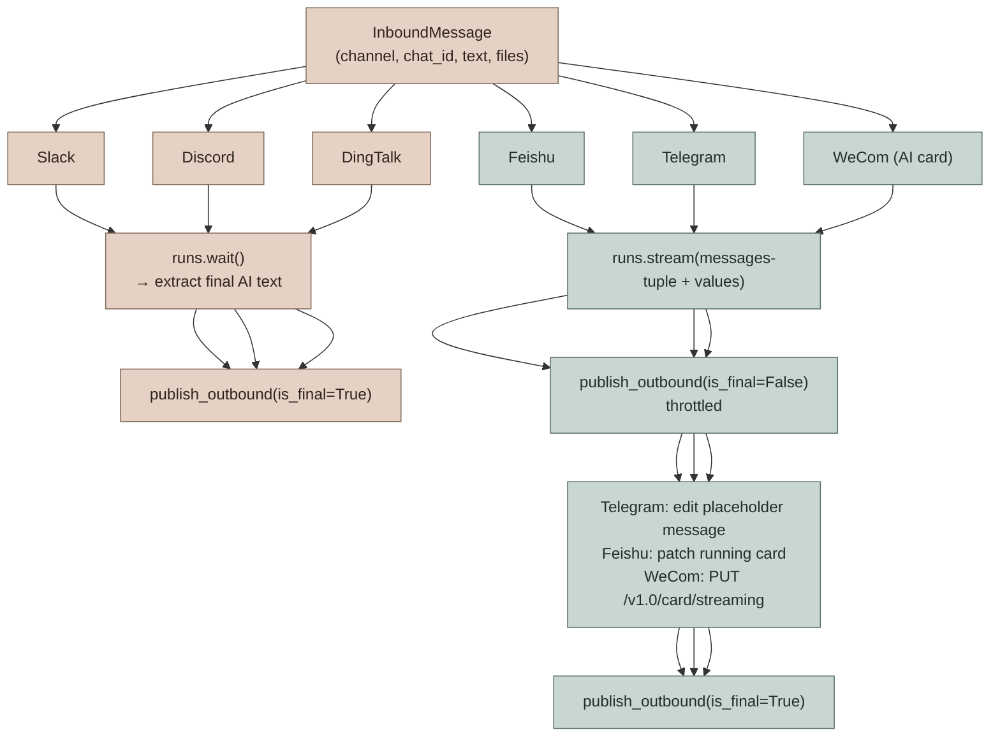
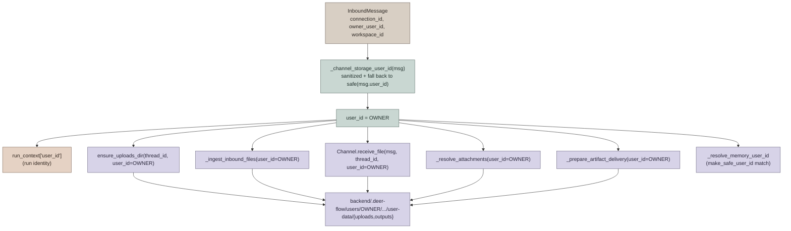

# IM Channel Connections

DeerFlow supports user-owned IM channel bindings for Telegram, Slack, Discord, Feishu/Lark, DingTalk, WeChat, WeCom, QQ, and Buzz. The feature reuses the existing `channels.*` runtime configuration, so it works in local and private deployments with the same outbound transports already supported by DeerFlow.

No public IP, OAuth callback URL, or provider webhook is required in this implementation.

This document covers both **architecture** (how the bind / dispatch / file pipeline fits together) and **configuration / operations** (the existing `config.yaml` knobs and security notes). For the high-level orientation, see [AGENTS.md](../AGENTS.md) → "IM Channels System".

---

## Architecture Overview

A user-owned IM channel connection is a **per-DeerFlow-user bind layer** layered on top of the existing provider bot credentials in `channels.*`. The connection layer adds three things the bot credentials alone cannot give you:

1. **Owner identity** — each `(provider, external account, workspace)` maps to exactly one DeerFlow account (`owner_user_id`). Every run created from that connection runs in the owner's bucket (memory, uploads, outputs, custom agent).
2. **One-time bind codes** — the browser Connect flow mints a short-lived `secrets.token_urlsafe(16)` code (600 s TTL, single-use) and surfaces it only in the initiating user's browser. The platform worker consumes `/connect <code>` (Telegram uses `/start <code>` over a deep link) before applying any `allowed_users` filter, so a not-yet-allowlisted user can complete their first bind.
3. **Strict ownership transfer** — the latest successful bind wins; `upsert_connection` revokes other owners' active rows for the same external identity. The DB-enforced partial unique index `uq_channel_connection_active_identity` (`WHERE status != 'revoked'`) makes the invariant race-free across concurrent writers.

### Conversation-scoped Custom Agents

Connected users can run `/agent list` to inspect the Custom Agents in their own DeerFlow user bucket, then `/agent use <name>` to start a new conversation with one.
The selection is written to the new Gateway thread's channel metadata and, for a Custom Agent, to the canonical `agent_name` routing metadata used by the Web UI. It is cached by `ChannelManager` for subsequent turns; on restart, the manager reads the channel metadata before the first resumed turn. Opening that thread from Web search therefore continues under the same Custom Agent instead of falling back to the default runtime.
Because selecting an agent always creates a new thread instead of mutating the current one, an existing conversation keeps its original runtime, prompt, skills, and checkpoint lineage.
`/agent use lead_agent` starts a new conversation with the default agent.

### Goal status (`/goal`)

`/goal <condition>` sets a goal on the chat's conversation and starts a run with the condition as the task; `/goal clear` clears it. `/goal` alone reports what the web goal bar shows: the goal, `In progress.` while a run is pending or running, and once auto-continue has stood down, why (for example `Stopped: the continuation limit was reached.` or `Waiting for you: it needs your input.`). A met goal is cleared and recorded in the thread state, so `/goal` answers `Goal met: <goal>` until the next goal change. Reasons come only from host-written codes; the goal checker's notes and provider errors are never sent.

DeerFlow's own replies here and to `/connect` use the binding owner's web UI language (the `locale` user preference), else `channel_connections.notification_locale` (`en-US` by default). A reply with no known owner, such as one to an invalid or expired code, uses the configured default. Agent replies are not translated.

Connect codes are deliberately **bind-time defenses**, not chat-time defenses. After binding, ordinary `allowed_users` continue to gate regular messages exactly as before.

## Connect-code Flow

The browser initiates; the provider worker consumes the code; the manager never sees the code itself.



## Single-active-owner Transfer

The partial unique index is the source of truth — application code never has to "revoke the previous owner" explicitly because the upsert that re-uses an identity fails on conflict and the loser retries against the now-visible revoked state.



After the dust settles:



The same invariant protects the `find_connection_by_external_identity` lookup used by `ChannelManager._get_bound_identity_rejection` — a non-revoked row can resolve to exactly one owner at any time.

## Provider Message Flow Once Bound

After a connection is bound, every inbound message walks the same path through `ChannelManager`. Slack/Discord (no streaming) and Feishu/Telegram (streaming) diverge only at the run boundary.



### Inbound capacity and overload behavior

Three top-level `channels` settings control the MessageBus/manager lifecycle: `inbound_queue_maxsize` (default `1000`) covers queued messages plus provider-side reservations that may still be doing final identity/ack preparation, `max_concurrency` (default `5`) is the exact number of long-lived `ChannelManager` workers, and `shutdown_grace_period_seconds` (default `3`) bounds graceful draining before active handlers are cancelled. Active handlers run inline in those workers, so a burst cannot create a task per message. The maximum manager-owned live intake is therefore the pending capacity plus the fixed worker count.

Admission never waits for queue space, because waiting producer coroutines would simply move the unbounded backlog outside the queue. At capacity:

- Slack, Discord, Feishu/Lark, DingTalk, Telegram, WeChat, and WeCom drop the new message before DeerFlow sends its working acknowledgment. `MessageBus` emits a rate-limited warning with a cumulative rejection count.
- Buzz leaves the per-channel replay watermark unchanged and reconnects, allowing relay history to replay the event.
- GitHub webhook fan-out returns `503`. GitHub records the delivery as failed; an operator or recovery job can retry it through the Recent Deliveries UI or REST redelivery API (GitHub does not retry failed deliveries automatically).

Shutdown first closes admission and cancels follow-up watchers, but keeps provider transports alive while workers drain accepted messages for up to `shutdown_grace_period_seconds`. Once that grace expires, it cancels active handlers, discards queue entries that never began, and awaits every manager-owned worker and watcher. Provider coroutines submitted from SDK threads are likewise retained, cancelled, and awaited before their channel tears down SDK resources. A successful stop therefore leaves no owned handler able to use a closed transport. The Gateway's outer shutdown timeout remains the process-level bound; if it cancels cleanup, the service retains its transports and singleton instead of reporting a successful stop or hiding unfinished ownership.

## Sync vs Streaming Channels

The two paths split on `ChannelRunPolicy.supports_streaming` (per-channel registration in `CHANNEL_CAPABILITIES`):



For the special GitHub case (`fire_and_forget=True` channel policy), the manager calls `runs.create()` and returns once the run is `pending` — no outbound reply, because GitHub agents post via the `gh` CLI from inside their sandbox. See [GITHUB_AGENTS.md](GITHUB_AGENTS.md) for the full GitHub flow.

## Attachment delivery feedback

The shared channel outbound path sends text before uploading attachments. Channels inheriting the default, unsupported `send_file` implementation explain the limitation in that first reply instead of attempting uploads. Supported channels continue trying the other attachments after an individual failure, then send one combined notice listing only unsent files. Successful uploads need no additional confirmation.

The notice stays in the original conversation, preserves connection/owner routing, and carries no attachments or clarification-card payload. Built-in IM outbounds do not currently populate `metadata.locale`, so their notices choose Chinese or English from the first non-empty response line. This path does not read user language preferences; an explicitly supplied locale still overrides the heuristic. Files stay in the original DeerFlow conversation for download. If the platform no longer accepts the notice, the upload failures and notice failure remain in the logs; no proactive notification, regeneration, or new upload retry is started.

WeCom reuses this shared processing, sends failure notices as text replies on the original inbound frame after the final stream, and retains its frame/stream cleanup after delivery. Provider-specific upload protocols, reply windows, and send ordering are unchanged.

## Owner-scoped File Storage

`ChannelManager` resolves the storage owner **once** at the top of `_handle_chat` via `_channel_storage_user_id(msg)` and threads that value through the entire file pipeline. The same identity is used as the run `user_id` in `run_context` and as the bucket for memory, uploads, and outputs — so the bucket the agent reads/writes is always the bucket where channel files were staged.



The cached value is reused across the blocking (`runs.wait`) and streaming (`_handle_streaming_chat`) paths — even if a future `Channel.receive_file` returns a rewritten `InboundMessage`, uploads and artifact delivery still target the same bucket.

## IM File Attachment Pipeline

Inbound files (images, documents) first pass through `Channel.receive_file` for
provider-specific materialization. Attachments that continue through the shared
metadata path are staged by `_ingest_inbound_files`; their metadata is placed in
`HumanMessage.additional_kwargs.files`, and `UploadsMiddleware` injects a
`<current_uploads>` block for the current message. Some providers instead consume
their descriptors while downloading and rewrite placeholders or message text with
the resulting virtual path (or a failure notice). Historical uploads are not
automatically injected on later turns; the agent discovers them with
`list_uploaded_files`.

Feishu/Lark inbound resource streams are read with a 20,000,000-byte cap before
they are persisted or synced into a non-local sandbox. Oversized resources and
per-file path failures are surfaced as a failure placeholder in the message text
without aborting later attachments in the same inbound message.

```mermaid
sequenceDiagram
    autonumber
    participant IM as Provider message<br/>(file attachment)
    participant Worker as Provider worker
    participant Mgr as ChannelManager
    participant Ch as Channel impl<br/>.receive_file
    participant FS as Uploads directory<br/>users/OWNER/.../uploads/
    participant MW as UploadsMiddleware
    participant Agent as Agent run

    IM->>Worker: message with file URL/bytes
    Worker->>Mgr: InboundMessage(files=[...], connection_id, owner_user_id)
    Mgr->>Mgr: storage_user_id = _channel_storage_user_id(msg)
    Mgr->>Ch: receive_file(msg, thread_id, user_id=storage_user_id)
    Note over Ch: provider-specific download/decrypt/read;<br/>may persist or hand bytes to manager
    Ch-->>Mgr: materialized message<br/>(provider may rewrite placeholders/text)
    alt attachment continues through shared metadata path
        Mgr->>FS: _ingest_inbound_files(<br/>thread_id, msg, user_id=storage_user_id)
        FS-->>Mgr: uploaded file metadata
        Mgr->>MW: HumanMessage with<br/>additional_kwargs.files
        MW->>Agent: prepend <current_uploads><br/>(paths under /mnt/user-data/uploads/)
    else provider supplies virtual path in message text
        Ch->>FS: persist and/or sync attachment
        Mgr->>Agent: HumanMessage with rewritten path<br/>or failure notice
    end
    Agent->>FS: read_file / view_image (sandbox)
```

## Cross-references

- [AGENTS.md](../AGENTS.md) → "IM Channels System" — the index view in `backend/AGENTS.md` (configuration knobs, message flow, component list)
- [GITHUB_AGENTS.md](GITHUB_AGENTS.md) — webhook-driven GitHub channel, agent bindings, fan-out, token lifecycle
- `app/channels/manager.py` — dispatcher, `_channel_storage_user_id`, `_handle_chat`, `_handle_streaming_chat`
- `deerflow.persistence.channel_connections` — SQL tables (`channel_connections`, `channel_oauth_states`, `channel_conversations`, `channel_credentials`) and `upsert_connection` / `consume_oauth_state` / `find_connection_by_external_identity`

---

# Configuration

Configure the actual IM bots under the existing `channels` block:

```yaml
channels:
  inbound_queue_maxsize: 1000
  max_concurrency: 5
  shutdown_grace_period_seconds: 3

  telegram:
    enabled: true
    bot_token: $TELEGRAM_BOT_TOKEN

  slack:
    enabled: true
    bot_token: $SLACK_BOT_TOKEN
    app_token: $SLACK_APP_TOKEN

  discord:
    enabled: true
    bot_token: $DISCORD_BOT_TOKEN

  feishu:
    enabled: true
    app_id: $FEISHU_APP_ID
    app_secret: $FEISHU_APP_SECRET

  dingtalk:
    enabled: true
    client_id: $DINGTALK_CLIENT_ID
    client_secret: $DINGTALK_CLIENT_SECRET

  wechat:
    enabled: true
    bot_token: $WECHAT_BOT_TOKEN

  wecom:
    enabled: true
    bot_id: $WECOM_BOT_ID
    bot_secret: $WECOM_BOT_SECRET

  buzz:
    enabled: true
    relay_url: wss://buzz.example.com
    private_key: $BUZZ_PRIVATE_KEY   # hex or nsec1…
```

Then enable user bindings in `channel_connections`:

```yaml
channel_connections:
  enabled: true
  # Auth-enabled deployments require ordinary IM messages to come from a
  # connected DeerFlow user by default. Set this to false only for legacy
  # operator-owned/open-bot deployments that intentionally route unbound
  # platform users to platform-ID user buckets.
  require_bound_identity: true

  telegram:
    enabled: true
    bot_username: $TELEGRAM_BOT_USERNAME

  slack:
    enabled: true

  discord:
    enabled: true

  feishu:
    enabled: true

  dingtalk:
    enabled: true

  wechat:
    enabled: true

  wecom:
    enabled: true

  buzz:
    enabled: true
```

`channel_connections` does not duplicate provider secrets. It only controls the browser-facing connect UI and stores per-user binding records. Telegram needs `bot_username` only so the frontend can open a deep link.

When `channel_connections.enabled` and `require_bound_identity` are true, auth-enabled deployments reject ordinary unbound IM messages before creating a DeerFlow thread or run. Users must connect the channel from DeerFlow Settings first. Auth-disabled local mode still routes channel messages to the auth-disabled default user, and legacy open-bot behavior can be restored explicitly with `require_bound_identity: false`.

Upgrade note: existing auth-enabled deployments that already have `channel_connections.enabled: true` will start rejecting ordinary unbound IM messages after this field is introduced because `require_bound_identity` defaults to true. Legacy operator-owned/open-bot deployments that intentionally allow unbound platform users to create DeerFlow runs should set `require_bound_identity: false` before upgrading and restart the service.

## Connect Flow

Every worker answers the bind message in the chat: `<Provider> connected to DeerFlow.` on success, otherwise that the code (Telegram: the link) is invalid or expired, or that the bind could not be completed from that message. Replies use the code owner's web UI language once the code is consumed, else `channel_connections.notification_locale` ([reply language](#goal-status-goal)).

Telegram:

- The frontend creates a short one-time code.
- The Connect button opens `https://t.me/<bot_username>?start=<code>`.
- The existing Telegram long-polling worker receives `/start <code>` and binds that Telegram chat/user to the current DeerFlow user.

Slack:

- The frontend creates a short one-time code.
- The UI shows `Send /connect <code> to the DeerFlow Slack bot.`
- The existing Slack Socket Mode worker receives the message and binds the Slack user/team to the current DeerFlow user.

Discord:

- The frontend creates a short one-time code.
- The UI shows `Send /connect <code> to the DeerFlow Discord bot.`
- The existing Discord Gateway worker receives the message and binds the Discord user/guild to the current DeerFlow user.

Feishu/Lark, DingTalk, WeChat, and WeCom:

- The frontend creates a short one-time code.
- The UI shows `Send /connect <code> to the DeerFlow <Provider> bot.`
- The already-running long-connection or polling worker receives the message and binds the platform user/workspace identity to the current DeerFlow user.

Buzz:

- Unlike the bot/app credentials above, Buzz has no separate developer console: DeerFlow joins the relay as an ordinary member identity. Generate a Nostr keypair for that identity — everything below refers to its **hex public key**.
- **Onboarding takes two separate steps, and both are required.** Relay membership and channel membership are different things, and doing only the first produces a connector that connects and authenticates cleanly while receiving nothing:

  1. **Register the pubkey as a relay member** — `buzz-admin add-member --pubkey <hex>`. This is what lets the identity authenticate (NIP-42) and publish at all.
  2. **Add it to each channel it should participate in** — `buzz channels add-member --channel <uuid> --pubkey <hex> --role bot`. Chat events are only delivered to a channel's members, and the relay additionally **rejects** any message that `p`-mentions a non-member with `mentioned pubkeys are not channel members` — so without this step the connector can neither hear a mention nor answer one.

  See the [Buzz project](https://github.com/block/buzz) for the admin tooling.
- **Channels are auto-discovered — you do not list them in `config.yaml`.** On every connection the connector asks the relay which channels this identity belongs to and subscribes to each one individually. Adding it to a new channel later takes effect **live**, without a restart or reconnect: the relay sends a membership notification and the connector starts listening immediately (and stops listening when it is removed). If you see `channel discovery returned no channels` in the logs, step 2 above has not been done.
- Configure `relay_url` and `private_key` (hex or `nsec1…`) under `channels.buzz`, then enable `channel_connections.buzz`.
- The frontend creates a short one-time code.
- The UI shows `Send /connect <code> to the DeerFlow Buzz bot.`
- The already-running Buzz relay-loop worker receives the message — sent as a DM or an @mention in a channel both parties belong to — and binds the sender's Nostr pubkey to the current DeerFlow user.
- Requires the `buzz` dependency extra (`uv sync --extra buzz`) for the `coincurve` library. `scripts/detect_uv_extras.py` (and Docker/production builds via `backend/Dockerfile`) auto-detect and preserve this extra when `channels.buzz.enabled: true` in `config.yaml`, the same way the `browser` extra is auto-detected for `browser_navigate`.

### Buzz subscription model

Buzz's relay only delivers chat events to **channel-scoped** subscriptions, which is why the connector's subscriptions look the way they do. A global `REQ {"kinds":[9]}` is accepted and answered with `EOSE`, but no chat event is ever fanned out to it, and a single subscription cannot cover several channels either (a multi-value `#h` matches nothing). So, on **every** connection, after NIP-42 auth completes:

| Subscription | Filter | Purpose |
|---|---|---|
| `buzz-discovery` | `{"kinds":[39000]}` | Historical query listing exactly the channels this identity is a member of (one stored event each, then `EOSE`). Supplies each channel's name and type, which is also what the DM mention-exemption reads. Do **not** narrow it with `#p` — that matches nothing. |
| `buzz-membership` | `{"kinds":[44100,44101], "#p":["<our pubkey>"], "since": …}` | **Live** membership notifications. `44100` (added) subscribes to the new channel immediately; `44101` (removed) closes that channel's live and backlog subscriptions and clears its paging state. This is what makes a newly added channel work without a restart. |
| `buzz-chat-<uuid>` | `{"kinds":[9], "#h":["<uuid>"], "since": …}` | One per discovered channel — the only shape that actually receives messages. |

Consequences worth knowing operationally:

- **Replay is tracked per channel.** Each channel carries its own `since` watermark, advanced only by events DeerFlow actually processed. A single shared watermark would let a busy channel drag the cursor past a quiet channel's unread messages and skip them after a reconnect; per-channel cursors can only ever cost duplicate delivery (which the manager's inbound dedupe absorbs), never a miss.
- **Membership is scoped to live events.** The relay *stores* 44100/44101 events, so without a `since` every connection replayed the whole membership history as if it had just happened — re-running channel discovery once per stored add (you would see several `channel discovery complete` lines for one connect, and channels logged as `<unnamed>`), re-subscribing channels you have since been removed from, and briefly unsubscribing channels you are still in. The subscription is therefore anchored at the moment the socket opened, minus 60s of slack so a membership change made *during* the connect/auth handshake — or a small relay clock skew — is still picked up.
- **The number of channel subscriptions is capped** (256). The channel list comes off the wire, so it is bounded like any other remote-fed state. At the cap, new channels are refused and named in a `per-channel subscription limit reached` warning rather than an existing, working subscription being evicted.
- **A subscription the relay closes is re-opened, up to 3 times per connection.** Every subscription on the socket fails *silently* when the relay drops it: a chat subscription deafens one channel, `buzz-membership` stops DeerFlow ever learning it was added to or removed from a channel, `buzz-discovery` kills the completeness sweep. So a `CLOSED` frame is recovered, not just noted, and the subscription that went quiet is always named at WARNING level. Recovery is skipped when the relay's stated reason says the subscription is not ours any more — a NIP-01/NIP-42 `auth-required:` / `restricted:` / `blocked:` / `invalid:` prefix, or buzz-relay's own revocation wording — because re-issuing the same REQ then just fights the relay. Any other reason (including a `CLOSED` with no reason at all) is treated as a hiccup and retried, with the 3-attempt budget as the backstop; after that it stays down until the next reconnect, which rebuilds everything from scratch.
- **A backlog larger than the relay's 2000-per-subscription cap is now paged, not lost.** The relay serves at most 2000 stored events per subscription, newest-first, even with a `since`. When a channel's history page comes back *at* that cap, DeerFlow walks the history backwards with further `until`-bounded queries on a separate subscription until a page comes back under the cap or it reaches the point it had already read, so the oldest unread messages are fetched rather than skipped. The walk needs a read watermark to stop at, so it runs only for a channel DeerFlow has already read from; a channel's *first* connect (and any channel whose cursor was evicted) keeps the previous newest-2000 behaviour rather than paging back with nothing to reach. The walk is best-effort and additive. It stops with a warning at 50 pages or when a saturated page makes no timestamp progress. A full page of events at the inclusive `until` boundary cannot be advanced safely using timestamps alone: subtracting a second could skip unread events with that timestamp, so DeerFlow stops instead of repeatedly fetching the same page. Remaining history may be unfetched. Membership removal or a closed live subscription closes any open backlog page and clears its state; late backlog frames are ignored.

### Buzz trust model

On a team-run Buzz relay the relay operator is not necessarily the DeerFlow operator, so be precise about what the connector proves and what it takes on trust:

**Verified (cryptographically, on every inbound event):** DeerFlow recomputes each event's NIP-01 id from the delivered payload and verifies its BIP-340 Schnorr signature against the claimed `pubkey` before the event can influence anything. A relay therefore cannot rewrite a member's message, replay one author's signature onto another payload, or claim an allowlisted author it does not hold the key for. This applies to `/connect` binds as well as ordinary chat, so a relay cannot bind someone else's pubkey to an attacker's DeerFlow account. Events that fail verification are dropped with a warning.

**Trusted (not verified):** the *authorship* of kind-39000 channel metadata. Buzz publishes channel discovery events from the relay's own keypair, but nothing already configured identifies that key (`relay_url` is a network address, not a signing key), so DeerFlow only proves such an event was signed by *some* member. Because channel discovery and subscription are now driven by exactly these events, a forged kind-39000 has two effects, not one:

1. It can mark a channel `type: "dm"`, which relaxes the `require_mention` requirement for that channel.
2. It can make DeerFlow **open a chat subscription** for a channel of the forger's choosing, since the set of channels DeerFlow listens to is the set it holds metadata for.

Neither can make anything be *acted on*. The `allowed_users` allowlist and per-event signature verification are independent gates: an author who is not allowlisted is dropped regardless of channel type or how the subscription was opened. The blast radius of (2) is a relay reading its own traffic back to a subscriber that ignores it, bounded by the 256-subscription cap (which refuses new subscriptions rather than evicting working ones, so an induced subscription cannot displace a real channel). The same applies to a forged kind-44100 membership notification, except that its `p` tag is re-checked locally, so it must at least name this identity. If you need the mention requirement to be unforgeable on a relay whose members you do not all trust, keep those channels out of `mention_free_channels` and treat DM detection as convenience rather than a boundary.

**Deny-by-default allowlist:** unlike other providers (where an empty `allowed_users` means "allow everyone"), `channels.buzz.allowed_users` is deliberately deny-by-default — an empty list means *nobody* can trigger a run, and DeerFlow logs a startup warning saying so. Add each member pubkey (hex or `npub1…`) that should be able to reach the agent. Individual drops are logged at DEBUG level.

**Bound identity:** once a pubkey completes `/connect`, its inbound messages resolve to that connection and run under the bound DeerFlow user (memory, files, and artifacts land in that user's buckets). Bindings are scoped to the relay host, so the same pubkey on a different relay is a different identity and must bind separately.

### Feishu / Lark TLS troubleshooting

If Gateway startup succeeds but the Lark SDK keeps logging
`connect failed, err: [SSL: CERTIFICATE_VERIFY_FAILED] ... self-signed certificate in certificate chain`,
the channel worker has started but its connection has not passed TLS verification.
Changing the App ID, App Secret, or event permissions does not repair a certificate
trust failure. A browser that can reach Feishu does not prove that the Gateway's
Python environment trusts the same CA certificates.

The SDK first obtains a connection URL over HTTPS using Requests, then opens a
WebSocket using Python's default SSL context. Check both trust sources in the
**same environment and process configuration as the Gateway**. From the repository
root, after installing backend dependencies:

```bash
uv run --no-sync --project backend python -c "import ssl; print(ssl.get_default_verify_paths()); print(ssl.create_default_context().cert_store_stats())"
uv run --no-sync --project backend python -c "import requests; print(requests.certs.where()); print(requests.Session().merge_environment_settings('https://open.feishu.cn', {}, None, None, None)['verify'])"
```

These commands inspect trust configuration without sending app credentials or
connecting to Feishu. They do not establish that the remote certificate chain
is valid. Run them inside the Gateway container when using Docker; host Python
and the container can have different trust stores.

If a corporate proxy or security product inspects TLS, ask its administrator for
the approved root/intermediate CA certificates in PEM format and verify their
provenance. Use a CA bundle that retains the public roots needed by other Gateway
connections and includes those approved certificates. If no TLS inspection is
expected, investigate the presented certificate chain and repair the Python or
container CA installation before adding any certificate to trust.

Set **both** variables to the absolute path of that bundle in the Gateway's
environment, for example in the root `.env`:

```dotenv
SSL_CERT_FILE=/absolute/path/to/approved-ca-bundle.pem
REQUESTS_CA_BUNDLE=/absolute/path/to/approved-ca-bundle.pem
```

`SSL_CERT_FILE` selects the default OpenSSL CA file for the WebSocket connection
(and clients such as HTTPX); `REQUESTS_CA_BUNDLE` selects the Requests CA bundle
for connection discovery and synchronous API calls. Setting only the Requests
variable can leave the WebSocket handshake failing. The diagnostic commands above
do not load `.env` themselves: export these variables in the diagnostic shell as
well, using your shell's environment-variable syntax.

For Docker, mount the bundle read-only into the `gateway` service and use its
**container path** in both variables. A host path in `.env` is not automatically
mounted. Recreate the Gateway container after changing its environment or mounts;
for local development, restart the Gateway process. These variables configure
trust for the whole Gateway, so use an operator-approved bundle.

Do not disable certificate or hostname verification (`verify=False`,
`CERT_NONE`, or an unverified SSL context) to make the bot connect. Confirm recovery
by checking that the certificate errors stop and that the bot receives and replies
to a test message; the earlier "channel started" log alone is not a handshake or
message-delivery check. If the error persists, compare the CA issuer and trust
configuration for both the configured Feishu/Lark API domain and the WebSocket
host. When sharing diagnostics, omit app secrets, tokens, and connection-URL query
parameters.

References: [Python SSL trust paths](https://docs.python.org/3.12/library/ssl.html#ssl.get_default_verify_paths),
[Requests CA bundles](https://requests.readthedocs.io/en/latest/user/advanced/#ssl-cert-verification).

### Feishu scheduled-task notifications

Feishu/Lark sends scheduled-task result and lifecycle notices as static Markdown
cards to the task owner's currently bound user. The existing notification outbox
provides retry, localization, redaction and send-time binding checks; Settings
reports this through `proactive_notifications`. Manual trial runs stay silent.

The configured app needs bot messaging permission (`im:message:send_as_bot`, or
its broader `im:message` alternative), and the recipient must be in its available
scope. Complete `/connect <code>` in a private chat with the same app. The outbox
keeps the application-scoped `open_id` as its identity; delivery prefers that
owner's currently connected, explicitly recorded private-chat address. Group
chats are never used for these personal notices. Older bindings without recorded
chat type keep the `open_id` path; if Feishu rejects it with `230101`, bind again
in private chat. Changing the app also requires rebinding.
The existing WebSocket channel must be running; sends use the configured SDK's
REST client, so no public callback or interactive-card subscription is needed.

For provider-backed acceptance, bind a test user, let a once task run on its
schedule, and confirm the notice arrives without another chat message. Check
that a platform rejection is recorded as a failed delivery and that unbinding
prevents later sends. API acceptance is not a read receipt. The shared outbox
can retry an ambiguously acknowledged send; it does not promise exactly-once
messages at the provider. Record whether domestic Feishu or international Lark
was actually exercised.

### Group notifications

Tasks may explicitly select one additional connected Feishu, QQ or WeCom group. Personal
notifications keep their existing recipients. The task stores the chosen
`notification_group_connection_id`; a group notice stores that connection ID as
its outbox target with `payload.target_type="group"`. It never infers a group
destination from all of the owner's bindings.

In the task form select the supported channel's group-binding button. For QQ
and WeCom, enter a recognizable group name before generating the code; the
browser sends optional `group_name` to `POST /api/channels/{provider}/connect`,
which stores the name with the single-use OAuth state. Send the unchanged
`/connect` command in that group, then refresh and select the saved name.
Bindings for two groups remain distinct from each other and from private chats.
Feishu can retrieve its group name using `im:chat:read`; grant that permission
and publish the app changes. A failed lookup does not discard the binding,
but unnamed groups cannot be newly selected: fix the permission or name and
bind again. API selection and each delivery verify the
task owner, connection ID, connected status, and recorded group/chat identity.
The adapter resolves its verified group identity; a lost binding cannot fall back
to another group or a private chat. A bot removed from the group produces a
normal platform rejection handled by the existing retry budget.

Omitting the field in PATCH preserves it; `null` clears it. Destination-only
edits do not re-arm completed tasks or change the run budget. The destination
is fixed when each notification is enqueued; later task edits affect future
notices, and unbinding still blocks pending ones. Migration `0040` adds a nullable
reference with no backfill. Upgrade Gateway workers and the frontend together;
the form uses `/api/features.scheduled_tasks.group_notifications` to hide new
selection on older Gateways. The conversation scheduling tool does not set
group targets in this version.

Real-provider acceptance should confirm that a selected task appears in the
specified group, an unselected task remains private, and removing the bot or
revoking its binding prevents a successful group send. Record the account and
tenant setup actually used; the outbox remains at-least-once.

### QQ WebSocket setup (MVP)

QQ uses an outbound WebSocket connection for events and the QQ Open Platform
HTTPS API for replies. No public server, webhook route, callback URL, or tunnel
is required. This transport requires a bot whose developer console offers
WebSocket access; availability should be checked for your bot.

1. Create a bot in the QQ Open Platform console and select **WebSocket** under
   development settings. Enable the private-message and group @mention
   capabilities you intend to use. Configure permitted test accounts/groups in
   the console when the bot is in testing; publishing and platform approval
   requirements are separate from DeerFlow configuration.
2. Supply `QQ_APP_ID` and `QQ_CLIENT_SECRET` to the Gateway process, or save the
   App ID and Client secret through the administrator's Channels UI. Do not
   commit credentials. A frontend `.env.local` file is not a substitute for
   supplying the Gateway's environment.
3. Configure the transport and, for authenticated users, the binding UI:

```yaml
channels:
  qq:
    enabled: true
    app_id: $QQ_APP_ID
    client_secret: $QQ_CLIENT_SECRET
    allowed_users: []
    sandbox: false

channel_connections:
  enabled: true
  require_bound_identity: true
  qq:
    enabled: true
```

4. Restart the Gateway after editing YAML. In **Settings > Channels > QQ**, get
   a one-time binding code and send `/connect <code>` to the bot. For a group
   binding, @mention the bot before the command in that group. Then send a
   private text message, or @mention the bot with text in the bound group.

`allowed_users` contains QQ OpenIDs, not numeric QQ account numbers. An empty
list admits ordinary messages from all senders, subject to the shared bound
identity policy. As with other channels, a valid binding code is consumed
before this allowlist. Treat the code as confidential; only bind in trusted
groups. Private identities are scoped to the bot App ID; group identities are
scoped to both the App ID and group OpenID. Do not assume private and group
OpenIDs represent the same identity. Bind each context separately. Group
conversation histories are isolated by sender, but replies remain visible to
everyone in the group.

List several OpenIDs as a YAML list. A single OpenID, such as an
`allowed_users: $QQ_ALLOWED_USERS` reference, is one entry rather than a
sequence of characters. An unset or null value, an empty list, and a blank or
whitespace-only string such as `" "` all allow every sender; they do not
restrict access. Entries that are not OpenID strings, such as numeric
QQ account numbers, are ignored with a warning, and a mapping is rejected as a
whole, so none of its keys is authorized. A configured value with no valid
OpenID denies every sender and logs an error.

The MVP supports text-only `C2C_MESSAGE_CREATE` and `GROUP_AT_MESSAGE_CREATE`
events and final text replies. It does not download/upload attachments, stream
partial answers or handle guild/channel messages. Scheduled private results
use the separate proactive notification path described below. Replies require the original message ID: C2C replies have a 60-minute
window with at most four replies per source message; group replies have a
5-minute window with at most five replies. Long answers are split at UTF-8 character boundaries with a
conservative 4,000-byte adapter budget per message; overflow is marked as
truncated in the last permitted reply. Unknown or timezone-naive message
timestamps use the full advisory window and emit a rate-limited warning without
message content; QQ still enforces reply expiry server-side.
Runs that finish after the platform's reply window remain available
in DeerFlow but cannot be delivered through that source message. QQ may reject
links that are not approved in the bot's URL allowlist.

Use one active Gateway channel worker per bot for this MVP. Token refresh,
heartbeat monitoring, reconnect backoff, and session Resume are automatic.
Invalid sessions/sequence numbers trigger a fresh Identify. Bindings persist;
session state, duplicate suppression and passive-reply contexts are bounded
in-memory state and do not survive a process restart. The `sandbox` option
changes only the REST API host; test-account/group membership is controlled
separately in the QQ console.

For an opt-in transport check, supply the two QQ credential environment
variables, set `DEER_FLOW_RUN_LIVE_TESTS=1`, and run
`uv run pytest -m live tests/test_qq_channel_live.py` from `backend/`.
It checks READY, two heartbeat acknowledgements and shutdown; it does not send
chat messages or establish end-to-end agent or group-message compatibility.

Protocol references: [QQ event subscriptions](https://bot.q.qq.com/wiki/develop/api-v2/dev-prepare/interface-framework/event-emit.html)
and [message sending rules](https://bot.q.qq.com/wiki/develop/api-v2/server-inter/message/send-receive/send.html).

Codes use 128 bits of randomness, expire after 10 minutes, and are single-use.

For providers with an `allowed_users` allowlist (Telegram, Slack, DingTalk, WeChat, …), a valid `/connect <code>` (or Telegram `/start <code>`) is consumed **before** the allowlist is checked. This is intentional: a user who is not yet on the allowlist — and whose platform identity the bot has therefore never seen — can still complete their first browser-initiated bind. After binding, `allowed_users` continues to gate ordinary (non-bind) messages as before.

## Runtime Model

Connection records live in SQL tables under `deerflow.persistence.channel_connections`:

- `channel_connections`: owner user, provider identity, workspace/guild/team, status, metadata.
- `channel_oauth_states`: one-time connect codes and Telegram deep-link state.
- `channel_conversations`: connection-scoped IM conversation to DeerFlow thread mapping.
- `channel_credentials`: per-connection provider tokens for future provider-token flows, encrypted with `DEER_FLOW_CREDENTIALS_KEY` (see [CONFIGURATION.md](CONFIGURATION.md#credentials-encryption-key-deer_flow_credentials_key)); not written by the local/private binding flow.

Incoming messages that resolve to a connection carry `connection_id`, `owner_user_id`, and `workspace_id`. `ChannelManager` uses `owner_user_id` as the DeerFlow run user id and preserves the raw platform user id as `channel_user_id`.

Runtime provider credentials are deployment-level bot secrets, not user-owned
connection credentials. They can come from `channels.*` in `config.yaml` or
from the browser runtime setup flow (`POST` / `DELETE
/api/channels/{provider}/runtime-config`, admin only), so local/private
deployments can configure bots without editing YAML. With a `sqlite` or
`postgres` database the flow stores one row per provider in
`channel_runtime_configs`: the provider's config block encrypted with
`DEER_FLOW_CREDENTIALS_KEY`, a plaintext disconnect flag (a disconnect keeps
suppressing the provider's `config.yaml` block, key or no key), and a
`version` bumped on every save. Every request re-reads the table, so all
Gateway instances serve the same providers. Without a usable key, saving
credentials answers `503` rather than storing plaintext, and rows the key
cannot decrypt read as not configured. The first start after the upgrade
imports an existing `{DEER_FLOW_HOME}/channels/runtime-config.json` (a
provider already in the table keeps its row) and then deletes the plaintext
file, so a downgrade to a build without the table must re-enter UI-configured
bots. With `database.backend: memory` that file (mode `0600`, saves under an
advisory sidecar lock) remains the store; use it only where the DeerFlow data
directory is already trusted as secret storage. WeChat QR login auth state
follows the local-runtime model and may persist a QR-derived bot token in the
channel state directory.

With several Gateway instances, `channels.leader_lease` gives each provider's
platform connection to one instance: the holder of the provider's row in
`channel_leases`. Bindings, connect codes and conversations are shared SQL
state, so the connect flow works on any instance; `GET /api/channels/` names
each provider's `leader`. Runtime credentials saved, or a disconnect made, on
any instance reach the holder within one lease renewal interval: it compares
each provider's `version` in `channel_runtime_configs` on every tick and
restarts, starts or stops its transport when the config changed. Channel runs are created with `on_disconnect: continue`, so a run
keeps executing when the request that created it dies with its instance (a
leader hand-off, a rolling restart, a crash): its thread state is persisted
and the answer stays readable in the web UI, while the IM reply itself is
lost with the old holder's transport state. Because that run survives, the
manager keeps the inbound dedupe key once a run request has left it (a
cancelled worker, a read timeout, a dropped connection), so the provider's
redelivery of the same message on the new holder is dropped instead of
executing the turn twice; a request the Gateway rejected, or a failure before
the request was sent, still releases the key for a retry. See
[IM channel leader lease](CONFIGURATION.md#im-channel-leader-lease-channelsleader_lease).

### Duplicate and late deliveries

The inbound dedupe key is `(channel, workspace, chat, message id)`; with a
PostgreSQL database every instance shares it for 10 minutes, and it fails open
on a database error. Discord keys a message by its guild (`dm` for a direct
message, which used to get no key at all) and by the channel it was posted in,
so two instances that route a reply in a thread differently still see one
message. A Discord session on every instance receives every message, so the
adapter claims that key before it creates a Discord thread for the message:
only the instance that wins the claim creates one. A claimed message that is
never processed (a failed or cancelled hand-off, a shutdown that discards it
from the queue) gives the key back, so a peer can still take it.

Past the dedupe window, after a restart, or while the dedupe store is down, a
redelivery still reaches the run request. Every run request for a message
with a dedupe key carries an `Idempotency-Key` derived from it, and the human
message id is derived from the same key, so the Gateway returns the run it
admitted for the first delivery instead of starting another one (on a
`memory` database, only while that Gateway process still holds the run). The
Gateway scopes these internal keys by owner rather than by thread, so a
redelivery that arrives after `/new` rebound the conversation to a fresh thread
gets a 409 for the admitted run, answered with the same note, instead of
running again there. The
redelivery then attaches to that run: a streaming channel replays its events,
or, once they are gone, the manager reads this message's turn from the thread
state; a `runs.wait` channel reads that turn as well, and a run that is still
in progress is answered with a short "already being processed" note. A
redelivered message is not run again even when its first run failed; a new
message is. Messages without a dedupe key (no stable message id or workspace)
are not covered.

The first message of a new conversation binds it to a thread with an
insert-if-absent claim on `channel_conversations` (connected users) or
`channel_thread_bindings` (unbound chats). An instance that created a thread
but lost the claim adopts the winner's thread and deletes its own, empty one;
`/new` still rebinds the conversation to a fresh thread.

## Security Notes

- Browser APIs remain authenticated and CSRF-protected.
- Connect codes are 128-bit random, short-lived, and single-use.
- Runtime provider bot tokens are shared deployment secrets. Runtime setup
  responses mask password fields, and mutating runtime/channel-worker APIs
  require an admin user.
- Stored per-connection credentials use the `channel_credentials` encryption
  path, keyed by `DEER_FLOW_CREDENTIALS_KEY` (or the generated
  `{DEER_FLOW_HOME}/.credentials_key` on a single instance). If stored
  credential material cannot be decrypted — a lost or changed key — DeerFlow
  treats it as unavailable instead of using corrupt secrets. A declared
  multi-instance deployment with channel connections enabled must set the key.
- Runtime bot credentials entered in the browser are encrypted with the same
  key in `channel_runtime_configs`. Only `database.backend: memory` keeps the
  plaintext JSON fallback documented above; prefer deployment-managed
  environment/config secrets there.
- `allowed_users` is **not** a bind-time defense. Because connect codes are processed before the allowlist (see Connect Flow), anyone who possesses a valid code can consume it — not only allowlisted users. Bind security therefore rests entirely on the code's confidentiality: it is 128-bit random, expires after 10 minutes, is single-use, and is shown only in the initiating user's browser (never echoed back to chat). Treat connect codes like one-time passwords and do not forward them.
- An external identity — `(provider, external account, workspace/team/guild)` — has at most one active owner. The most recent successful bind wins: connecting an identity that another DeerFlow user already holds transfers ownership and revokes the previous owner's binding (and its stored credentials). This is enforced at the database layer, so two users racing to bind the same identity cannot both end up connected.
- Provider bot tokens remain in `channels.*` and are never returned to the browser.
- Stored per-connection credentials are encrypted. If stored credential material cannot be decrypted, DeerFlow treats it as unavailable instead of using corrupt secrets.
- This implementation does not add public provider callback or webhook routes.

## Proactive notification settings

The shared outbox sends scheduled result/lifecycle notices to bound private
identities on WeCom, Feishu/Lark, WeChat and QQ. **Settings → Notifications → IM
notifications** lists connected, push-capable apps with the same per-provider
control. The setting is durable and owner-scoped, and also works in local
`DEER_FLOW_AUTH_DISABLED=1` mode. It does not disable chatting, disconnect an
account or stop a scheduled task. Browser notifications have a separate switch.

Opting out stops new enqueueing and permanently closes pending/retrying notices
for that owner/provider, including any selected group. Re-enabling does
not replay these notices. A platform send already in progress may still arrive.
Preference lookup failures park instead of sending; ordinary binding revocation,
localized summaries, redaction, deduplication and retry budgets remain shared.
Upgrade every Gateway worker before relying on an opt-out during a rolling
upgrade. Downgrading below `0041_im_notice_preferences` removes the choices.

The same settings page has three default-off ordinary task/goal event controls:
completion, terminal failure and requests for input. These use the same outbox,
ownership checks, localized renderer and send/retry opt-out. An unanswered
Human Input Card takes precedence over completion and is rechecked before
sending; an answered or superseded request is dropped. Ordinary goal stand-downs,
recoverable tool errors and interrupted runs do not become failure or input
notices. IM-originated runs retain their normal conversation replies. Migration
`0043_runtime_im_notices` adds real source identities for non-scheduled notices;
downgrading that revision deletes the runtime notices and retains scheduled ones.

WeCom groups bound before group destinations were introduced keep their legacy
chat identity. That compatibility applies only to the old group-binding shape;
a new private binding never authorizes messages from an unbound group. Bind a
specific group again with a name to make it available as a notification target.

### WeChat private notifications

Use the existing iLink QR/bot setup and bind in a private chat. Send one private
message so the worker can securely save the current conversation context. New
contexts live in encrypted connection credentials and survive restart; private
context tokens are not exposed by the browser connection API. Old bindings do
not automatically trust a token previously stored in public metadata, and a
changed bot token needs a fresh private message. Missing context or a platform
rejection fails visibly rather than being recorded as sent. A server-expired
context may need another private message. Notifications use the existing
`sendmessage` HTTP path and require its success ACK, without a provider-local
retry loop. WeChat group notification targets are not part of this version.

Official protocol: [Tencent/openclaw-weixin](https://github.com/Tencent/openclaw-weixin/blob/main/docs/protocol.md).
The client-side protocol does not guarantee that the server accepts missing or
arbitrarily old conversation contexts; real account acceptance is still required.

### QQ private notifications

Configure the existing QQ WebSocket bot and `/connect` in **private/C2C chat**.
Group member OpenIDs are a different recipient namespace; a group-only binding
is not used as a private notification destination. A proactive notice uses
`POST /v2/users/{user_openid}/messages`, without `msg_id`, `event_id`, passive reply
sequence/quota or `is_wakeup`. The recipient must permit proactive messages and
the bot must have platform access. Success requires a nonempty message ID ACK.
Transport failures park; platform rejections use the shared retry budget.

Current official rules are in the [QQ message overview](https://bot.q.qq.com/wiki/develop/api-v2/server-inter/message/overview.html).
Older GitHub bot-docs snapshots say proactive sending was discontinued; use the
current live documentation and verify the actual bot account. QQ group notices
use the selected connection's current-App `group_openid`, not a member OpenID
or the passive reply context. WeCom group notices use the selected current-bot
`chatid` through the same smart-bot WebSocket sender; neither path falls back to
a private destination when a group binding is unavailable.
