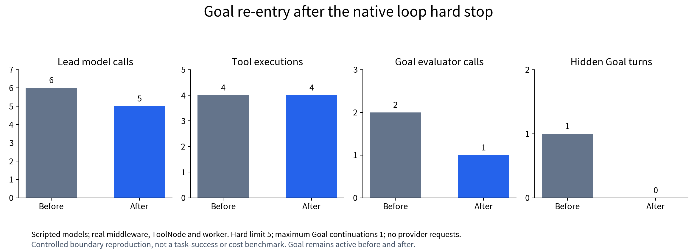
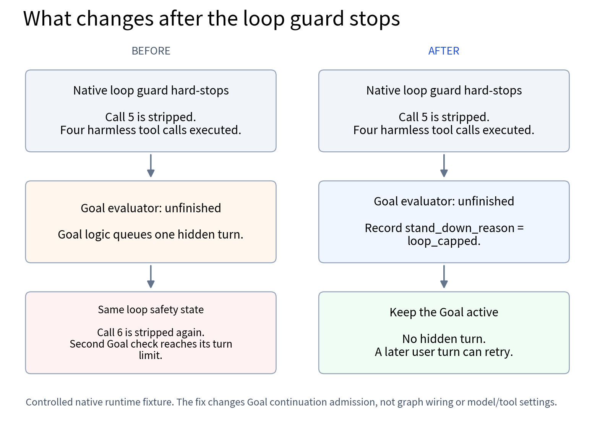
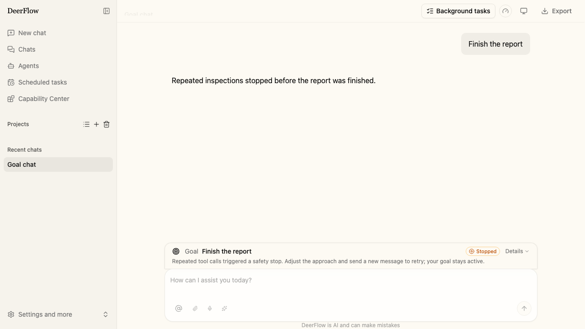

# Goal continuation after a loop hard stop

This offline reproduction exercises the native loop guard, LangChain graph and
ToolNode, Gateway worker, in-memory run/event stores and checkpoints. The model
always requests the same harmless marker inspection; the Goal evaluator always
reports the synthetic task unfinished. Neither model calls a provider.

On the affected main commit `1fd266e0c03e1d998918990727de43769136e7f6`, an unmet Goal
starts another hidden turn after the loop guard has already stopped the run.
Adding `loop_capped` to the existing Goal stand-down condition prevents that
re-entry and keeps the Goal active for a later user turn.

## Recorded result

| Observed count or state | Before | After |
| --- | ---: | ---: |
| Lead model calls | 6 | 5 |
| Actual tool executions | 4 | 4 |
| Goal evaluator calls | 2 | 1 |
| Hidden Goal continuations | 1 | 0 |
| Goal state | active | active |
| Last Goal stand-down reason | max_continuations_reached | loop_capped |
| Run stop reason | loop_capped | loop_capped |





The fixture deliberately sets the identical-call hard limit to 5 and the maximum
Goal continuations to 1. Both chat-only runs retain the existing run status
`success`; that status does not establish Goal achievement. The fifth repeated
call is stripped by the real middleware, so only four tools execute. Before the
fix, the sixth call is stripped again in a hidden turn.

These are deterministic boundary observations, not real-model task success,
latency, token pricing or an estimate of production incident frequency.

## Run

From `backend/`, with the repository's locked environment installed:

```bash
uv run --locked python -m scripts.benchmark.goal_loop_stop --output /tmp/goal-loop-stop.json
uv run --locked pytest tests/test_goal_loop_stop_probe.py tests/test_goal_worker.py -q
```

The reproduction creates temporary storage and no sandbox/container, shell tool,
Gateway server or background service. It replaces only the evaluator provider
factory with a scripted evaluator; Goal decisions and the loop guard are native.

To compare the affected source and this fix, start from a checkout containing
this reproduction, at the repository root:

```bash
git worktree add --detach ../goal-loop-before 1fd266e0c03e1d998918990727de43769136e7f6
cp -R backend/scripts/benchmark/goal_loop_stop ../goal-loop-before/backend/scripts/benchmark/
(cd ../goal-loop-before/backend && uv sync --locked && uv run --locked python -m scripts.benchmark.goal_loop_stop --output /tmp/goal-loop-before.json)
(cd backend && uv run --locked python -m scripts.benchmark.goal_loop_stop --output /tmp/goal-loop-after.json)
```

Only the reproduction module is copied into the affected checkout; its runtime
source is left unchanged. The locked dependency manifests are the same in both
recorded runs: Python 3.12.13, LangGraph 1.2.9, langgraph-checkpoint 4.2.0 and
LangChain 1.3.14 on macOS arm64.

## User-facing stop reason

The browser regression checks both ordinary and custom-agent chat pages, including
a reload, against mocked Gateway responses. The production frontend renders the
localized stop reason and retains the active Goal; this is separate from the
native worker reproduction above.



## Investigation context and scope

This follow-up came from our completion/delivery investigation. In the earlier
12-unit real-task comparison (three task types, two repetitions per arm), the
ordinary runtime qualified in 4/6 units and the broader experimental intervention
in 1/6. All failures were retained. That experiment did not support adopting the
broader intervention, so this fix isolates a separately reproduced native Goal
control-flow problem.

Our earlier [Goal investigation (#6555)](https://github.com/bytedance/deer-flow/issues/6555)
also found evaluator replays returning both `run_failed` and `goal_not_met_yet`
after a loop stop. This fix makes an unmet Goal respect the explicit hard stop
without depending on which of those blocker labels the evaluator chooses.

The historical A/B figures are background, not validation of this patch. This
change introduces no step-budget middleware, warning prompt, tool-schema rewrite,
automatic file presentation, provider integration or dependency upgrade.
Satisfied Goal candidates still go through the existing delivery and persistence
checks; other blockers and unclassified stop reasons keep their existing behavior.

## Data

- [Before](evidence/before.json), [after](evidence/after.json), and [CSV counts](evidence/comparison.csv)
- [Source/version provenance](evidence/provenance.json)
- [Historical investigation summary](evidence/investigation-context.json)
- Figures: [call counts](figures/call-counts.png), [flow](figures/flow.png)

All committed results are synthetic counts and non-secret version/source metadata.
They contain no provider requests, credentials, user messages or production logs.
