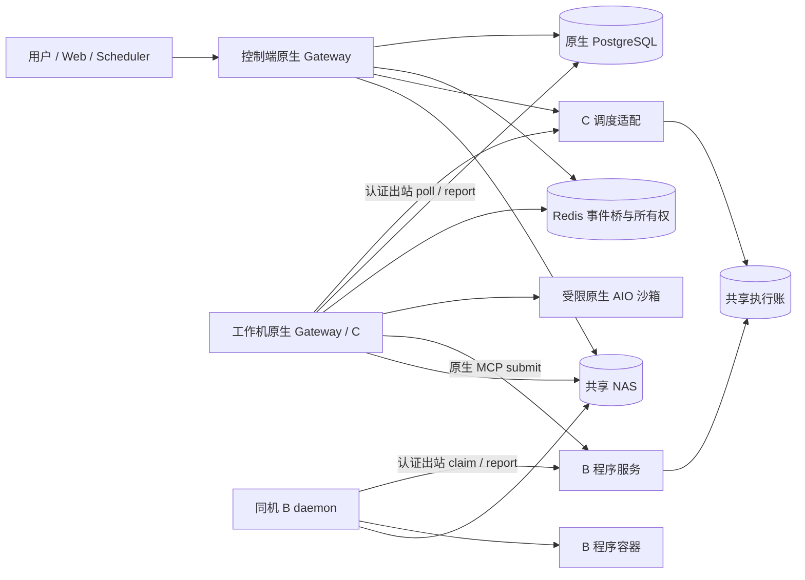

# 原生 DeerFlow ECS 工作池架构

更新：2026-10-09。本文对应 `codex/ecs-native-reuse` 的实际实现。B 主干及 C 执行部分已通过本地验证和独立审查；C→B→C 依赖合同已通过本地主干与独立审查。原生 Scheduler 已通过真实自动派发组合主干与独立审查；原生记忆共享与本地索引也已通过真实主干及独立审查；完整浏览器、fork 合并、运维及云验收仍待完成。本文不是部署完成声明。

## 需求与职责

B 和 C 可以共存，共用节点和资源账。B 执行程序；C 执行完整原生 Agent。C 可以提交 B，在外部工作期间结束当前执行，再由结果事件继续原目标。

| 需求 | 原生能力 | 本次补充 |
| --- | --- | --- |
| 用户、会话、权限、文件展示 | users、threads、artifact API、NAS 目录 | 签名身份传递、输入快照、输出发布 |
| B 长任务跟踪、轮询、通知 | McpTaskService、ordinary MCP driver、mcp_tasks | 持久程序队列、Docker 执行及物理清理 |
| C 推理、工具、checkpoint、事件、取消 | Gateway、RunManager、run_agent、PostgreSQL、Redis | 排队、pending Run 所有权交接、纯出站执行接点 |
| 目标评估和预算 | GoalState 与原生目标运行逻辑 | 依赖关联、有效性判定及原生通知准入 |
| 机器池容量 | 原生子系统各自限流 | B/C 共用 CPU、内存、并发资源预留 |

不新增第二套 Agent 图、checkpoint、用户会话或目标评估器。执行账记录物理工作；原生数据库记录用户任务和 Agent 生命周期。

## 拓扑

控制端可以承载 PostgreSQL、Redis、原生 Gateway、前端及 B 服务。工作机承载原生 Gateway 和 B daemon，两者使用不同节点锁，通过同一执行账做准入。控制端不主动连接工作机来启动任务。正常数据库、Redis 和 NAS 连接仍是工作机必需的共享基础设施。

固定节点、profile、镜像、资源上限和凭据由操作者配置。模型不能指定机器、突破资源限制或提供可信用户身份。最小测试部署为一台 2c8g 控制端、一台 2c4g 工作机；这不是生产容量建议。

## B 主干

1. 原生工具调用携带签名的 user/thread/incarnation/run 身份与参数摘要。
2. 程序服务持久保存 staged 执行记录，返回远程 handle。
3. 原生 McpTaskService 先保存本地任务，再通过首次签名 status 激活 queued。
4. 出站 B worker 在共享容量事务中取得 assignment，持久写入 start intent 后启动受限 Docker 容器。
5. 输入引用先在 owner/incarnation 保护下形成不可变快照；输出检查后原子发布到原生 outputs 目录。
6. 原生任务轮询读取结果并走现有通知和文件展示。取消只有在物理 STOP 得到确认后才能报告成功。

程序容器使用操作者允许的镜像、非 root 用户及 CPU/内存/PID 限制。网络默认 none；网络名称必须显式允许。失败清理保存 cleanup_pending，由所属节点重试。

## C 主干

1. 控制端完成正常权限、输入规范化及原生 Run 准入，创建唯一 pending Run。
2. 调度适配保存执行快照和队列映射，将原生 owner 从控制端 CAS 交给 dispatch owner。
3. 同一线程 incarnation 的后续执行保持固定节点 affinity。工作机认证出站获取短期、参数绑定的启动能力。
4. 工作机重新检查原生身份、线程 incarnation、目标和权限，CAS 接管同一个 pending Run。
5. 执行现有 execute_admitted_native_run / run_agent，直接使用原生 checkpoint、事件、所有权 heartbeat 与取消机制。
6. 另一实例可以读取结果和事件。完整 native task finalizers 完成后释放动态执行额度；取消额外要求精确沙箱物理 STOP。

请求级 secret 使用原生 Fernet 加密机制绑定 owner/thread/incarnation/run/node，仅在工作机内存恢复；持久 config 和 API 保持脱敏。工作机不能靠已有快照恢复新的权限。

排队租约在原生 orphan recovery 前续期。无法认证联系控制端时，工作机启动失败，不能绕过恢复规则。已持久 start intent 的未知工作不重放，也不因租约过期就释放容量。

停机先关闭新 claim/adoption，再由原生 manager 排空。清理观察器只处理已接管任务的 abort/interrupt；它不能创建新 run。物理清理使用 120 秒有界等待，未知状态继续保留执行预留和节点锁。

## 工作机资源账

| 项目 | CPU | 内存 | 释放条件 |
| --- | --- | --- | --- |
| Gateway 常驻预算 | 500m | 1024 MiB | 进程停止 |
| 原生 AIO 常驻预算 | 1000m | 1024 MiB | 常驻分配停止 |
| C 动态执行预算 | 500m | 1024 MiB | 原生任务完整收尾；取消还需物理 STOP |
| B 程序预算 | profile 配置 | profile 配置 | 所属容器停止被确认 |

2c4g 节点配置 max_concurrency=1。B/C 共享预留，不能各自认为独占余量。原生 AIO replicas=1 加 hard_capacity，创建前检查真实 Docker 数量；销毁未知则阻止新增。健康沙箱可以保温，保温仍计入常驻预算。C 动态额度释放不表示保温容器已销毁。

本地已检查 AIO 的实际 Docker 限额。Linux 上 Gateway 的 500m/1GiB cgroup 限额尚须部署脚本及云/容器环境验证。

## C→B→C：原生依赖合同

当前 C 提交 B 后，需要持久保存原生任务成员和目标 identity/revision，在 checkpoint、工作区及完整原生收尾后释放可释放额度。B 结果经原生 McpTaskService 的既有通知通道触发一次有效续跑。

目标、线程 incarnation、用户取消、新消息及累计预算必须重新校验；重复事件不能创建竞争 run。等待 B 时也必须保留原生 Scheduler occurrence 的 overlap 保护。最新实际组合主干通过：1 passed / 142.71 秒，检查同节点、真实 C 收尾在 B 启动之前、B attempt=1、两个原生 Run、原目标预算及文件交付。定时任务接点有原生运行时和 SQL 合同验证；SPEC 与质量复审通过，冻结代码相关回归 282 passed；完整 Scheduler 配置验收见下文实际自动派发主干。不能把此证据视为完整功能已交付。

## 扩展边界与后续同步原仓库

原生 plugins 可注册 middleware、任务生命周期、Gateway 服务及 HTTP 路由；B 使用公开 MCP 接口。目前 ECS 是独立包加必要核心接点，尚未全部转成可安装插件。公开扩展 API 不直接覆盖 pending Run 所有权交接、目标收尾及 Scheduler occurrence 转移，不能用 monkeypatch 冒充稳定接口。

节点、资源、物理执行、签名传输和依赖业务留在 ecs-executor；核心仅保留可选准入、可信 RunContext callback 和必要原生仓库合同。关闭 ECS 配置时保留普通原生路径。后续公开接口应单独版本化并提供兼容默认值。

同步方向是原仓库更新 → 本地集成分支 → 用户自己的 GitHub fork 主干 → 用户 Gitee 仓库。我们不假设有原作者主干写权限；向其贡献 PR 需要另行授权。每次同步处理必要接点与迁移兼容，再复验原生、B、C、组合主干，保留用户无关改动，不覆盖整个 fork。未来更新不保证零冲突。本轮不推送远程。

## 尚待验证与交付

原生浏览器在多实例下有明确启动限制。需提供正确的会话 affinity 和 HTTP/WS 控制路由，不能仅删除限制或静默关闭浏览器。记忆需要共享事实文件、跨进程锁和每实例本地检索索引；Scheduler 需要共享租约及工作机准入。

fork 迁移、旧 Fleet 数据处置、版本回滚、可复用启动/停止脚本和部署/测试记录仍属交付范围。两台上海 ECS 保持用户要求的停机状态；本轮没有部署或推送。

关联：[库表文档](ecs-native-database.md)、[实现计划](superpowers/plans/2026-10-08-ecs-native-reuse-implementation.md)、[证据与审查记录](superpowers/plans/2026-10-08-ecs-native-reuse-audit-notes.md)。

## 原生 Scheduler 的执行端角色

控制端运行原生 ScheduledTaskService 的后台恢复、领取和派发。工作机保持 scheduler.enabled/tool_enabled/multi_instance，并由可信 NativeWorkerHost 设置 scheduler_dispatch_enabled=False；原生服务的 dispatch_enabled 默认 True，无 ECS host 时仍沿用原行为。

工作机前台 schedule_task/stop_scheduled_task 和完成回调保持可用；manual trial/trigger 写入同一原生持久 occurrence 队列，由控制端处理。is_running 表示本地 poller，is_available 表示前台能力；停止服务会清除前台 readiness。角色不由模型参数或请求 context 决定。用户 UI 入口仍为控制端。

实际自动 once 定时 C→MCP B→C 主干通过：1 passed / 72.92 秒，保留同 occurrence、一次计数、原目标预算和原生文件交付。SPEC 与质量审查 PASS。浏览器、fork 运维和云验收仍待完成；原生记忆验收见测试文档。
