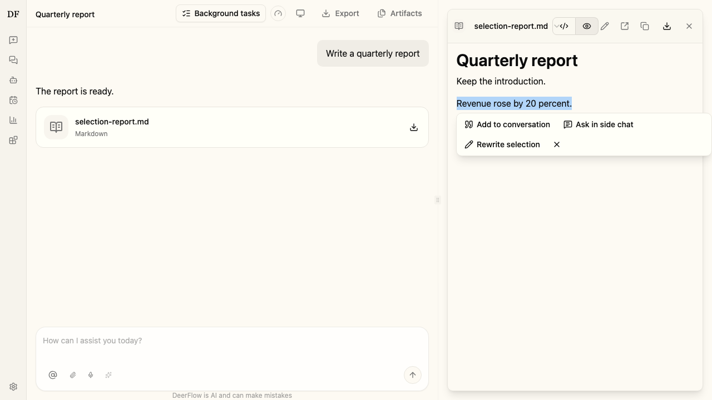
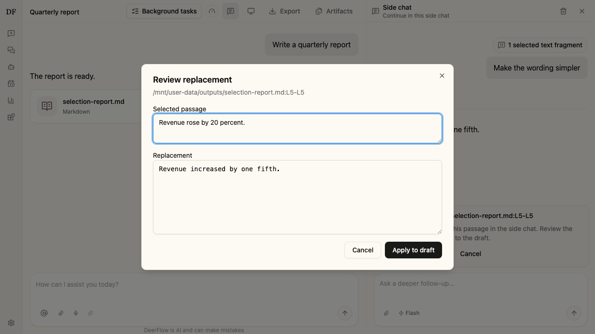

# File attachments and previews

## Attachments and downloads

Attachments show individual ready, uploading, uploaded, failed and cancelled states.
Failed uploads retain per-file error details; session-state messages remain localized.
Retry a failed file or remove it before sending again; successful uploads and the
message draft are retained. File cards share format icons and preserve extensions
in long filenames. Sent attachments open in the right-hand artifact panel.
Single-file downloads show preparation and retry feedback while preventing duplicate
requests. Unsupported formats offer the original file for download.
Public Showcase files keep their standalone viewer and download controls available
without requiring sign-in.

Deployments can add binary readers through the optional `artifactPreviews` browser
contribution; see the [plugin contract](../full-stack-plugins.md#artifact-previews).

## Quote and rewrite a passage

Select text in a Markdown artifact or its source editor to open the selection
toolbar. **Add to conversation** attaches the passage to the main composer;
**Ask in side chat** opens a follow-up alongside the conversation. Both carry
the selected text and file path, plus the source line range when available. You can
add several quotations before sending your question. Assistant replies already
offer the same two quotation actions.

For a writable output file, **Rewrite selection** opens side chat with that
passage. Describe the change and choose **Rewrite selection** in the side-chat
composer. Use the regular send action to ask a question about the passage and
end the pending rewrite. Once the rewrite finishes, choose
**Review replacement**, inspect or adjust the proposed text, and choose
**Apply to draft**. This replaces exactly the selected source range and opens
the file's editor. **Save** publishes the draft using the existing revision
check. Everything before and after the selected range stays unchanged.

The edit survives switching from the artifact panel to side chat. Changing
the draft, changing its saved revision, or starting a run prevents stale edits
from being applied or saved. Edits stay in memory for the current conversation;
switching conversations or discarding the side chat clears the pending rewrite.
Nothing writes to the file until you explicitly save it.

Selections support up to 12,000 characters. Markdown may hide formatting markers,
so a rendered selection is rewritable only when the renderer can verify its
exact source range. For other selections, quote the passage or switch to
**View source** to choose an exact range. HTML and CSV/TSV use source selections;
binary previews do not expose text selections. Truncated previews can be quoted
but require **Load full file** before rewriting. Read-only artifacts, demos,
and files outside the output directory cannot be rewritten.

## Office artifact preview extension

The optional [Office preview package](../../examples/deerflow-extension-office-preview/README.md)
adds read-only XLSX, DOCX and PPTX readers with search, worksheet/page navigation,
Word outlines, PowerPoint thumbnails and per-file reading preferences. It requires
the artifact-preview host contribution and operator installation; it is not enabled
by a catalog entry alone. Legacy binary Office files retain the download fallback.
Previews also work over LAN HTTP. Reading preferences use the file's ETag when
available, with an optional content hash on secure origins; without either, files
still open but reading preferences are not restored.
Office preview validates ZIP metadata before loading, prepares files in a cancellable
Worker with a deadline, and limits XML/layout and image sizes before DOM rendering.
Word XML/model preparation and PPT conversion run in that Worker; the UI receives
bounded models with images and document relationships preserved.
Files exceeding preview budgets retain the original-file download fallback.

See the [Office package guide](../../examples/deerflow-extension-office-preview/README.md)
for installation, supported formats, resource limits and validation commands.
