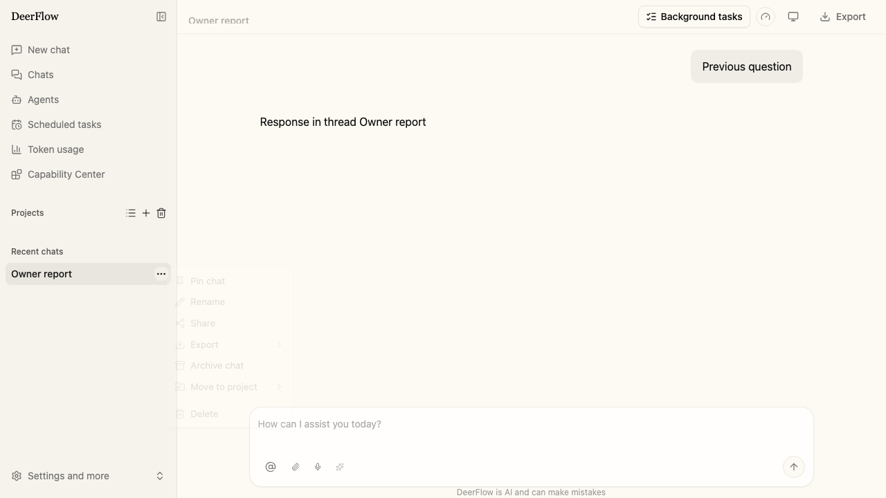
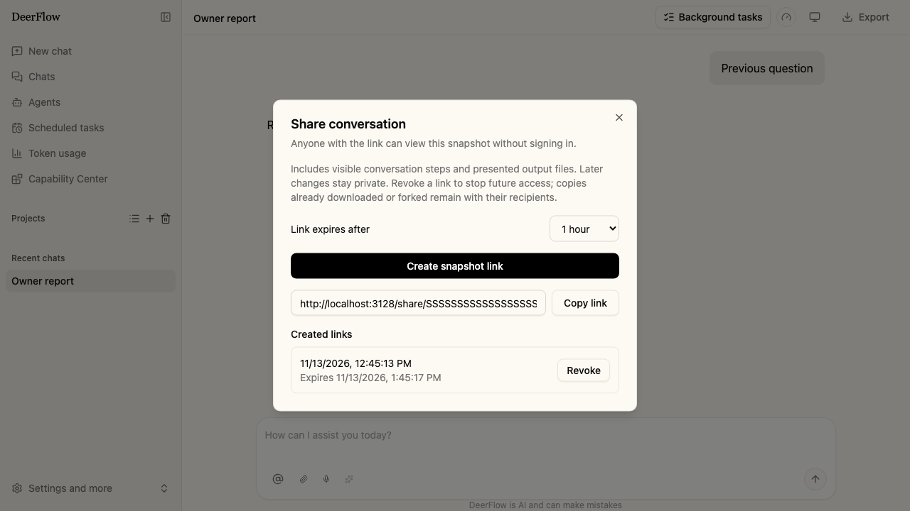
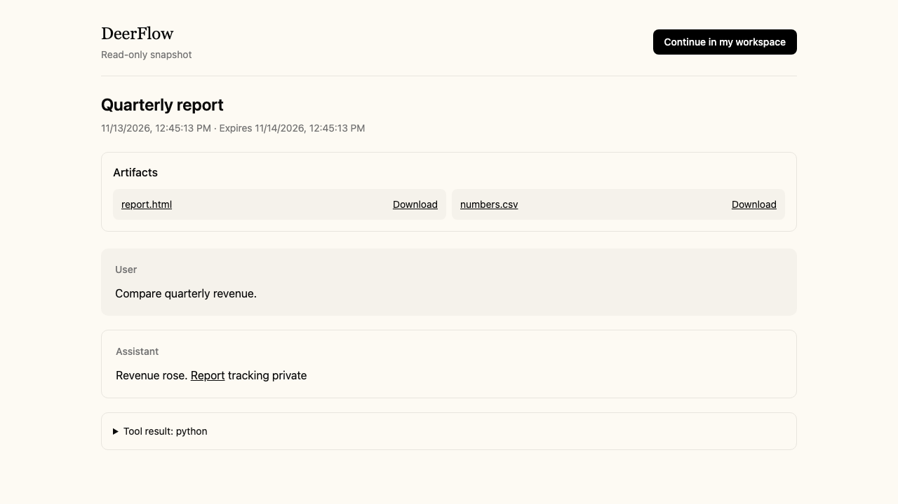

# Share a conversation snapshot

Open a conversation's sidebar menu, choose **Share**, select an expiry, then
choose **Create snapshot link**. Copy the generated `/share/<token>` URL. Anyone
with that link can read the snapshot without signing in. The dialog lists your
links and lets you revoke them. Revocation and expiry stop subsequent reads,
file downloads and imports; recipients keep copies they already downloaded or
imported.

The snapshot contains the visible conversation history and the output files
presented as artifacts at creation time. Later messages and file edits do not
change it. Uploads, hidden messages, system prompts and execution metadata are
excluded. Tool result text is included, so review the conversation before
sharing it. A source conversation must have finished its current turn. Deleting
the source conversation also makes its links unavailable.

The shared page has no composer or source workspace controls. It previews
Markdown, text, CSV/TSV, images, PDF and static HTML; other files are available
for download. Text previews show at most 512 KiB. HTML scripts, forms and network
requests are blocked. The page rechecks availability on return and every
30 seconds while visible.

Choose **Continue in my workspace** to create an independent conversation with
copied history and output files. Visitors sign in first and return to the shared
page. The copy uses their default agent and permissions. It does not inherit the
source's agent, project, sandbox, uploads, tool calls or credentials. Tool results
are imported as historical assistant text. The copied conversation remains
usable after the source link is revoked.

## Deployment and limits

Sharing requires SQLite or PostgreSQL persistence. The Gateway's startup
migration creates the share tables. Both the transcript and file bytes are
stored in the database, so backups include shared content and all Gateway workers
read the same frozen bytes. No separate public object store is required.

Links expire after 7 days by default; the supported range is 1 hour to 30 days.
A conversation can have 10 active links. Each snapshot allows 10,000 visible
history rows, 10 MiB of transcript JSON, and 64 artifacts, with limits of 20 MiB
per file and 100 MiB total. Exceeding a limit rejects the whole snapshot. Revoking
a link deletes its stored transcript and file bytes. You can revoke an expired
link from the same dialog to remove its stored copy.

Treat share URLs as access credentials, including in proxy access logs. The
server stores only a hash of the random token; a token is returned once on
creation. Public responses disable caching, referrers and search indexing.

## API contract

All paths below are relative to `/api`.

| Method and path | Access and behavior |
| --- | --- |
| `POST /threads/{id}/shares` | Owner with `threads:write` and `runs:read`; creates the snapshot. Body: optional `expires_in_seconds` and `checkpoint_id`. Returns `201`, token and snapshot coordinates. |
| `GET /threads/{id}/shares` | Owner with `threads:read`; returns up to 100 link summaries, with active links first and expired links awaiting cleanup before revoked links. Tokens are never listed. |
| `DELETE /threads/{id}/shares/{share_id}` | Owner with `threads:write`; revokes access and removes stored snapshot bytes. |
| `GET /shares/{token}` | Anonymous capability read; returns visible messages, artifact manifest, checkpoint and sequence. |
| `GET`, `HEAD /shares/{token}/artifacts/{path}` | Reads only a copied manifest entry. Supports byte ranges and `?download=true`. |
| `POST /shares/{token}/fork` | Signed-in visitor with `threads:write`; body contains a UUID `request_id`. Returns the new `thread_id`. Retrying the same request reuses a completed import. |

Creation captures the latest idle root checkpoint and its persisted visible
history under exclusive thread admission. `checkpoint_id`, when supplied, is
an expected-head guard: a stale value returns `409`. Older checkpoints cannot
be selected because the source filesystem does not retain file versions for
historical checkpoints. The response binds the snapshot to the captured
checkpoint and highest visible history sequence.

Expired, revoked and unknown tokens all return `404`. A running conversation or
stale checkpoint returns `409`; size limits return `413`; SQL-disabled servers
return `503`. Share tokens only authorize the two public read routes. They never
authorize thread mutation, execution, or access to the original file tree.
