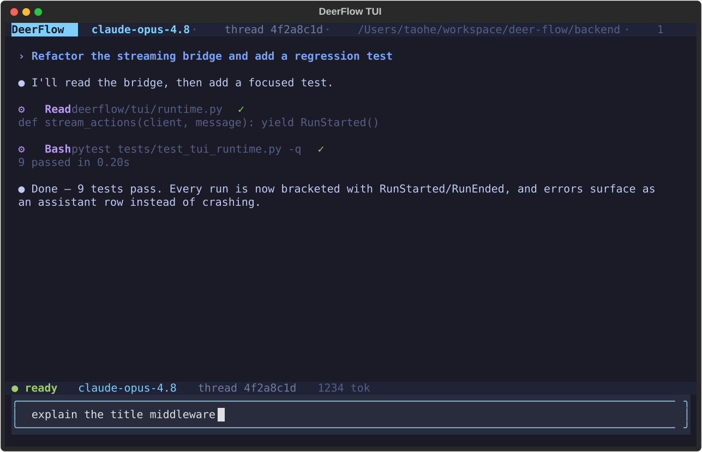

# Terminal Workbench (TUI)

`deerflow` is a terminal-native workbench for people who live in the shell. It runs **embedded** over `DeerFlowClient` — no Gateway, frontend, nginx, or Docker required — while honoring the same `config.yaml`, checkpointer, skills, memory, MCP, and sandbox settings as the rest of DeerFlow.

Parallel synchronous stdio MCP calls use independent sessions on their own event
loops. They do not cancel each other's connections, but they do not share
server-side state; session reuse requires the same loop. See the
[MCP session notes](../../backend/docs/MCP_SERVER.md) for details.
Manually managed event loops must drain pending session owners before closing;
the normal `asyncio.run()` path does this automatically.



```bash
uv pip install 'deerflow-harness[tui]'        # optional 'textual' dependency

deerflow                                      # launch the terminal UI (TTY required)
deerflow --tui-transparent                    # use the terminal's default background
deerflow --continue                           # resume the most recent thread
deerflow --resume THREAD                      # resume a thread by id
deerflow --print "summarize this repo"        # headless one-shot answer to stdout
deerflow --json  "hello"                       # headless newline-delimited StreamEvents; failure -> one {"type": "error"} record, exit 1
deerflow --recursion-limit 250 --print "task" # override the headless agent-loop limit
```

Headless `--print` and `--json` exit with status `1` when the run fails, including provider errors returned as fallback messages. `--print` still writes the fallback text to stdout; `--json` appends a terminal error record.

A keyboard-driven chat surface with a streaming transcript (Markdown-rendered answers), compact tool-activity cards, a `/` slash-command palette, display-only `/clear`, `/goal` goal management, `/model` and `/threads` pickers, input history, PageUp/PageDown transcript navigation, and `Esc` / `Ctrl+C` interrupt. The composer preserves line breaks and indentation in pasted code, stack traces, and multi-paragraph prompts; `Enter` sends the complete document. Transcript refreshes preserve your reading position after you scroll upward and resume following new output when you return to the bottom. `/clear` removes rows from the current terminal display without deleting the thread or its persisted conversation; `/new` and `/clear` ask you to wait during an active run instead of resetting in-flight display state. Sessions opened in the TUI also appear in the Web UI sidebar — it writes the shared thread store under the local default user, so terminal and web stay in sync **without running the Gateway**.

TUI slash commands accept Unicode whitespace before their arguments, including
spaces, tabs, line breaks, and nonbreaking spaces. A separator closes the slash
palette so Enter submits the composed text. Pasted skill tasks can start on the
next line; their internal line breaks and indentation are preserved.

During an active run, `/resume`, `/threads`, and `/switch` ask you to wait before
switching conversations. An invalid `/resume` reference displays an error without
closing the TUI or changing the current conversation.
After an interrupt, late stream actions from the previous run cannot change the
next run's display or status, even when both prompts use the same conversation.
A tool call already in progress still finishes, so until it does a new prompt in
that conversation is held back with a notice instead of racing it; `/new` and
`/resume` stay available. Quitting waits for that step as well and closes the TUI
once it finishes; press `Ctrl+C` again to quit at once without saving it.
If a run cannot start, the TUI reports an error and returns to idle so you can retry.
A message that is held back or cannot start stays in the composer, so `Enter` resends it.

At the last composer row, `Down` leaves an unsent draft untouched unless you are
browsing input history; after recalling history, it moves forward to restore your
saved draft.

At the first composer row, `Up` also leaves the draft, cursor, and undo history
untouched when no input history is available.
Recalling identical history text or a saved draft also preserves the cursor and
undo history.

Thread visibility and title updates remain best-effort. If a database update times out,
the TUI requests cancellation of the pending update; already committed writes are not rolled back.

See [backend/docs/TUI.md](../../backend/docs/TUI.md) for the full guide.
