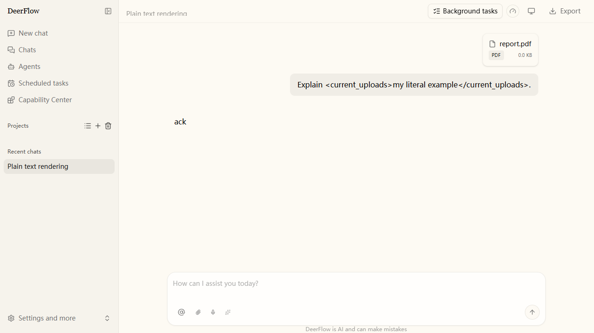

# Upload context and user messages

Upload descriptions must reach the model without becoming part of the user's
stored prose. New upload turns store the validated description on the owning
`HumanMessage`:

```json
{
  "content": "Explain <current_uploads>my example</current_uploads>",
  "additional_kwargs": {
    "files": [{"filename": "report.pdf", "size": 24}],
    "deerflow_upload_context": {
      "version": 1,
      "text": "<current_uploads>…validated file descriptions…</current_uploads>"
    }
  }
}
```

`files` remains the attachment-display and upload-admission input. The Gateway
removes caller-supplied `deerflow_upload_context`; only `UploadsMiddleware`
captures it after validating the references against the runtime owner's uploads.
Existing file-count limits, outline bounds and filename/outline sanitization
continue to apply. This changes neither upload authorization nor file storage.

## Model and persistence boundaries

`InputSanitizationMiddleware` sanitizes and frames the user's original content
first, then projects the context ahead of it on a request-only copy. Native media
blocks retain their values and order. Projection preserves message IDs and does
not append a hidden sibling message, so normal replacement, deletion, checkpoint
replay and compaction manage the context together with its owning turn.

The copied envelope carries `projected: true` for nested-wrapper idempotence.
It is transient: UI/run-journal restoration removes that flag and restores the
user text. Never copy a projected request back into graph state. Model-facing
copies and persisted messages must not share mutable content blocks.

Summary token counting and summary prompts project the same context before
trimming. Parent conversation snapshots include it as inert historical data,
not child system instructions. Memory admission removes the context metadata;
file outlines are not durable user memory.

## Display and compatibility

For a supported version-1 envelope with a string `text`, the human content is
already user data. Chat rendering, editing/copying, conversation outlines and
Markdown/JSON exports do not remove tag-like text from it. Internal context is
never included in the export's selected fields. Attachment chips still use
`additional_kwargs.files`.

Unversioned historical messages keep the existing inline-tag cleanup and legacy
file-chip fallback. Unsupported or malformed metadata does not opt a message out
of that containment; backend projection ignores it with a warning. Assistant and
hidden framework-message filtering retain their existing rules.

There is no bulk migration of old checkpoints. Recapturing an old upload turn
can restore its explicit `original_user_content` provenance before recording a
new envelope; it never guesses which part of the user's text is internal.
Other internal-context producers remain outside this upload-specific change.



## Verification

`backend/tests/test_structured_upload_context.py` exercises capture, sanitization,
checkpointed sync/async agent replay and deletion, journal restoration, summaries,
delegation snapshots, memory admission and forged Gateway metadata without live
model calls. Existing upload-admission tests continue to exercise owner isolation
through a real agent graph. Frontend coverage pins literal examples, legacy
cleanup, export and conversation grouping; the plain-text Playwright suite checks
the rendered bubble and file chip.
