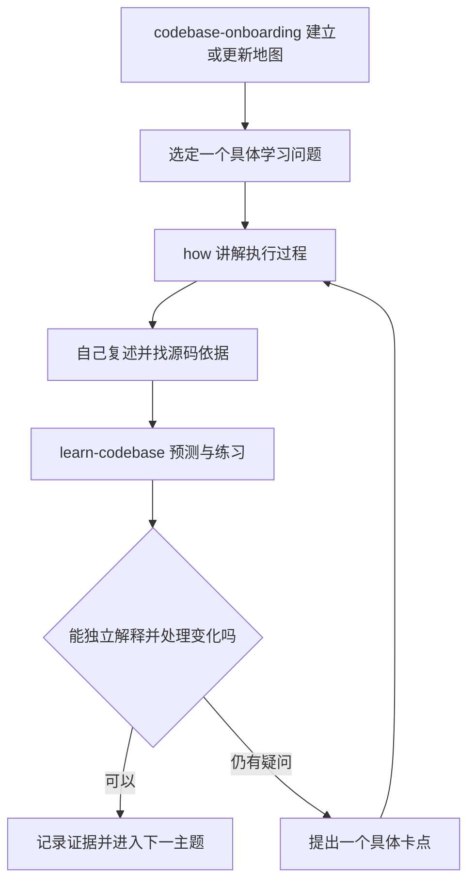

# 使用三个 Skill 学习 DeerFlow

当前日常入口已简化为“开始学习”和“结束今天的学习”，由助手组织三个技能。唯一学习安排见[核心源码阅读路线](DeerFlow核心源码阅读路线.md)，进度见[学习日志](../learn-codebase-journal.md)。下文仅为手动调用技能的参考，不是另一套学习计划。

适用背景：熟悉 Python 和后端开发，希望先理解 DeerFlow 架构，再选择二次开发方向。更新日期：2026-10-13。

推荐顺序是：**用 `codebase-onboarding` 建立项目地图，用 `how` 讲清一个模块，再用 `learn-codebase` 检查自己能否解释和应用。** 每次学习围绕一个具体问题，最后留下自己的复述、源码依据和下一步。

这三款技能安装在 Codex 中，用来帮助你阅读本地 DeerFlow。DeerFlow 应用自己的 Skills 则由它的运行时加载，属于另一个使用场景。

## 三个技能分别负责什么

| 技能 | 解决的问题 | 你需要提供什么 | 应得到的结果 | 使用时机 |
| --- | --- | --- | --- | --- |
| `codebase-onboarding` | 项目有哪些层次，从哪里开始读，改功能应该去哪里 | 当前仓库、学习目标、关注范围 | 有源码依据的架构地图、请求链路、少量阅读入口 | 首次进入项目，或架构发生较大变化时 |
| `how` | 某个功能到底怎样工作 | 一个函数、模块或执行场景 | 输入输出、调用过程、状态变化、关键分支和源码位置 | 学习新模块，或被具体实现卡住时 |
| `learn-codebase` | 我是否已经理解，能否独立运用 | 本次主题、可用时间、自己的预测和回答 | 提问、分级提示、小练习、掌握程度和学习日志 | 日常学习、复习和阶段验收 |

`codebase-onboarding` 默认把概览输出到对话；需要保存时，明确给出目标文件。`how` 的 Explain 模式用于解释，其 Critique 模式用于架构评审。你现在以 Explain 为主。

`learn-codebase` 已适配 Codex，并保留手动触发设置：学习时明确写 `$learn-codebase`。原有模板和提问参考文件已保留。`how` 会使用子代理进行只读探索，跨模块问题可能涉及多个子代理；控制好问题范围即可，不需要另外创建多个聊天。

## 怎样开始和切换

在当前 DeerFlow 项目的 Codex 聊天中发送提示词。下面代码框中的内容都是聊天提示词，不是终端命令。每次以一个技能为主，分几条消息完成交接。



熟悉的主题可以直接从 `learn-codebase` 开始检查，遇到卡点再调用 `how`。不需要每天重新生成全仓库地图，也不需要在一条消息里要求三个技能同时完成全部教学。

### 第一次建立项目地图

复制以下提示词：

```text
$codebase-onboarding

请以当前本地 DeerFlow 工作区为准，用中文建立学习地图。
我熟悉 Python 后端，目标是理解架构后做二次开发。

先读根目录和相关模块的 AGENTS.md，重点说明：
1. App 与 Harness 的职责和依赖方向。
2. Web 消息从提交、创建 Run、执行 Agent 到 SSE 返回的主要链路。
3. Agent 组装、工具、状态和沙箱分别在哪里。
4. 最多 8 个阅读入口，每个入口给出一个需要回答的问题。

关键结论附源码路径和符号；区分代码确认、文档说明和待验证行为。
结合核心源码阅读路线检查已有地图，避免重复堆积内容。
把本轮地图保存到 learning/deerflow-book/架构地图.md；若已存在则核对后更新。
本次只授权学习地图的写入，保留业务源码和项目指导文件。
```

地图完成后，你先用自己的话说清三个问题：哪些进程在运行，App 与 Harness 怎样分工，一条消息的执行大致经过哪些组件。答不出来的部分，就是下一次 `how` 的主题。

### 让 how 解释一个具体模块

```text
$how

请用 Explain 模式讲解 DeerFlow 的 make_lead_agent。
沿实际源码说明模型、工具、中间件、提示词和 state_schema
如何被收集并传给 create_agent。

我是熟悉 Python 的后端开发者。先给一张小图，再解释关键步骤。
每一步附实际文件和函数名，优先讲默认路径，再选一个有代表性的分支。
把源码事实与对设计意图的推测分开，控制在本次主题内。
```

听完后，你向 AI 复述，例如：“我理解这里主要是组装 Agent，真正执行发生在运行时。模型和工具分别从……取得。”让它指出你的复述与源码不一致的地方。

### 交给 learn-codebase 检查理解

```text
$learn-codebase

继续当前 DeerFlow 项目，检查我对 make_lead_agent 的理解。
我刚看过 how 的讲解，请复用本轮上下文。

每次只问一个问题，先等我回答，再给反馈。
围绕输入、组装过程、返回值和一个变化场景提问。
如果我卡住，先给提示；仍不会时解释，并用一道相似题检查迁移能力。
允许我查源码，但先让我说出预测和理由。

把进度写入 learning/learn-codebase-journal.md。
区分“看过讲解”“有提示完成”“独立完成”，按实际表现记录。
```

你最重要的配合是交出自己的判断。即使不确定，也可以回答“我猜是 X，因为看到 Y；不确定的是 Z”。这能让下一轮提示针对真正的卡点。

## 一次学习怎样安排

下面是一个 40 分钟的示例，可以放进现有项目学习时段，不额外叠加一套日程。一个主题可以持续多次。

| 时间 | 做什么 | 技能和你的配合 |
| --- | --- | --- |
| 5 分钟 | 复习一个上次的概念 | `learn-codebase` 提问，你先回忆，再查源码 |
| 10 分钟 | 解释本次的一个新问题 | 需要时调用 `how`，你标出输入、输出和调用者 |
| 20 分钟 | 预测、追踪、读测试或做小练习 | `learn-codebase` 给反馈，你实际作答或操作 |
| 5 分钟 | 保存证据和停点 | 写下已会内容、未解问题、下次从哪里继续 |

时间较少时，可以只做一个复习题和一个源码追踪题。每次优先完成一个完整的小目标，例如“解释一次工具错误怎样回到模型”，然后保存停点。

## DeerFlow 的推荐学习顺序

按单元推进，每个单元以右侧的可检查结果为准。已有基础的单元先做一次检查，通过后即可跳过重复讲解。

| 单元 | 本地阅读入口 | 用 how 追问什么 | 用 learn-codebase 验收什么 |
| --- | --- | --- | --- |
| 1. 分层与运行入口 | [根指南](../../AGENTS.md)、[后端指南](../../backend/AGENTS.md) | App、Harness、Gateway、Nginx 分别负责什么 | 画出依赖方向，解释为什么 Harness 不应导入 App |
| 2. Agent 组装 | [agent.py](../../backend/packages/harness/deerflow/agents/lead_agent/agent.py)、[prompt.py](../../backend/packages/harness/deerflow/agents/lead_agent/prompt.py) | `make_lead_agent` 最终怎样调用 `create_agent` | 找到模型、工具、中间件、提示词和状态 schema 的来源 |
| 3. 工具与技能 | [工具指南](../../backend/packages/harness/deerflow/tools/AGENTS.md)、[技能指南](../../backend/packages/harness/deerflow/skills/AGENTS.md)、[MCP 指南](../../backend/packages/harness/deerflow/mcp/AGENTS.md) | 工具怎样进入模型可见集合，Skill 怎样参与任务 | 解释模型生成工具参数后由谁执行，以及 Tool、Skill、MCP 的不同职责 |
| 4. 沙箱与执行环境 | [沙箱指南](../../backend/packages/harness/deerflow/sandbox/AGENTS.md)、[sandbox/tools.py](../../backend/packages/harness/deerflow/sandbox/tools.py) | 一次文件读取如何从工具到达实际执行环境 | 追踪路径和 runtime 的作用，说明所用 provider 的隔离边界 |
| 5. 请求与运行生命周期 | [thread_runs.py](../../backend/app/gateway/routers/thread_runs.py)、[services.py](../../backend/app/gateway/services.py)、[manager.py](../../backend/packages/harness/deerflow/runtime/runs/manager.py)、[worker.py](../../backend/packages/harness/deerflow/runtime/runs/worker.py) | 请求如何创建 Run，谁管理运行，谁执行 Agent | 追踪一次正常运行与取消路径，区分 Thread 和 Run |
| 6. 状态与流式事件 | [thread_state.py](../../backend/packages/harness/deerflow/agents/thread_state.py)、[StreamBridge](../../backend/packages/harness/deerflow/runtime/stream_bridge/base.py)、[前端接收入口](../../frontend/src/core/threads/hooks.ts) | 状态如何合并，执行进展怎样到达界面 | 区分状态、Checkpoint、运行事件和 SSE，解释一种刷新或重连场景 |
| 7. 子任务与长期记忆 | [子代理指南](../../backend/packages/harness/deerflow/subagents/AGENTS.md)、[记忆指南](../../backend/packages/harness/deerflow/agents/memory/AGENTS.md) | 子任务生命周期怎样管理，记忆在何时被使用 | 分别画出子任务结果返回过程和记忆使用过程，明确与会话状态的区别 |
| 8. 最小二次开发 | [现有行数工具](../../backend/packages/harness/deerflow/tools/file_stats.py)、[对应测试](../../backend/tests/test_count_file_lines.py)、[扩展示例](../../examples/deerflow-extension-example/README.md) | 一个明确的小需求应该放在哪层，能复用哪些能力 | 独立提出方案、实现一个变化、验证行为并解释取舍 |

当前 Web 路径的 Agent 运行时嵌入 Gateway，`/api/langgraph/*` 经 Nginx 改写为 Gateway 的 `/api/*` 路由。先按本地实现追踪；网上其他版本的目录与服务拆分应重新核对。

学习前端时，第一轮只需理解消息提交和事件接收；深入界面开发时再按[前端指南](../../frontend/AGENTS.md)展开。子任务、记忆和多实例运行的复杂分支也可以在基本链路明确后分别学习。

## 用现有测试验证理解

优先挑一个已有测试，先读输入与断言，预测结果，再执行并解释结果。可从这些文件开始：

- [test_harness_boundary.py](../../backend/tests/test_harness_boundary.py)：依赖方向。
- [test_thread_state_reducers.py](../../backend/tests/test_thread_state_reducers.py)：状态合并。
- [test_tool_error_handling_middleware.py](../../backend/tests/test_tool_error_handling_middleware.py)：工具异常处理。
- [test_run_manager.py](../../backend/tests/test_run_manager.py)：运行管理。
- [test_stream_bridge.py](../../backend/tests/test_stream_bridge.py)：事件发布与消费。

例如，在已安装依赖的当前 Windows 工作区，可以从 PowerShell 运行一个状态测试文件：

```powershell
Set-Location 'F:\harness-learn\deer-flow\backend'
& '.\.venv\Scripts\python.exe' -m pytest tests/test_thread_state_reducers.py -q
```

这是阅读阶段的小范围验证。正式后端功能和缺陷修改，应遵守[后端 TDD 要求](../../backend/AGENTS.md)：先写行为测试，执行要求的 `make test` 和 `make test-blocking-io` 检查，并同步相关文档。单个文件通过只说明它覆盖的场景通过。

你的仓库已有行数统计工具及配套测试，可以用它做复习。先解释为什么模型可见参数与 Python 函数签名不同、模拟读取验证了什么，再判断是否需要增加练习。不要把已有用例重复写一遍当成新功能；真实模型调用、真实沙箱访问与离线单元测试应分别记录证据。

## 卡住时怎样求助

把问题收窄为“哪个输入经过哪个函数后，我不理解哪个变化”。附自己的判断、查看过的位置，以及报错或运行结果。

```text
$how

我在学习 DeerFlow 的 count_file_lines，卡在 runtime 的来源。
我理解模型只提供 path，但 Python 函数还需要 runtime。
请从本地工具定义追踪到实际注入位置，解释普通 .func 调用与框架调用
各自如何提供参数，并给出对应源码和可以验证这一点的测试入口。
```

得到解释后，另发一条 `$learn-codebase`，让它用一个变化场景检查理解。例如：“如果我直接调用原始函数，会不会自动得到 runtime？请先让我预测。”

如果连续两轮提示仍然卡住，可以直接说：“请先用 10 行以内的独立 Python 例子解释，再回到 DeerFlow。”对已有 Python 基础的部分不必重新铺一整套课程。

## 如何保存进度和继续学习

本轮建议用一份学习日志 `learning/learn-codebase-journal.md`。它会在首次实际教学时创建；如你已指定其他日志，就沿用那份。架构地图记录项目事实，日志记录你的表现，两者分工不同。

每个主题至少留下：

| 内容 | 示例 |
| --- | --- |
| 本次问题 | `make_lead_agent` 返回什么，执行发生在哪里 |
| 源码依据 | 实际文件、函数名和当前行号 |
| 我的复述 | 用自己的话解释组装过程 |
| 掌握程度 | 看过讲解 / 有提示完成 / 独立解释 / 独立处理变化 |
| 验证证据 | 回答要点、实际执行的命令、结果及覆盖范围 |
| 下次停点 | 从哪个文件、哪个问题继续 |

日志中的复习日期用于下次打开学习会话时检查，不会自动创建提醒或定时任务。

**结束一次学习时：**

```text
请保存本次学习进度到 learning/learn-codebase-journal.md。
记录我的实际回答、需要过的提示、已验证行为、未解问题和下次停点。
把助手讲解、我的独立理解和运行验证分开记录。
保留历史记录；没有实际执行的命令标为待验证。
```

**下次继续时：**

```text
$learn-codebase

继续当前 DeerFlow 项目的学习，先读取 learning/learn-codebase-journal.md。
今天有 40 分钟，先用一道题复习上次的薄弱点，再从记录的停点继续。
每次只问一个问题，等待我回答后反馈，并按实际表现更新日志。
```

在新的聊天中继续时，先选择同一个 DeerFlow 项目，并提供日志位置。技能文件保存的是教学方法，项目日志保存的是学习进度。

## 怎样判断已经可以开始二次开发

当你能完成以下几项，就可以选一个小需求进入实践，不必等待读完整个仓库：

1. 根据需求判断应改 App、Harness、工具、Skill 还是前端，并说明理由。
2. 找到一个相似实现，追踪输入、输出、运行上下文和错误路径。
3. 提出正常、边界和失败场景的验收条件。
4. 在 AI 提示下完成后，能独立处理一个相近但不同的变化。
5. 用源码、测试或实际运行结果说明结论的依据和覆盖范围。

开始实作时，明确告诉 AI：“现在进入实现练习，请先让我提出修改方案和测试，再给反馈。”`how` 继续负责理解与定位，`learn-codebase` 负责教学反馈；实际修改遵循仓库开发流程。

## 与已有资料怎样衔接

- [核心源码阅读路线](DeerFlow核心源码阅读路线.md)：唯一的目录分类、源码阅读与验证安排。
- [第四章学习记录](ch04_notes.md)：作为已有练习的历史证据，复习时抽取相关内容。

本文按你本次确认的 Python 后端背景和架构学习目标组织。旧资料中的日期、业务方向和学习者背景不自动成为本轮安排；历史记录也不直接等同于现在已经熟练，先用一个小问题检查即可。

技能原始来源：[codebase-onboarding](https://github.com/quokkify/skills/blob/main/skills/repository/codebase-onboarding/SKILL.md)、[learn-codebase](https://github.com/ktaletsk/learn-codebase)、[how](https://github.com/heyimcarlos/agent-skills/blob/main/skills/engineering/how/SKILL.md)。实际使用以已安装版本和你的明确指令为准。
