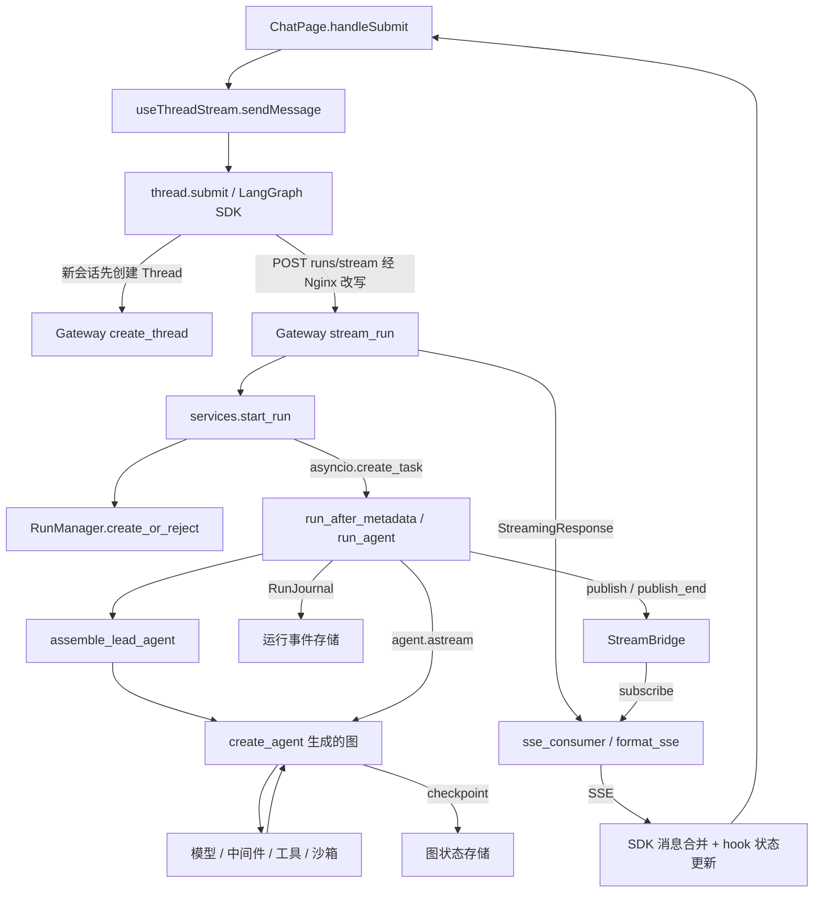

# DeerFlow 架构学习地图

核对日期：2026-10-13。工作区：`F:\harness-learn\deer-flow`；Git HEAD：`99367100`，包含本地未提交改动。本文以本轮读取的工作区文件为准，HEAD 不能单独代表这些文件的内容。面向熟悉 Python 后端、准备做二次开发的读者。

证据标记：**【代码确认】**表示已核对实现或本地依赖代码；**【文档说明】**表示仓库指南提出的规则或约定；**【待验证】**表示需要运行实验才能确认。本轮只做静态阅读，没有启动服务、调用模型或运行测试。

已读根 [AGENTS.md](../../AGENTS.md)、[backend/AGENTS.md](../../backend/AGENTS.md)、[frontend/AGENTS.md](../../frontend/AGENTS.md)，并按调用链查阅 Gateway、Harness 根、runtime、agents、middlewares、tools、sandbox 与 frontend/src 下的模块指南。下文路径均相对仓库根目录；`H/` 专指 `backend/packages/harness/deerflow/`。

## 与已有学习资料的分工

当前唯一学习路线是[核心源码阅读路线](DeerFlow核心源码阅读路线.md)。旧的四周计划及其他学习计划已按用户要求删除。本文保留为架构证据笔记，用于补充入口、调用关系和源码定位，不另行排课。

本轮核对后需要补充的精度：

- 【代码确认】普通聊天路由 `frontend/src/app/workspace/chats/[thread_id]/page.tsx::WorkspaceChatPage` 仅返回 `ChatPage`。实际页面交互在 `components/workspace/chats/chat-page.tsx::ChatPage`；`frontend/src/AGENTS.md` 把部分交互职责记在路由文件名下，应沿这个委托继续找实现。
- 【代码确认】Gateway 选用 `assemble_lead_agent`，拿到图及装配描述；旧阅读清单中的 `make_lead_agent`、`_make_lead_agent` 现在都是返回图的包装入口。
- 【代码确认】普通聊天流采用增量模式，主请求排除 `values`；完整状态读取、历史消息读取和流重连另有路径，不能把旧概念图理解为每一步都推送完整会话。
- 当前学习背景以本次确认的“熟悉 Python 后端”为准。二次开发实战路线（旧学习计划已删除） 中较早的“没有后端经验”和历史练习完成记录，不用于推定本次学习起点或验证结果。

## App 与 Harness：先分清包边界和进程边界

**【代码确认】App 负责把外部请求接入产品并提供运行依赖；Harness 负责组装和执行 Agent。正常 Web 路径中，它们运行在同一个 Gateway 进程内。**

| 层 | 职责与源码证据 | 二次开发的归属判断 |
| --- | --- | --- |
| App，导入前缀 `app.*` | `backend/app/gateway/app.py::lifespan` 进入 `deps.py::langgraph_runtime`，建立运行基础设施；路由负责 HTTP、身份/权限、请求模型与响应。`services.py::start_run` 将 HTTP 输入转为 Harness 所需的输入、配置与依赖。IM 接入也放在 `backend/app/channels/`（模块归属见 backend 指南）。 | Web/IM 接入、HTTP 请求语义、产品级服务编排，从这里改。 |
| Harness，导入前缀 `deerflow.*` | `H/runtime/runs/worker.py::run_agent` 消费注入的 `RunContext`；`H/agents/lead_agent/agent.py::assemble_lead_agent` 装配图。工具、模型、状态、沙箱及通用运行管理也在该包。 | 可复用的 Agent 能力、执行生命周期、工具与环境适配，从这里改。 |
| 扩展契约，`deerflow_extension_api.*` | `backend/pyproject.toml` 同时声明 `deerflow-harness` 与 `deerflow-extension-api`；`backend/packages/harness/pyproject.toml` 也声明后者。 | 插件契约作为独立包存在；具体扩展开发留待专题。 |

【文档说明】`backend/AGENTS.md` 明确要求 **App → Harness，Harness 不反向导入 App**；`backend/tests/test_harness_boundary.py::test_harness_does_not_import_app` 定义了扫描 `app` 导入的静态测试。【代码确认】`services.py` 调用 Harness 的运行组件，worker 通过 `RunContext` 获取 checkpointer、store、事件存储等依赖；这体现了该方向。本轮没有运行边界测试，不能将“存在检查”记成“检查已通过”。

【代码确认】标准代理配置将浏览器入口 `:2026` 的 `/api/langgraph/*` 改写为 Gateway 的 `/api/*`，其余页面交给 Frontend。证据：`docker/nginx/nginx.local.conf`、`docker/nginx/nginx.conf` 的 `location /api/langgraph/`、`rewrite` 和 `proxy_pass`；`app.py::lifespan` → `deps.py::langgraph_runtime`。因此，`/api/langgraph` 这个 URL 前缀本身不意味着另一个常驻 Agent 服务。【待验证】本机实际启动了哪些进程、是否覆盖前端 API 地址，尚未检查。

## 一条 Web 消息怎样执行并返回

以下跟踪普通已登录聊天，先忽略重新生成、分支、人工恢复和目标续跑等分支。图中是调用/数据流，worker 与 SSE consumer 并发工作。



下表均为【代码确认】，路径与符号可直接用于搜索：

| 阶段 | 实际发生的事 | 证据 |
| --- | --- | --- |
| 提交 | `ChatPage.handleSubmit` 调 `sendMessage`。Hook 防重复提交、放入乐观消息；有附件时先上传，然后用 `thread.submit({messages}, options)` 发送。选用 `assistantId: "lead_agent"`，传入模型/模式上下文与 `recursion_limit: 1000`。 | [chat-page.tsx](../../frontend/src/components/workspace/chats/chat-page.tsx)：`ChatPage` / `handleSubmit`；[hooks.ts](../../frontend/src/core/threads/hooks.ts)：`useThreadStream` / `sendMessage` |
| 创建 Thread 与 Run 请求 | 新页面给 `useStream` 的 thread ID 为 `undefined`；本地 SDK 先调用 `client.threads.create`，再调用 `client.runs.stream`。后者 POST `/threads/{id}/runs/stream`；已有会话复用 Thread。创建 Thread 和执行一次 Run 是两件事。 | 本地依赖 `frontend/node_modules/@langchain/langgraph-sdk/dist/react/stream.lgp.js`：`submit`；`dist/client.js`：`RunsClient.stream`（本地安装版本 1.6.0）；Gateway `routers/threads.py::create_thread` |
| 客户端适配与代理 | `getAPIClient` 返回兼容包装后的客户端；`forceChatRunStreamOptions` 固定主聊天的增量模式。默认 API 基址是当前站点 `/api/langgraph`，Nginx 改写到 Gateway `/api`。 | [api-client.ts](../../frontend/src/core/api/api-client.ts)：`getAPIClient` / `createCompatibleClient`；[stream-mode.ts](../../frontend/src/core/api/stream-mode.ts)：`forceChatRunStreamOptions`；`core/config/index.ts::getLangGraphBaseURL` |
| HTTP 接入与准入 | `stream_run` 带 `runs:create`、owner 与会话存在性检查，接收 `RunCreateRequest`。`start_run` 规范化输入、合并上下文、注入服务端认证身份，调用 `RunManager.create_or_reject` 进行运行准入。默认冲突策略是 `reject`；冲突可变成 HTTP 409。 | [thread_runs.py](../../backend/app/gateway/routers/thread_runs.py)：`stream_run`；[run_models.py](../../backend/app/gateway/run_models.py)：`RunCreateRequest`；[services.py](../../backend/app/gateway/services.py)：`start_run` / `normalize_input` / `inject_authenticated_user_context` |
| 启动 worker | `start_run` 将 `run_after_metadata(record)` 用 `asyncio.create_task` 挂到 `record.task`；后者进入 `run_agent`。`RunManager` 负责准入、状态和取消协调，真正创建此次后台执行 task 的调用点在 Gateway 服务层。 | `services.py::start_run` 内的 `run_after_metadata`；[manager.py](../../backend/packages/harness/deerflow/runtime/runs/manager.py)：`RunManager.create_or_reject` / `_admit_thread_operation` / `try_start` |
| 执行 Agent | worker 经 `try_start` 后调用工厂；`resolve_agent_factory` 选择 `assemble_lead_agent`。worker 解包图、绑定 checkpointer/store，再由内部 `_stream_once` 消费 `agent.astream(...)`；图驱动模型与工具循环。 | `services.py::resolve_agent_factory`；[worker.py](../../backend/packages/harness/deerflow/runtime/runs/worker.py)：`run_agent` / `_agent_graph` / `_stream_once`；`agent.py::assemble_lead_agent` |
| 返回浏览器 | worker 序列化图事件并 `bridge.publish`；`sse_consumer` 订阅同一 `run_id`，由 `format_sse` 编码。`stream_run` 返回 `text/event-stream`，附 `Content-Location` 标识 Run。SDK 合并消息增量，hook 的 `onUpdateEvent` 合并可展示状态，`onCustomEvent` 处理自定义进度等事件。 | `worker.py::_publish_stream_item`；[base.py](../../backend/packages/harness/deerflow/runtime/stream_bridge/base.py)：`StreamBridge`；`services.py::sse_consumer` / `format_sse`；`hooks.ts::useThreadStream`；`core/threads/stream-state.ts::reduceThreadStateUpdates` |

需要记准的流式契约：

- **【代码确认】请求模式、图内部模式和 SSE 事件名要分开看。** 主聊天请求 `messages-tuple + updates + custom`；`H/runtime/stream_modes.py::to_langgraph_stream_modes` 将 `messages-tuple` 转成图的 `messages`。当前 `worker.py::_lg_mode_to_sse_event` 保持该名称，普通消息在网络帧中的事件名是 `messages`。不能拿请求参数名直接猜 SSE 帧名。
- 【代码确认】主聊天包装去掉 `values`，但 Gateway 仍支持显式请求完整状态，且未指定模式时默认 `values`。消息 chunk 由 SDK 合并；`updates` 由 DeerFlow reducer 合并 title、artifacts、todos、goal 等字段。主聊天没有请求 `streamSubgraphs`，子任务进度走根命名空间 `task_*` 自定义事件。证据：`stream-mode.ts::CHAT_RUN_STREAM_MODES`、`hooks.ts::sendMessage` / `onUpdateEvent`。
- 【代码确认】连接断开与取消 Run 分开处理。当前 hook 设置 `streamResumable: true`；本地 SDK 据此默认选择 `onDisconnect: "continue"`，兼容层随后从 HTTP 选项删除不受支持的 `streamResumable`。Gateway 的创建流依据 `record.on_disconnect` 处理断开；观察/重连流不借断开取消 Run。证据：SDK `stream.lgp.js::submit`、`stream-mode.ts::sanitizeRunStreamOptions`、`services.py::sse_consumer`。
- 【代码确认】重连使用 SSE `Last-Event-ID`。超出保留窗口会收到 `gap`；`api-client.ts::recoverStreamReplayGaps` 读取 durable thread state、补给客户端 `values`，再 join 流。StreamBridge 的缓冲不等于永久聊天历史。**【待验证】真实网络断开、慢客户端、模型失败时的完整用户体验，本轮未实测。**

## Agent、工具、状态和沙箱各在哪里

### Agent 装配：从工厂看依赖如何汇合

【代码确认】`H/agents/lead_agent/agent.py::assemble_lead_agent` → `_assemble_lead_agent`，正常 lead 分支的大致顺序是：

```text
AppConfig + 运行 context/configurable + 可选自定义 Agent 配置
  → 解析用户、模型、thinking/plan/subagent 等选项
  → get_available_tools → 授权过滤 → 可选 deferred tools 组装
  → build_middlewares + apply_prompt_template
  → create_agent(model, tools, middleware, system_prompt, state_schema)
  → LeadAgentAssembly(graph, descriptor)
```

模型构造交给 `H/models/factory.py::create_chat_model`；提示词入口是 `H/agents/lead_agent/prompt.py::apply_prompt_template`。技能元数据、动态激活、授权过滤和延迟工具装配都会影响实际可见能力，因此配置里有工具不等于本轮模型已获得其完整 schema。

【代码确认】中间件有两级装配：`H/agents/middlewares/tool_error_handling_middleware.py::build_lead_runtime_middlewares` / `_build_runtime_middlewares` 建共享运行链，`agent.py::build_middlewares` 再补 lead 专属逻辑与扩展。先认识输入清洗、ThreadData、Uploads、Sandbox、工具错误处理，再看 DynamicContext、SkillActivation、摘要等条件分支即可。这里的中间件参与模型/工具/Agent 生命周期，与 FastAPI HTTP middleware 分属不同边界。

### 工具：声明、装配、执行三步分别找

【代码确认】`H/tools/tools.py::get_available_tools` 汇集 `config.tools` 中通过 `resolve_variable(cfg.use, BaseTool)` 加载的工具、内置工具、缓存 MCP 工具和条件能力；例如 `subagent_enabled` 决定是否加入 `task`。调用者随后继续做授权过滤与 deferred 处理，最终列表传给 `create_agent`。

二次开发定位：普通 Python 工具看 `H/tools/` 或 `H/community/`；文件/命令工具看 `H/sandbox/tools.py`。Skill 是说明及资源，由装配与中间件使其进入模型上下文；它与 Python 可执行工具不是同一类注册物。子任务入口属于工具层，执行器在 `H/subagents/executor.py::SubagentExecutor`（系统定位由 agents/tools 指南说明，本轮未深入其调度实现）。

### 状态：用四种“保存的东西”理解生命周期

| 对象 | 保存什么、解决什么问题 | 代码定位 |
| --- | --- | --- |
| Thread 元信息 | 会话的归属、标题、索引等，支持列表/搜索；一个 Thread 可承载多次 Run。 | `H/persistence/thread_meta/base.py::ThreadMetaStore`；Gateway `routers/threads.py::create_thread` |
| Run 记录 | 一次执行的标识、状态、元数据及取消/所有权信息。状态枚举有 `pending/running/success/error/timeout/interrupted`。 | `H/runtime/runs/manager.py::RunRecord` / `RunManager`；`runs/schemas.py::RunStatus`；`runs/store/base.py::RunStore` |
| ThreadState / Checkpoint | Agent 图的工作状态及执行快照；`ThreadState(AgentState)` 扩展 sandbox、thread_data、title、artifacts、todos、goal、skill_context、summary_text 等，reducer 决定如何合并更新。 | [thread_state.py](../../backend/packages/harness/deerflow/agents/thread_state.py)：`ThreadState` / `merge_artifacts` / `merge_goal` / `get_thread_state_schema`；`runtime/checkpoint_state.py::CheckpointStateAccessor` |
| 运行事件 / SSE 缓冲 | `RunJournal` 与 `RunEventStore` 记录运行过程和消息；`StreamBridge` 负责事件发布、订阅、有限回放及结束通知。两者分别服务历史读取和实时传输。 | `H/runtime/journal.py::RunJournal`；`runtime/events/store/base.py::RunEventStore`；`runtime/stream_bridge/base.py::StreamBridge`；`memory.py::MemoryStreamBridge` / `redis.py::RedisStreamBridge` |

上表为【代码确认】的结构定位，存储是否跨进程/重启保留取决于配置的具体后端。【文档说明】`H/runtime/AGENTS.md` 要求状态访问遵循 `CheckpointStateAccessor`，因为 `full` / `delta` 的原始 checkpoint 表示不同。入门先掌握“状态 schema + reducer + checkpointer”；持久化后端和 delta 回放留作专题。

### 沙箱：接口抽象、实例生命周期、实际执行环境

【代码确认】用一次文件读取串起这些职责：

```text
sandbox/tools.py::_read_file_tool_async
  → _run_sync_tool_after_async_sandbox_init
  → ensure_sandbox_initialized_async：授权、复用或获取实例
  → read_file_tool / _read_file_from_sandbox
  → Sandbox.read_file（具体 provider 返回的实现）
```

`H/sandbox/sandbox.py::Sandbox` 定义执行接口；`sandbox_provider.py::SandboxProvider` 定义获取/查询/释放，`get_sandbox_provider` 用 `config.sandbox.use` 解析 provider。`sandbox/middleware.py::SandboxMiddleware` 连接图生命周期与沙箱状态；lead 默认 `lazy_init=True`，通常到首次工具使用才获取沙箱，但显式技能投影等分支会提前准备。`H/agents/middlewares/thread_data_middleware.py::ThreadDataMiddleware` 负责用户/线程路径信息，懒初始化时只计算路径。

【代码确认】工具虚拟路径主要是 `/mnt/user-data/{workspace,uploads,outputs}`，实例依用户/线程绑定。`sandbox/local/local_sandbox_provider.py::LocalSandboxProvider.acquire` 建映射；`local_sandbox.py::LocalSandbox.execute_command` 最终使用宿主机 shell。因此 Local provider 的路径映射不能证明容器级隔离。【文档说明】AIO 等 community provider 提供其他执行环境；释放也可能进入 warm pool，不能把 `release` 一概理解为销毁。【待验证】本机当前启用哪个 provider、实际挂载和隔离效果，本轮没有检查运行配置或启动实例。

## 第一轮只保留 8 个阅读入口

按顺序阅读，每项先回答一个问题，再按上面的证据跳转。表中的配套文件用于跟踪同一个问题，不另开学习主题。

| 顺序 | 主入口与关键符号 | 读完必须回答的问题 |
| --- | --- | --- |
| 1 | `backend/app/gateway/app.py::lifespan`，配套 `deps.py::langgraph_runtime` 与 `test_harness_boundary.py` | **Gateway 如何给 Harness 提供依赖，同时保持 Harness 不反向引用 App？** |
| 2 | `frontend/src/components/workspace/chats/chat-page.tsx::handleSubmit` → `core/threads/hooks.ts::useThreadStream/sendMessage` | **点击发送后，消息、附件和模式选项怎样组成一次提交？** |
| 3 | `frontend/src/core/api/api-client.ts::createCompatibleClient`，配套 `stream-mode.ts::forceChatRunStreamOptions` | **主聊天请求了哪些流模式，消息 chunk 与状态更新分别由谁合并？** |
| 4 | `backend/app/gateway/routers/thread_runs.py::stream_run` → `services.py::start_run` | **创建 Run 前后分别做哪些校验，HTTP 响应和后台执行从哪里分开？** |
| 5 | `H/runtime/runs/worker.py::run_agent`，配套 `manager.py::RunManager`、`services.py::sse_consumer` | **一次运行的准入、图执行、事件发布和 SSE 输出由哪些对象分别负责？** |
| 6 | `H/agents/lead_agent/agent.py::_assemble_lead_agent/build_middlewares`，配套 `H/tools/tools.py::get_available_tools` | **配置中的模型、工具、技能和中间件怎样成为本轮实际装配的 Agent？** |
| 7 | `H/agents/thread_state.py::ThreadState/merge_artifacts`，配套 `runtime/checkpoint_state.py::CheckpointStateAccessor` | **同一线程跨 Run 保留的图状态怎样合并，它与 Run 记录、历史事件有什么区别？** |
| 8 | `H/sandbox/tools.py::read_file_tool`，配套 `ensure_sandbox_initialized_async`、`SandboxMiddleware`、`SandboxProvider` | **读一个虚拟路径时，谁决定权限、用户/线程归属、执行位置及实例释放？** |

## 从理解架构走向二次开发

先用需求确定落点：HTTP 接口与请求语义 → App；模型/工具循环的通用行为 → Harness Agent 或 middleware；新增可调用能力 → 工具实现及装配；执行环境变化 → Sandbox/provider；前端展示变化 → hook 的事件归并与组件。若改流式协议，需要同时检查前端请求适配、Gateway 请求 schema、worker 发布及客户端消费。

【文档说明】后续真正改功能时，遵循根与模块 AGENTS.md 的测试和文档要求。本轮只创建此地图，业务源码、已有学习计划和项目指导文件均保留。

下一次验证可复用已有测试，以下只是证据入口，**本轮未执行**：

- `backend/tests/test_harness_boundary.py::test_harness_does_not_import_app`：包依赖约束。
- `backend/tests/test_thread_state_reducers.py::TestMergeGoal`、`TestMergeSandbox`：合并与保留语义。
- `backend/tests/test_stream_bridge.py::test_subscribe_replays_after_last_event_id`、`test_evicted_last_event_id_yields_gap_before_partial_replay`：回放与缺口行为。
- `frontend/tests/unit/core/api/stream-mode.test.ts`：前端流选项契约。

【待验证】得到运行实验授权后，沿一条普通消息记录 Thread ID、Run ID、实际请求体与 SSE 帧，再用一个只读文件工具请求核对 provider 路径；最后观察断开/重连后的消息合并。实测应记录所用配置和结果，不能用“代码有这个分支”代替“当前环境已跑通”。
